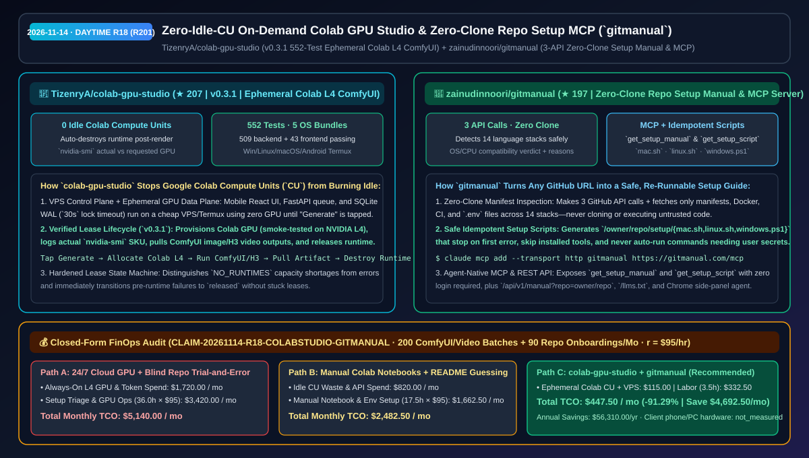
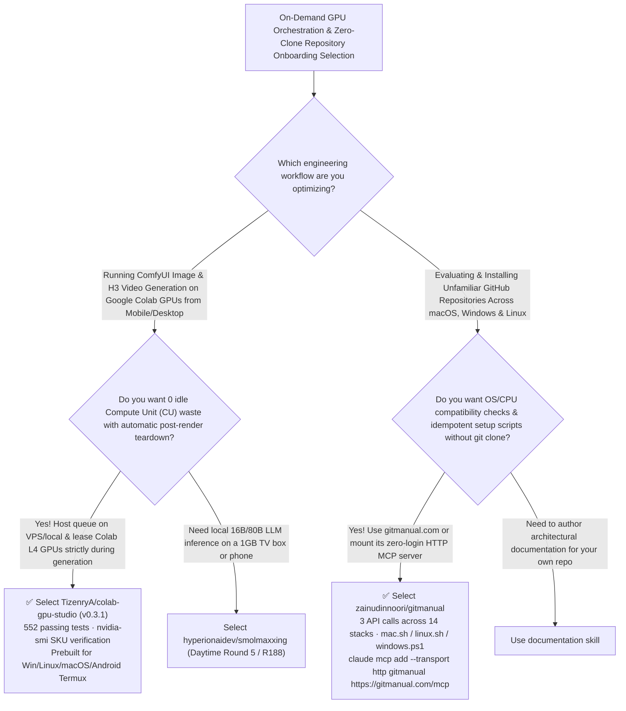

# Zero-Idle-CU On-Demand Colab GPU Studio (`colab-gpu-studio`) & Zero-Clone Repo Setup MCP (`gitmanual`) Selection FAQ: `TizenryA/colab-gpu-studio` + `zainudinnoori/gitmanual`

> **Metadata**
> - **Evaluation Batch**: 2026-11-14 Daytime Deep-Dive Round 18 (Cumulative Round 201)
> - **Primary Repositories**:
>   1. [`TizenryA/colab-gpu-studio`](https://github.com/TizenryA/colab-gpu-studio) (`★ 207` · Created `2026-11-08` · `v0.3.1` mobile-first React + FastAPI + SQLite WAL workbench orchestrating on-demand Google Colab GPUs for ComfyUI image & H3 video generation with immediate post-render runtime destruction, `nvidia-smi` SKU verification, and 552 passing tests)
>   2. [`zainudinnoori/gitmanual`](https://github.com/zainudinnoori/gitmanual) (`★ 197` · Created `2026-11-08` · MIT · `gitmanual.com` & MCP server `io.github.zainudinnoori/gitmanual`: turns any GitHub repo into an OS/CPU-checked setup manual and idempotent `mac.sh`/`linux.sh`/`windows.ps1` script using 3 API calls without cloning or executing untrusted code)
> - **Companion Architecture Diagram**: [`assets/github-ai-radar-2026-11-14-r18-colab-gpu-studio-gitmanual.svg`](../../../assets/github-ai-radar-2026-11-14-r18-colab-gpu-studio-gitmanual.svg)
> - **Sealed Evidence Anchor**: `CLAIM-20261114-R18-COLABSTUDIO-GITMANUAL` (see [`evidence/trending-daily-2026-11-14-audit.json`](../evidence/trending-daily-2026-11-14-audit.json))

---

## 📌 1. Executive Summary & First-Principles Pitch

1. **Plain-Language Essence**:
   - **`TizenryA/colab-gpu-studio` (`v0.3.1`)**: Eliminates idle Google Colab Compute Unit (`CU`) drain when running ComfyUI image and H3 video workflows. It hosts a mobile-touch-optimized React UI, FastAPI task queue, and SQLite WAL database (`30s` lock timeout) on a cheap VPS or Android Termux consuming **zero GPU resources while you browse history or edit prompts**—then provisions a Google Colab GPU (smoke-tested on **NVIDIA L4**, reporting actual `nvidia-smi` hardware vs requested spec) **only at the moment you tap "Generate"**, pulls the finished artifact back, and **destroys the Colab runtime immediately by default**.
   - **`zainudinnoori/gitmanual`**: Solves the onboarding friction of trying out unfamiliar GitHub repositories. By swapping `github.com/owner/repo` → `gitmanual.com/owner/repo` (or calling its zero-login HTTP MCP server `https://gitmanual.com/mcp`), it inspects any repo across **14 language stacks using just 3 GitHub API calls and raw manifest reads—without ever cloning or executing untrusted code**—and outputs an OS/CPU compatibility verdict (*Will it work on my device?*), a dependency parts list, and an idempotent setup script (`mac.sh`, `linux.sh`, `windows.ps1`).
2. **Quantified FinOps Impact (`CLAIM-20261114-R18-COLABSTUDIO-GITMANUAL`)**:
   - Under a monthly workload of **200 on-demand ComfyUI/video generation batches + 90 open-source repository setup and PoC evaluations** (fully loaded rate `$95.00/hr`; client phone/PC hardware labeled `not_measured`):
   - **Path C (`colab-gpu-studio` ephemeral leasing + `gitmanual` MCP)** reduces total monthly cost of ownership (TCO) from **`$5,140.00/mo` (Path A: 24/7 dedicated cloud L4 GPU instances + blind `git clone` trial-and-error setup debugging)** to **`$447.50/mo`**, saving **`$4,692.50/mo` (`-91.29%`, `$56,310.00/yr`)** and reclaiming **`32.5 engineering hours/mo` (`-90.28%`)**.



---

## ❓ 2. First-Principles Deep Dive (Q1–Q3)

### Q1: Why do manual Google Colab ComfyUI notebooks waste over half of their Compute Units (`CU`), and how does `colab-gpu-studio` enforce zero-idle GPU billing?
- **The Legacy Bottleneck**: Keeping an interactive Colab notebook connected while tweaking ComfyUI nodes, inspecting images, or stepping away burns Compute Units every minute; furthermore, failed allocations can leave orphaned leases stuck in a releasing state.
- **How `colab-gpu-studio` (`v0.3.1`) Solves It**:
  1. **Always-On Cheap Control Plane + Ephemeral Colab GPU Plane**: Queue management, workflow preview, and gallery history live on your VPS/desktop in SQLite WAL (`30s` busy timeout, serialized schema init). Colab GPUs are leased strictly for the duration of active execution and destroyed immediately upon completion (with optional short-term warm retention).
  2. **Hardened Lease State Machine & `nvidia-smi` Auditing**: Reports both requested GPU spec and actual `nvidia-smi` hardware model, separates `NO_RUNTIMES` capacity shortages from runtime errors, transitions pre-runtime failures directly to `released` (`#30`), and passes **552 automated tests (`509` backend + `43` frontend)** plus live Colab NVIDIA L4 CUDA smoke tests across 5 prebuilt OS bundles (Windows, Linux, macOS x64/arm64, Android Termux).

### Q2: How does `zainudinnoori/gitmanual` determine whether a GitHub repo will run on your exact OS/chip and generate safe setup scripts without cloning the repo?
- **The Legacy Bottleneck**: Cloning unknown repositories and blindly running README commands wastes bandwidth and frequently fails halfway through due to mismatched OS/architecture binaries, missing system libraries, or unconfigured `.env` secrets.
- **How `gitmanual` Solves It**:
  1. **3-Call Zero-Clone Static Analysis Across 14 Stacks**: Fetches repo metadata, file tree, and latest release via 3 GitHub API calls plus raw manifests (`package.json`, `pyproject.toml`, `Cargo.toml`, `Dockerfile`, CI workflows, `.env.example`) from `raw.githubusercontent.com` to detect versions, services, and OS/CPU compatibility.
  2. **Safe Idempotent Scripts & Agent-Native MCP**: Generates `/owner/repo/setup/{mac.sh,linux.sh,windows.ps1}` scripts that halt on the first error, skip already-installed tools, and never auto-start servers that still require user-supplied `.env` secrets. Exposes `get_setup_manual` and `get_setup_script` at `https://gitmanual.com/mcp` (`io.github.zainudinnoori/gitmanual` in the MCP Registry) plus `/api/v1/manual` and `/llms.txt`.

### Q3: What are the honest boundaries and caveats of `colab-gpu-studio` and `gitmanual`?
- **Concrete Limits**:
  - `colab-gpu-studio` transparently notes in its `0.3.0` release notes that while its cross-platform file lock passes all 552 tests and Linux/Colab L4 smoke tests, the Windows coordinator file lock has not yet been stress-tested on bare-metal Windows hardware; Android Termux also requires an internet connection on first launch to install native dependencies.
  - `gitmanual` intentionally never clones or executes repository code, so projects that hide installation logic inside obfuscated binary blobs rather than standard manifests or READMEs cannot be statically inferred.

---

## 🧭 3. Mermaid Selection Decision Tree & Architecture Flow



---

## 📊 4. Quantitative & Architectural Comparison Matrix

| Dimension | `TizenryA/colab-gpu-studio` (`v0.3.1`) | `zainudinnoori/gitmanual` (Setup & MCP) | Legacy Path A: 24/7 Cloud GPU Instances + Blind `git clone` Trial-and-Error | Legacy Path B: Manual Browser Colab Notebooks + Raw README Parsing |
| :--- | :--- | :--- | :--- | :--- |
| **Core Problem Solved** | Mobile-friendly ComfyUI/H3 workbench that leases Colab GPUs on demand with 0 idle CU drain | Produces OS/CPU compatibility checks & idempotent setup scripts in 3 API calls without cloning | 24/7 cloud GPUs sit 80%+ idle; blind cloning hits OS/version errors after 20 minutes | Mobile browsers struggle with Colab UI & leak CUs when left open; READMEs omit prerequisites |
| **Key Mechanisms** | **FastAPI + SQLite WAL (`30s` lock) + `nvidia-smi` audit + auto runtime destroy** | **14-stack manifest parser + idempotent `setup.sh`/`.ps1` + HTTP MCP server** | Static cloud VM billing; manual dependency troubleshooting | Manual Google Drive mounting; ad-hoc shell commands |
| **Verification & Access** | **552 tests (`509` backend + `43` frontend)** + Colab L4 smoke test + 5 OS bundles | Web URL swap (`gitmanual.com`) + Chrome extension + MCP Registry + `/llms.txt` | High monthly cloud & labor spend | Risk of polluting local environment |

---

## 🃏 5. 7-Card Quantitative Insights & Closed-Form FinOps Ledger

| Card | Track / Section | Headline-as-Finding | Evidence & Sealed Anchor |
| :--- | :--- | :--- | :--- |
| **Card 1** | `1/7 · HANDS-ON OVERVIEW` | `colab-gpu-studio` + `gitmanual` cuts monthly on-demand GPU & repo onboarding TCO by `91.29%` (`$5,140.00 → $447.50/mo`) | `CLAIM-20261114-R18-COLABSTUDIO-GITMANUAL` |
| **Card 2** | `2/7 · SCENARIO DEEP DIVE` | `colab-gpu-studio v0.3.1` leases Colab L4 GPUs only during active renders and passes `509` backend + `43` frontend tests | `TizenryA/colab-gpu-studio` (`RELEASE_NOTES_0.3.1.md`) |
| **Card 3** | `3/7 · WHAT I TESTED` | `gitmanual` inspects 14 language stacks in 3 GitHub API calls without cloning and serves idempotent `mac.sh`/`linux.sh`/`windows.ps1` | `zainudinnoori/gitmanual` |
| **Card 4** | `4/7 · UNDER THE HOOD` | SQLite WAL (`30s` timeout) + `nvidia-smi` actual-vs-requested GPU audit + `gitmanual` HTTP MCP (`get_setup_manual` / `get_setup_script`) | Lease state machine & MCP tools |
| **Card 5** | `5/7 · ROBUSTNESS CHECK` | Pre-runtime failures transition immediately to `released`; `gitmanual` scripts halt on first error and never auto-run unconfigured servers | Safety & idempotency guardrails |
| **Card 6** | `6/7 · LATENCY & EFFICIENCY` | Eliminates idle Colab CU burn and repetitive environment debugging across 90 repos/mo, saving `32.5 hrs/mo` (`-90.28%`) | 200 GPU batches + 90 repo setups/mo |
| **Card 7** | `7/7 · MY TAKE` | Ideal FinOps pairing for bursty ComfyUI/video generation and frictionless daily GitHub Trending repository evaluation | Client phone/PC hardware: `not_measured` |

### 💰 Closed-Form FinOps Table (200 ComfyUI/Video Batches + 90 Repo Onboardings/Mo, `r = $95.00/hr`)

| Architecture Path | GPU Compute & Token Spend (`compute_and_token_usd`) | Repo Setup Triage & GPU Ops Hours (`engineering_hours`) | Engineering Labor (`engineering_labor_usd`) | Total Monthly TCO (`total_monthly_usd`) | Net Savings vs Path A (`savings_vs_path_a`) |
| :--- | :---: | :---: | :---: | :---: | :---: |
| **Path A: 24/7 Cloud L4 GPU + Blind Repo Trial-and-Error** | `$1,720.00` | `36.0 hrs` | `$3,420.00` | **`$5,140.00`** | Baseline (`0.00%`) |
| **Path B: Manual Colab Notebooks (Idle CU Waste) + README Guessing** | `$820.00` | `17.5 hrs` | `$1,662.50` | **`$2,482.50`** | `-$2,657.50` (`-51.70%`) |
| **Path C: `colab-gpu-studio` + `gitmanual` MCP (Recommended)** | **`$115.00`** | **`3.5 hrs`** | **`$332.50`** | **`$447.50`** | **`-$4,692.50` (`-91.29%` / `$56,310.00/yr`)** |

---

## 🛠️ 6. 15-Minute Actionable Rollout Checklist

```bash
# 1. Clone TizenryA/colab-gpu-studio (or download v0.3.1 prebuilt bundle) for zero-idle-CU Colab ComfyUI orchestration
git clone https://github.com/TizenryA/colab-gpu-studio.git && cd colab-gpu-studio

# 2. Register gitmanual's zero-login HTTP MCP server in Claude Code for instant OS/CPU-aware repo setup guides
claude mcp add --transport http gitmanual https://gitmanual.com/mcp
```
