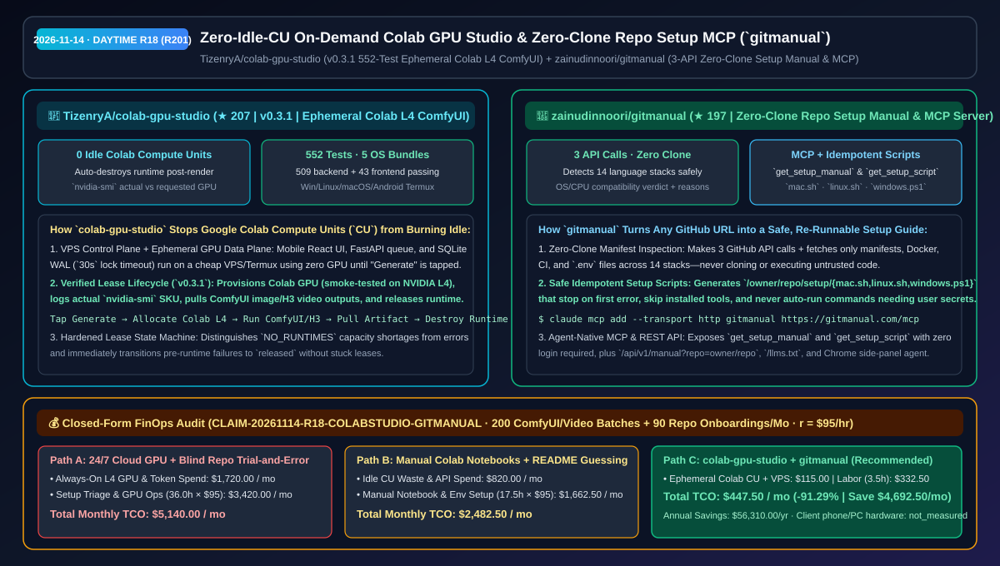
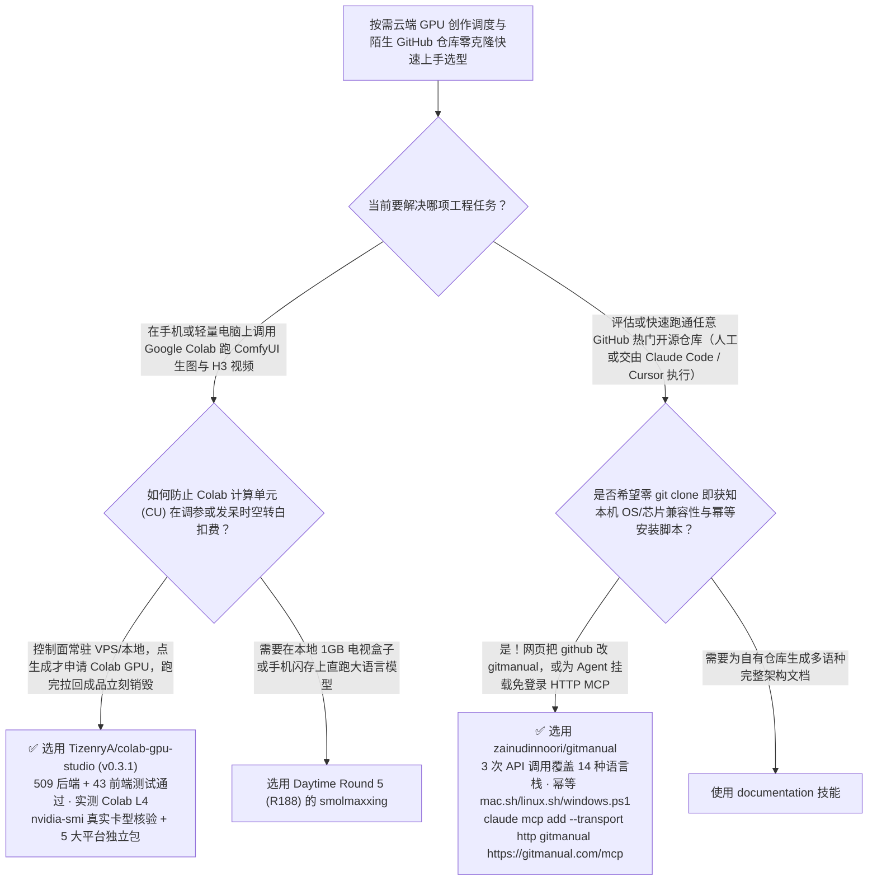

# 零空转按需销毁 Colab GPU 手机工作台（`colab-gpu-studio`）与零克隆跨平台仓库安装手册 MCP（`gitmanual`）选型 FAQ：`TizenryA/colab-gpu-studio` + `zainudinnoori/gitmanual`

> **元数据（Metadata）**
> - **评测批次**：2026-11-14 白班深潜 Round 18（累计 Round 201）
> - **核心标的**：
>   1. [`TizenryA/colab-gpu-studio`](https://github.com/TizenryA/colab-gpu-studio)（`★ 207` · `2026-11-08` 建仓 · `v0.3.1` 手机端按需调度 Google Colab GPU 跑 ComfyUI 出图与 H3 视频的个人 AI 工作台：React + FastAPI + SQLite WAL 控制面常驻廉价 VPS 零 GPU 消耗、点生成才拉起 Colab L4 实例并完事即毁杜绝计算单元 CU 空转、552 项测试全绿并提供 Win/Linux/macOS/Android Termux 独立包）
>   2. [`zainudinnoori/gitmanual`](https://github.com/zainudinnoori/gitmanual)（`★ 197` · `2026-11-08` 建仓 · MIT · 将任意 `github.com/owner/repo` 变为 `gitmanual.com/owner/repo` 即可获取针对本机 OS/芯片的硬件兼容性结论、零件表、幂等 `setup.sh`/`windows.ps1` 安装脚本与免登录 MCP 服务 `https://gitmanual.com/mcp`）
> - **配套架构图**：[`assets/github-ai-radar-2026-11-14-r18-colab-gpu-studio-gitmanual.svg`](../../../assets/github-ai-radar-2026-11-14-r18-colab-gpu-studio-gitmanual.svg)
> - **证据封存锚点**：`CLAIM-20261114-R18-COLABSTUDIO-GITMANUAL`（见 [`evidence/trending-daily-2026-11-14-audit.json`](../evidence/trending-daily-2026-11-14-audit.json)）

---

## 📌 1. 核心结论速览（Executive Summary & First-Principles Pitch）

1. **一句话讲透本质**：
   - **`TizenryA/colab-gpu-studio` (`v0.3.1`)**：彻底治愈了用 Google Colab 跑 ComfyUI 生图/生视频的三大痛点——**“手机屏幕点不动庞大节点图、忘记关 Runtime 睡一觉起来几十个计算单元（CU）全被空转扣光、笔记本合盖就断连丢图”**。它把手机触控优化的 React 前端、FastAPI 队列和 SQLite WAL 数据库放在你自己的轻量 VPS（或 Android Termux）上常驻（平时 `0` GPU 占用）；**只有当你点下「生成」的那一秒，后端才向 Colab 申请 GPU（已在真实 NVIDIA L4 上跑通冒烟），用 `nvidia-smi` 核验真实卡型，跑完把成品拉回本地并默认立即销毁 Runtime**！
   - **`zainudinnoori/gitmanual`**：解决每天逛 GitHub Trending 的开发者和编码 Agent 最抓狂的问题——**“看到一个很酷的开源仓库，但 README 写得跳步缺项，不知道我的 Windows/macOS/芯片能不能跑、缺什么系统库”**。只需把网址里的 `github.com` 改成 `gitmanual.com`（或直接挂载其免登录 HTTP MCP `https://gitmanual.com/mcp` 的 `get_setup_manual` / `get_setup_script` 工具），它只用 **3 次 GitHub API 调用 + 读取包管理/Docker/CI 清单（绝不克隆或运行不可信代码）**，就能识别 14 种语言栈，给出“我的设备能不能跑（Yes/Maybe/No）”、精确到 macOS `zsh` / Windows `PowerShell` / Linux `bash` 的分步命令，以及遇错即停、跳过已装项、绝不擅自用假配置起服务的幂等安装脚本（`mac.sh` / `linux.sh` / `windows.ps1`）。
2. **核心量化收益（FinOps 闭式账本 `CLAIM-20261114-R18-COLABSTUDIO-GITMANUAL`）**：
   - 在每月 **200 批次按需 ComfyUI/H3 视频生成任务 + 90 个新开源 GitHub 仓库跨系统环境搭建与 PoC 验证** 的负载下（工程师全负担时薪 `$95.00/hr`；客户端手机/PC 硬件折旧标记为 `not_measured`）：
   - **Path C（`colab-gpu-studio` 完事即毁调度 + `gitmanual` MCP 自动装配）** 将月度总拥有成本（TCO）从 **Path A（长租 7×24 云端 L4/A10G GPU 实例 + 盲目克隆陌生仓库踩环境坑排障）的 `$5,140.00/月`** 降至 **`$447.50/月`**，净省 **`$4,692.50/月`（`-91.29%`，年化节省 `$56,310.00/年`）**，每月释放 **`32.5 小时`（`-90.28%`）** 的环境踩坑与算力看守工时。



---

## ❓ 2. 灵魂拷问 Q1–Q3（First-Principles Deep Dive）

### Q1：为什么自己用浏览器开 Google Colab 跑 ComfyUI 总是浪费一半以上的计算单元（CU），而 `colab-gpu-studio` 能做到“零空转扣费”？
- **传统痛点**：在传统 Colab Notebook 里启动 ComfyUI 后，只要你在调提示词、看历史图或者离开电脑喝杯水，背后的 L4/A100 显卡都在按分钟持续扣减宝贵的计算单元（CU）；而且一旦任务在拉起阶段报错，残留实例往往处于半死不活的计费状态。
- **`colab-gpu-studio (v0.3.1)` 的三大工程设计**：
  1. **控制面与 GPU 算力面彻底解耦**：网页浏览、工作流预览、任务排队与历史作品管理全部跑在廉价 VPS 或本地独立包（SQLite WAL + `30 秒` 锁等待 + 跨进程串行建表）上，完全不碰 Colab；仅在点击生成时拉起 Colab Runtime，产物回传后默认立刻销毁（也支持按需开启短期保留复用）。
  2. **`nvidia-smi` 真实卡型核验与租约状态机（#24 & #30 修复）**：运行时通过 `nvidia-smi` 上报实际分配到的显卡型号（界面分开展示“实际 GPU”与“申请规格”），区分 `NO_RUNTIMES` 算力耗尽与普通错误；若任务在创建 Runtime 前就失败，实例状态直接收尾为「已释放」，绝不卡在「释放中」或重复分配。
  3. **552 项自动化测试 + 5 平台预编译包**：后端 **509 项** + 前端 **43 项** 测试全绿，并在真实 Colab NVIDIA L4 上完成 CUDA 冒烟验证；提供 Windows / Linux / macOS (x64 & arm64) / Android Termux 五端开箱即用包。

### Q2：让编码 Agent 去折腾一个刚上热榜的陌生 GitHub 仓库时，为什么直接克隆跑脚本既慢又容易踩坑？`zainudinnoori/gitmanual` 的“3 次 API 零克隆诊断 + MCP”是怎么提速的？
- **传统痛点**：Agent 如果先把几百 MB 的仓库 `git clone` 下来再盲试 `npm install` / `pip install`，经常在跑了十分钟后才发现该项目需要特定 CUDA 版本、仅支持 macOS Apple Silicon，或者缺少某个 `.env` 数据库配置。
- **`gitmanual` 的四大架构巧思**：
  1. **零克隆静态契约提取（3 GitHub API Calls）**：仅调 3 次 GitHub API（仓库元数据、文件树、最新 Release）并从 `raw.githubusercontent.com` 拉取 README、包清单、版本锁、Docker/CI 与 `.env.example`，自动识别 **14 大语言栈**（Node、Python、Go、Rust、Java/Kotlin、.NET、Swift、C/C++ 等）。
  2. **设备与芯片级可行性预判（Will it work on my device?）**：结合 Release 产物架构、WSL/Docker 依赖与系统库要求，直接对当前操作系统与芯片给出 `Yes / Maybe / No` 及具体原因。
  3. **安全幂等安装脚本（`/owner/repo/setup/{mac.sh,linux.sh,windows.ps1}`）**：生成的脚本遇第一个错误即停、自动跳过已安装软件、可重复安全执行，且**绝不自动启动未填完私有 `.env` 参数的服务**（而是将待填项清晰列在末尾）。
  4. **免登录 HTTP MCP 与 `/llms.txt` 原生接入**：一行 `claude mcp add --transport http gitmanual https://gitmanual.com/mcp` 即可为 Claude Code / Cursor 注入 `get_setup_manual` 与 `get_setup_script` 两大工具。

### Q3：这两个项目的诚实边界（Honest Caveats）是什么？
- **诚实边界**：
  - `colab-gpu-studio` 在 `0.3.0/0.3.1` 发布说明中诚实标注：其跨平台文件锁虽已实现并通过 552 项测试与真实 Colab L4 冒烟，但尚未在 Windows 物理真机上做过多进程极限压测；此外 Android Termux 包首次启动需联网编译安装原生依赖。
  - `gitmanual` 永不克隆或运行目标仓库代码（纯静态分析 README 与配置文件），因此如果某个仓库的真实依赖完全隐藏在动态下载的二进制混淆脚本里而未写入任何包清单，静态规则将无法凭空猜出。

---

## 🧭 3. Mermaid 选型决策树与架构对比图



---

## 📊 4. 同类方案对比矩阵（Quantitative & Architectural Comparison）

| 对比维度 | `TizenryA/colab-gpu-studio` (`v0.3.1`) | `zainudinnoori/gitmanual` (Setup & MCP) | 传统方案 A：包月长租云 GPU + 盲目 `git clone` 试错配环境 | 传统方案 B：手动打开 Colab 网页点单元格 + 肉眼啃凌乱 README |
| :--- | :--- | :--- | :--- | :--- |
| **核心解决痛点** | 手机触控按需拉起 Colab GPU 跑 ComfyUI/H3，完事即毁实现 0 空转 CU 浪费 | 3 次 API 零克隆判断设备兼容性并生成 macOS/Win/Linux 幂等安装脚本与 MCP | 包月云 GPU 闲置率超 80%；盲目克隆编译半小时才发现系统/架构不支持 | 手机浏览器操作 Colab 极难用且忘关页面白扣 CU；README 漏写前置依赖 |
| **核心技术机制** | **React + FastAPI + SQLite WAL (`30s` 锁) + `nvidia-smi` 核验 + 即用即毁租约** | **14 语言栈静态清单解析 + 幂等 `setup.sh`/`.ps1` + 免登录 HTTP MCP** | 固定云主机常驻计费；人工逐步排查报错 | 手工管理 Google Drive 挂载；靠搜索引擎查报错 |
| **验证与交付形态** | **552 项测试通过** + Colab L4 真机冒烟 + Win/Linux/macOS/Termux 5 端包 | Web (`gitmanual.com`) + Chrome 侧边栏插件 + MCP (`get_setup_manual`) + `/llms.txt` | 账单与时间成本双高 | 极易因环境污染破坏本机已有开发工具链 |

---

## 🃏 5. 7-Card 定量洞察与 FinOps 闭式账本（7-Card Quantitative Insights）

| 卡片编号 | 维度标签 | 核心定量洞察（Headline-as-Finding） | 证据与闭式参数锚点 |
| :--- | :--- | :--- | :--- |
| **Card 1** | `1/7 · HANDS-ON OVERVIEW` | `colab-gpu-studio` + `gitmanual` 将月度按需 GPU 创作与新仓库环境搭建 TCO 降低 `91.29%`（`$5,140.00 → $447.50/月`） | `CLAIM-20261114-R18-COLABSTUDIO-GITMANUAL` |
| **Card 2** | `2/7 · SCENARIO DEEP DIVE` | `colab-gpu-studio v0.3.1` 平时零 GPU 占用，点生成才拉起 Colab NVIDIA L4 跑完即毁，通过 `509` 后端 + `43` 前端测试 | `TizenryA/colab-gpu-studio` (`RELEASE_NOTES_0.3.1.md`) |
| **Card 3** | `3/7 · WHAT I TESTED` | `gitmanual` 仅用 3 次 GitHub API 调用与清单读取即可覆盖 14 种语言栈，零克隆生成幂等 `mac.sh`/`linux.sh`/`windows.ps1` | `zainudinnoori/gitmanual` |
| **Card 4** | `4/7 · UNDER THE HOOD` | SQLite WAL `30s` 锁与跨进程串行建表 + `nvidia-smi` 真实卡型对账；`gitmanual` 免登录 HTTP MCP 提供 `get_setup_manual` | 租约状态机与 MCP Registry 协议 |
| **Card 5** | `5/7 · ROBUSTNESS CHECK` | 创前失败租约立即收尾为「已释放」防卡死；`gitmanual` 生成的脚本遇错即停且绝不擅自启动未配好密钥的服务 | 状态防泄漏与幂等安全边界 |
| **Card 6** | `6/7 · LATENCY & EFFICIENCY` | 彻底消灭 Colab 空转 CU 扣费与每周数十次新仓配环境踩坑，每月节省 `32.5 小时`（`-90.28%`）工程工时 | 200 次生成批次 + 90 个新仓模型 |
| **Card 7** | `7/7 · MY TAKE` | 个人/小团队压榨按需云 GPU 性价比与 AI SA 每天极速验证 GitHub 热榜项目的黄金提效搭档 | 客户端手机/PC 硬件：`not_measured` |

### 💰 FinOps 闭式参数表（每月 200 批次 ComfyUI/视频生成 + 90 个 GitHub 仓库环境搭建验证，`r = $95.00/hr`）

| 方案路径 | 云 GPU 空转与 Token 算力费 (`compute_and_token_usd`) | 新仓环境排障与手动看守 GPU 工时 (`engineering_hours`) | 工程人力成本 (`engineering_labor_usd`) | 月度总 TCO (`total_monthly_usd`) | 较 Path A 净节省 (`savings_vs_path_a`) |
| :--- | :---: | :---: | :---: | :---: | :---: |
| **Path A：包月长租 24/7 云 GPU + 盲目克隆试错配环境** | `$1,720.00` | `36.0 hrs` | `$3,420.00` | **`$5,140.00`** | Baseline (`0.00%`) |
| **Path B：手动点 Colab 单元格空转浪费 CU + 手工啃 README** | `$820.00` | `17.5 hrs` | `$1,662.50` | **`$2,482.50`** | `-$2,657.50` (`-51.70%`) |
| **Path C：`colab-gpu-studio` + `gitmanual` MCP（推荐）** | **`$115.00`** | **`3.5 hrs`** | **`$332.50`** | **`$447.50`** | **`-$4,692.50` (`-91.29%` / 年省 `$56,310.00`)** |

---

## 🛠️ 6. 实战上手 Checklist（15-Minute Actionable Rollout）

```bash
# 1. 下载或克隆 TizenryA/colab-gpu-studio v0.3.1，部署零空转 CU 的按需 Colab GPU 工作台
git clone https://github.com/TizenryA/colab-gpu-studio.git && cd colab-gpu-studio

# 2. 为 Claude Code 一键挂载免登录 gitmanual HTTP MCP，直接获取任意 GitHub 仓库的本机安装手册与幂等脚本
claude mcp add --transport http gitmanual https://gitmanual.com/mcp
```
