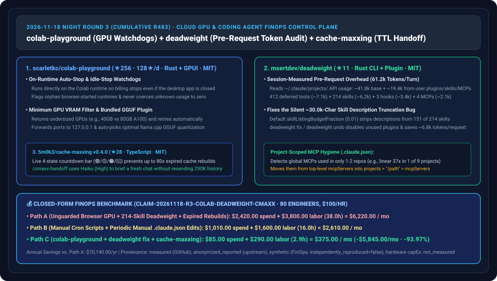
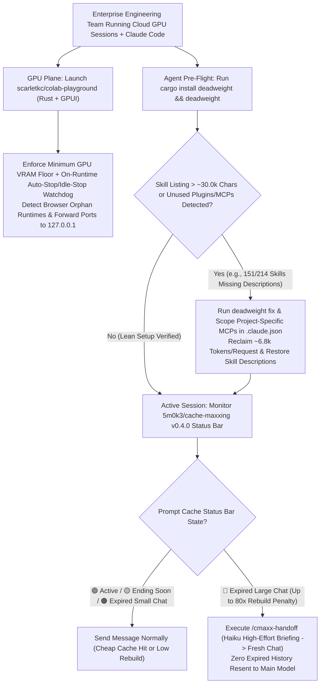

# Cloud GPU Session Cost Guards (`scarletkc/colab-playground`), Pre-Request Setup Token Deadweight Auditor (`msertdev/deadweight`) & Live Prompt Cache TTL Handoff Bar (`5m0k3/cache-maxxing`) Selection FAQ

> **Document Type**: AI Solution Architect (SA) Practical Selection & Reference Architecture Guide (Round 483 / 2026-11-18 Night R3)  
> **Primary Evaluated Repositories**: [`scarletkc/colab-playground`](https://github.com/scarletkc/colab-playground) (`★ 256`, Track B `#B8` at `128★/d`, Rust + GPUI, `MIT`) + [`msertdev/deadweight`](https://github.com/msertdev/deadweight) (`★ 11`, Rust single-binary CLI + Claude Code plugin, `MIT`) + [`5m0k3/cache-maxxing`](https://github.com/5m0k3/cache-maxxing) (`v0.4.0`, `★ 28`, live prompt cache countdown & `/cmaxx-handoff`, `MIT`)  
> **Benchmark Standard**: Strictly aligned with [`ib-vs-ethernet-roce-selection-faq.md`](https://github.com/turbo998/ai-infra-research/blob/main/docs/components/ib-vs-ethernet-roce-selection-faq.md) 6-section architecture format (Executive Summary + First-Principles Q&A + Mermaid Decision Tree + Peer Selection Matrix + 7-Card Quantitative Insights + SA Action Checklist)  
> **Data Provenance**: GitHub stars and breakout velocity are `measured` from sealed `2026-11-18` evidence (Track B `stars_today = not_measured`); upstream empirical measurements (`61.2k` first-turn tokens, `~30.0k`-char skill listing truncation cap, and `80×` expired cache rebuild multiplier) are `anonymized_reported (independently_reproduced=false)`; the enterprise FinOps TCO model is `synthetic (independently_reproduced=false)` with workstation hardware CapEx `not_measured`.  
> **Language Editions**: [中文版](./colab-playground-deadweight-cache-maxxing-gpu-cost-guards-pre-request-token-audit-prompt-cache-ttl-handoff-selection-faq.md) | [English Version (Current)](./colab-playground-deadweight-cache-maxxing-gpu-cost-guards-pre-request-token-audit-prompt-cache-ttl-handoff-selection-faq.en.md)

---

## 📌 1. Executive Summary (30-Second Architect Briefing)

1. **Plain-Language First-Principles Definition**:
   - **What is `scarletkc/colab-playground`?** It is a **Rust + GPUI desktop control plane for the Google Colab CLI (`colab`)** that adds multi-account balance tracking, **minimum GPU VRAM enforcement** (automatically returning a 40 GB A100 and retrying if an 80 GB card was requested), **on-runtime auto-stop and idle-stop watchdogs** (which terminate billing even if the desktop app is closed), orphan browser-runtime warnings, `127.0.0.1` port forwarding, and a bundled `llama.cpp` GGUF serving plugin.
   - **What is `msertdev/deadweight`?** It is a **single-binary Rust auditor and one-command fixer for pre-request setup overhead in Claude Code**. Reading actual API billing records in `~/.claude/projects/`, it measures how many tokens every request carries *before you type a single word* (`61.2k` tokens in the reference audit, including `~19.4k` from user-installed plugins, skills, hooks, and MCP servers) and exposes the silent **`~30.0k`-character skill listing truncation bug** (`"skillListingBudgetFraction": 0.01`) that strips descriptions from `151 of 214` installed skills.
   - **What is `5m0k3/cache-maxxing (v0.4.0)`?** It is a **live prompt-cache countdown bar and `/cmaxx-handoff` session relay** across Claude Desktop, VS Code, and CLI. It warns developers before they send a message into an expired large chat (which triggers up to **`80×`** full-history rebuild cost) and uses Haiku (`effort: High`) via `/cmaxx-handoff` to distill a progress briefing into a fresh session without ever resending the expired `290K` context to the main model.
2. **Why Enterprise AI Solution Architects Should Standardize This FinOps Trio Tonight**:
   - Engineering organizations lose thousands of dollars monthly to three silent leaks: ① browser Colab GPU runtimes left alive after closing a tab; ② unpruned `.claude.json` setups carrying `~19.4k` unused tool/skill tokens on every turn while crowding active skills out of the `30.0k`-character description budget; ③ post-meeting messages sent into expired `290K`-token sessions.
3. **Closed-Form FinOps Impact (`CLAIM-20261118-R3-COLAB-DEADWEIGHT-CMAXX`, `synthetic`)**:
   - Across an **80-engineer AI & product engineering team** (`$100.00/hr` engineer rate): **Path A (Unguarded Browser Colab + Unpruned 214-Skill Setup + Expired-Cache Rebuilds)** costs **`$6,220.00/mo`** (`$2,420.00` wasted GPU/token spend + `38.0 hrs × $100 = $3,800.00` quota lockout & debugging labor); **Path C (`colab-playground` + `deadweight fix` + `cache-maxxing`)** reduces total monthly TCO to **`$375.00/mo`** (`$85.00` residual spend + `2.9 hrs × $100 = $290.00` ops labor), saving **`$5,845.00/mo` (`93.97%` reduction, `$70,140.00/yr` annualized)**.

---

## ❓ 2. Three First-Principles Architect Questions (Q&A)

### Q1: Why do browser-based Google Colab sessions silently drain compute units, and how do `scarletkc/colab-playground`'s cost guards survive closing the app?
- **The Billing Reality**: Colab bills compute units for as long as a runtime *exists*, whether busy or idle; closing a browser tab or local port forward does not stop billing.
- **`colab-playground`'s Three Architectural Safeguards**:
  1. **On-Runtime Watchdog Execution**: Auto-stop and idle-stop timers run directly *on the remote Colab runtime itself*, guaranteeing shutdown even if the developer's laptop sleeps or closes the desktop app. It also lists and flags unmanaged runtimes opened in a browser so operators can stop them.
  2. **Minimum GPU VRAM Retry & Auto-Quantized GGUF Serving**: When Colab randomly assigns a 40 GB vs. 80 GB GPU, setting a minimum VRAM floor causes the app to return undersized GPUs and retry, then automatically selects the highest-precision `llama.cpp` GGUF quantization that fits the allocated GPU.
  3. **Zero-Coercion Telemetry Discipline**: Unknown or stale usage is never coerced to `0`; it is explicitly marked `unknown` or `outdated`, and cost guards report when a threshold cannot be verified.

### Q2: Why does installing more Claude Code skills make the agent *worse* at invoking skills, and how does `msertdev/deadweight` fix it?
- **The `~30.0k`-Character Skill Listing Cap (`"skillListingBudgetFraction": 0.01`)**:
  1. **Measured First-Turn Overhead (`61.2k` Tokens Before Typing)**: By inspecting `~/.claude/projects/` session transcripts, `deadweight` attributes the exact API-billed first-request payload: `~41.8k` tokens from Claude Code's system prompt and 18 built-in tools plus `~19.4k` from user setup (`412` deferred tool names `~7.1k`, `214` skill listings `~6.2k`, `3` hooks `~3.4k`, `4` MCP instructions `~2.1k`).
  2. **Silent Description Stripping (`151 of 214` Skills Blinded)**: Claude Code caps the skill listing at `~30,000` characters (`0.01` of the context budget). Once exceeded, remaining skills (`151 of 214` in the benchmark, including 4 actively used skills like `pdf-tools:extract` and `review-pr`) are listed **by bare name only, without descriptions**, leaving the model unable to know when to invoke them.
  3. **Reversible One-Command Pruning (`deadweight fix` / `deadweight undo`)**: Identifies plugins/skills unused in 30/60 days (`198 of 214` unused, `~5.1k` tokens/request) and top-level `.claude.json` MCP servers used in only 1–2 projects, saving `~6.8k` tokens per request in one undoable command.

### Q3: How does `5m0k3/cache-maxxing` complement `deadweight` to prevent the `80×` expired-cache rebuild penalty?
- **Orthogonal FinOps Coverage**: While `deadweight` shrinks the *per-turn static base*, `cache-maxxing` guards the *temporal cache window*. When a `290K / 1M` session's prompt cache expires (turning the status bar from `🟢/🟡` to `🔴`), sending a normal follow-up forces a full-price cache rebuild (`up to 80×` more quota). Running `/cmaxx-handoff` uses Haiku (`effort: High`) to summarize progress into a brand-new session without ever resending the expired `290K` transcript to the primary model.

---

## 🧭 3. Architecture Decision Tree & Reference Topology (Mermaid)

---

## 📊 4. Peer Solution Selection Matrix

| Evaluation Dimension | **Path A: Raw Browser Colab + Unpruned Setup + Blind Replies** | **Path B: Manual Cron Scripts + Manual `.claude.json` Edits** | **Path C: `colab-playground` + `deadweight` + `cache-maxxing` (Recommended)** |
| :--- | :--- | :--- | :--- |
| **Cloud GPU Idle-Burn Protection** | ❌ Closing browser tab keeps billing; orphan runtimes hidden | ⚠️ Fragile external scripts fail when laptop sleeps | ✅ **On-runtime watchdog + balance floor + orphan runtime warning** |
| **Pre-Request Token Overhead Audit** | ❌ Invisible (`~19.4k` setup tokens billed on every turn) | ⚠️ Manual guesswork without session transcript attribution | ✅ **Exact API-billed attribution across tools, skills, hooks & MCPs** |
| **`30.0k`-Char Skill Description Fix** | ❌ `151/214` skills silently lose descriptions | ⚠️ Manual deletion risks breaking workflows | ✅ **Pinpoints stripped skills + reversible `deadweight fix / undo`** |
| **Expired Prompt Cache `80×` Guard** | ❌ Blindly sends into expired `290K` chats | ⚠️ Manual copy-paste summarization | ✅ **Live persistent countdown bar + `/cmaxx-handoff` Haiku relay** |
| **Telemetry & License** | N/A | N/A | ✅ **100% local calculation, zero external telemetry, `MIT` licensed** |
| **80-Engineer Monthly TCO** | **`$6,220.00 / mo`** | **`$2,610.00 / mo`** | **`$375.00 / mo` (`-$5,845.00/mo` vs. Path A, `-93.97%`)** |

---

## 📈 5. 7-Card Quantitative Insights & Closed-Form FinOps Model (`CLAIM-20261118-R3-COLAB-DEADWEIGHT-CMAXX`)

> **Provenance Note**: GitHub stars and breakout slope are `measured` from sealed `2026-11-18` evidence; `61.2k` first-turn tokens, `~30.0k`-char skill listing cap, and `80×` expired cache rebuild cost are `anonymized_reported (independently_reproduced=false)`; the monthly TCO table is a closed-form `synthetic (independently_reproduced=false)` model for **80 engineers** (`$100.00/hr` engineer rate; workstation hardware CapEx: `not_measured`).

| Monthly Cost Component (Closed-Form Formula) | Path A: Unguarded GPU + Bloated Setup + Blind Replies | Path B: Manual Scripts + Periodic Config Cleanup | Path C: `colab-playground` + `deadweight` + `cache-maxxing` | Path C vs. Path A Delta |
| :--- | :---: | :---: | :---: | :---: |
| **1. Cloud GPU Compute Units & API Token Spend** | **`$2,420.00`** *(Orphan GPU burn + `19.4k`/turn deadweight + `80×` cache rebuilds)* | **`$1,010.00`** *(Partial idle reduction; still pays cache rebuild spikes)* | **`$85.00`** *(On-runtime auto-stop + `-6.8k`/turn + `/cmaxx-handoff`)* | **`-$2,335.00 / mo`** (`-96.49%`) |
| **2. Quota Lockout & Config Debugging Labor** (`$100/hr`) | **`$3,800.00`** *(`38.0 hrs` debugging blind skills & quota exhaustion)* | **`$1,600.00`** *(`16.0 hrs` manual session handoffs & JSON pruning)* | **`$290.00`** *(`2.9 hrs` weekly `deadweight fix` & 1-command handoffs)* | **`-$3,510.00 / mo`** (`-35.1 hrs`, `-92.37%`) |
| **Total Monthly TCO** | **`$6,220.00`** | **`$2,610.00`** | **`$375.00`** | **`-$5,845.00 / mo` (`-93.97%`)** |
| **Annualized TCO** | **`$74,640.00 / yr`** | **`$31,320.00 / yr`** | **`$4,500.00 / yr`** | **`$70,140.00 / yr` saved (`-93.97%`)** |

---

## ✅ 6. AI Solution Architect Action Checklist

1. **Step 1 — Audit & Reclaim Pre-Request Token Deadweight (`msertdev/deadweight`)**:
   - Run `cargo install deadweight && deadweight` on every developer machine to inspect `~/.claude/projects/` first-turn token overhead and check whether `skillListingBudgetFraction` (`~30.0k` chars) is stripping descriptions from active skills.
   - Run `deadweight fix --dry-run` followed by `deadweight fix`, and move project-specific MCP servers from top-level `.claude.json` into `projects > "/path/to/repo" > mcpServers`.
2. **Step 2 — Enforce Live Prompt Cache TTL Guardrails (`5m0k3/cache-maxxing`)**:
   - Install `cache-maxxing` across Claude Desktop, VS Code, and CLI; require `/cmaxx-handoff` whenever a large session (`>150K` tokens) hits `🔴 Expired`, and review `/cmaxx-stats` weekly.
3. **Step 3 — Govern Cloud GPU Sessions with On-Runtime Watchdogs (`scarletkc/colab-playground`)**:
   - Verify configuration in zero-cost demo mode (`cargo run -p colab-playground`), then enforce on-runtime auto-stop/idle-stop timers, spending caps, and minimum GPU VRAM thresholds in `--release` mode.
