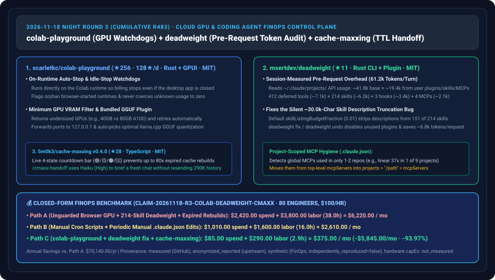
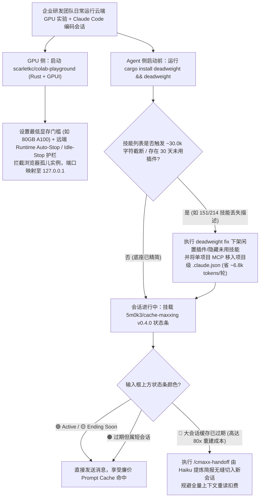

# 云端 GPU 会话成本护栏工作台（`scarletkc/colab-playground`）、Claude Code 请求前静态 Token 死重清理器（`msertdev/deadweight`）与缓存过期倒计时接力条（`5m0k3/cache-maxxing`）选型 FAQ

> **文档类型**：AI Solution Architect (SA) 实战选型与参考架构指南（Round 483 / 2026-11-18 Night R3）  
> **核心评估对象**：[`scarletkc/colab-playground`](https://github.com/scarletkc/colab-playground)（`★ 256`，Track B `#B8` `128★/d`，Rust + GPUI，`MIT`） + [`msertdev/deadweight`](https://github.com/msertdev/deadweight)（`★ 11`，Rust 单二进制 CLI + Claude Code 插件，`MIT`） + [`5m0k3/cache-maxxing`](https://github.com/5m0k3/cache-maxxing)（`v0.4.0`，`★ 28`，实时缓存倒计时与 `/cmaxx-handoff`，`MIT`）  
> **对标范式**：严格遵循 [`ib-vs-ethernet-roce-selection-faq.md`](https://github.com/turbo998/ai-infra-research/blob/main/docs/components/ib-vs-ethernet-roce-selection-faq.md) 六段式结构（核心结论速览 + 三大灵魂拷问 + Mermaid 决策树 + 选型对比矩阵 + 7-Card 定量洞察 + SA 落地 Checklist）  
> **数据溯源分级（Provenance）**：GitHub 星标与新仓斜率源自 `2026-11-18` 封存证据（`measured`；Track B `stars_today = not_measured`）；上游实测开销数据（如 `61.2k` 首轮请求 Token、`~30.0k` 字符技能列表上限、`80×` 缓存过期重建倍率）标注为 `anonymized_reported (independently_reproduced=false)`；企业 FinOps 成本算例为 `synthetic (independently_reproduced=false)`，硬件折旧 `not_measured`。  
> **语言版本**：[中文版 (当前)](./colab-playground-deadweight-cache-maxxing-gpu-cost-guards-pre-request-token-audit-prompt-cache-ttl-handoff-selection-faq.md) | [English Version](./colab-playground-deadweight-cache-maxxing-gpu-cost-guards-pre-request-token-audit-prompt-cache-ttl-handoff-selection-faq.en.md)

---

## 📌 一、核心结论速览（Executive Summary — 30 秒看懂）

1. **大白话本质定义**：
   - **`scarletkc/colab-playground` 是什么？** 它是用 Rust + GPUI 编写的 **Google Colab CLI 桌面端多账号与 GPU 成本护栏总控台**。它不替代 CLI，而是在 `google-colab-cli` 之上提供四大企业级能力：① **多账号算力余额一屏监控与切换影响预检**；② **最低显存保障（如申请 80GB A100 却被随机分配到 40GB 时自动退回重试）**；③ **植入运行时的自动停机/空闲停机守护进程（即使关掉本地桌面客户端也能按时停机止损）** 与浏览器孤儿会话告警；④ 端口转发至 `127.0.0.1` 及内置 `llama.cpp` GGUF 一键部署插件。
   - **`msertdev/deadweight` 是什么？** 它是 **Claude Code 请求前静态 Token “死重（Dead Weight）”剖析与一键瘦身工具**。它直接读取本地 `~/.claude/projects/` 真实账单记录，算出你在敲下第一个字之前每次请求背负的隐性 Token 税（实测示例高达 **`61.2k` tokens/请求**，其中用户安装的插件/技能/MCP 占 `~19.4k`），并揭露了一个致命机制：**Claude Code 默认将技能列表截断在约 `30,000` 字符（`"skillListingBudgetFraction": 0.01`），超出部分的技能（如 `214` 个中的 `151` 个）会被剥夺描述、只剩光秃秃的名字，导致模型根本不知道何时调用它们！**
   - **`5m0k3/cache-maxxing (v0.4.0)` 是什么？** 它是挂载在 Claude 桌面端、VS Code 与终端输入框上方的 **Prompt Cache 过期秒表与 `/cmaxx-handoff` 无损换房插件**。当大上下文会话（如 `290K / 1M`）缓存即将过期或已过期（继续发消息将触发高达 **`80×`** 的全量重读扣费）时，它用四色状态条（🟢/🟡/🟠/🔴）实时预警，并通过 `/cmaxx-handoff` 调用 Haiku（`effort: High`）生成精炼交接简报开启新会话，永不向主模型重发过期大上下文。
2. **为什么企业 AI 解决方案架构师（SA）今晚必须将这三款工具纳入研发 FinOps 标准包？**
   - 企业研发团队最常见的三大“隐形出血点”：① 工程师在浏览器开多个 Colab GPU 跑实验忘记关机，算力单元（Compute Units）通宵空转；② 团队成员装了十几个插件和 200+ 个技能，不仅每句话多付 `~19.4k` tokens，还把常用核心技能挤出了 `30.0k` 字符描述预算；③ 开完会回来对着已过期的 `290K` 长会话随手敲一句“继续”，瞬间烧穿全天订阅额度。
3. **闭式 FinOps 量化收益（`CLAIM-20261118-R3-COLAB-DEADWEIGHT-CMAXX`，`synthetic`）**：
   - 以 **80 人企业 AI 与应用研发团队**（工程师时薪 `$100.00/hr`）计：**Path A（无护栏浏览器 GPU + 未清理 214 技能死重 + 过期缓存硬发消息）** 月均总成本 **`$6,220.00`**（闲置 GPU 与冗余/重建 Token 浪费 `$2,420.00` + 额度锁死等待与排障人工 `38.0h × $100 = $3,800.00`）；**Path C（`colab-playground` + `deadweight fix` + `cache-maxxing` 三件套）** 月均总成本降至 **`$375.00`**（算力/Token 残余开销 `$85.00` + 维护人工 `2.9h × $100 = $290.00`），**净省 `$5,845.00/月`（降幅 `93.97%`，年化节省 `$70,140.00`）**。

---

## ❓ 二、三大灵魂拷问（First-Principles Q&A）

### Q1：为什么用浏览器跑 Google Colab 经常莫名其妙烧光算力？`scarletkc/colab-playground` 的成本护栏是怎么做到“关掉软件依然生效”的？
- **计费真相**：只要 Colab 运行时（Runtime）存在，无论是否正在执行代码、无论你是否关掉了浏览器标签页或本地端口转发，它都会按秒持续扣除算力单元；更糟的是，随机分配硬件时若拿到显存不足的次级卡，手动重开还会白扣启动费。
- **`colab-playground` 的三大硬核机制**：
  1. **远端运行时内置 Watchdog（关掉客户端照样停机）**：它的自动停机（Auto-Stop）与空闲停机（Idle Stop）守护进程直接注入在远端 Colab Runtime 内部运行，即便本地电脑合盖休眠或关闭 App，到点依然强制销毁实例停止计费；同时在界面高亮标记那些“从浏览器手动打开、未受本地 Watchdog 保护”的孤儿实例。
  2. **显存下限自动退卡重试（Minimum GPU Memory Filter）**：当 Colab 随机发放 40GB 或 80GB A100 时，只要设定最低显存门槛，拿到小显存卡会自动退回并重新申请，随后通过内置插件自动匹配最契合该显存的 `llama.cpp` GGUF 量化档位并映射到本地 `127.0.0.1`。
  3. **严禁将未知用量伪造为 0（Zero-Fabrication Guardrail）**：当算力用量尚未同步或过期时，系统严格标记为 `unknown` 或 `outdated` 并弹出护栏失效提示，绝不静默显示为 `0`。

### Q2：为什么装的 Claude Code 技能越多，模型反而越“笨”、越不会自动调技能？`msertdev/deadweight` 发现了什么底层真相？
- **第一性原理拆解（`~30.0k` 字符预算截断陷阱）**：
  1. **敲字前的 `61.2k` Token 固定税**：通过解析 `~/.claude/projects/` 首条请求的真实计费账单，`deadweight` 揭示出一次典型重度配置在输入第一个字前就携带了 **`61.2k` tokens**（其中 Claude Code 自身系统提示与 18 个内置工具占 `~41.8k`，用户装的 `412` 个延迟工具名占 `~7.1k`、`214` 个技能占 `~6.2k`、`3` 个 Hook 注入占 `~3.4k`、`4` 个 MCP 说明占 `~2.1k`）。
  2. **151/214 技能沦为“无描述盲盒”**：Claude Code 默认将技能列表总字符数限制在上下文窗口的 `1%`（`"skillListingBudgetFraction": 0.01`，约 **`30,000` 字符**）。一旦装了上百个技能把这 3 万字符塞满，排在后面的技能（实测 214 个中有 **151 个**，包含 4 个高频核心技能）会被**砍掉全部功能描述、只把技能名塞给模型**！模型看不见描述，自然无法在正确时机触发技能。
  3. **一键可逆瘦身（`deadweight fix` / `deadweight undo`）**：自动识别过去 30/60 天从未使用的插件与技能（如 214 个中有 198 个 30 天未用），以及“全局挂载在 `.claude.json` 却只在 1 个项目里用过”的 MCP（建议下沉到项目级 `projects > "/path" > mcpServers`），一条 `deadweight fix` 即可每轮立省 **`~6.8k` tokens**，且随时支持 `deadweight undo` 完整还原。

### Q3：`5m0k3/cache-maxxing` 是如何与 `deadweight` 配合，把长会话的“午休后第一条消息 80 倍暴击”彻底消除的？
- **`deadweight` 管“宽度”（削减每轮固定底座），`cache-maxxing` 管“时间”（消灭过期重建峰值）**：
  - 当会话累积到 `290K` tokens 时，只要在缓存有效期内（🟢/🟡）发送消息，全部走廉价的 `cache_read`；一旦喝杯咖啡回来缓存过期（🔴），直接发消息会触发高达 **`80×`** 的全量重读计费。
  - `cache-maxxing` 在输入框上方提供跨重启/休眠持久化的秒级倒计时条；一旦变为 🔴，工程师只需输入 **`/cmaxx-handoff`**，插件立即调用低成本 Haiku（`effort: High`）提炼当前进度摘要并自动拉起一个全新会话接力，彻底绕开主模型的全量缓存重建！

---

## 🧭 三、架构师选型决策树与端到端参考架构（Mermaid）

---

## 📊 四、同类方案横向选型对比矩阵（Peer Selection Matrix）

| 评估维度 | **Path A：浏览器裸跑 Colab + 盲装插件不清理 + 过期硬聊** | **Path B：手工定时脚本 + 人工定期删 `.claude.json`** | **Path C：`colab-playground` + `deadweight` + `cache-maxxing`（推荐）** |
| :--- | :--- | :--- | :--- |
| **云端 GPU 防忘关机能力** | ❌ 关浏览器标签页仍持续扣费，孤儿实例难察觉 | ⚠️ 仅靠外部脚本轮询，断网或休眠即失效 | ✅ **远端 Runtime 内部 Watchdog + 余额底线 + 孤儿实例高亮** |
| **请求前静态 Token 死重可见性** | ❌ 完全黑盒（每轮白背 `~19.4k` 闲置插件/技能税） | ⚠️ 靠人工猜哪些插件费 Token | ✅ **基于 `~/.claude/projects/` 真实账单精确归因到每个插件/MCP** |
| **`30.0k` 字符技能描述截断治理** | ❌ `151/214` 技能静默丢失描述，模型无法正确选用 | ⚠️ 手工删技能易误删且不可逆 | ✅ **精准定位无描述技能 + `deadweight fix / undo` 一键可逆瘦身** |
| **Prompt Cache 过期 `80×` 暴击防护** | ❌ 毫无感知，休息回来发一句即打爆额度 | ⚠️ 人工看表估算，手动复制粘贴总结 | ✅ **跨休眠秒级四色倒计时条 + `/cmaxx-handoff` 自动简报换房** |
| **数据隐私与外部依赖** | N/A | N/A | ✅ **100% 本地计算，零遥测外发，全部 MIT 开源协议** |
| **80 人团队月均总拥有成本 (TCO)** | **`$6,220.00 / 月`** | **`$2,610.00 / 月`** | **`$375.00 / 月`（较 Path A 净省 `$5,845.00/月`，`-93.97%`）** |

---

## 📈 五、7-Card 定量洞察与闭式 FinOps 算例（`CLAIM-20261118-R3-COLAB-DEADWEIGHT-CMAXX`）

> **Provenance 声明**：GitHub 星标与新仓斜率源自 `2026-11-18` 封存证据（`measured`）；`61.2k` 首轮请求 Token、`30.0k` 字符技能列表上限与 `80×` 缓存过期重建倍率为上游实测报告数据（`anonymized_reported`, `independently_reproduced=false`）；月度 TCO 为面向 **80 名研发人员** 的闭式合成模型（`synthetic`, `independently_reproduced=false`；底层工作站硬件折旧 CapEx：`not_measured`）。

| 成本构成项（月度闭式公式） | Path A：裸跑 GPU + 臃肿插件底座 + 过期硬聊 | Path B：手工脚本 + 人工定期清理配置 | Path C：`colab-playground` + `deadweight` + `cache-maxxing` | Path C 对比 Path A 净变化 |
| :--- | :---: | :---: | :---: | :---: |
| **1. 云端 GPU 算力单元与 API Token 支出** | **`$2,420.00`** *(孤儿 GPU 空转 + 每轮 `19.4k` 死重 + `80×` 缓存重建)* | **`$1,010.00`** *(部分拦截闲置开销，仍存缓存重建峰值)* | **`$85.00`** *(Watchdog 自动停机 + 每轮省 `6.8k` + `/cmaxx-handoff`)* | **`-$2,335.00 / 月`** (`-96.49%`) |
| **2. 额度锁死等待与配置排障人工成本** (`$100/hr`) | **`$3,800.00`** *(`38.0 hrs`：排查技能不触发、额度提前耗尽中断开发)* | **`$1,600.00`** *(`16.0 hrs`：手动整理会话摘要与手工改 `.claude.json`)* | **`$290.00`** *(`2.9 hrs`：每周跑一次 `deadweight fix` 与一键换房)* | **`-$3,510.00 / 月`** (`-35.1 hrs`, `-92.37%`) |
| **月度总拥有成本 (Monthly Total TCO)** | **`$6,220.00`** | **`$2,610.00`** | **`$375.00`** | **`-$5,845.00 / 月` (`-93.97%`)** |
| **年化总拥有成本 (Annualized TCO)** | **`$74,640.00 / 年`** | **`$31,320.00 / 年`** | **`$4,500.00 / 年`** | **年省 `$70,140.00` (`-93.97%`)** |

---

## ✅ 六、AI 解决方案架构师（SA）实战落地 Checklist

1. **Step 1 — 用 `msertdev/deadweight` 为全员 Claude Code 底座体检瘦身**：
   - 执行 `cargo install deadweight` 并运行 `deadweight --days 60`，检查是否存在“技能列表超 `30.0k` 字符导致常用技能丢失描述”或“全局 MCP 仅在单项目使用”的问题。
   - 运行 `deadweight fix --dry-run` 确认变更列表后执行 `deadweight fix`（需要恢复时随时执行 `deadweight undo`），并将单项目 MCP 迁移至 `.claude.json` 的 `projects > "/path" > mcpServers` 作用域。
2. **Step 2 — 挂载 `5m0k3/cache-maxxing` 根治长会话缓存过期暴击**：
   - 在团队开发环境启用 `cache-maxxing` 状态条；制定团队铁律：当超过 `150K` tokens 的长会话状态灯变红（🔴 Expired）时，严禁直接敲回车续聊，一律执行 `/cmaxx-handoff` 无损切入新会话，并用 `/cmaxx-stats` 周度复盘团队缓存命中率。
3. **Step 3 — 统一通过 `scarletkc/colab-playground` 管控云端实验 GPU**：
   - 先用 `cargo run -p colab-playground`（零计费 Demo 模式）验证界面，再切换至 `--release` 绑定团队 Google 账号池，强制开启远端 Runtime Auto-Stop / Idle-Stop 与最低显存过滤，彻底清零无人值守的僵尸 GPU 账单。
