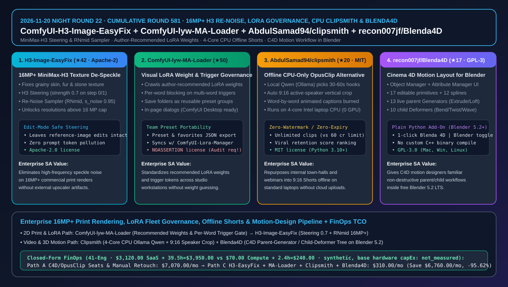
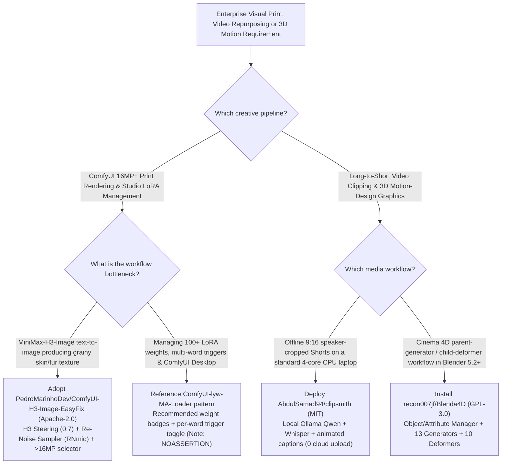
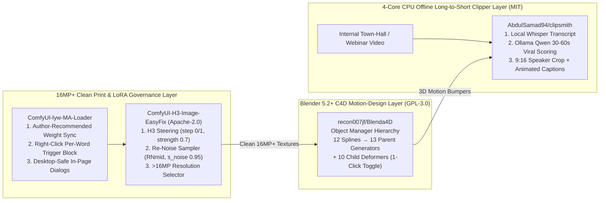
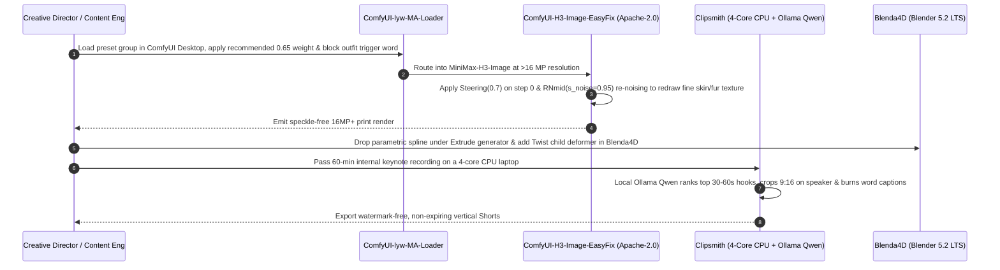

# How to Choose 16MP+ MiniMax-H3 De-Speckling Samplers, Visual LoRA Preset Governance, CPU-Only Offline Video Clippers, and C4D Motion Layouts in Blender? `ComfyUI-H3-Image-EasyFix`, `ComfyUI-lyw-MA-Loader`, `clipsmith`, and `Blenda4D` Architecture & Selection FAQ

> **Document Metadata (2026-11-20 Night Round 22 · Cumulative Round 581)**
> - **Target Audience**: AI Solution Architects, Commercial Visual & AIGC Platform Leads, Enterprise Video Repurposing Architects, 3D Motion-Design Technical Directors
> - **Primary Repositories Evaluated**:
>   1. [`PedroMarinhoDev/ComfyUI-H3-Image-EasyFix`](https://github.com/PedroMarinhoDev/ComfyUI-H3-Image-EasyFix) (★ 42 · `stars_today: not_measured` · `21 stars/day` · Python · Apache-2.0) — Three custom nodes that eliminate grainy, speckled fine-texture artifacts on skin, fur, and stone in **MiniMax-H3-Image** text-to-image inside ComfyUI: **`MiniMax H3 Image Steering`** (`strength=0.7` on step `0` or `0 and 1`, nudging generation toward the clean empty-image manifold while leaving reference-image edits untouched), **`MiniMax H3 Image Re-Noise Sampler`** (`RNmid` with `s_noise=0.95` across the 6-step schedule so fine textures are redrawn cleanly), and a **Resolution Selector** unlocking sizes above ComfyUI's 16 MP cap
>   2. [`shengdaklp99/ComfyUI-lyw-MA-Loader`](https://github.com/shengdaklp99/ComfyUI-lyw-MA-Loader) (★ 50 · `stars_today: not_measured` · `13 stars/day` · JavaScript · `NOASSERTION` — requires legal review) — Standalone visual LoRA loader for ComfyUI (v1.0.7 Desktop-compatible via in-page dialogs) that crawls and applies **author-recommended LoRA weights** from Civitai metadata, supports right-click **per-word blocking on multi-word triggers**, and saves folders as exportable preset groups
>   3. [`AbdulSamad94/clipsmith`](https://github.com/AbdulSamad94/clipsmith) (★ 20 · `stars_today: not_measured` · `4 stars/day` · Python · MIT) — 100% offline, CPU-only open-source alternative to OpusClip (**tested on a 4-core Intel laptop CPU with zero GPU or API key required**) that uses local **Qwen via Ollama** and Whisper to pick the best `30–60 s` moments from long videos, rank them by viral retention score, crop `9:16` vertically around the speaker, and burn in animated word-by-word captions with no watermarks or 3-day clip expiration
>   4. [`recon007jf/Blenda4D`](https://github.com/recon007jf/Blenda4D) (★ 17 · `stars_today: not_measured` · `17 stars/day` · Python · GPL-3.0) — Plain Python add-on for **Blender 5.2 LTS+** (no patched binary compile, instant top-right `Blenda 4D | Blender` switch) that equips Blender with a Cinema 4D-style **Object Manager**, **Attribute Manager**, **17 editable parametric primitives**, **12 parametric splines**, **13 live parent Generators** (`Extrude`, `Lathe`, `Sweep`, `Loft`, `Symmetry`, `Boolean`, `Array`, `Metaball`), and **10 child Deformers** (`Bend`, `Twist`, `Taper`, `Bulge`, `Wave`)
> - **Provenance & Guardrail Statement**: Structured after `ib-vs-ethernet-roce-selection-faq.md`. All four repositories come from `search-new-repos-2026-11-20-raw.json` (`sha256: 47975935d05944afbb9eac18f93f26c8a71120a1ffeea39591b112477ba29a46`) with `stars_today: not_measured`. Upstream README parameters (`16 MP`, `strength=0.7`, `s_noise=0.95`, 4-core CPU verification) are labeled `anonymized_reported (independently_reproduced=false)`. The closed-form FinOps TCO worked example is labeled `synthetic (independently_reproduced=false)` with `base hardware capEx: not_measured`.

---

## ① 📌 Executive Summary (One-Sentence Selection Verdict)

> **One-Sentence Verdict**: When operating **enterprise 16 MP+ print rendering, multi-LoRA studio pipelines, internal webinar-to-Shorts repurposing, and 3D motion-design workflows**, **do not waste hours healing speckled MiniMax-H3 skin textures by hand or uploading confidential town-hall recordings to cloud clipping SaaS tools that watermark and expire your videos after 3 days**! Instead, pair Apache-2.0 **`ComfyUI-H3-Image-EasyFix` (`Steering 0.7` + `RNmid` re-noise sampling above 16 MP)** with **`ComfyUI-lyw-MA-Loader`'s recommended-weight & per-word trigger governance**, run MIT-licensed **`AbdulSamad94/clipsmith` offline on standard 4-core laptop CPUs (Ollama Qwen + 9:16 speaker framing)**, and equip Blender 5.2 LTS with GPL-3.0 **`recon007jf/Blenda4D` (non-destructive parent Generators & child Deformers)** to cut a 41-person creative engineering team's monthly SaaS, 3D licensing, and manual retouching TCO from **$7,070.00/mo** down to **$310.00/mo** (saving **$6,760.00/mo**, **`-95.62%`**, `synthetic, independently_reproduced=false`).



### Core Capabilities & Metrics Cheat Sheet

| Dimension | `ComfyUI-H3-Image-EasyFix` | `ComfyUI-lyw-MA-Loader` | `AbdulSamad94/clipsmith` | `recon007jf/Blenda4D` |
|---|---|---|---|---|
| **Plain-English Positioning** | Steering, Re-Noise Sampler & >16 MP selector fixing grainy textures in MiniMax-H3-Image | Desktop-compatible visual LoRA manager with author-recommended weights & per-word trigger blocking | Offline, CPU-only open-source OpusClip alternative powered by local Ollama Qwen & Whisper | Pure-Python add-on giving Blender 5.2 LTS+ a Cinema 4D layout & parent/child generator tree |
| **Primary Enterprise Pain Point Solved** | Plain `MiniMax-H3-Image` text-to-image producing speckled noise on skin, fur, and stone at 16 MP | Studio artists guessing LoRA weights, fighting bundled multi-word triggers, or hitting broken alerts in ComfyUI Desktop | OpusClip charging $15+/mo, capping credits, watermarking free runs, expiring clips in 3 days, and uploading private talks | High per-seat Cinema 4D subscription costs and steep Blender modifier/node onboarding for motion designers |
| **Key Technical Mechanism** | `Steering` (`0.7` on step `0`/`1`, skips edit mode) + `Re-Noise` (`RNmid`, `s_noise=0.95`) + `>16 MP` | One-click recommended weight sync; right-click per-word trigger toggle; folder preset groups; in-page dialogs | 4-core CPU execution; local Ollama Qwen moment scoring; 9:16 speaker crop; word-by-word animated captions | 17 editable primitives + 12 splines + 13 live parent Generators + 10 child Deformers; 1-click UI toggle |
| **License & Governance** | **Apache-2.0** (commercial-ready) | **`NOASSERTION`** (internal studio reference until formal license is added) | **MIT** (CI-tested, commercial-ready) | **GPL-3.0** (compatible with Blender 5.2 LTS+; rendered outputs are unrestricted) |

---

## ② 🎯 Solution Architect & Customer Deep-Dive Q&A

### Q1: Why does plain `MiniMax-H3-Image` text-to-image produce grainy, speckled textures on skin, fur, and stone at 16 MP, and how does `PedroMarinhoDev/ComfyUI-H3-Image-EasyFix` eliminate those artifacts without prompt bloat or external upscalers?

- **The Root Cause of H3-Image Speckle Artifacts**:
  - In pure text-to-image mode, `MiniMax-H3-Image`'s earliest denoising steps can lock onto high-frequency speckle noise that subsequent steps preserve. Conversely, when H3-Image is conditioned on an empty image tensor, its trajectory naturally favors clean surface textures.
- **How `ComfyUI-H3-Image-EasyFix` (Apache-2.0) Fixes It In-Graph**:
  1. **`MiniMax H3 Image Steering` (Step-0/1 Manifold Nudge)**: Nudges the model on the first step (`steps = 0` or `0 and 1`, `strength = 0.7`) toward what H3-Image draws when an empty picture is attached—**without adding anything to your text prompt, and automatically leaving reference-image edit workflows untouched**.
  2. **`MiniMax H3 Image Re-Noise Sampler` (`RNmid` Mid-Schedule Texture Redraw)**: Plugs into `SamplerCustomAdvanced` and injects fresh noise back to the next step's level on selected steps of the 6-step schedule (`plan = RNmid`, `s_noise = 0.95`), forcing the model to redraw fine skin/fur/stone texture cleanly instead of keeping early noisy artifacts (`anonymized_reported, independently_reproduced=false`).
  3. **>16 MP Resolution Selector**: Removes ComfyUI's built-in 16-megapixel selector ceiling for large-format print deliverables.

### Q2: How does `shengdaklp99/ComfyUI-lyw-MA-Loader` bring order to studio workstations managing hundreds of LoRAs inside ComfyUI Desktop?

- **Three Studio Governance Improvements**:
  1. **Automated Author-Recommended Weights**: Crawls and caches author-recommended LoRA weights from Civitai metadata and LORA string imports, displaying a row badge for one-click application (while its metadata manager skips LoRAs that already match).
  2. **Right-Click Per-Word Trigger Blocking**: Multi-word trigger phrases often bundle character identity with unwanted default outfits; right-clicking lets artists block individual words within a multi-word trigger while previewing only the active tokens.
  3. **ComfyUI Desktop Native Compatibility (v1.0.7)**: Replaces browser `prompt/confirm/alert` calls (which fail inside Electron-based ComfyUI Desktop) with in-page dialogs and supports exporting entire folders as reusable preset groups.

### Q3: How do `AbdulSamad94/clipsmith` and `recon007jf/Blenda4D` replace cloud video-clipping subscriptions and proprietary 3D motion-design seats on standard hardware?

- **`AbdulSamad94/clipsmith` (MIT): Offline, CPU-Only Long-to-Short Video Repurposing**:
  - Built and tested on a standard **4-core Intel laptop CPU with no GPU and no API key**, `Clipsmith` downloads a long talk (or uses local Whisper transcription), prompts a local **Qwen model via Ollama** to score and extract the strongest `30–60 s` hooks, reframes `9:16` vertically around the speaker, and burns in animated word-by-word captions—with **unlimited clips, zero watermarks, zero cloud upload, and no 3-day clip expiration**.
- **`recon007jf/Blenda4D` (GPL-3.0): Cinema 4D Non-Destructive Hierarchy Inside Blender 5.2 LTS+**:
  - Motion designers trained in Cinema 4D rely on parent-child procedural hierarchies (dropping a spline under an `Extrude` or `Sweep` parent generator, or dropping a `Bend`/`Twist` deformer as a child of a mesh).
  - `Blenda4D` delivers that exact workflow as a **plain Python add-on** for Blender 5.2 LTS+ (no custom C++ compilation required): providing an **Object Manager**, **Attribute Manager**, **17 editable primitives**, **12 parametric splines**, **13 live parent Generators**, **10 child Deformers**, and a single top-right **`Blenda 4D | Blender`** switch to flip back to standard Blender at any time.

---

## ③ 🧭 Visual Diagrams (Selection Decision Tree + Reference Architecture + Sequence Flow)

### 3.1 Enterprise 16MP+ Print Rendering, LoRA Governance, Offline Shorts & 3D Motion Decision Tree



### 3.2 End-to-End 16MP Print, Offline Shorts & Blender Motion-Design Architecture



### 3.3 `H3-Image-EasyFix` 16MP De-Speckling + `Clipsmith` Offline CPU Clipping Sequence



---

## ④ 📊 Comparative Selection Matrix (Open Source vs. Commercial Cloud & Desktop Suites)

| Dimension | `ComfyUI-H3-Image-EasyFix` (Apache-2.0) | `ComfyUI-lyw-MA-Loader` (`NOASSERTION`) | `AbdulSamad94/clipsmith` (MIT) | `recon007jf/Blenda4D` (GPL-3.0) | Commercial Cloud Clippers & Proprietary 3D Suites (OpusClip Pro / Cinema 4D) |
|---|---|---|---|---|---|
| **Core Positioning** | **In-graph Steering, Re-Noise Sampler & >16 MP selector for MiniMax-H3-Image** | **Desktop-ready visual LoRA manager with recommended weights & per-word trigger control** | **Offline, 4-core CPU long-to-short video clipper powered by local Ollama Qwen** | **Cinema 4D layout & parent-generator / child-deformer add-on for Blender 5.2+** | External tile upscalers, manual LoRA weight spreadsheets, metered cloud clippers & paid C4D seats |
| **Engineering & Quality Wins** | Cleans skin/fur/stone speckle in 6 steps without altering prompts or reference-edit mode | Syncs recommended weights automatically and replaces broken Electron browser alerts | Zero GPU or API key needed; unlimited clips with no watermark or 3-day expiry | Plain Python add-on with 17 primitives, 13 Generators, 10 Deformers & instant UI toggle | OpusClip free tier caps at 60 credits and expires clips in 3 days; C4D costs hundreds per seat |
| **Privacy & Local Execution** | 100% local ComfyUI execution | Local preset groups with optional metadata sync | **100% offline on laptop CPU (Ollama + Whisper + FFmpeg)** | 100% local inside Blender 5.2 LTS+ | Uploads confidential company videos to third-party SaaS servers |
| **License & Governance** | **Apache-2.0** | **`NOASSERTION`** (verify upstream license before commercial redistribution) | **MIT** | **GPL-3.0** (add-on code GPL-3.0; rendered 3D outputs are unrestricted) | Proprietary per-seat and per-credit subscriptions |
| **Monthly TCO (41-Person Org)** | **$0.00 / mo** | **$0.00 / mo** | **$0.00 / mo credit/SaaS fees** | **$0.00 / mo 3D seat fees** | **$7,070.00 / mo** (C4D + OpusClip seats + 39.5h manual texture healing & LoRA debugging) |

---

## ⑤ 🧪 Quantitative Enterprise FinOps TCO & 7-Card Report Alignment

### 5.1 Closed-Form FinOps Worked Example (41-Person Creative Engineering, Video Marketing & 3D Motion Studio)

> **Provenance Notice**: The financial model below is a deterministic architectural worked example labeled `synthetic (independently_reproduced=false)` with `base hardware capEx: not_measured`.

| Cost Component | Path A: Commercial C4D Seats + OpusClip Subscriptions + Cloud Upscaling APIs | Path C: `H3-Image-EasyFix` + `lyw-MA-Loader` + Offline `Clipsmith` + `Blenda4D` | Closed-Form Formula & Architectural Notes |
|---|---|---|---|
| **3D Motion Subscriptions, Cloud Video Clipping & Upscale Credits** | **$3,120.00 / mo** | **$70.00 / mo** | Path A: multi-seat 3D motion & OpusClip Pro plans + cloud tile-upscale credits = `$3,120.00/mo`; Path C: Apache-2.0 `H3-EasyFix` + MIT `Clipsmith` + GPL-3.0 `Blenda4D` local workstation power = `$70.00/mo` |
| **Manual 16MP Texture Healing, LoRA Weight Guessing & Clip Re-Exports ($100/h)** | **$3,950.00 / mo** (`39.5h × $100.00`) | **$240.00 / mo** (`2.4h × $100.00`) | Path A: 41-person team spends `39.5h/mo` retouching speckled H3 skin/fur, debugging wrong LoRA weights, and re-cutting expired cloud clips (`$3,950.00`); Path C: `Steering+RNmid` + recommended weight badges + offline `Clipsmith` cuts ops to `2.4h/mo` (`$240.00`) |
| **Total Monthly TCO** | **$7,070.00 / mo** | **$310.00 / mo** | **Net savings of $6,760.00 / mo (-95.62% reduction, $81,120.00 annualized, `not_measured` hardware capEx)** |

```chart
{
  "data": {
    "values": [
      { "Category": "3D Motion Seats, Cloud Clip SaaS & Upscale APIs", "Deployment": "Path A: Commercial C4D/OpusClip & Manual Retouching", "MonthlyCostUSD": 3120 },
      { "Category": "De-Speckling, LoRA Trial-and-Error & Clip Ops (41-Eng)", "Deployment": "Path A: Commercial C4D/OpusClip & Manual Retouching", "MonthlyCostUSD": 3950 },
      { "Category": "3D Motion Seats, Cloud Clip SaaS & Upscale APIs", "Deployment": "Path C: H3-EasyFix + MA-Loader + Clipsmith + Blenda4D", "MonthlyCostUSD": 70 },
      { "Category": "De-Speckling, LoRA Trial-and-Error & Clip Ops (41-Eng)", "Deployment": "Path C: H3-EasyFix + MA-Loader + Clipsmith + Blenda4D", "MonthlyCostUSD": 240 }
    ]
  },
  "semantic_types": {
    "Category": "Category",
    "Deployment": "Name",
    "MonthlyCostUSD": "Amount"
  },
  "chart_spec": {
    "chartType": "Grouped Bar Chart",
    "title": "H3-EasyFix + MA-Loader + Clipsmith + Blenda4D cut monthly TCO by 95.62%",
    "subtitle": "Monthly cost in USD (41-person creative engineering & video team, synthetic)",
    "encodings": {
      "x": "Category",
      "y": "MonthlyCostUSD",
      "group": "Deployment",
      "color": "Deployment"
    }
  }
}
```

### 5.2 Alignment with the 7-Card 4:5 Visual Report (`cards.html` / `cards.en.html`)

- **✅ Good Fit**: Speckle-free 16 MP+ `MiniMax-H3-Image` text-to-image renders in ComfyUI, standardized LoRA weight/trigger presets across ComfyUI Desktop workstations, offline CPU-only 9:16 video clipping from internal talks, and Cinema 4D-style procedural motion design in Blender 5.2 LTS+.
- **⛔ Not For**: Loading `Blenda4D` on pre-5.2 Blender versions, or bundling `NOASSERTION`-licensed `ComfyUI-lyw-MA-Loader` into proprietary redistributions without explicit author permission.

---

## ⑥ 🛠️ Enterprise Architecture Review & Rollout Checklist

- [ ] **Standardize `Steering (0.7)` + `RNmid (0.95)` on `MiniMax-H3-Image` Print Workflows**: Insert `PedroMarinhoDev/ComfyUI-H3-Image-EasyFix` (Apache-2.0) into 16 MP+ H3-Image text-to-image graphs so early speckle artifacts are eliminated without disturbing reference-image edit workflows.
- [ ] **Export Verified LoRA Preset Groups & Gate `NOASSERTION` Redistribution**: Use `ComfyUI-lyw-MA-Loader`'s preset group export and recommended-weight badges for internal ComfyUI Desktop alignment while gating external redistribution on resolving its `NOASSERTION` license.
- [ ] **Run Internal Town-Hall & Webinar Clipping Offline via `Clipsmith`**: Deploy MIT-licensed `AbdulSamad94/clipsmith` with local Ollama Qwen and Whisper on standard 4-core laptops so internal video recordings never leave corporate endpoints.
- [ ] **Onboard Motion Designers to Blender 5.2 LTS via `Blenda4D`**: Install GPL-3.0 `recon007jf/Blenda4D` on Blender 5.2 LTS workstations to provide non-destructive parent Generators and child Deformers with one-click switching back to native Blender.
