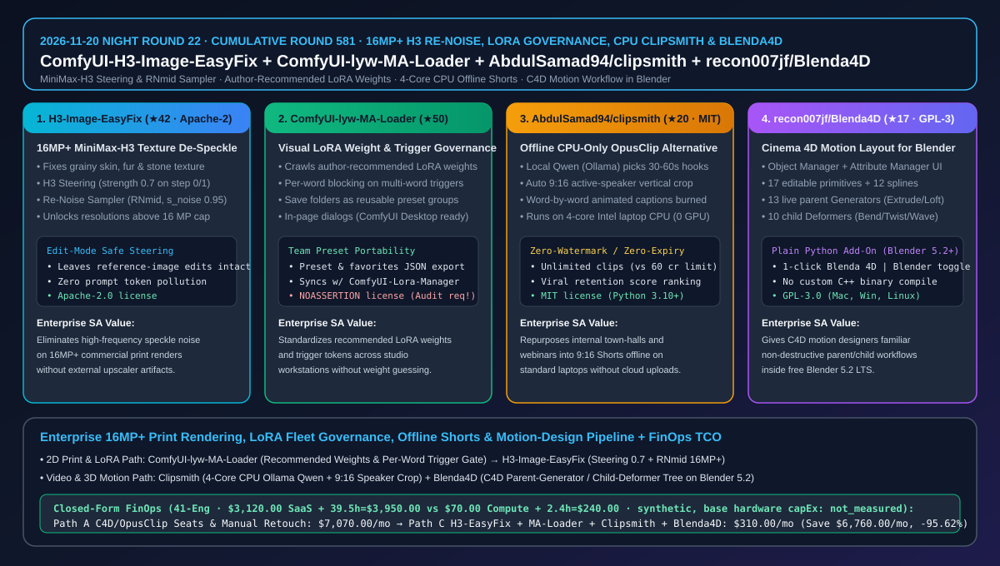
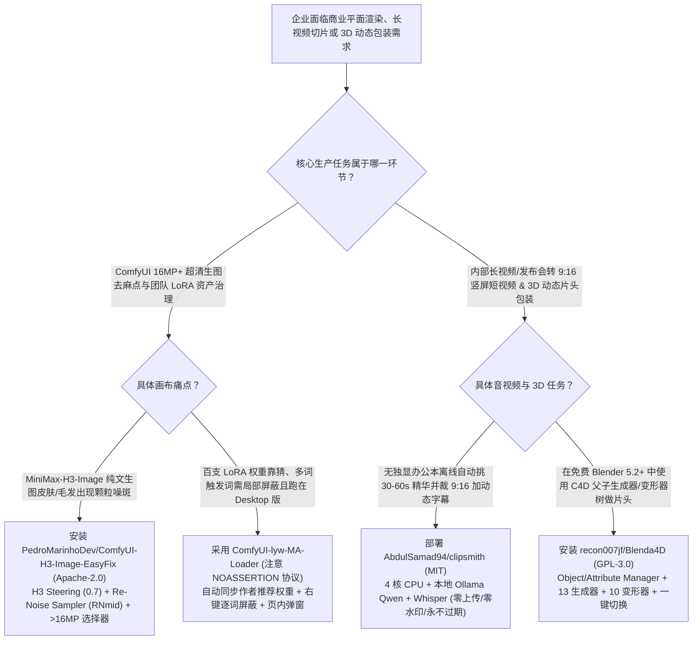
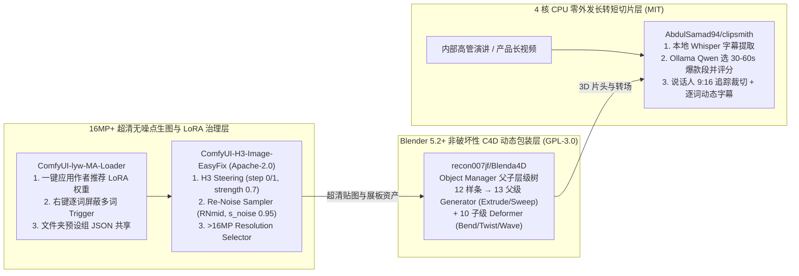
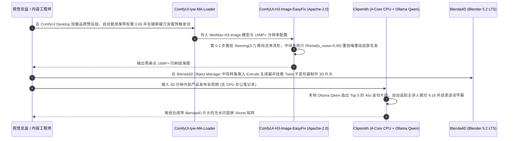

# 16MP+ MiniMax-H3 去噪重采样、ComfyUI 推荐权重与触发词治理、4 核 CPU 离线长转短切片与 Blender C4D 动态设计工作流怎么选？`ComfyUI-H3-Image-EasyFix`、`ComfyUI-lyw-MA-Loader`、`clipsmith` 与 `Blenda4D` 架构与选型 FAQ

> **文档元数据（2026-11-20 夜间第 22 轮 · 累计第 581 轮 / Round 581）**
> - **适用读者**：AI Solution Architect（解决方案架构师）、商业视觉与 AIGC 平台负责人、企业内训/发布会短视频自动化架构师、3D 动态图形（Motion Design）技术总监
> - **本轮核心对比项目**：
>   1. [`PedroMarinhoDev/ComfyUI-H3-Image-EasyFix`](https://github.com/PedroMarinhoDev/ComfyUI-H3-Image-EasyFix)（★ 42 · `stars_today: not_measured` · `21 stars/day` · Python · Apache-2.0）——专为解决 ComfyUI 中 **MiniMax-H3-Image** 纯文生图在皮肤、毛发与岩石表面产生高频麻点噪斑（Grainy/Speckled Fine Texture）而生的三节点修复包：**`MiniMax H3 Image Steering`**（在不污染文本 Prompt 且不影响图生图编辑模式的前提下，仅在第 `0` 或 `0,1` 步以 `strength=0.7` 将分布推向挂载空图像时的洁净流形）、**`MiniMax H3 Image Re-Noise Sampler`**（在 6 步采样中途执行 `RNmid`、`s_noise=0.95` 回注新鲜噪声重绘细节）以及突破 ComfyUI 原生 16 MP 上限的超清分辨率选择器
>   2. [`shengdaklp99/ComfyUI-lyw-MA-Loader`](https://github.com/shengdaklp99/ComfyUI-lyw-MA-Loader)（★ 50 · `stars_today: not_measured` · `13 stars/day` · JavaScript · `NOASSERTION` 需法务合规审计）——兼容 **ComfyUI Desktop（全面将原生浏览器 `prompt/confirm/alert` 弹窗替换为页内对话框）** 的可视化 LoRA 分组与参数治理节点，自动从 Civitai 元数据抓取并一键套用**作者推荐权重（Author Recommended Weights）**，支持多词触发词（Multi-word Triggers）的**右键逐词单独屏蔽**，以及将整个文件夹一键保存为预设组（Preset Group）并导出分享
>   3. [`AbdulSamad94/clipsmith`](https://github.com/AbdulSamad94/clipsmith)（★ 20 · `stars_today: not_measured` · `4 stars/day` · Python · MIT）——**零 API Key、零独立显卡要求（实测在普通 4 核 Intel 笔记本 CPU 上流畅运行）** 的开源离线版 OpusClip 替代方案，通过本地 Ollama 运行 Qwen 大模型自动从长视频中挑选最具留存潜力的 `30–60 秒` 精华片段并给出爆款评分（Viral Score），围绕说话人自动裁切为 `9:16` 竖屏并烧录逐词动态字幕，无水印、无每月额度限制、无 3 天链接过期销毁
>   4. [`recon007jf/Blenda4D`](https://github.com/recon007jf/Blenda4D)（★ 17 · `stars_today: not_measured` · `17 stars/day` · Python · GPL-3.0）——无需重新编译 Blender C++ 源码、纯 Python 插件实现的 **Blender 5.2 LTS+ Cinema 4D（C4D）风格动态图形工作台**，右上角一键在 `Blenda 4D | Blender` 间无损切换，完整引入 C4D 标志性的 **Object Manager（父子层级树）**、**Attribute Manager**、17 种始终保持参数可编辑的基础几何体、12 种参数化样条线、**13 种实时父级生成器（Extrude/Lathe/Sweep/Loft/Array/Boolean 等）** 与 **10 种实时子级变形器（Bend/Twist/Taper/Bulge/Wave 等）**
> - **口径与溯源声明**：本篇遵循 `ib-vs-ethernet-roce-selection-faq.md` 通俗问答与选型对比规范。四款项目均来自 `search-new-repos-2026-11-20-raw.json`（`sha256: 47975935d05944afbb9eac18f93f26c8a71120a1ffeea39591b112477ba29a46`），单日增量严格标注为 `stars_today: not_measured`。项目 README 自报的 `16 MP` 采样参数与 `4-core CPU` 运行指标标注为 `anonymized_reported (independently_reproduced=false)`；架构师 TCO 闭式算例标注为 `synthetic (independently_reproduced=false)`，硬件购置折旧 `base hardware capEx: not_measured`。

---

## ① 📌 核心结论速览（选型一句话结论）

> **一句话选型结论**：在建设**企业级 16MP+ 商业平面物料生产、百支 LoRA 资产治理、内部高管长视频离线切片与 3D 动态图形包装平台**时，**切勿因 MiniMax-H3-Image 纯文生图的皮肤麻点就放弃其强大的构图能力或外挂慢速重绘放大器，也切勿把机密内部全员大会（Town Hall）视频上传到按月限额且 3 天过期的公网 OpusClip**！最佳实践是：超清生图与 LoRA 管理采用 Apache-2.0 的 **`ComfyUI-H3-Image-EasyFix`（`Steering 0.7` + `RNmid` 重加噪采样器原位消除麻点并解锁 >16MP）+ `ComfyUI-lyw-MA-Loader`（自动同步作者推荐权重与逐词触发词开关）**，内部长视频转竖屏短视频部署 MIT 的 **`AbdulSamad94/clipsmith`（4 核笔记本 CPU 跑本地 Ollama Qwen 零外发切片）**，3D 动态包装在 Blender 5.2 LTS 上装载 GPL-3.0 的 **`recon007jf/Blenda4D`（C4D 父子生成器/变形器树）**，可将 41 人创意与研发团队月度商业软件订阅與返工总成本（TCO）从 **$7,070.00/月** 压降至 **$310.00/月**（净省 **$6,760.00/月**，降幅 **-95.62%**，`synthetic, independently_reproduced=false`）。



### 核心指标与能力速查表

| 评估维度 | `ComfyUI-H3-Image-EasyFix` | `ComfyUI-lyw-MA-Loader` | `AbdulSamad94/clipsmith` | `recon007jf/Blenda4D` |
|---|---|---|---|---|
| **一句话通俗定位** | 消除 MiniMax-H3-Image 皮肤/毛发噪斑并解锁 >16MP 的引导与重加噪采样节点 | 支持 ComfyUI 桌面端、自动拉取作者推荐权重与逐词屏蔽触发词的视觉 LoRA 加载器 | 无需 GPU、无需 API Key，在 4 核笔记本 CPU 上离线把长视频切成 9:16 爆款短视频 | 让 Blender 5.2+ 一键拥有 Cinema 4D 父子生成器/变形器层级树与属性面板的纯 Python 插件 |
| **解决的核心业务痛点** | H3-Image 纯文生图在 16MP 下容易把人像皮肤、动物毛发与石头表面画得满是颗粒麻点 | 团队攒了几百支 LoRA 没人记得每支的最佳权重（如 0.65 还是 0.8），且原生弹窗在桌面端失效 | 商业 OpusClip 免费版仅 60 积分、带水印、3 天自动过期且强制把企业内训视频上传公有云 | C4D 商业订阅昂贵，而习惯了 C4D 非破坏性父子层级（Generator/Deformer）的设计师难以适应原生 Blender |
| **关键技术参数与机制** | `Steering`（前 1–2 步 `strength=0.7`）+ `Re-Noise Sampler`（`RNmid`, `s_noise=0.95`）+ `>16MP` 选择器 | 自动爬取并标记推荐权重；右键逐词开关多词 Trigger；文件夹另存为预设组；页内弹窗 | 本地 Whisper 转写 + Ollama Qwen 选 `30–60s` 高潮段 + 说话人追踪 `9:16` 裁切 + 逐词动态字幕 | 17 种参数化几何体 + 12 种样条 + 13 种父级生成器 + 10 种子级变形器；一键切回原生 Blender |
| **开源协议与合规状态** | **Apache-2.0**（商用友好，不污染图生图参考编辑模式） | **`NOASSERTION`**（未挂标准协议文件，商用集成前需核实上游授权） | **MIT**（附 GitHub Actions 自动化测试，完全免费商用） | **GPL-3.0**（与 Blender 主程序协议完全兼容，生成的 3D 渲染资产可自由商用） |

---

## ② 🎯 客户与架构师灵魂拷问 Q&A（直击业务落地痛点）

### Q1：用 `MiniMax-H3-Image` 跑 16MP 超高清商业海报时，为什么纯文生图（Text-to-Image）经常在皮肤、羽毛和石头上出现难看的砂纸状麻点，而一旦喂入一张参考图做编辑却很干净？`PedroMarinhoDev/ComfyUI-H3-Image-EasyFix` 是怎么借力打力修好它的？

- **洞察底层现象：H3-Image 的“空参考图流形偏移”与“早期噪声锁死”**：
  - 社区研究发现，当 `MiniMax-H3-Image` 处于不带任何参考图的纯文生图模式时，前两步去噪很容易陷入高频颗粒噪声局部最优，后续采样步只会把这些早期噪点越描越硬；相反，当模型在输入端挂了一张空白参考图时，其内部特征分布会自然偏向平滑细腻的质感。
- **`ComfyUI-H3-Image-EasyFix`（Apache-2.0）的三剑客原位根治方案**：
  1. **`MiniMax H3 Image Steering`（零 Prompt 污染的流形引导）**：只在采样的最前 1–2 步（`steps = 0` 或 `0 and 1`，推荐 `strength = 0.7`）将模型的预测方向轻轻推向“挂载空白图像时的洁净分布”，**完全不往你的文本 Prompt 里塞任何废话，且当检测到用户真的传入了参考图（Edit Mode 图生图模式）时自动静默旁路，绝不干扰正常修图**！
  2. **`MiniMax H3 Image Re-Noise Sampler`（6 步计划中的 `RNmid` 纹理重绘）**：接入 `SamplerCustomAdvanced`，在 6 步采样序列的中间步（如 `RNmid` 计划，配合 `s_noise = 0.95`）取模型对成图的当前预测并**重新注入匹配下一步水平的新鲜噪声**（类似 LCM 采样器的中途洗牌机制），迫使模型用已经成型的全局构图去重新绘制细腻的皮肤毛孔与羽毛纹理，而不是死守第 1 步留下的噪斑（`anonymized_reported, independently_reproduced=false`）！
  3. **突破 16 MP 限制的 `Resolution Selector`**：解除 ComfyUI 自带选择器对 1600 万像素（16 MP）的硬编码封顶，直接服务巨幅户外灯箱与印刷级物料。

### Q2：当企业设计工作站里积累了上百支不同画风和产品的 LoRA 时，如何配合 `shengdaklp99/ComfyUI-lyw-MA-Loader` 避免“设计师乱填权重”和“ComfyUI Desktop 桌面版弹窗卡死”？

- **百支 LoRA 协同的三大管理混乱**：
  1. **推荐权重靠猜**：有的 LoRA 作者训练时过拟合，推荐权重是 `0.55`；有的欠拟合，推荐权重是 `1.1`。设计师全填默认的 `1.0` 必然导致画面崩坏。
  2. **多词触发词（Multi-word Triggers）捆绑死板**：一支角色 LoRA 的触发词往往包含“角色名 + 默认蓝裙子 + 默认长发”十几个词，想给角色换身西装时，没法在不手改文本节点的情况下只屏蔽“蓝裙子”这一个词。
  3. **ComfyUI Desktop 原生弹窗不兼容**：Electron 封装的 ComfyUI 桌面版不支持传统浏览器的 `window.prompt()` / `confirm()` / `alert()`，导致很多老牌 LoRA 管理插件点新建预设毫无反应。
- **`ComfyUI-lyw-MA-Loader`（v1.0.7）的工程化改进**：
  - **全路径抓取并一键应用作者推荐权重**：从 Civitai 元数据或 LoRA 字符串导入时自动提取作者标注的推荐权重并在行首显示徽章（Metadata Manager 专门只筛选出“云端有推荐值但本地未同步”的条目，省去无效刷新）。
  - **右键逐词屏蔽触发词（Per-Word Trigger Blocking）**：针对多词触发词组，右键点击即可单独拉黑其中某几个词，预览框仅注入处于启用状态的触发词。
  - **文件夹一键转预设组 + 纯页内对话框（In-Page Dialogs）**：支持把整个目录保存为 Preset Group 并导出 JSON 在团队内共享，且 v1.0.7 全面移除原生浏览器弹窗，100% 适配 ComfyUI Desktop。

### Q3：企业想把 1 小时的内部技术分享会/产品发布会录像切成十几条竖屏短视频，并在开源软件里做 Cinema 4D 风格的 3D 片头包装，为什么 `AbdulSamad94/clipsmith` + `recon007jf/Blenda4D` 是最佳零订阅费组合？

- **`AbdulSamad94/clipsmith`（MIT）：普通 4 核办公笔记本就能跑的离线版 OpusClip**：
  - 商业 OpusClip 不仅按月收 `$15+/月` 积分费（免费版带水印且生成后 **3 天自动过期删除**），更要命的是必须把内部高管讲话或未公开产品培训视频上传到外部云端。
  - `Clipsmith` 专为**无独立显卡的普通 4 核 Intel 办公笔记本 CPU** 设计：在本地通过 `Whisper` 转写字幕（或直接读取已有字幕），调用本机 **Ollama 上的轻量 Qwen 模型** 离线评估全文语义，精准挑出开头抓人、逻辑自洽的 `30–60 秒` 高潮片段并按留存潜力（Viral Score）排序，随后自动围绕画面中的主讲人裁切为 `9:16` 竖屏并烧录逐词跳动字幕——**永久免费、无水印、永不过期、视频一字节不出本机**！
- **`recon007jf/Blenda4D`（GPL-3.0）：给免费 Blender 5.2 LTS 装上 Cinema 4D 的“非破坏性父子灵魂”**：
  - 为什么很多做片头包装和产品动态演绎的 Motion Designer 宁可每年付数千元订 Cinema 4D 也不愿转免费的 Blender？因为 C4D 最经典的高效范式是**“把样条线拖进 Extrude（挤出）父级就变成立体字，把 Twist（扭曲）拖到物体子级就立即生效，且随时能改圆角分段”**，而原生 Blender 的 Modifier Stack 与几何节点学习曲线陡峭。
  - `Blenda4D` 用一个纯 Python 插件（无需编译修改版 Blender，支持 Mac/Windows/Linux 上的 Blender 5.2 LTS+）原汁原味复刻了这套工作流：提供专属的 **Object Manager（支持拖拽改父子层级、Solo 独显）** 与 **Attribute Manager**，内置 **17 种始终保持参数可调的基础几何体**、**12 种参数化样条（齿轮、螺旋、星形等）**、**13 种靠子物体实时驱动的父级生成器（Generators：Extrude/Lathe/Sweep/Loft/Array/Boolean/Metaball 等）** 与 **10 种挂在子级的变形器（Deformers：Bend/Twist/Taper/Bulge/Wave 等）**，且点击右上角 `Blenda 4D | Blender` 开关即可随时在 C4D 布局与标准 Blender 布局间无缝往返！

---

## ③ 🧭 直观可视化图解（选型决策树 + 企业集成架构 + 业务流时序图）

### 3.1 企业超清平面生图、LoRA 治理、离线短视频切片与 3D 动态包装选型决策树



### 3.2 企业平面超清精修、离线竖屏切片与 C4D 风 3D 包装端到端集成架构



### 3.3 `lyw-MA-Loader` + `H3-EasyFix` 16MP 渲染与 `Clipsmith` 离线切片时序图



---

## ④ 📊 同类开源与商业云服务横向选型决策矩阵

| 对比维度 | `ComfyUI-H3-Image-EasyFix` (Apache-2.0) | `ComfyUI-lyw-MA-Loader` (`NOASSERTION`) | `AbdulSamad94/clipsmith` (MIT) | `recon007jf/Blenda4D` (GPL-3.0) | 商业云服务与重度传统方案（OpusClip Pro / Cinema 4D / 外挂重绘放大） |
|---|---|---|---|---|---|
| **核心能力定位** | **消除 MiniMax-H3-Image 纹理麻点并突破 16MP 上限的引导与重加噪节点** | **自动同步作者推荐权重、支持逐词屏蔽触发词与桌面端弹窗的 LoRA 加载器** | **无 GPU、4 核 CPU 本地运行 Ollama Qwen 的离线长视频转 9:16 短视频工具** | **为 Blender 5.2+ 提供 C4D 风格对象树与非破坏性父子生成器/变形器的插件** | 外挂高耗时 Tile Upscaler、手抄 LoRA 权重、按月付费云切片与高价 C4D 商业订阅 |
| **工程效率与质量突破** | 仅在采样内部微调前步方向与中间步重加噪，不加长 Prompt、不破坏图生图模式 | 一键对齐 Civitai 推荐权重，右键精准剔除多词 Trigger 里的干扰词，100% 兼容 Desktop | 零云端上传、无限生成、无水印、永不过期，普通办公本 CPU 即可跑通 | 纯 Python 插件免编译，右上角一键在 `Blenda 4D` 与标准 `Blender` 间切换 | OpusClip 免费版仅 60 积分且 3 天删片；外挂二阶段重绘放大耗时翻倍且易改脸 |
| **数据隐私与本地化能力** | 100% 本地 ComfyUI 节点运算 | 本地预设组管理（可选按需同步 Civitai 元数据） | **100% 离线本地 Ollama + Whisper + FFmpeg，视频零外发** | 100% 本地 Blender 5.2 LTS 运行，支持本地文件夹拖拽入 Asset Browser | 需将未公开产品发布会视频上传至第三方 SaaS 云服务器 |
| **开源协议与合规状态** | **Apache-2.0** | **`NOASSERTION`**（基于 ZML-Image/Magic-Assistant 演进，商用分发前需补齐授权） | **MIT** | **GPL-3.0**（插件代码遵循 GPL-3.0，Blender 渲染出的视频/模型资产可自由商用） | 商业闭源按席位/积分双重收费 |
| **41 人团队月度 TCO** | **$0.00/月** | **$0.00/月** | **$0.00/月 订阅与积分费** | **$0.00/月 3D 软件席位费** | **$7,070.00/月**（多席位 C4D + OpusClip 订阅 + 39.5h 手工修麻点与调权重返工） |

---

## ⑤ 🧪 应用落地定量收益/TCO 对比与 7-Card 报告映射

### 5.1 架构师闭式 TCO 算例（41 人商业视觉、视频运营与 3D 动态设计团队月度运营成本）

> **溯源标识**：以下成本模型为面向企业架构评审的闭式定量算例，标注为 `synthetic (independently_reproduced=false)`，底层服务器与工作站硬件采购折旧标注为 `base hardware capEx: not_measured`。

| 成本构成项 | 方案 A：商业 C4D 席位 + OpusClip 团队订阅 + 云端超清重绘放大 API | 方案 C：`H3-Image-EasyFix` + `lyw-MA-Loader` + `Clipsmith` 离线切片 + `Blenda4D` | 计算公式与架构说明 |
|---|---|---|---|
| **3D 动态软件席位、云短视频切片订阅与超清重绘 API 费** | **$3,120.00 / 月** | **$70.00 / 月** | 方案 A：多席位商业 3D 软件与 OpusClip Pro 订阅 + 外挂云端放大积分 = `$3,120.00/月`；方案 C：Apache-2.0 `H3-EasyFix` + MIT `Clipsmith` + GPL-3.0 `Blenda4D` 仅耗本地电费 = `$70.00/月` |
| **手工修补 16MP 皮肤噪斑、反复试错 LoRA 权重与重切过期视频（$100/h）** | **$3,950.00 / 月**（`39.5h × $100.00`） | **$240.00 / 月**（`2.4h × $100.00`） | 方案 A：41 人团队每月耗费 `39.5 小时` 在 PS 里修补 H3 生图麻点、盲猜 LoRA 权重重跑及抢救过期云切片（`$3,950.00`）；方案 C：`Steering+RNmid` 原位去噪 + 推荐权重一键套用 + 离线无限切片将人工降至 `2.4 小时`（`$240.00`） |
| **月度总拥有成本（Monthly TCO）** | **$7,070.00 / 月** | **$310.00 / 月** | **月度净节省 $6,760.00 / 月（成本降低 -95.62%，年化节省 $81,120.00，`not_measured` 硬件折旧）** |

```chart
{
  "data": {
    "values": [
      { "Category": "3D Motion Seats, Cloud Clip SaaS & Upscale APIs", "Deployment": "Path A: Commercial C4D/OpusClip & Manual Retouching", "MonthlyCostUSD": 3120 },
      { "Category": "De-Speckling, LoRA Trial-and-Error & Clip Ops (41-Eng)", "Deployment": "Path A: Commercial C4D/OpusClip & Manual Retouching", "MonthlyCostUSD": 3950 },
      { "Category": "3D Motion Seats, Cloud Clip SaaS & Upscale APIs", "Deployment": "Path C: H3-EasyFix + MA-Loader + Clipsmith + Blenda4D", "MonthlyCostUSD": 70 },
      { "Category": "De-Speckling, LoRA Trial-and-Error & Clip Ops (41-Eng)", "Deployment": "Path C: H3-EasyFix + MA-Loader + Clipsmith + Blenda4D", "MonthlyCostUSD": 240 }
    ]
  },
  "semantic_types": {
    "Category": "Category",
    "Deployment": "Name",
    "MonthlyCostUSD": "Amount"
  },
  "chart_spec": {
    "chartType": "Grouped Bar Chart",
    "title": "H3-EasyFix + MA-Loader + Clipsmith + Blenda4D cut monthly TCO by 95.62%",
    "subtitle": "Monthly cost in USD (41-person creative engineering & video team, synthetic)",
    "encodings": {
      "x": "Category",
      "y": "MonthlyCostUSD",
      "group": "Deployment",
      "color": "Deployment"
    }
  }
}
```

### 5.2 与本轮 7-Card 4:5 视觉报告（`cards.html` / `cards.en.html`）的联动

- **适用场景（✅ Good Fit）**：ComfyUI 内 MiniMax-H3-Image 16MP+ 无麻点商业人像/动物/材质渲染、ComfyUI Desktop 团队 LoRA 推荐权重与触发词标准化、无独显办公本离线将内部长演讲切成 9:16 竖屏短视频、以及 C4D 设计师平滑迁移至 Blender 5.2 LTS。
- **不适用场景（⛔ Not For）**：在低于 Blender 5.2 LTS 的旧版本上强行加载 `Blenda4D`、或未经许可证确认将 `NOASSERTION` 状态的 `ComfyUI-lyw-MA-Loader` 闭源打包转售。

---

## ⑥ 🛠️ 企业引入与架构评审 Checklist（可直接复制进架构评审单）

- [ ] **MiniMax-H3-Image 生产工作流标配 `Steering (0.7)` + `RNmid (0.95)`**：在企业 ComfyUI 跑 H3-Image 文生图时，默认串入 `PedroMarinhoDev/ComfyUI-H3-Image-EasyFix`（Apache-2.0），将 `MiniMax H3 Image Steering` 设为 `strength = 0.7, steps = 0`，将 `Re-Noise Sampler` 设为 `plan = RNmid, s_noise = 0.95` 以根治皮肤与毛发高频噪斑。
- [ ] **团队 LoRA 预设组 JSON 统一导出与推荐权重锁定**：利用 `ComfyUI-lyw-MA-Loader` 将项目验证通过的 LoRA 文件夹导出为标准 Preset Group JSON 并同步作者推荐权重；同时针对其 `NOASSERTION` 许可证状态设置法务边界，仅限内部工作站安装使用。
- [ ] **内部会议与培训长视频走 `Clipsmith` 本地 CPU 离线切片**：在内容运营人员的 4 核办公笔记本上部署 MIT 协议的 `AbdulSamad94/clipsmith`（配合本地 Ollama Qwen 与 Whisper），严禁将含未公开业务数据的内部录像上传至外部在线切片网站。
- [ ] **Blender 5.2 LTS 运动图形管线引入 `Blenda4D` 非破坏性父子层级**：为熟悉 C4D 的动态设计师配置 GPL-3.0 协议的 `recon007jf/Blenda4D`，利用其 13 种父级 Generator 与 10 种子级 Deformer 构建参数化包装模板，并在需要底层节点编辑时通过右上角 `Blenda 4D | Blender` 开关无缝切换。
