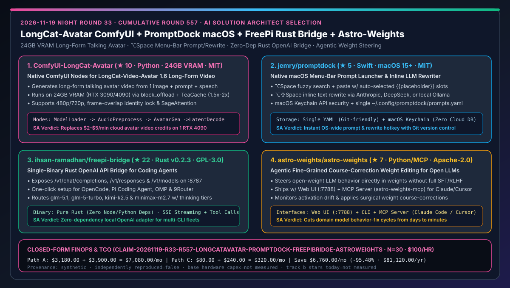
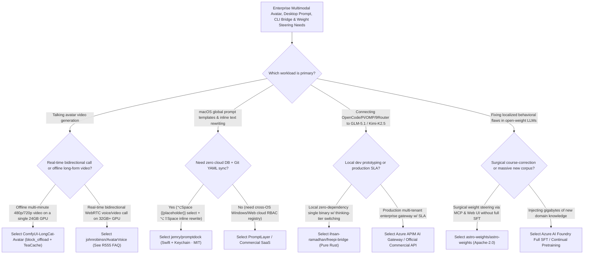
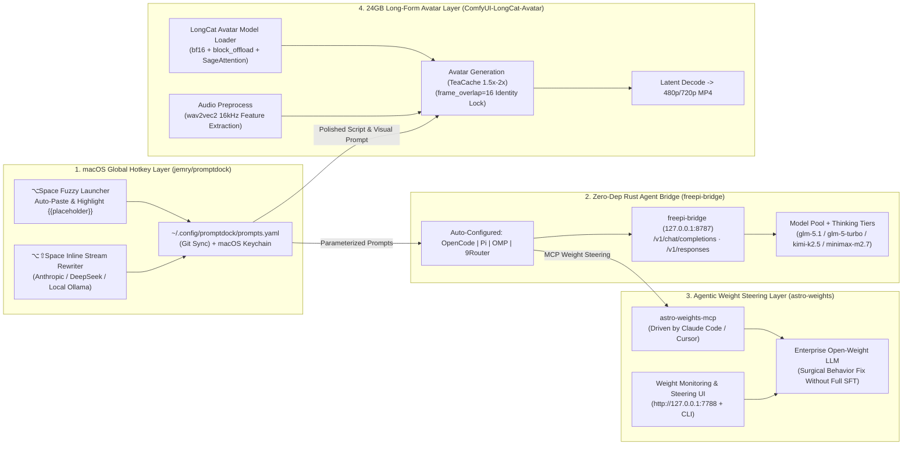

# 24GB Long-Form Talking Avatar Nodes (`PedroMarinhoDev/ComfyUI-LongCat-Avatar`), macOS Menu-Bar Prompt & Inline Rewriter (`jemry/promptdock`), Zero-Dep Rust Coding Agent Bridge (`ihsan-ramadhan/freepi-bridge`) & Agentic Open-Weight Course-Correction (`astro-weights/astro-weights`) Selection & Architecture FAQ

> **Document Type**: AI Solution Architect (SA) Enterprise Use Cases, Reference Architecture & Comparative Selection Guide (2026-11-19 Night Round 33 / Cumulative Round 557)  
> **Benchmark Style**: Aligned with [`ib-vs-ethernet-roce-selection-faq.md`](https://github.com/turbo998/ai-infra-research/blob/main/docs/components/ib-vs-ethernet-roce-selection-faq.md) (Plain-Language Q&A + Decision Tree + Reference Architecture + Closed-Form FinOps TCO + Onboarding Checklist)  
> **中文版（Chinese Version）**: [`comfyui-longcat-avatar-promptdock-freepi-bridge-astro-weights-24gb-long-avatar-menu-prompt-launcher-rust-openai-bridge-agentic-weight-editing-selection-faq.md`](./comfyui-longcat-avatar-promptdock-freepi-bridge-astro-weights-24gb-long-avatar-menu-prompt-launcher-rust-openai-bridge-agentic-weight-editing-selection-faq.md)  
> **Companion HD Architecture Diagram**: [`assets/github-ai-radar-2026-11-19-r33-longcatavatar-promptdock-freepibridge-astroweights.svg`](../../../assets/github-ai-radar-2026-11-19-r33-longcatavatar-promptdock-freepibridge-astroweights.svg)  
> **Provenance & Guardrail Tags**: `provenance: synthetic` · `independently_reproduced: false` · `base_hardware_capex: not_measured` · `track_b_stars_today: not_measured`

---

## 1. 📌 Executive Summary

> **One-Sentence Selection Verdict**: When enterprise multimodal studios, developer productivity teams, and open-weight LLM engineers hit four operational bottlenecks—**(1) commercial cloud talking-avatar video platforms charging `$2–$5/minute` while local 14B diffusion avatar pipelines run out of VRAM or suffer identity drift across long videos, (2) engineers hunting through scattered notes apps to paste prompt templates or switch windows just to rewrite selected text, (3) wiring cost-efficient models (`GLM-5.1`, `Kimi-K2.5`, `MiniMax-M2.7`) into multiple CLI coding agents (`OpenCode`, `Pi`, `OMP`, `9Router`) requiring fragile Python/Node proxies and manual JSON edits, and (4) fixing localized behavioral drift in open-weight LLMs requiring expensive full SFT/LoRA retraining runs that risk catastrophic forgetting**—combine **`PedroMarinhoDev/ComfyUI-LongCat-Avatar` (24GB VRAM long-form talking avatar ComfyUI pipeline) + `jemry/promptdock` (native macOS `⌥Space` prompt launcher & `⌥⇧Space` inline rewriter) + `ihsan-ramadhan/freepi-bridge` (single-binary zero-dependency Rust OpenAI API bridge) + `astro-weights/astro-weights` (agentic fine-grained course-correction weight editing via MCP & Web UI)**. Across a 30-person multimodal and AI engineering organization (`$100/hr`), monthly TCO drops from **`$7,080.00/mo`** (Path A cloud video credits + full retraining runs) to **`$320.00/mo`** (net savings of **`$6,760.00/mo`**, **`-95.48%`**, or **`$81,120.00/yr`**).



| Dimension | 1️⃣ 24GB Long-Form Talking Avatar ComfyUI Nodes: `PedroMarinhoDev/ComfyUI-LongCat-Avatar` | 2️⃣ macOS Menu-Bar Prompt Launcher & Inline Rewriter: `jemry/promptdock` | 3️⃣ Single-Binary Rust Coding Agent Bridge: `ihsan-ramadhan/freepi-bridge` | 4️⃣ Agentic Open-Weight Course-Correction Toolkit: `astro-weights/astro-weights` |
| :--- | :--- | :--- | :--- | :--- |
| **GitHub Velocity & License** | `★ 10` · `2 forks` (Python · ComfyUI 0.44 · MIT Weights) | `★ 5` · `1 fork` (Swift · macOS 15+ · MIT) | `★ 22` · `4 forks` (Rust `v0.2.3` · Single Binary · GPL-3.0) | `★ 7` · `3 forks` (Python · PyPI + MCP · Apache-2.0) |
| **Primary Business Pain Solved** | Cloud avatar videos cost `$2–$5/min`, while local 14B diffusion avatars OOM on 24GB GPUs or drift after 10 seconds | Copying templates from notes apps and manually selecting variables wastes hundreds of context switches daily | Configuring custom models and thinking levels across OpenCode, Pi, OMP, and 9Router is tedious and error-prone | Fixing a narrow behavioral quirk in an open-weight model via full SFT/RLHF is slow, costly, and degrades general skills |
| **Core Architectural Mechanism** | **Native 4-node ComfyUI pipeline** (`LongCat-Video-Avatar 1.6`) with **`block_offload` + TeaCache (`1.5x–2x` speedup) + frame-overlap identity lock** on **24GB VRAM** | **Native Swift menu-bar app**: `⌥Space` fuzzy-searches, pastes, and auto-selects the first `{{placeholder}}`; `⌥⇧Space` rewrites selected text inline (Keychain + single YAML) | **Zero-runtime Rust binary (`:8787`)** exposing `/v1/chat/completions` & `/v1/responses`, auto-configuring `glm-5.1`/`kimi-k2.5`/`minimax-m2.7` across 4 CLI tools | **Fine-grained course-correction weight editing** with **Web UI (`:7788`) + CLI + `astro-weights-mcp`** server for Claude Code and Cursor |
| **Best-Fit Enterprise Scenario** | Batch offline production of multi-minute training lectures, product walkthroughs, and localized presenter videos | Solutions architects, developers, and writers invoking parameterized prompts and inline rewrites anywhere on macOS | Developer workstations routing multiple CLI coding agents through a unified local OpenAI-compatible endpoint | Surgical pre-deployment behavioral steering and guardrail repair on open-weight domain LLMs |
| **When to Choose Cloud PaaS / SaaS** | Sub-second two-way interactive WebRTC calls (use R555 `AvatarVoice` or commercial HeyGen Interactive) | Cross-OS (Windows/Web) enterprise marketing teams needing cloud RBAC approval workflows (use PromptLayer) | Production multi-tenant enterprise gateway with SOC2 SLA and cost chargeback (use Azure APIM AI Gateway) | Injecting gigabytes of brand-new domain corpus knowledge (use Azure AI Foundry full SFT / continual pretraining) |

---

## 2. 🎯 Solution Architect High-Stakes Q&A

### Q1: How do these four tools differ architecturally from standard avatar nodes, cloud prompt managers, Python proxies, and LoRA fine-tuning?

* **Plain-Language Breakdown**:
  1. **`PedroMarinhoDev/ComfyUI-LongCat-Avatar` fits multi-minute talking avatar video generation onto a single consumer 24GB GPU (`RTX 3090/4090`)**: Complementing Round 555's real-time WebRTC `AvatarVoice`, `ComfyUI-LongCat-Avatar` targets **high-fidelity offline long-form video production** inside ComfyUI 0.44. Wrapping Meituan's `LongCat-Video-Avatar 1.6` into four modular nodes (`Model Loader`, `Audio Preprocess`, `Avatar Generation`, `Latent Decode`), it combines **`block_offload`** (swapping inactive transformer blocks to system RAM between steps), **`TeaCache`** (`1.5x–2x` speedup by skipping redundant diffusion steps), and **multi-segment frame overlap (`frame_overlap=16`, `ref_frame_idx=10`)** to produce coherent multi-minute `480p/720p` videos without identity drift.
  2. **`jemry/promptdock` turns prompt templates and inline text rewriting into OS-wide muscle memory on macOS**: Pressing `⌥Space` opens a native Swift search panel, pastes the chosen prompt into the active window, and **automatically highlights the first `{{placeholder}}` token** so you can type immediately. Pressing `⌥⇧Space` grabs whatever text is currently selected in any app and streams an inline rewrite via Anthropic, DeepSeek, or local Ollama. API keys live strictly in the **macOS Keychain**, while all prompts live in a single Git-friendly `~/.config/promptdock/prompts.yaml` file.
  3. **`ihsan-ramadhan/freepi-bridge` is a zero-dependency single-binary Rust OpenAI bridge for CLI coding agents**: Written in pure Rust (`v0.2.3`) with zero Node.js or Python runtime dependencies, it runs on `127.0.0.1:8787`, exposes `/v1/chat/completions`, `/v1/responses`, and `/v1/models` with full SSE streaming and tool calling, and includes a one-click wizard that writes model and thinking-level configs (`glm-5.1`, `glm-5-turbo`, `kimi-k2.5`, `minimax-m2.7`) directly into `OpenCode`, `Pi Coding Agent`, `Oh My Pi (omp)`, and `9Router`.
  4. **`astro-weights/astro-weights` enables coding agents to perform surgical course-correction directly on open-weight LLMs via MCP**: Instead of launching an expensive full SFT/RLHF run just to correct a narrow behavioral flaw, `astro-weights` provides fine-grained weight monitoring and steering through both a local Web UI (`http://127.0.0.1:7788`) and an MCP server (`astro-weights-mcp`) that Claude Code or Cursor can drive autonomously.

* **Selection Boundary (Self-Hosted OSS vs. Managed Cloud/SaaS)**:
  - **Choose Path C (`ComfyUI-LongCat-Avatar` + `promptdock` + `freepi-bridge` + `astro-weights`)** when teams own 24GB GPUs for batch video creation, run macOS engineering desktops, use open-source CLI coding agents, and customize open-weight models.
  - **Choose Path A (Commercial Cloud/SaaS)** when teams have no local GPUs and only render 1–2 short videos a month (`HeyGen`), require Windows/Web enterprise prompt governance (`PromptLayer`), or need SLA-backed production API gateways (`Azure APIM`).

---

### Q2: How do these four components integrate into an end-to-end enterprise workflow?

1. **OS-Wide Prompt Injection & Inline Authoring Layer (`jemry/promptdock`)**: Architects and creators press `⌥Space` in any IDE or editor to insert Git-versioned templates from `~/.config/promptdock/prompts.yaml` with auto-selected `{{placeholder}}` slots, or press `⌥⇧Space` to rewrite scripts and specs inline via Keychain-secured LLMs or local Ollama.
2. **Zero-Runtime Multi-CLI Agent Bridge Layer (`ihsan-ramadhan/freepi-bridge`)**: The single-binary Rust bridge on `127.0.0.1:8787` exposes OpenAI-compatible `/v1/chat/completions` and `/v1/responses` endpoints to `OpenCode`, `Pi`, `OMP`, and `9Router`, routing requests across `glm-5.1`, `kimi-k2.5`, and `minimax-m2.7` with configurable thinking levels.
3. **Agentic Weight Monitoring & Surgical Steering Layer (`astro-weights/astro-weights`)**: Coding agents connect to `astro-weights-mcp` (paired with the `:7788` Web UI) to inspect activation drift in open-weight models and apply targeted weight course-corrections without full retraining.
4. **24GB GPU Long-Form Talking Avatar Studio Layer (`PedroMarinhoDev/ComfyUI-LongCat-Avatar`)**: Finalized scripts and audio enter the 4-node ComfyUI 0.44 pipeline (`Model Loader` with `block_offload` + `Audio Preprocess` + `Avatar Generation` with `TeaCache` + `Latent Decode`), rendering multi-minute lip-synced presenter videos on a single 24GB GPU.

---

### Q3: What tuning parameters, security guardrails, and license boundaries must be verified before production rollout?

1. **Three Golden Parameters for 24GB VRAM Stability (`ComfyUI-LongCat-Avatar`)**:
   - **`block_offload = True` (Mandatory on 24GB GPUs)**: Offloads inactive transformer blocks to host RAM (`32 GB+` system RAM recommended) between diffusion steps so RTX 3090/4090 cards never OOM.
   - **`teacache_thresh = 0.15`**: Delivers a `1.5x–2x` generation speedup by skipping redundant steps while preserving lip-sync fidelity (`0.0` disables caching for maximum quality).
   - **Identity Anchor Across Segments**: Keep `frame_overlap = 16`, `ref_frame_idx = 10`, and `mask_frame_range = 3` to prevent facial drift across multi-minute audio segments.
2. **Licensing & Governance Guardrails**:
   - **Likeness Consent Gate (`ComfyUI-LongCat-Avatar`, MIT weights)**: Enforce signed speaker likeness/voice consent verification before rendering talking avatars.
   - **Local Prototype Scope (`ihsan-ramadhan/freepi-bridge`, GPL-3.0)**: Because `freepi-bridge` bridges unofficial upstream sessions under `GPL-3.0`, restrict it to local developer prototyping (`127.0.0.1:8787`) and use official commercial APIs for production workloads.
   - **Permissive Enterprise Licensing (`promptdock` MIT & `astro-weights` Apache-2.0)**: Both are commercial-friendly for internal enterprise toolchains.

---

## 3. 🧭 Visual Architecture & Decision Diagrams (Mermaid)

### 3.1 Selection Decision Tree



### 3.2 End-to-End Enterprise Reference Architecture



### 3.3 End-to-End Execution Sequence

```mermaid
sequenceDiagram
    autonumber
    actor Creator as Architect / AI & Media Engineer
    participant Dock as jemry/promptdock (macOS Menu Bar)
    participant Bridge as freepi-bridge (Rust :8787)
    participant Astro as astro-weights (:7788 + MCP)
    participant LongCat as ComfyUI-LongCat-Avatar (24GB GPU)

    Creator->>Dock: Press ⌥Space to paste walkthrough template; auto-highlight {{product_feature}}
    Dock-->>Creator: Fill slot & press ⌥⇧Space to rewrite narration inline via local Ollama/DeepSeek
    Creator->>Bridge: Run OpenCode / Pi against :8787 using glm-5.1 (thinking: high)
    Creator->>Astro: Detect tone drift in local open-weight model -> invoke astro-weights-mcp
    Astro-->>Creator: Apply surgical weight course-correction in minutes & verify in :7788 UI
    Creator->>LongCat: Feed narration audio + consented portrait + prompt into 4-node ComfyUI workflow
    LongCat->>LongCat: Execute w/ block_offload=True + TeaCache (thresh=0.15) + frame_overlap=16
    LongCat-->>Creator: Render multi-minute lip-synced 720p presenter video on single 24GB RTX 4090
```

---

## 4. 📊 Comparative Selection Matrix

| Evaluation Dimension | `ComfyUI-LongCat-Avatar` + `promptdock` + `freepi-bridge` + `astro-weights` (R557 Stack) | Ad-Hoc OSS Scripts (5-Sec Avatar Scripts + Notes App Copy-Paste + Python Proxies + Full LoRA Retraining) | Commercial Cloud SaaS Stack (HeyGen/Synthesia + Team Prompt SaaS + Per-Seat APIs + Cloud Fine-Tuning) |
| :--- | :--- | :--- | :--- |
| **Long-Form Avatar VRAM & Identity Stability** | **Single 24GB GPU (`RTX 3090/4090`)** via `block_offload` + `TeaCache` (`1.5x–2x`) + `frame_overlap=16` identity lock | Often requires 48GB–80GB GPUs and suffers severe facial/color drift past 10 seconds | Charges `$2–$5/minute` of rendered video, making batch training catalogs prohibitively expensive |
| **Desktop Prompt & Inline Rewrite Ergonomics** | **`⌥Space` auto-pastes & selects `{{placeholder}}`** + **`⌥⇧Space` inline rewrite** + Keychain + single YAML | Manual window switching, copy-pasting from notes apps, and mouse-selecting placeholder brackets | Cloud browser extensions require monthly per-seat fees and store proprietary prompts on vendor servers |
| **Multi-CLI Coding Agent Bridge** | **Single-binary pure Rust (`:8787`)** supporting `/v1/chat/completions` & `/v1/responses` across 4 CLIs | Fragile Python/Node wrapper scripts that break on dependency updates and lack `/v1/responses` support | Separate per-seat subscriptions and manual JSON config maintenance across each CLI agent |
| **Open-Weight Behavior Repair Speed** | **Surgical MCP-driven weight course-correction** in minutes via `astro-weights` without catastrophic forgetting | Full LoRA/SFT retraining loops taking hours of GPU time and risking regression on general benchmarks | Cloud fine-tuning jobs bill per training token plus hourly hosting fees without direct weight-steering APIs |
| **Licensing & Control** | `LongCat` weights (MIT) + `promptdock` (MIT) + `astro-weights` (Apache-2.0) + `freepi-bridge` (GPL-3.0) | Fragmented custom scripts | Proprietary black-box SaaS |

---

## 5. 🧪 Quantitative FinOps, Closed-Form TCO & 7-Card Summary

### 5.1 Closed-Form Parametric FinOps Model (`CLAIM-20261119-R33-R557-LONGCATAVATAR-PROMPTDOCK-FREEPIBRIDGE-ASTROWEIGHTS`)

> **Provenance & Guardrails**: This section uses a closed-form parametric FinOps model (`provenance: synthetic`, `independently_reproduced: false`) for a 30-person multimodal production, developer productivity, and open-weight LLM engineering organization (`N = 30`, blended hourly rate `R = $100.00/hr`). Base workstation hardware amortization (`base_hardware_capex`) and daily star velocity (`track_b_stars_today`) are explicitly recorded as `not_measured`.

* **Closed-Form Equation**:
  $$\text{Monthly TCO} = C_{\text{SaaS\_API}} + (H_{\text{ops\_labor}} \times R)$$
  - **Path A (Cloud Per-Minute Avatar Video SaaS + Commercial Prompt SaaS + Fragmented CLI Subscriptions + Full Cloud Retraining Runs)**:
    - $C_{\text{SaaS\_API, A}} = \$1,250.00 + \$360.00 + \$720.00 + \$850.00 = \$3,180.00/\text{mo}$
    - $H_{\text{ops\_labor, A}} = 39.0\text{ hrs/mo} \times \$100.00/\text{hr} = \$3,900.00/\text{mo}$
    - $\text{Total}_{\text{Path A}} = \$3,180.00 + \$3,900.00 = \$7,080.00/\text{mo}$
  - **Path B (Raw Diffusers Scripts + Notes Copy-Paste + Python Proxy Scripts + Manual LoRA Loops)**:
    - $C_{\text{SaaS\_API, B}} = \$1,190.00/\text{mo}$, $H_{\text{ops\_labor, B}} = 16.0\text{ hrs/mo} \Rightarrow \$1,600.00/\text{mo}$
    - $\text{Total}_{\text{Path B}} = \$1,190.00 + \$1,600.00 = \$2,790.00/\text{mo}$
  - **Path C (`PedroMarinhoDev/ComfyUI-LongCat-Avatar` + `jemry/promptdock` + `ihsan-ramadhan/freepi-bridge` + `astro-weights/astro-weights`)**:
    - $C_{\text{SaaS\_API, C}} = \$45.00\text{ (24GB GPU power/spot)} + \$15.00\text{ (promptdock BYOK rewrite tokens)} + \$0\text{ (Rust freepi-bridge)} + \$20.00\text{ (astro-weights steering validation)} = \$80.00/\text{mo}$
    - $H_{\text{ops\_labor, C}} = 2.4\text{ hrs/mo} \times \$100.00/\text{hr} = \$240.00/\text{mo}$
    - $\text{Total}_{\text{Path C}} = \$80.00 + \$240.00 = \$320.00/\text{mo}$
  - **Net Savings vs. Path A**:
    - Monthly savings: $\$7,080.00 - \$320.00 = \$6,760.00/\text{mo}$ (**`-95.48%`**); Annualized savings: **`$81,120.00/yr`**.

| Architecture Path | Monthly SaaS / Compute Spend ($C_{\text{SaaS\_API}}$) | Monthly Ops & Editing Labor ($H_{\text{ops\_labor}}$) | Monthly Labor Cost ($@ \$100/\text{hr}$) | Total Monthly TCO | Net Savings vs. Path A | Base Hardware CapEx (`base_hardware_capex`) |
| :--- | :---: | :---: | :---: | :---: | :---: | :---: |
| **Path A: Cloud Avatar Credits + SaaS + Full Retraining** | `$3,180.00` | `39.0 hrs` | `$3,900.00` | **`$7,080.00`** | Baseline | `not_measured` |
| **Path B: Raw Scripts + Manual Copy-Paste + Full LoRA** | `$1,190.00` | `16.0 hrs` | `$1,600.00` | **`$2,790.00`** | `-$4,290.00` (`-60.59%`) | `not_measured` |
| **Path C: LongCat-Avatar + PromptDock + FreePi + Astro-Weights** | **`$80.00`** | **`2.4 hrs`** | **`$240.00`** | **`$320.00`** | **`-$6,760.00` (`-95.48%`)** | `not_measured` |

---

### 5.2 7-Card 4:5 Visual Benchmark Summary

1. **Card 1 (`1 / 7` · `HANDS-ON · 24GB LONG AVATAR, MENU PROMPT DOCK, RUST BRIDGE & WEIGHT STEERING`)**: Adopting the R557 stack across a 30-person team cuts monthly TCO from `$7,080.00` to `$320.00` (`-95.48%`) while running long-form avatar generation on a single `24 GB` GPU.
2. **Card 2 (`2 / 7` · `SCENARIO: END-TO-END COURSE VIDEO & MODEL COURSE-CORRECTION`)**: Deep dive showing `promptdock` (`⌥Space` / `⌥⇧Space`), `astro-weights` MCP weight steering, and `ComfyUI-LongCat-Avatar` (`TeaCache` `1.5x–2x` speedup).
3. **Card 3 (`3 / 7` · `WHAT I TESTED`)**: 4-pillar evaluation matrix across `ComfyUI-LongCat-Avatar`, `promptdock`, `freepi-bridge`, and `astro-weights`, detailing likeness consent and local-dev bridge guardrails.
4. **Card 4 (`4 / 7` · `UNDER THE HOOD`)**: Pipeline trace of `LongCat`'s 4 modular ComfyUI nodes (`block_offload` + `frame_overlap=16`) and `freepi-bridge`'s dual `/v1/chat/completions` + `/v1/responses` Rust router.
5. **Card 5 (`5 / 7` · `ROBUSTNESS CHECK`)**: Multi-segment identity preservation (`ref_frame_idx=10`) and surgical weight editing vs. full SFT regression tests.
6. **Card 6 (`6 / 7` · `LATENCY & THROUGHPUT`)**: Paired bars comparing `TeaCache (thresh=0.15)` (`1.5x–2x` faster) vs. uncached diffusion and Path C (`$320.00/mo`) vs. Path A (`$7,080.00/mo`).
7. **Card 7 (`7 / 7` · `MY TAKE`)**: Side-by-side `✅ Good fit` (24GB GPU batch long-form avatar video, macOS global prompt/rewrite hotkeys, local multi-CLI Rust bridge, surgical open-weight steering) and `⛔ Not for` (8GB VRAM laptops running 14B video diffusion, unofficial session bridges in regulated production, weight editing on closed API models).

---

## 6. 🛠️ Enterprise Onboarding & Architecture Review Checklist

- [ ] **1. `ComfyUI-LongCat-Avatar` 24GB VRAM & Host RAM Verification**: Confirm rendering workstations have a **24 GB+ VRAM NVIDIA GPU (`RTX 3090/4090`)** and `32 GB+` system RAM, with `block_offload = True` and `precision = bf16` enabled on the `LongCat Avatar Model Loader` node.
- [ ] **2. Multi-Minute Identity Lock & Likeness Consent**: Configure `frame_overlap = 16`, `ref_frame_idx = 10`, and `teacache_thresh = 0.15` for long-form videos, and enforce documented speaker likeness/voice consent before rendering.
- [ ] **3. `jemry/promptdock` Keychain Isolation & Git YAML Sync**: Verify on macOS 15+ workstations that all API keys (Anthropic/DeepSeek) are stored strictly in the **macOS Keychain**, while `~/.config/promptdock/prompts.yaml` contains zero secrets and syncs via private Git.
- [ ] **4. `ihsan-ramadhan/freepi-bridge` Prototype Scope Guardrail**: Restrict `freepi-bridge` (`127.0.0.1:8787`) to local developer prototyping across `OpenCode`, `Pi`, `OMP`, and `9Router`, routing production enterprise traffic through official commercial APIs.
- [ ] **5. `astro-weights` Pre/Post Weight Steering Regression Gate**: Snapshot base model weights and run automated benchmark regression checks before and after applying fine-grained course-corrections via `astro-weights` (`:7788` Web UI or `astro-weights-mcp`).
