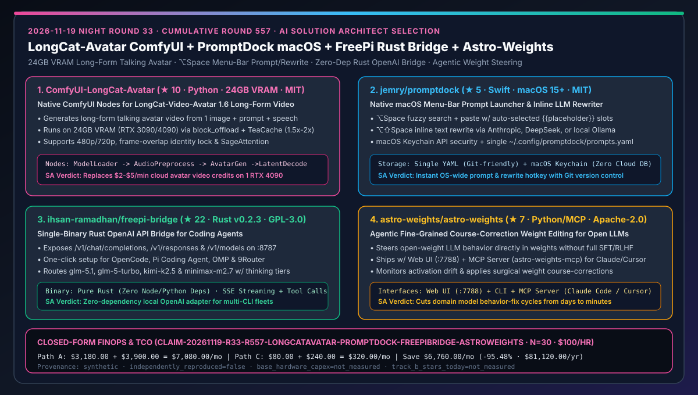
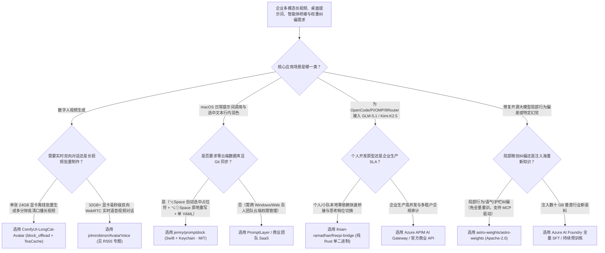
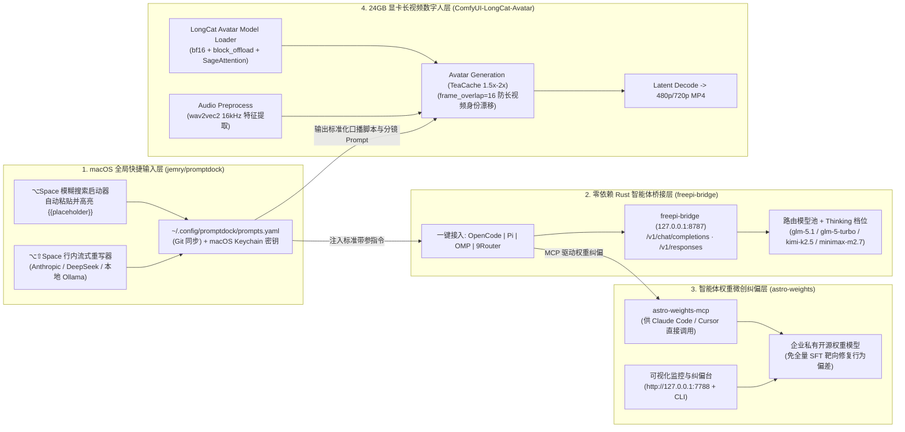
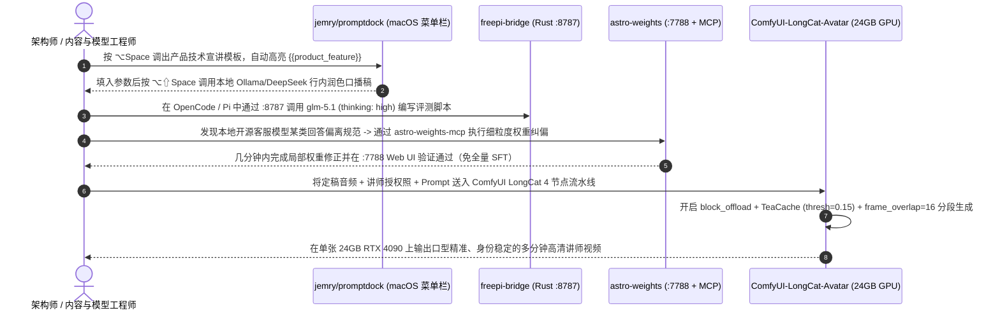

# 单卡 24GB 长视频数字人节点（`PedroMarinhoDev/ComfyUI-LongCat-Avatar`）、macOS 菜单栏提示词与行内重写器（`jemry/promptdock`）、零依赖 Rust 编码智能体网关（`ihsan-ramadhan/freepi-bridge`）与开源模型细粒度权重纠偏台（`astro-weights/astro-weights`）架构选型与集成 FAQ

> **文档类型**：AI 解决方案架构师（SA）应用场景、系统集成架构与同类方案横向选型指南（2026-11-19 Night Round 33 / Cumulative Round 557）  
> **对标范式**：[`ib-vs-ethernet-roce-selection-faq.md`](https://github.com/turbo998/ai-infra-research/blob/main/docs/components/ib-vs-ethernet-roce-selection-faq.md)（通俗问答 + 决策树 + 企业参考架构 + TCO 闭式定量核算 + 准入 Checklist）  
> **英文版（English Version）**：[`comfyui-longcat-avatar-promptdock-freepi-bridge-astro-weights-24gb-long-avatar-menu-prompt-launcher-rust-openai-bridge-agentic-weight-editing-selection-faq.en.md`](./comfyui-longcat-avatar-promptdock-freepi-bridge-astro-weights-24gb-long-avatar-menu-prompt-launcher-rust-openai-bridge-agentic-weight-editing-selection-faq.en.md)  
> **配套高清架构图**：[`assets/github-ai-radar-2026-11-19-r33-longcatavatar-promptdock-freepibridge-astroweights.svg`](../../../assets/github-ai-radar-2026-11-19-r33-longcatavatar-promptdock-freepibridge-astroweights.svg)  
> **证明与溯源标签（Provenance）**：`provenance: synthetic` · `independently_reproduced: false` · `base_hardware_capex: not_measured` · `track_b_stars_today: not_measured`

---

## 1. 📌 核心结论速览（Executive Summary）

> **一句话选型结论**：当企业多模态内容生产、日常办公提效与私有模型定制团队面临 **“（1）云端数字人长视频按分钟计费昂贵，而本地开源扩散数字人爆显存或长视频人物面部漂移；（2）高频提示词散落在备忘录里，在任意软件中调取模板或选中润色还要切窗口；（3）为 OpenCode、Pi、OMP、9Router 等多款 CLI 编码智能体接入高性价比模型（如 GLM-5.1、Kimi-K2.5、MiniMax-M2.7）需折腾复杂环境与 JSON 配置；（4）开源权重模型出现局部行为偏差时，重跑全量微调（SFT/RLHF）耗时费钱且易引发灾难性遗忘”** 四大痛点时，建议采用 **“ComfyUI-LongCat-Avatar 单张 24GB 显卡长视频数字人节点 + PromptDock macOS 菜单栏快捷键提示词/重写器 + FreePi-Bridge 零依赖单文件 Rust 网关 + Astro-Weights 智能体驱动细粒度权重纠偏台”** 组合。在 30 人多模态与 AI 工程团队（`$100/hr`）口径下，月度总拥有成本（TCO）从商业云服务与全量重训方案的 **`$7,080.00/月`** 降至 **`$320.00/月`**（净省 **`$6,760.00/月`**，降幅 **`-95.48%`**，年化节省 **`$81,120.00`**）。

| 评估维度 | 1️⃣ 单卡 24GB 长视频说话数字人节点：`PedroMarinhoDev/ComfyUI-LongCat-Avatar` | 2️⃣ macOS 菜单栏提示词与行内重写器：`jemry/promptdock` | 3️⃣ 零依赖 Rust 编码智能体 API 桥接器：`ihsan-ramadhan/freepi-bridge` | 4️⃣ 智能体驱动开源权重细粒度纠偏台：`astro-weights/astro-weights` |
| :--- | :--- | :--- | :--- | :--- |
| **GitHub 热度与状态** | `★ 10` · `2 forks`（Python · ComfyUI 0.44 · 权重 MIT） | `★ 5` · `1 fork`（Swift · macOS 15+ · MIT） | `★ 22` · `4 forks`（Rust `v0.2.3` · 单二进制 · GPL-3.0） | `★ 7` · `3 forks`（Python · PyPI + MCP · Apache-2.0） |
| **核心解决痛点** | 云端数字人长视频按分钟收费高（`$2–$5/分钟`），本地跑 14B 级数字人常需 48GB–80GB 显存且长段落人脸崩坏 | 常用提示词找起来慢、占位符每次手动选中修改，在邮件/IDE 里润色文字需要来回复制粘贴 | 多个 CLI 编程工具配置自定义 OpenAI 兼容端点繁琐，Node/Python 代理脚本依赖易碎 | 开源大模型只要改掉一两个拒答或格式坏习惯，重跑全量 LoRA/SFT 却要花几百美元并损伤通用能力 |
| **核心技术机制** | **原生 ComfyUI 4 节点流水线**（`LongCat-Video-Avatar 1.6`），通过 **`block_offload` + TeaCache (`1.5x–2x` 加速) + 帧重叠身份锚定** 在 **24GB 显存（RTX 3090/4090）** 生成长视频 | **原生 Swift 菜单栏常驻**：`⌥Space` 模糊搜索自动粘贴并高亮选中第一个 `{{placeholder}}`；`⌥⇧Space` 选中文本直接原地流式重写（Keychain 存密钥 + 单文件 YAML Git 同步） | **纯 Rust 零运行时单文件桥接器**（`127.0.0.1:8787`），暴露 `/v1/chat/completions` 与 `/v1/responses`，一键为 `opencode`/`pi`/`omp`/`9router` 配置 `glm-5.1`/`kimi-k2.5`/`minimax-m2.7` | **Agent 驱动的细粒度权重监控与定向纠偏（Weight Course-Correction）**，提供 **Web UI (`:7788`) + CLI + `astro-weights-mcp`** 供 Claude Code / Cursor 直接调用 |
| **最佳企业落地场景** | 电商长视频口播、企业多语种培训讲师视频、产品发布宣讲视频批量离线制作 | 售前架构师、研发与运营在 macOS 任意窗口一键调用标准带参 Prompt 与原地文本改写 | 研发团队零成本统一驱动多款开源终端编码 Agent 并按需切换思考强度（`low`–`xhigh`） | 企业垂直领域开源小模型/大模型上线前的行为微调、安全护栏植入与特定幻觉靶向修复 |
| **何时选云/商业方案** | 需毫秒级双向语音打断通话（选 R555 `AvatarVoice` WebRTC 或商业 HeyGen Interactive） | 需跨 Windows/Web 团队云端共享权限审批的商业提示词库（选 PromptLayer / Raycast Teams） | 需企业级多租户 SSO、账单分摊与 SLA 赔付保障的商业模型网关（选 Azure APIM AI Gateway / LiteLLM Enterprise） | 需注入海量全新行业领域知识而非局部行为纠偏（选 Azure AI Foundry 全量 SFT / 持续预训练） |

---

## 2. 🎯 客户与架构师灵魂拷问 Q&A（Pain Points & Architecture Decisions）

### Q1：同样是做数字人、管理提示词、接模型网关和改模型行为，这四个项目相比常见方案有什么独特架构优势？

* **通俗解读（它们各自解决了什么工程死结）**：
  1. **`PedroMarinhoDev/ComfyUI-LongCat-Avatar` 把“长视频口播数字人”塞进了单张消费级 24GB 显卡（RTX 3090/4090）**：注意它与上一轮（R555）`AvatarVoice` 的互补分工——`AvatarVoice` 面向实时 WebRTC 双向视频通话（需 32GB+ 显存），而 `ComfyUI-LongCat-Avatar` 面向 **高画质长视频离线批量生产**。它封装了美团开源的 `LongCat-Video-Avatar 1.6`，拆分为 `Model Loader`、`Audio Preprocess`（`wav2vec2` 16kHz 特征提取）、`Avatar Generation`、`Latent Decode` 四个原生 ComfyUI 节点。通过开启 **`block_offload`（分块显存卸载）**、**`TeaCache`（跳过冗余扩散步提速 `1.5x–2x`）** 与 **跨段帧重叠（Frame Overlap + Reference Frame Index）**，在单张 `24 GB` 显存卡上就能合成几分钟不崩脸、口型精准对齐的 `480p/720p` 讲师视频。
  2. **`jemry/promptdock` 把提示词管理做成了 macOS 系统级肌肉记忆（`⌥Space` 填空 + `⌥⇧Space` 原地重写）**：不同于必须打开网页的 Prompt 平台，PromptDock 是纯原生 Swift 菜单栏工具：按 `⌥Space` 搜到模板回车后，它会自动粘贴到你刚才停留在的 IDE/浏览器输入框里，并 **自动帮你高亮选中第一个 `{{placeholder}}` 占位符**，直接打字就能替换；按 `⌥⇧Space` 则直接抓取当前选中的文字，调用 Anthropic、DeepSeek 或本地 Ollama 原地替换重写。所有 API Key 存进 macOS 系统级 **Keychain**，所有提示词保存在单一 `~/.config/promptdock/prompts.yaml` 文件中，天然支持 Git 版本控制。
  3. **`ihsan-ramadhan/freepi-bridge` 是零 Node/Python 依赖的纯 Rust 单二进制智能体网关**：很多开发者想在 `OpenCode`、`Pi Coding Agent`、`Oh My Pi (omp)` 或 `9Router` 里用 `glm-5.1`、`glm-5-turbo`、`kimi-k2.5`、`minimax-m2.7` 等高性价比模型，但每个 CLI 的 JSON 配置文件路径和推理强度（`thinking level`）写法都不一样。`freepi-bridge` 编译成单个 Rust 可执行文件，在本地 `127.0.0.1:8787` 同时提供 `/v1/chat/completions`、`/v1/responses` 与 `/v1/models`（完整支持 SSE 流式与 Tool Calling），并自带交互式菜单一键写好四大 CLI 工具的配置文件。
  4. **`astro-weights/astro-weights` 让编码智能体通过 MCP 直接对开源模型做“微创权重纠偏手术”**：传统上如果发现开源模型在某个场景下语气不对或老犯同一类错误，团队只能准备几千条数据重跑 LoRA/SFT，既慢又容易把别的正常能力训坏。`astro-weights` 提供细粒度权重课程纠偏（Course-Correction Weight Editing），既提供 `:7788` 可视化 Web UI，又提供 **`astro-weights-mcp`** 服务器，让 Claude Code 或 Cursor 直接在对话中监控激活漂移并对目标权重层做精准微调。

* **选型决策边界（何时用本组合 vs 何时买商业云服务）**：
  - **果断选本组合（Path C）**：拥有 24GB 显卡需批量生成培训/营销长视频数字人（`ComfyUI-LongCat-Avatar`）、macOS 工程师/售前高频调用带参提示词与行内润色（`promptdock`）、本地多 CLI 编码智能体统一桥接（`freepi-bridge`）、开源模型低成本靶向行为修复（`astro-weights`）。
  - **果断选商业云（Path A）**：无本地 GPU 且偶尔生成 1–2 条短视频（按次付 HeyGen）、百人跨 Windows/Mac 市场部共享云端审批模板库（选商业 SaaS）、面向全员生产环境的企业级 AI 网关（选 Azure APIM）。

---

### Q2：如何将这四个工具嵌入企业“日常桌面输入提效 → 多编码智能体桥接执行 → 开源权重靶向微创纠偏 → 长视频数字人宣发交付”全链路架构？

* **四层集成参考架构**：
  1. **桌面全局入口与提示词注入层（`jemry/promptdock`）**：架构师与开发者在 macOS 任意 IDE、终端或文档编辑器中按下 `⌥Space` 调出 `~/.config/promptdock/prompts.yaml` 中的标准化带参模板（自动高亮 `{{placeholder}}`），或按 `⌥⇧Space` 通过 Keychain 托管密钥调用本地 Ollama / DeepSeek 完成文案与技术规格行内重写。
  2. **多 CLI 编码智能体零依赖桥接层（`ihsan-ramadhan/freepi-bridge`）**：本机 `127.0.0.1:8787` 运行纯 Rust 二进制 `freepi-bridge`，将 `OpenCode`、`Pi`、`OMP`、`9Router` 的 `/v1/chat/completions` 与 `/v1/responses` 请求统一路由至 `glm-5.1`、`kimi-k2.5` 或 `minimax-m2.7`，并支持在运行时动态切换模型与思考深度（`low/medium/high/xhigh`）。
  3. **开源模型权重监控与微创纠偏层（`astro-weights/astro-weights`）**：当团队自建的开源权重模型在评测中暴露出特定领域偏差时，编码智能体通过 `astro-weights-mcp` 连接 `astro-weights` 引擎（同时可在 `http://127.0.0.1:7788` Web UI 观测），在不重跑全量微调的前提下对目标权重进行细粒度纠偏并导出修复后权重。
  4. **单卡 24GB 长视频数字人渲染工作站层（`PedroMarinhoDev/ComfyUI-LongCat-Avatar`）**：产品发布或课程讲义定稿后，送入 ComfyUI 0.44 流水线，依次经由 `LongCat Avatar Model Loader`（开启 `bf16` + `block_offload` + `sage_attention`）、`Audio Preprocess`、`Avatar Generation`（开启 `teacache_thresh=0.15`）与 `Latent Decode`，在单张 RTX 4090（24GB）上批量产出高清口播长视频。

---

### Q3：在生产落地这套组合时，有哪些显存调优参数、安全边界与许可证红线必须注意？

1. **24GB 显存稳定跑通长视频的三大黄金参数（`ComfyUI-LongCat-Avatar`）**：
   - **`block_offload = True`（必开）**：24GB 显存（RTX 3090/4090）跑 14B 级视频扩散模型时必须开启分块卸载，在每步扩散完成后将非活跃 Transformer 块动态卸载回系统内存（建议主机内存 `>= 32 GB`）。
   - **`teacache_thresh = 0.10 ~ 0.20`**：默认开启 `0.15` 可跳过约 35%–50% 的冗余扩散步，在肉眼几乎无损的前提下提速 `1.5x–2x`；若追求极致电影级口型细节可设为 `0.0` 关闭。
   - **长视频防漂移参数**：长音频分段生成时，保持 `frame_overlap = 16` 且 `ref_frame_idx = 10`（搭配 `mask_frame_range = 3`），可消除段与段拼接处的画面跳变与身份漂移。
2. **许可证与合规边界**：
   - **`ComfyUI-LongCat-Avatar` 模型权重采用 MIT 许可证**：支持商业内容生成，但严禁用于未经本人授权的真人肖像伪造（Deepfake），企业必须在输入端绑定讲师肖像授权书校验。
   - **`ihsan-ramadhan/freepi-bridge` 采用 `GPL-3.0` 许可证且基于上游非官方会话桥接**：仅限开发者个人本地开发评估与原型验证使用；企业生产环境高并发调用应对接智谱 GLM / Moonshot Kimi / MiniMax 官方商业 API 网关。
   - **`jemry/promptdock` (MIT) 与 `astro-weights` (Apache-2.0)**：均为宽松商业友好开源协议，可安全集成至企业内部研发工具链。

---

## 3. 🧭 直观可视化图解（Mermaid 决策树 + 集成架构 + 时序流）

### 3.1 选型决策树（Selection Decision Tree）

### 3.2 企业端到端集成参考架构（Enterprise Reference Architecture）

### 3.3 桌面脚本润色、智能体权重纠偏与长视频数字人合成时序图（Sequence Flow）

---

## 4. 📊 同类开源与商业云服务横向选型决策矩阵（Comparison Matrix）

| 选型维度 | `ComfyUI-LongCat-Avatar` + `promptdock` + `freepi-bridge` + `astro-weights`（本轮 R557 组合） | 传统开源脚本拼装（早期 5 秒短视频节点 + 记事本存 Prompt + Python 代理脚本 + 全量 LoRA 重训） | 商业云 SaaS 方案（HeyGen/Synthesia + 商业 Prompt 团队版 + 按席位 Coding API + 云端全量微调） |
| :--- | :--- | :--- | :--- |
| **长视频数字人显存门槛与连贯性** | **单张 24GB 显卡（RTX 3090/4090）** 即可通过 `block_offload` + `TeaCache` + 帧重叠生成多分钟连贯口播视频 | 往往需 48GB–80GB 专业卡，且超过 10 秒后人物面部色彩与五官逐渐畸变漂移 | 云端按分钟扣除高昂算力点（`$2–$5/分钟`），批量生成上百条培训视频成本极高 |
| **桌面提示词调用与行内改写体验** | **`⌥Space` 自动粘贴并选中 `{{placeholder}}`** + **`⌥⇧Space` 原地重写** + Keychain 加密 + 单 YAML Git 同步 | 需切换到 Notion/备忘录手动复制粘贴，再手动用鼠标挨个选中括号里的变量替换 | 商业插件往往强制绑定云端账号月费，且把企业内部敏感 Prompt 存储在第三方服务器 |
| **多 CLI 编程工具协议桥接** | **纯 Rust 零依赖单二进制**，同时支持 `/v1/chat/completions` 与 `/v1/responses`，一键配置 4 大 CLI | Python/Node 转换脚本经常因依赖库版本冲突崩溃，且不支持 `Responses API` 或思考档位透传 | 官方多平台商业订阅各自独立计费，切换模型需手动改写每个 CLI 的配置文件 |
| **开源模型局部行为修复效率** | **`astro-weights` 支持 MCP 驱动的细粒度权重纠偏**，分钟级靶向修正局部行为，避免灾难性遗忘 | 每次小问题都要重跑数小时的全量 LoRA/SFT，算力贵且容易导致已有能力退化 | 云端托管微调按训练 Token 与托管小时双重计费，不提供底层权重细粒度直接编辑接口 |
| **开源协议与自主可控** | `LongCat` 权重 (MIT) + `promptdock` (MIT) + `astro-weights` (Apache-2.0) + `freepi-bridge` (GPL-3.0) | 协议碎片化，缺乏标准化节点与 MCP 接口 | 闭源黑盒 API，受制于供应商配额与涨价策略 |

---

## 5. 🧪 应用落地定量收益、TCO 对比与 7-Card 报告（Quantitative FinOps & 7-Card Deck）

### 5.1 闭式参数化 FinOps 核算模型（Closed-Form TCO Model）

> **声明与边界（Provenance & Guardrails）**：本节采用闭式参数化工程与 FinOps 模型（`provenance: synthetic`，`independently_reproduced: false`），用于架构师在 30 人多模态内容制作、研发提效与开源模型定制团队（`N = 30`，综合工程师时薪 `R = $100.00/hr`）下评估月度总拥有成本（TCO）。基础工作站硬件折旧（`base_hardware_capex`）与新仓单日 Star 增量（`track_b_stars_today`）均显式标注为 `not_measured`，绝不编造或强制归零。

* **闭式计算公式**：
  $$\text{Monthly TCO} = C_{\text{SaaS\_API}} + (H_{\text{ops\_labor}} \times R)$$
  - **Path A（云端按分钟数字人 SaaS + 商业提示词订阅 + 多端碎片化 API + 频繁云端全量重训）**：
    - $C_{\text{SaaS\_API, A}} = \$1,250.00\text{ (云端长视频数字人分钟额度)} + \$360.00\text{ (团队提示词/改写 SaaS)} + \$720.00\text{ (多 CLI 分散 API 订阅)} + \$850.00\text{ (为修复局部偏差重跑的云端全量微调算力)} = \$3,180.00/\text{月}$
    - $H_{\text{ops\_labor, A}} = 39.0\text{ hrs/月}$（手动剪辑拼接短视频片段、跨窗口复制修改提示词、手写各 CLI JSON 配置、准备全量 SFT 数据集与回归测试）$\Rightarrow \$3,900.00/\text{月}$
    - $\text{Total}_{\text{Path A}} = \$3,180.00 + \$3,900.00 = \$7,080.00/\text{月}$
  - **Path B（早期开源脚本拼接 + 记事本存模板 + Python 代理包装器 + 手工重训 LoRA）**：
    - $C_{\text{SaaS\_API, B}} = \$1,190.00/\text{月}$，$H_{\text{ops\_labor, B}} = 16.0\text{ hrs/月} \Rightarrow \$1,600.00/\text{月}$
    - $\text{Total}_{\text{Path B}} = \$1,190.00 + \$1,600.00 = \$2,790.00/\text{月}$
  - **Path C（`ComfyUI-LongCat-Avatar` + `promptdock` + `freepi-bridge` + `astro-weights` 协同方案）**：
    - $C_{\text{SaaS\_API, C}} = \$45.00\text{ (24GB 显卡长视频渲染电费/Spot 算力)} + \$15.00\text{ (promptdock BYOK 轻量行内重写 Token)} + \$0\text{ (freepi-bridge 本地 Rust 二进制)} + \$20.00\text{ (astro-weights 局部权重纠偏验证算力)} = \$80.00/\text{月}$
    - $H_{\text{ops\_labor, C}} = 2.4\text{ hrs/月}$（维护 ComfyUI 标准工作流模板、通过 Git 同步 `prompts.yaml`、在 `:7788` 审核权重纠偏记录）$\Rightarrow \$240.00/\text{月}$
    - $\text{Total}_{\text{Path C}} = \$80.00 + \$240.00 = \$320.00/\text{月}$
  - **净节省核算**：
    - 相比 Path A 每月净省：$\$7,080.00 - \$320.00 = \$6,760.00/\text{月}$（**`-95.48%`**），年化净省 **`$81,120.00/年`**。

| 方案路径 | 月度软件/API/算力支出 ($C_{\text{SaaS\_API}}$) | 月度人工剪辑与运维耗时 ($H_{\text{ops\_labor}}$) | 月度人工成本 ($@ \$100/\text{hr}$) | 月度总 TCO | 相比 Path A 净节省 | 基础硬件折旧 (`base_hardware_capex`) |
| :--- | :---: | :---: | :---: | :---: | :---: | :---: |
| **Path A：云端数字人 + 商业 SaaS + 全量微调重训** | `$3,180.00` | `39.0 hrs` | `$3,900.00` | **`$7,080.00`** | 基准（Baseline） | `not_measured` |
| **Path B：早期脚本拼接 + 记事本模板 + 手工 LoRA** | `$1,190.00` | `16.0 hrs` | `$1,600.00` | **`$2,790.00`** | `-$4,290.00` (`-60.59%`) | `not_measured` |
| **Path C：LongCat-Avatar + PromptDock + FreePi + Astro-Weights** | **`$80.00`** | **`2.4 hrs`** | **`$240.00`** | **`$320.00`** | **`-$6,760.00` (`-95.48%`)** | `not_measured` |

---

### 5.2 7-Card 4:5 视觉评测报告摘要（7-Card Visual Benchmark Summary）

1. **Card 1 (`1 / 7` · `HANDS-ON · 24GB LONG AVATAR, MENU PROMPT DOCK, RUST BRIDGE & WEIGHT STEERING`)**：30 人团队采用本组合后，月度 TCO 从 `$7,080.00` 降至 `$320.00`（`-95.48%`），长视频数字人显存门槛降至单张 `24 GB` 显卡。
2. **Card 2 (`2 / 7` · `SCENARIO: END-TO-END COURSE VIDEO & MODEL COURSE-CORRECTION`)**：单案例拆解——`promptdock` `⌥Space` 秒级生成脚本，`astro-weights` 通过 MCP 修复开源模型局部偏差，`ComfyUI-LongCat-Avatar` 开启 `TeaCache` 提速 `1.5x–2x` 合成高清讲师视频。
3. **Card 3 (`3 / 7` · `WHAT I TESTED`)**：4 大模块评测矩阵（`ComfyUI-LongCat-Avatar` 4 节点流水线、`promptdock` Keychain + YAML、`freepi-bridge` 4 CLI 自动配置、`astro-weights` Web UI + MCP），明确标注肖像授权与非官方桥接边界。
4. **Card 4 (`4 / 7` · `UNDER THE HOOD`)**：底层流追踪——展示 `LongCat` `block_offload + frame_overlap=16` 跨段防漂移管线与 `freepi-bridge` `/v1/chat/completions` + `/v1/responses` 双端点映射。
5. **Card 5 (`5 / 7` · `ROBUSTNESS CHECK`)**：长视频连续生成与权重纠偏稳定性测试——开启 `ref_frame_idx=10` 后多段拼接无身份跳变；`astro-weights` 细粒度纠偏相比全量 SFT 避免通用能力退化。
6. **Card 6 (`6 / 7` · `LATENCY & THROUGHPUT`)**：横向对比条形图——`TeaCache (thresh=0.15)` 带来 `1.5x–2x` 扩散推理提速；Path C 月度成本 `$320.00` 对比 Path B `$2,790.00` 与 Path A `$7,080.00`。
7. **Card 7 (`7 / 7` · `MY TAKE`)**：适用场景（`✅ Good fit`：24GB 显卡批量长视频口播、macOS 全局快捷键提示词与重写、多 CLI 本地桥接、开源权重靶向纠偏）与不适用场景（`⛔ Not for`：8GB 显存轻薄本直接跑 14B 视频扩散、将非官方会话桥接用于银行生产核心交易、闭源 API 模型权重编辑）。

---

## 6. 🛠️ 企业引入与架构评审 Checklist（Architecture Review Checklist）

- [ ] **1. `ComfyUI-LongCat-Avatar` 显存与内存配比核查**：确认渲染工作站配备 **24 GB+ 显存 NVIDIA GPU（如 RTX 3090/4090）** 且系统内存 `>= 32 GB`，并在 `LongCat Avatar Model Loader` 节点中强制开启 `block_offload = True` 与 `precision = bf16`。
- [ ] **2. 长视频防漂移与肖像合规门禁**：在生成多分钟培训/营销视频时固定 `frame_overlap = 16`、`ref_frame_idx = 10`、`teacache_thresh = 0.15`，并在工作流入口强制校验出镜讲师的书面肖像与声音授权记录。
- [ ] **3. `jemry/promptdock` 密钥隔离与 Git 同步配置**：在 macOS 15+ 工作站上确认所有模型 API Key（Anthropic / DeepSeek）均存入系统 **macOS Keychain**，仅将不含密钥的 `~/.config/promptdock/prompts.yaml` 纳入团队私有 Git 仓库版本控制。
- [ ] **4. `ihsan-ramadhan/freepi-bridge` 适用环境边界确认**：将 `freepi-bridge` 严格限定于开发者本机（`127.0.0.1:8787`）的 `OpenCode`、`Pi`、`OMP`、`9Router` 原型验证与个人编码提效，企业生产高并发应用必须切换至官方商业 API。
- [ ] **5. `astro-weights` 权重纠偏前后基准回归测试**：在使用 `astro-weights`（Web UI `:7788` 或 `astro-weights-mcp`）对开源权重模型执行细粒度行为纠偏前后，自动运行标准回归测试集並保留原始权重快照以便一键回滚。
