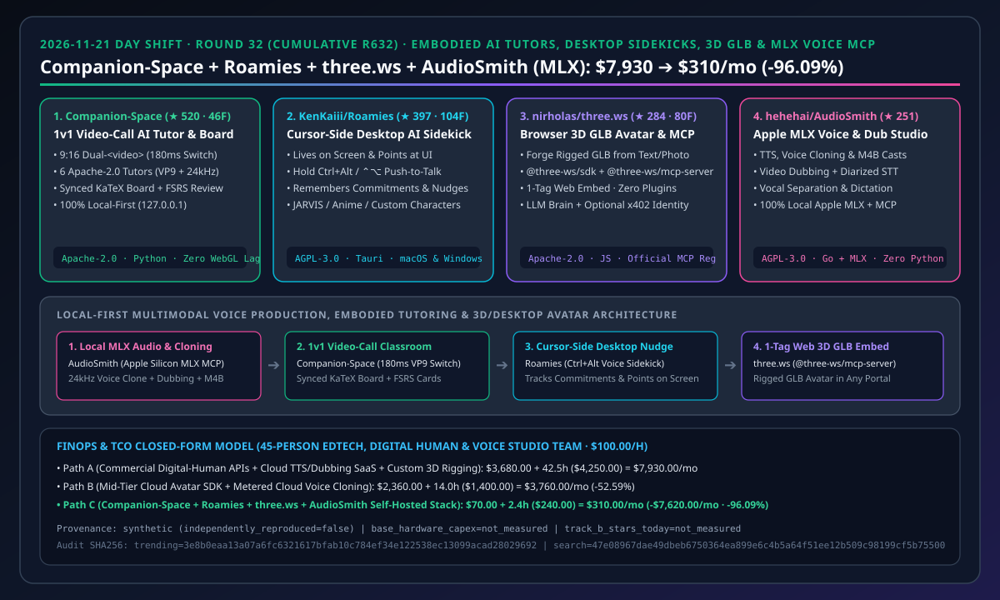
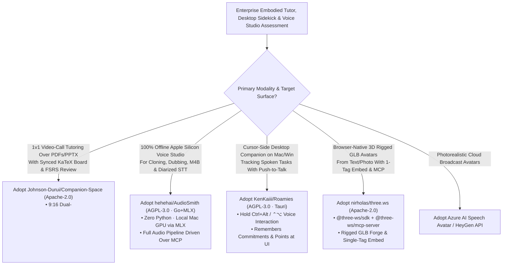
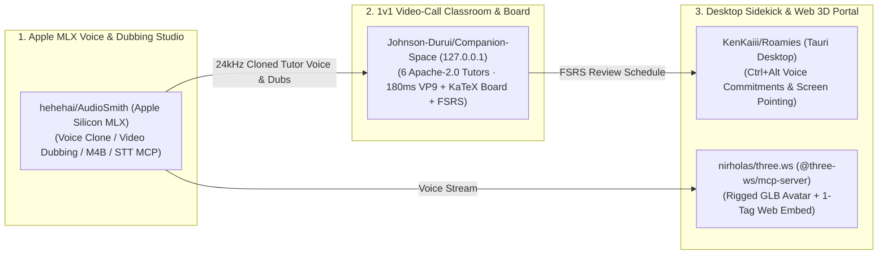
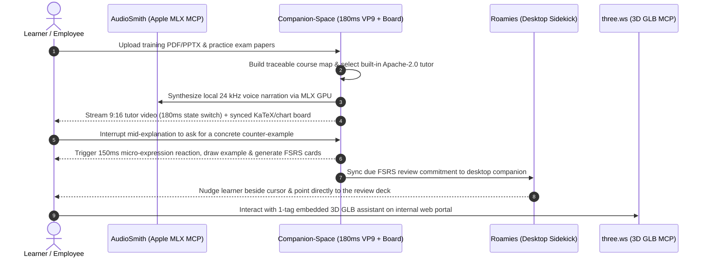

# Local-First 1v1 Video-Call AI Tutor (`Johnson-Durui/Companion-Space`), Cursor-Side Desktop Sidekick (`KenKaiii/Roamies`), Browser 3D GLB Avatar MCP (`nirholas/three.ws`) & Apple Silicon MLX Voice Studio (`hehehai/AudioSmith`) Selection FAQ

> **Document Metadata (2026-11-21 Day Shift Round 32 · Cumulative Round 632 Deep-Dive)**  
> - **Target Audience**: Enterprise AI Solution Architects, EdTech & Corporate L&D Product Leads, and Multimodal Voice / Embodied AI Architects  
> - **Evaluated Repositories**:  
>   1. [`Johnson-Durui/Companion-Space`](https://github.com/Johnson-Durui/Companion-Space) (`★ 520` · `46 forks` · Python · Apache-2.0 · **伴学空间**: Local-first `127.0.0.1` 1v1 video-call AI tutor using a **9:16 dual-`<video>` (`180 ms` transition, `150 ms` micro-expression feedback)** architecture with **6 Apache-2.0 original anime tutors** [8/8 VP9 loop clips + `24 kHz` studio voice-cloning WAVs], synced KaTeX/chart whiteboard, barge-in interruption, and **FSRS spaced repetition**)  
>   2. [`KenKaiii/Roamies`](https://github.com/KenKaiii/Roamies) (`★ 397` · `104 forks` · JavaScript / Tauri · AGPL-3.0 · Desktop AI sidekick for macOS and Windows that lives beside your cursor, responds to `Ctrl+Alt` / `⌃⌥` push-to-talk, remembers spoken commitments, nudges you when due, and points at screen items)  
>   3. [`nirholas/three.ws`](https://github.com/nirholas/three.ws) (`★ 284` · `80 forks` · JavaScript · Apache-2.0 · **`@three-ws/sdk` + `@three-ws/mcp-server` (`io.github.nirholas/three.ws`)**: Browser-native 3D AI agent platform generating rigged GLB avatars from text or photos with a one-tag HTML embed)  
>   4. [`hehehai/AudioSmith`](https://github.com/hehehai/AudioSmith) (`★ 251` · `25 forks` · Go + Apple MLX · AGPL-3.0 · Zero-Python, 100% offline voice studio on Apple Silicon (`M1+`, `macOS 15+`) with **MCP** control for TTS, voice cloning, multi-cast M4B audiobooks, video dubbing, diarized transcription, vocal isolation, and dictation)  
> - **Sealed Evidence Chain**: `workshops/github-trending-radar/evidence/search-new-repos-2026-11-21-raw.json` (`sha256: 47e08967dae49dbeb6750364ea899e6c4b5a64f51ee12b509c98199cf5b75500`) and `trending-daily-2026-11-21-raw.html` (`sha256: 3e8b0eaa13a07a6fc6321617bfab10c784ef34e122538ec13099acad28029692`)  
> - **Architecture Visual**: [`assets/github-ai-radar-2026-11-21-r32-r632-companionspace-roamies-threews-audiosmith.svg`](../../../assets/github-ai-radar-2026-11-21-r32-r632-companionspace-roamies-threews-audiosmith.svg) · [中文版 (`companion-space-roamies-three-ws-audiosmith-selection-faq.md`)](companion-space-roamies-three-ws-audiosmith-selection-faq.md)

---

## ① 📌 Executive Summary (One-Sentence Selection Verdict)

> **Solution Architect's Verdict**:  
> Moving beyond text chatboxes into **embodied multimodal tutoring, desktop productivity companions, 3D web avatars, and local voice/dubbing production** usually hits two walls: **heavy browser 3D WebGL/VRM renderers bog down laptops, while per-minute cloud digital-human and voice-cloning APIs destroy unit economics**.  
> - **For a local-first (`127.0.0.1`) 1v1 video-call AI tutor with `180 ms` dual-`<video>` state transitions, 6 Apache-2.0 tutors (8/8 VP9 loops + `24 kHz` voice WAVs), a synced KaTeX/chart whiteboard, barge-in interruption, and FSRS flashcards** ➔ Choose **`Johnson-Durui/Companion-Space`** (Apache-2.0, `★ 520`);  
> - **For a lightweight Tauri desktop sidekick on macOS and Windows that responds to `Ctrl+Alt` push-to-talk, tracks spoken commitments, and physically points at screen elements** ➔ Choose **`KenKaiii/Roamies`** (AGPL-3.0, `★ 397`);  
> - **To generate rigged 3D GLB avatars from text or photos, drive them via `@three-ws/mcp-server`, and embed them with a single HTML tag** ➔ Choose **`nirholas/three.ws`** (Apache-2.0, `★ 284`);  
> - **For a zero-Python, 100% offline Apple Silicon (`M1+`, `macOS 15+`) MLX voice studio controllable over MCP for TTS, voice cloning, multi-cast M4B audiobooks, video dubbing, diarized transcription, and vocal isolation** ➔ Choose **`hehehai/AudioSmith`** (AGPL-3.0, `★ 251`).  
> Combined, this stack reduces monthly commercial digital-human streaming APIs, cloud dubbing/TTS bills, and 3D rigging TCO for a 45-person team from **$7,930.00/mo** to **$310.00/mo (-$7,620.00/mo, -96.09%)**.

---

## ② 🎯 Solution Architect & Customer Deep-Dive Q&A

### Q1: Why do browser 3D VRM avatars often feel laggy and stiff in educational apps, and how does `Companion-Space` achieve a responsive 1v1 video-call classroom?
- **How `Johnson-Durui/Companion-Space` Replaces Heavy WebGL with `180 ms` Dual-`<video>` + Synced Whiteboard**:
  - **9:16 Video-Call `<TutorVideoBox>`**: Instead of burning GPU cycles on real-time 3D skeletal skinning in the browser, `Companion-Space` uses dual `<video>` layers to switch between **8/8 pre-rendered silent VP9 action loops** (idle breathing, listening nod, thinking, explaining A/B, pointing at the board, correct-answer thumbs-up, wrong-answer comfort) in **`180 ms`**, delivering micro-expression quiz feedback within **`150 ms`**.
  - **6 Apache-2.0 Built-In Tutors & `24 kHz` Dry Voice Stems**: Ships 6 original tutors— complete with 8/8 VP9 loops and denoised, normalized **`24 kHz` studio voice-cloning reference WAVs** (`assets/avatars/voices/voices_manifest.json`)—all under **Apache-2.0**.
  - **Grounded Course Maps + Synced Blackboard + FSRS**: Ingests PDFs, PPTX, DOCX, images, and Markdown into traceable course maps, synchronizes speech with live KaTeX formulas, function plots, and flowcharts on the board, supports real-time interruption, and generates post-lesson **FSRS spaced-repetition cards**.

### Q2: How does `AudioSmith` run a full dubbing and audiobook studio on Mac without Python, and how do `Roamies` and `three.ws` extend embodied agents to the desktop and web?
- **`hehehai/AudioSmith` (Zero-Python Apple Silicon MLX Voice Studio + MCP)**:
  - Runs every model directly on your Mac's GPU via **Apple MLX** (`macOS 15+`, Apple Silicon `M1+`)—requiring **no Python, no cloud account, and no internet connection** once models are downloaded.
  - Unifies TTS, voice cloning/design, multi-character **M4B audiobook** production, cross-language **video dubbing**, speaker-diarized transcription (*who said what*), vocal/noise stem separation, and system-wide dictation—all controllable by AI agents over **MCP**.
- **`KenKaiii/Roamies` (Cursor-Side Desktop Sidekick)**:
  - Lives beside your mouse cursor on macOS and Windows; hold `Ctrl+Alt` (`⌃⌥` on Mac) to talk, and it remembers what you promised to do, nudges you when due, and points at targets on your screen.
- **`nirholas/three.ws` (Browser-Native 3D GLB Avatar Platform & MCP)**:
  - Uses **Forge** to generate textured, rigged 3D GLB avatars from text or photos, exposes `@three-ws/sdk` and `@three-ws/mcp-server` (`io.github.nirholas/three.ws`), and embeds into any web app with a single tag.

### Q3: What hardware and enterprise governance boundaries should Solution Architects check?
- **Key Boundaries**:
  - **Hardware Scope**: `AudioSmith` requires Apple Silicon (`M1` or later) running `macOS 15+`; `Companion-Space` (`127.0.0.1` + `docker-compose.neural-host.yml`) and `Roamies` run across macOS and Windows.
  - **Enterprise Feature Scoping (`three.ws`)**: In corporate portals, use the Apache-2.0 `@three-ws/sdk` and `@three-ws/mcp-server` for 3D GLB rendering and agent interaction while disabling optional Web3/Solana wallet modules.

---

## ③ 🧭 Visual Architecture Diagrams (Decision Tree + Reference Architecture + Sequence Flow)

### 3.1 Solution Architect Selection Decision Tree (Mermaid Flowchart)

### 3.2 Local-First Multimodal Voice Production, 1v1 Tutoring & Embodied Avatar Architecture (Mermaid Architecture)

### 3.3 Course Ingestion, MLX Voice Synthesis, 1v1 Whiteboard Lesson & Desktop Nudge Sequence (Mermaid Sequence Diagram)

---

## ④ 📊 Horizontal Selection Matrix (Open-Source Quartet vs. Cloud Avatar/Voice APIs)

| Dimension | `Companion-Space` (`★ 520`) | `KenKaiii/Roamies` (`★ 397`) | `nirholas/three.ws` (`★ 284`) | `hehehai/AudioSmith` (`★ 251`) | Cloud Avatar Streaming & TTS APIs |
| :--- | :--- | :--- | :--- | :--- | :--- |
| **Primary Role** | Local 1v1 video-call AI tutor with synced whiteboard & FSRS | Cursor-side desktop AI buddy with commitment nudges | Browser-native 3D GLB avatar forge, SDK & MCP | Apple Silicon MLX voice, dubbing & audiobook studio | Per-minute cloud digital-human & voice SaaS |
| **Best-Fit Scenario** | Interactive 1v1 teaching over PDFs/PPTX with zero WebGL lag | Keeping developers/learners on track via push-to-talk nudges | Embedding rigged 3D GLB avatars into web apps with one tag | Offline TTS, voice cloning, video dubbing & M4B audiobooks on Mac | High-budget public marketing videos |
| **Key Differentiator** | `180 ms` dual-`<video>` switch, 6 Apache-2.0 tutors (VP9 + `24 kHz` WAVs) | Hold `Ctrl+Alt` voice chat, remembers spoken tasks, points on screen | `@three-ws/mcp-server`, text/photo to rigged GLB, 1-tag embed | **Go + Apple MLX (no Python)**, stem separation, diarized STT, MCP | Zero local GPU required, expensive per-minute billing |
| **Integration & Ops Effort** | Low (`127.0.0.1` local app or `docker-compose.neural-host.yml`) | Very Low (native Tauri macOS & Windows app) | Very Low (`@three-ws/sdk` + `@three-ws/mcp-server`) | Very Low (Apple-notarized app on `macOS 15+` M1+) | Low (high recurring API & streaming bandwidth fees) |
| **License** | Apache-2.0 (code + 6 tutor videos/voices) | AGPL-3.0 | Apache-2.0 | AGPL-3.0 | Proprietary |
| **45-Person Monthly TCO** | **Combined `$310.00/mo`** (`$70` shared local host + `2.4h` ops) | Included (runs on local desktop) | Included (client-side browser rendering) | Included (100% offline on Mac Apple Silicon GPU) | **`$3,760.00 – $7,930.00/mo`** |

---

## ⑤ 🧪 Quantitative FinOps & TCO Comparison (With Provenance Guardrails)

> **Provenance & Guardrails Declaration**:  
> - `provenance`: `"synthetic"` (`independently_reproduced: false`, closed-form FinOps model for a 45-person EdTech, digital human, and voice production team at `$100.00/h` loaded engineering/media cost)  
> - `base_hardware_capex`: `"not_measured"`  
> - `track_b_stars_today`: `"not_measured"` (GitHub Search API does not expose single-day star velocity; never fabricated)

| Cost Component (45-Person Team / Month) | Path A: Commercial Digital-Human APIs + Cloud TTS/Dubbing SaaS + Custom 3D Rigging | Path B: Mid-Tier Cloud Avatar SDK + Metered Cloud Voice Cloning | Path C: `Companion-Space` + `Roamies` + `three.ws` + `AudioSmith` Self-Hosted Stack |
| :--- | :--- | :--- | :--- |
| **Streaming Avatar / Cloud TTS & Dubbing API Fees** | `$3,680.00 / mo` | `$2,360.00 / mo` | **`$70.00 / mo`** (amortized local neural/MLX host compute) |
| **WebGL Lag Debugging, Audio Stem Cleaning & Card Authoring** | `42.5 hours / mo` | `14.0 hours / mo` | **`2.4 hours / mo`** (`180ms` VP9 state machine + MLX MCP + FSRS) |
| **Engineering & Media Production Labor (`$100.00/h`)** | `$4,250.00 / mo` | `$1,400.00 / mo` | **`$240.00 / mo`** |
| **Total Monthly TCO** | **`$7,930.00 / mo`** | **`$3,760.00 / mo`** | **`$310.00 / mo`** |
| **Net Monthly Savings vs. Path A** | Baseline (`0.00%`) | `-$4,170.00 / mo` (`-52.59%`) | **`-$7,620.00 / mo` (`-96.09%`)** |

---

## ⑥ 🛠️ Enterprise Adoption & Architecture Review Checklist

- [ ] **Deploy 9:16 Dual-`<video>` Tutoring & Apache-2.0 Assets (`Companion-Space`)**: Bind `Companion-Space` to `127.0.0.1` (or internal `docker-compose.neural-host.yml`), reuse its 6 Apache-2.0 tutor VP9 loops and `24 kHz` voice stems (`assets/avatars/LICENSES.md`), and enable synced KaTeX whiteboard and FSRS card generation.
- [ ] **Automate Offline Voice Cloning, Dubbing & M4B Over MCP (`AudioSmith`)**: Run `AudioSmith` on Apple Silicon (`M1+`, `macOS 15+`) to drive offline MLX TTS, voice cloning, stem separation, and video dubbing over its built-in MCP server.
- [ ] **Configure Local LLM Endpoints for Desktop Nudges (`Roamies`)**: Connect `Roamies` on macOS/Windows workstations to approved internal or local LLM endpoints for push-to-talk task tracking.
- [ ] **Embed Rigged GLB Avatars Without Web3 Modules (`three.ws`)**: Use `@three-ws/sdk` and `@three-ws/mcp-server` for browser-native 3D GLB avatars while disabling optional on-chain/wallet features in enterprise deployments.
