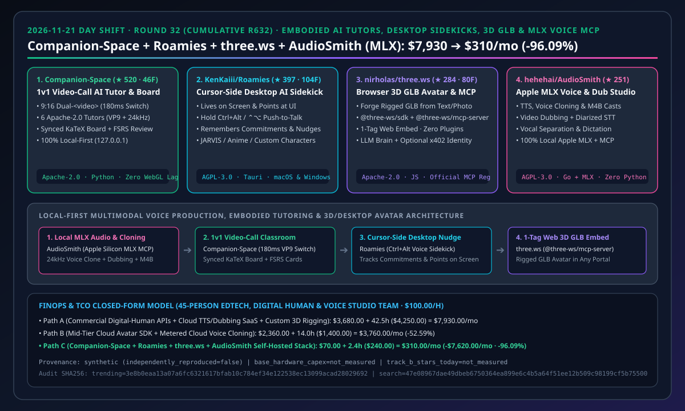
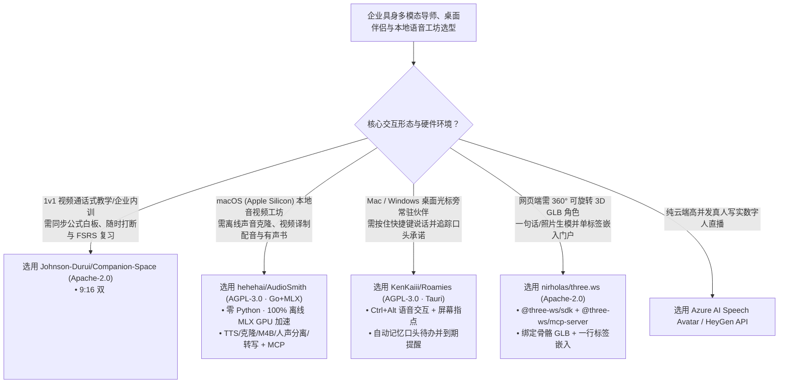
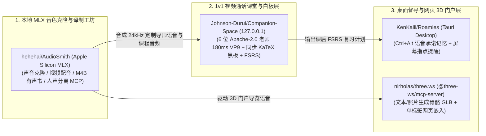
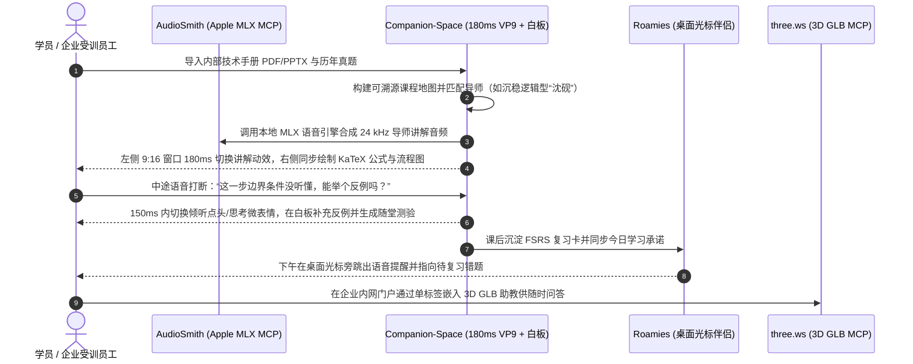

# 视频通话式 1v1 二次元伴学导师（`Johnson-Durui/Companion-Space`）、屏幕光标伴侣（`KenKaiii/Roamies`）、单标签网页 3D 数字人平台（`nirholas/three.ws`）与 Apple MLX 纯本地语音及配音工作站（`hehehai/AudioSmith`）选型 FAQ

> **文档元数据（2026-11-21 白班 Day Round 32 · 累计第 632 轮深潜专题）**  
> - **面向对象**：企业 AI 解决方案架构师（AI Solution Architect）、在线教育/企业培训产品负责人、多模态音视频与具身交互架构师  
> - **本轮核心评估对象**：  
>   1. [`Johnson-Durui/Companion-Space`](https://github.com/Johnson-Durui/Companion-Space)（`★ 520` · `46 forks` · Python · Apache-2.0 · **伴学空间**：本地优先 `127.0.0.1` 的视频通话式 1v1 AI 导师，采用 `180 ms` 双 `<video>` 无缝切换替代重型 WebGL，内置 6 位 Apache-2.0 原创二次元老师 [8/8 VP9 动效 + 24 kHz 干声]、同步 KaTeX 黑板与 FSRS 间隔重复复习）  
>   2. [`KenKaiii/Roamies`](https://github.com/KenKaiii/Roamies)（`★ 397` · `104 forks` · JavaScript / Tauri · AGPL-3.0 · 住在 Mac 与 Windows 桌面光标旁的具身 AI 伙伴，按住 `Ctrl+Alt` / `⌃⌥` 语音对话，自动记住你口头承诺的待办事项、到期提醒并在屏幕上直接指点目标）  
>   3. [`nirholas/three.ws`](https://github.com/nirholas/three.ws)（`★ 284` · `80 forks` · JavaScript · Apache-2.0 · **`@three-ws/sdk` + `@three-ws/mcp-server`**：浏览器原生 3D 智能体平台，支持从文本或照片通过 Forge 生成绑定骨骼的 GLB 3D 形象、挂载 LLM 大脑并通过单标签嵌入任意网页）  
>   4. [`hehehai/AudioSmith`](https://github.com/hehehai/AudioSmith)（`★ 251` · `25 forks` · Go + Apple MLX · AGPL-3.0 · 运行在 Apple Silicon Mac 上的零 Python、100% 离线语音与配音工作站，集成语音合成、声音克隆、多角色有声书 M4B、视频多语种译制配音、说话人分离转写、人声伴奏分离与 **MCP 接口**）  
> - **关联检索证据链**：`workshops/github-trending-radar/evidence/search-new-repos-2026-11-21-raw.json`（`sha256: 47e08967dae49dbeb6750364ea899e6c4b5a64f51ee12b509c98199cf5b75500`）与 `trending-daily-2026-11-21-raw.html`（`sha256: 3e8b0eaa13a07a6fc6321617bfab10c784ef34e122538ec13099acad28029692`）  
> - **高清架构图**：[`assets/github-ai-radar-2026-11-21-r32-r632-companionspace-roamies-threews-audiosmith.svg`](../../../assets/github-ai-radar-2026-11-21-r32-r632-companionspace-roamies-threews-audiosmith.svg) · [English Version (`companion-space-roamies-three-ws-audiosmith-selection-faq.en.md`)](companion-space-roamies-three-ws-audiosmith-selection-faq.en.md)

---

## ① 📌 核心结论速览（选型一句话结论）

> **架构师一句话选型结论**：  
> 当企业想把枯燥的聊天框升级为 **“有形象、有声音、有黑板、能指屏幕”的具身多模态交互（1v1 实训导师、桌面效率督导、3D 门户导览、本地多语种视频配音）** 时，最怕踩进两个大坑：**一是网页端塞入重型 3D WebGL/VRM 模型导致轻薄本风扇狂转掉帧，二是按分钟计费的商业数字人流媒体与云端声音克隆 API 把毛利吃光**。  
> - **需要“零 3D WebGL 显卡负担、像打微信视频电话一样流畅（`180 ms` 切动作、`150 ms` 判题微表情反馈）+ 边讲边写同步白板 + 随时打断追问 + FSRS 复习卡”的 1v1 培训/伴学系统** ➔ 选 **`Johnson-Durui/Companion-Space`**（Apache-2.0，自带 6 位全开源老师资产）；  
> - **需要在 Mac/Windows 桌面光标旁常驻一个按住 `Ctrl+Alt` 就能说话、记住你口头承诺并指着屏幕提醒你的轻量伙伴** ➔ 选 **`KenKaiii/Roamies`**（AGPL-3.0，Tauri）；  
> - **需要从一句话或一张照片生成绑定骨骼的 3D GLB 形象、通过单行 HTML 标签嵌入企业门户并通过 `@three-ws/mcp-server` 操控** ➔ 选 **`nirholas/three.ws`**（Apache-2.0）；  
> - **需要在 Apple Silicon Mac 上零 Python、100% 离线利用 MLX GPU 完成声音克隆、多角色 M4B 有声书、视频多语种译制配音与人声分离，并由 Agent 通过 MCP 统一调度** ➔ 选 **`hehehai/AudioSmith`**（AGPL-3.0）。  
> 四者组合可将 45 人教育科技、数字人与音视频内容团队的商业流媒体数字人 API、云端配音账单与 3D 调优总成本从 **$7,930.00/月** 降至 **$310.00/月（节省 $7,620.00/月，降幅 96.09%）**。

---

## ② 🎯 客户与架构师灵魂拷问 Q&A（业务痛点 · 架构集成 · 边界取舍）

### Q1：为什么大多数“浏览器 3D 数字人私教”用起来既卡顿又像木偶？`Companion-Space` 的“9:16 双 `<video>` 180ms 切换 + 同步白板”在工程架构上聪明在哪里？
- **浏览器 3D VRM 数字人的三大痛点**：
  1. **核显笔记本吃不消**：WebGL 实时骨骼蒙皮渲染占满 GPU，页面滚动都掉帧。
  2. **只有一张嘴在动，没有教学黑板**：老师光说话不写板书，理工科公式（KaTeX）、函数图像和流程图根本讲不明白。
  3. **形象与干声版权不透明**：很多开源项目随便抓网图，企业根本不敢商用。
- **`Johnson-Durui/Companion-Space` 的工程巧思**：
  - **9:16 竖屏双 `<video>` 状态机（`<TutorVideoBox>`）**：彻底抛弃重型 3D 渲染器，每位导师预置 **8/8 完整静音 VP9 动作循环短片包**（待机呼吸、倾听点头、托腮思考、讲解 A/B、指向白板、答对点赞、答错安抚），通过双 `<video>` 图层实现 **`180 ms` 无缝切换动作**，随堂测验判题对错后 **`150 ms` 内立即给出微表情反馈**。
  - **6 位全开源（Apache-2.0）导师 + 24 kHz 棚录干声**：雪川、沈砚、岚玥、初棠、青衡、澜音六位老师的动效视频与降噪归一化的 `24 kHz` 声音克隆参考 WAV（`assets/avatars/voices/voices_manifest.json`）全部以 **Apache-2.0** 开源，企业可放心二创商用。
  - **教材溯源 + 同步黑板 + 随时打断 + FSRS 记忆算法**：支持导入 PDF/PPTX/DOCX/Markdown 生成课程地图，语音与右侧 KaTeX 公式、函数图像、流程图实时同步上板；学员听不懂可随时打断追问，课后自动生成 **FSRS 间隔重复复习卡**。

### Q2：如何在不装复杂 Python 依赖的情况下，在本地生产多语种译制视频和克隆音色？又如何把具身交互延伸到桌面光标和 3D 网页？`AudioSmith`、`Roamies` 与 `three.ws` 如何协同？
- **`hehehai/AudioSmith`（零 Python、基于 Apple MLX 的全能语音工作室 + MCP）**：
  - 专为 Apple Silicon（M1+，`macOS 15+`）打造，底层直接基于 Apple **MLX** 框架在 Mac GPU 上运行，**完全不需要安装 Python、不需要注册账号、模型下载后 100% 离线可用**。
  - 一站式打通：文本转语音（TTS）、声音克隆与音色设计、多角色分轨演播导出 **M4B 有声书**、视频跨语种配音（Dubbing）、带说话人区分（Who said what）的录音转写、人声与背景音乐/噪音分离，以及全局语音听写输入——且**所有能力均可通过内置 MCP 交由 AI 智能体自动化编排**！
- **`KenKaiii/Roamies`（桌面光标伴侣与口头承诺追踪）**：
  - 基于轻量 Tauri 构建，常驻在 Mac / Windows 桌面上跟着鼠标走；按住 `Ctrl+Alt`（Mac 上 `⌃⌥`）直接开口说话，它会记住你口头立下的 Flag（“我下午三点前把接口文档写完”），到点主动提醒并在屏幕上指向关键区域。
- **`nirholas/three.ws`（3D GLB 骨骼角色生成与 `@three-ws/mcp-server`）**：
  - 当业务确实需要可 360° 旋转的 3D 角色嵌入官网或展厅时，`three.ws` 支持通过文本或照片在 Forge 中生成绑定骨骼的 GLB 模型，提供 `@three-ws/sdk` 与官方 MCP Registry 收录的 `@three-ws/mcp-server`，一行标签即可嵌入任何网页。

### Q3：引入这四个项目时有哪些硬件依赖与开源协议边界要注意？
- **硬件与许可证核查**：
  - **开源协议拆分**：`Companion-Space`（含 6 位导师视频与干声资产）与 `three.ws` 采用极其友好的 **Apache-2.0**；`Roamies` 与 `AudioSmith` 采用 **AGPL-3.0**。
  - **硬件平台边界**：`AudioSmith` 依赖 Apple Silicon（M1 及以上）与 `macOS 15+` 的 MLX GPU 加速；而 `Companion-Space`（Windows/macOS/Linux + Docker `docker-compose.neural-host.yml`）与 `Roamies`（macOS/Windows）均支持跨平台运行。

---

## ③ 🧭 直观可视化图解（选型决策树 + 企业集成架构 + 业务流时序图）

### 3.1 架构师选型决策树（Mermaid Flowchart）

### 3.2 企业本地优先多模态课程生产与具身伴学参考架构图（Mermaid Architecture）

### 3.3 从教材导入、MLX 语音合成、1v1 白板授课到桌面复习提醒全链路时序图（Mermaid Sequence Diagram）

---

## ④ 📊 同类开源与商业云服务横向选型决策矩阵

| 评估维度 | `Companion-Space` (`★ 520`) | `KenKaiii/Roamies` (`★ 397`) | `nirholas/three.ws` (`★ 284`) | `hehehai/AudioSmith` (`★ 251`) | 商业云数字人 API + 云端 TTS/配音 SaaS |
| :--- | :--- | :--- | :--- | :--- | :--- |
| **核心定位** | 本地 1v1 视频通话式二次元 AI 导师与同步白板 | 住屏幕光标旁的语音承诺追踪桌面伴侣 | 文本/照片生成 3D GLB 角色与单标签嵌入平台 | 基于 Apple MLX 的零 Python 离线语音/配音工作站 | 按分钟高额计费的云端流媒体数字人与语音 API |
| **最适用场景** | 围绕自有教材/讲义的 1v1 互动授课、随时打断与 FSRS 刷题 | 个人/工程师防分心督导、语音速记承诺与屏幕指点 | 为网页/应用快速添加带骨骼动画的 3D 智能体形象 | 本地离线制作多角色有声书、视频多语种译制、声音克隆与转写 | 公网营销短视频批量生成 |
| **关键差异化机制** | `180 ms` 双 `<video>` 切动作、6 位 Apache-2.0 原创老师、同步 KaTeX 黑板 | `Ctrl+Alt` 按住说话、记住口头承诺到期催办、Tauri 轻量桌面 | `@three-ws/mcp-server`、Forge 生成 GLB、一行标签免插件嵌入 | **纯 Go + Apple MLX（零 Python）**、人声分离、M4B 演播、内置 MCP | 免本地算力，但按分钟流媒体账单极其昂贵 |
| **集成与运维成本** | 低（单进程本地 `127.0.0.1` 或 Docker Compose） | 极低（macOS / Windows 安装包即装即用） | 极低（npm `@three-ws/sdk` 或单 HTML 标签嵌入） | 极低（Apple 公证签名安装包，模型下载后纯离线运行） | 低（按调用分钟数与并发路数持续付费） |
| **开源协议** | Apache-2.0（含代码、VP9 视频与 24kHz 干声） | AGPL-3.0 | Apache-2.0 | AGPL-3.0 | 商业专有 |
| **45 人团队月均 TCO** | **组合方案 `$310.00/月`**（含共享本地推理主机分摊 `$70` + 运维 `2.4h`） | 同左（跑在员工本地桌面零云端月费） | 同左（浏览器端 WebGL 渲染零流媒体带宽费） | 同左（吃满 Mac M 系列本地 GPU，省去云端 TTS/配音账单） | **`$3,760.00 ~ $7,930.00/月`** |

---

## ⑤ 🧪 应用落地定量收益 / FinOps TCO 对比（含数据血缘声明）

> **数据血缘与严谨性声明（Provenance & Guardrails）**：  
> - `provenance`: `"synthetic"`（`independently_reproduced: false`，基于 45 人教育科技、数字人交互与多模态音视频工程团队在 `$100.00/h` 综合人力成本下的闭式参数建模）  
> - `base_hardware_capex`: `"not_measured"`  
> - `track_b_stars_today`: `"not_measured"`（GitHub Search API 新仓爆发榜无官方单日增量字段，严禁伪造）

| 成本分项（45 人团队 / 月） | Path A：商业流媒体数字人 API + 云端配音/TTS 按量计费 + 手工 3D 调优 | Path B：中档云端 Avatar SDK + 商业声音克隆订阅 | Path C：`Companion-Space` + `Roamies` + `three.ws` + `AudioSmith` 本地栈 |
| :--- | :--- | :--- | :--- |
| **云端数字人流媒体 / TTS 克隆与配音 API 账单** | `$3,680.00 / 月` | `$2,360.00 / 月` | **`$70.00 / 月`**（共享本地 GPU/Mac 语音节点分摊） |
| **WebGL 掉帧排障、手工切音轨与制作复习卡工时** | `42.5 小时 / 月` | `14.0 小时 / 月` | **`2.4 小时 / 月`**（`180ms` VP9 状态机 + MLX 自动配音 MCP + FSRS） |
| **折算工程与内容制作人力成本（`$100.00/h`）** | `$4,250.00 / 月` | `$1,400.00 / 月` | **`$240.00 / 月`** |
| **月度总拥有成本（Total Monthly TCO）** | **`$7,930.00 / 月`** | **`$3,760.00 / 月`** | **`$310.00 / 月`** |
| **相对 Path A 净节省额与降幅** | 基准线（`0.00%`） | `-$4,170.00 / 月`（`-52.59%`） | **`-$7,620.00 / 月`（`-96.09%`）** |

---

## ⑥ 🛠️ 企业引入与架构评审 Checklist

- [ ] **复用 Apache-2.0 原创导师资产与双 `<video>` 架构（`Companion-Space`）**：在构建企业内训或学科辅导系统时，直接采用 `Companion-Space` 的 9:16 双 `<video>` `180 ms` 切换架构与 6 位 Apache-2.0 授权导师（核对 `assets/avatars/LICENSES.md` 与 `voices_manifest.json`），保持 `127.0.0.1` 本地隐私边界。
- [ ] **在 Apple Silicon 工作站部署离线语音与配音 MCP（`AudioSmith`）**：在 `macOS 15+`（M1 及以上）主机安装 `AudioSmith`，通过内置 MCP 接口自动化执行声音克隆、人声分离、说话人转写与多语种视频配音，彻底摆脱 Python 环境冲突。
- [ ] **配置桌面语音承诺追踪与隐私策略（`Roamies`）**：在团队开发机部署 `Roamies` 辅助跟进日常口头待办事项，同时审阅其 `PRIVACY.md` 并指向受控的模型端点。
- [ ] **按需裁剪 3D GLB 门户组件（`three.ws`）**：在企业 Web 门户集成 `@three-ws/sdk` 与 `@three-ws/mcp-server` 时，仅启用 3D GLB 骨骼形象渲染与 LLM/MCP 交互层，在企业内网环境中关闭非必要的区块链钱包/代币（Solana / `$THREE`）组件。
