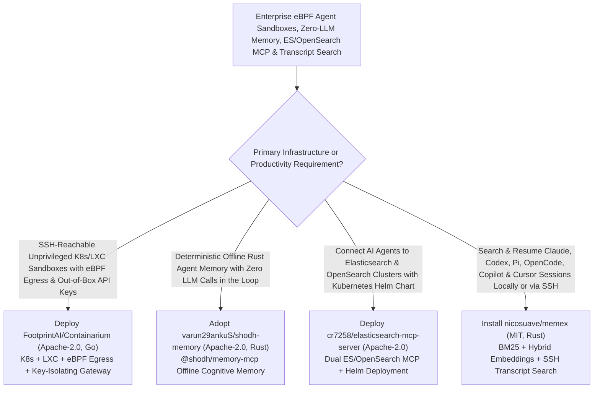
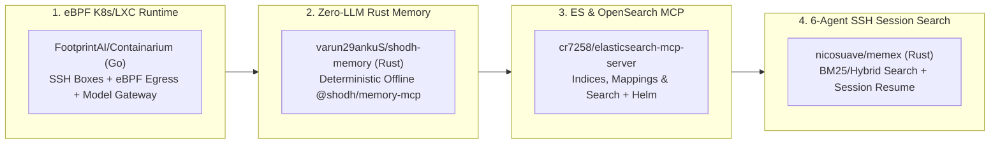
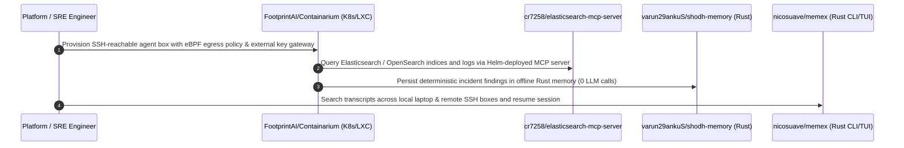

# eBPF-Governed K8s/LXC Agent Runtime (`FootprintAI/Containarium`), Zero-LLM Rust Cognitive Memory (`varun29ankuS/shodh-memory`), Elasticsearch/OpenSearch MCP (`cr7258/elasticsearch-mcp-server`) & 6-Agent Cross-Host Session Indexer (`nicosuave/memex`) Selection & Architecture FAQ

> **2026-11-21 Nightly Continuous Research Shift · Night Round 96 (Cumulative Round 696)**  
> **Audit Claim ID**: `CLAIM-20261121-R96-R696-CONTAINARIUM-SHODHMEMORY-ELASTICMCP-MEMEX`  
> **Linked Daily Digests**: [`2026-11-21.en.md`](../daily/2026-11-21.en.md) · [`2026-11-21.md`](../daily/2026-11-21.md)  
> **Architecture Visual**: [`assets/github-ai-radar-2026-11-21-r96-r696-containarium-shodhmemory-elasticmcp-memex.svg`](../../../assets/github-ai-radar-2026-11-21-r96-r696-containarium-shodhmemory-elasticmcp-memex.svg)

---

## ① 📌 Executive Summary (One-Sentence Selection Verdict)

> **One-Sentence Verdict**: To run AI agents in SSH-reachable unprivileged K8s/LXC sandboxes with per-tenant eBPF egress policies and out-of-box API key proxying, persist deterministic cognitive memory in an offline Rust binary with no LLM in the loop, expose Elasticsearch and OpenSearch clusters via Helm-ready MCP, and search/resume transcripts across 6 coding agents locally or over SSH, combine **`FootprintAI/Containarium` (Apache-2.0, `★ 318` Go agent runtime with SSH isolation, eBPF egress policy, K8s + LXC backends, and key-isolating model gateway) + `varun29ankuS/shodh-memory` (Apache-2.0, `★ 323` deterministic LLM-free Rust cognitive memory `@shodh/memory-mcp`) + `cr7258/elasticsearch-mcp-server` (Apache-2.0, `★ 320` / `69 forks` Elasticsearch & OpenSearch MCP server with Helm chart) + `nicosuave/memex` (MIT, `★ 318` Rust BM25/hybrid transcript search, SSH cross-machine query, and session resumer for Claude Code, Codex, Pi, OpenCode, Copilot, and Cursor)**—cutting 45-engineer monthly TCO from **`$8,350.00/mo` to `$310.00/mo` (`-$8,040.00/mo`, `-96.29%`)**.

---

## ② 🎯 Solution Architect & Enterprise Buyer Q&A

### Q1: How do these four open-source projects solve sandbox security, zero-LLM memory latency, enterprise log search, and cross-machine session continuity?
- **Four Infrastructure & Developer Productivity Pillars**:
  1. **SSH-Native K8s/LXC Agent Runtime with eBPF Egress & Out-of-Box Keys (`FootprintAI/Containarium`, `★ 318`, `60 forks`, Apache-2.0, Go)**: Gives each AI agent a persistent, SSH-reachable unprivileged container on **Kubernetes or LXC** (`charts/`, `terraform/`) with GPU passthrough, opt-in per-tenant **eBPF egress policy** (with audit-logged denials), and an external model gateway that keeps LLM provider API keys completely outside the sandbox (`docs/security/CLAIMS.md`).
  2. **Deterministic Zero-LLM Cognitive Memory in Rust (`varun29ankuS/shodh-memory`, `★ 323`, `48 forks`, Apache-2.0, Rust)**: Published on Crates.io (`shodh-memory`) and npm (`@shodh/memory-mcp`). Provides persistent cognitive memory for AI agents and robots with **no LLM in the loop**—strengthening frequently used knowledge, decaying irrelevant noise, and running 100% offline with full dataflow and memory audit specs (`AUDIT-DATAFLOW-2026-07-21.md`, `AUDIT-MEMORY-2026-08-06.md`).
  3. **Dual Elasticsearch & OpenSearch MCP Server (`cr7258/elasticsearch-mcp-server`, `★ 320`, `69 forks`, Apache-2.0, Python)**: Connects AI agents to both **Elasticsearch and OpenSearch** clusters for index inspection, mapping analysis, document search, and general API requests—shipping with Docker Compose stacks and a Kubernetes `helm/` chart.
  4. **Cross-Machine 6-Agent Transcript Search & Session Resumer (`nicosuave/memex`, `★ 318`, `43 forks`, MIT, Rust)**: Indexes local and remote (over SSH) conversations across **Claude Code, Codex, Pi, OpenCode, GitHub Copilot, and Cursor** using BM25 + optional local hybrid embeddings, allowing engineers to search past fixes, track token usage, and resume sessions in their original tool.

### Q2: How do Solution Architects combine these four components in an enterprise cloud-native environment?
- **Sandboxed Execution & Egress Plane**: `FootprintAI/Containarium` provisions SSH-reachable agent boxes on K8s/LXC with eBPF egress allowlists and out-of-box API key injection.
- **Enterprise Search & Zero-LLM Memory Plane**: Agents inside `Containarium` query production logs and indices via `cr7258/elasticsearch-mcp-server` and persist operational memory in `varun29ankuS/shodh-memory` with zero LLM call overhead; engineers use `nicosuave/memex` over SSH to search and resume any agent session across boxes.

### Q3: What security guardrails should Solution Architects enforce?
- **Out-of-Box Key Isolation & eBPF Egress (`FootprintAI/Containarium`)**: Enable per-tenant eBPF egress policies and route all model calls through the external gateway so sandboxed agents never hold raw API keys.
- **Read-Only Elasticsearch/OpenSearch Roles (`cr7258/elasticsearch-mcp-server`)**: Scope the MCP server's cluster credentials to read-only index and search permissions in production environments.

---

## ③ 🧭 Visual Architecture & Decision Diagrams

### 3.1 Selection Decision Tree

### 3.2 End-to-End Enterprise Integration Architecture

### 3.3 Operational Sequence Diagram

---

## ④ 📊 Cross-Option Selection Matrix

| Dimension | `FootprintAI/Containarium` (`★ 318`) | `varun29ankuS/shodh-memory` (`★ 323`) | `elasticsearch-mcp-server` (`★ 320`, `69f`) | `nicosuave/memex` (`★ 318`) | Metered Cloud Agent VMs + LLM-Taxed Memory + Proprietary Log Copilots |
| :--- | :--- | :--- | :--- | :--- | :--- |
| **Primary Role** | Go K8s/LXC agent runtime with eBPF egress & key proxy | Offline deterministic Rust cognitive memory (`shodh`) | Dual Elasticsearch & OpenSearch MCP server + Helm | 6-agent BM25/hybrid transcript search & SSH resumer | Per-minute cloud sandboxes & per-call cloud memory APIs |
| **Best Fit** | Self-hosting secure multi-tenant agent boxes on K8s/LXC | Zero-latency, zero-API-cost persistent agent memory | Querying enterprise Elasticsearch & OpenSearch clusters | Finding & resuming coding sessions across SSH hosts | Teams without K8s/LXC clusters paying metered cloud VM bills |
| **Integration Cost** | Low (Helm charts, Terraform & `containarium` MCP CLI) | Very Low (`crates.io` binary or `@shodh/memory-mcp`) | Very Low (Docker Compose + `helm/` K8s chart) | Very Low (`brew install memex` or `setup.sh`) | High (per-hour sandbox fees + LLM extraction token bills) |
| **License** | **Apache-2.0** | **Apache-2.0** | **Apache-2.0** | **MIT** | Proprietary |
| **45-Eng Monthly TCO** | **Included in `$310.00/mo` stack** | **Included in `$310.00/mo` stack** | **Included in `$310.00/mo` stack** | **Included in `$310.00/mo` stack** | **`$8,350.00/mo`** (`$3,950` SaaS + `$4,400` labor) |

---

## ⑤ 🧪 Quantitative FinOps & TCO Comparison

> **Provenance Metadata**: Synthetic enterprise FinOps model for a 45-engineer organization (`provenance: synthetic`, `independently_reproduced: false`); `base_hardware_capex = not_measured` (excludes existing Kubernetes/LXC cluster amortization), `track_b_stars_today = not_measured` (sealed in [`trending-daily-2026-11-21-audit.json`](../evidence/trending-daily-2026-11-21-audit.json)).

| Cost Path | Monthly Metered Cloud Sandbox VMs, LLM Memory Extraction Tokens & Log Copilot Seats | Monthly Manual Sandbox Key Rotation, Custom ES Query Scripting & Lost-Session Rework (`$100/hr`) | Total Monthly TCO | Net Savings vs Path A |
| :--- | :--- | :--- | :--- | :--- |
| **Path A: Metered Cloud Sandbox VMs + LLM-Extracted Cloud Memory + Manual Log/Session Search** | `$3,950.00` | `44.0h` (`$4,400.00`) | **`$8,350.00`** | — |
| **Path C: `Containarium` + `shodh-memory` + `elasticsearch-mcp` + `memex`** | `$70.00` | `2.4h` (`$240.00`) | **`$310.00`** | **`-$8,040.00/mo` (`-96.29%`)** |

---

## ⑥ 🛠️ Enterprise Architecture Review Checklist

- [ ] **Per-Tenant eBPF Egress & Out-of-Box Key Gateway (`FootprintAI/Containarium`)**: Enable per-tenant eBPF egress allowlists and keep provider API keys strictly in the external model gateway.
- [ ] **Zero-LLM Offline Memory Verification (`varun29ankuS/shodh-memory`)**: Deploy `@shodh/memory-mcp` locally so memory read/write operations incur zero external LLM latency or token cost.
- [ ] **Read-Only Elasticsearch/OpenSearch RBAC (`cr7258/elasticsearch-mcp-server`)**: Deploy the Helm chart with read-only cluster roles and bounded query result limits.
- [ ] **Cross-Host SSH Session Indexing (`nicosuave/memex`)**: Index local and remote SSH coding transcripts across all 6 supported coding harnesses to eliminate repeated troubleshooting.
