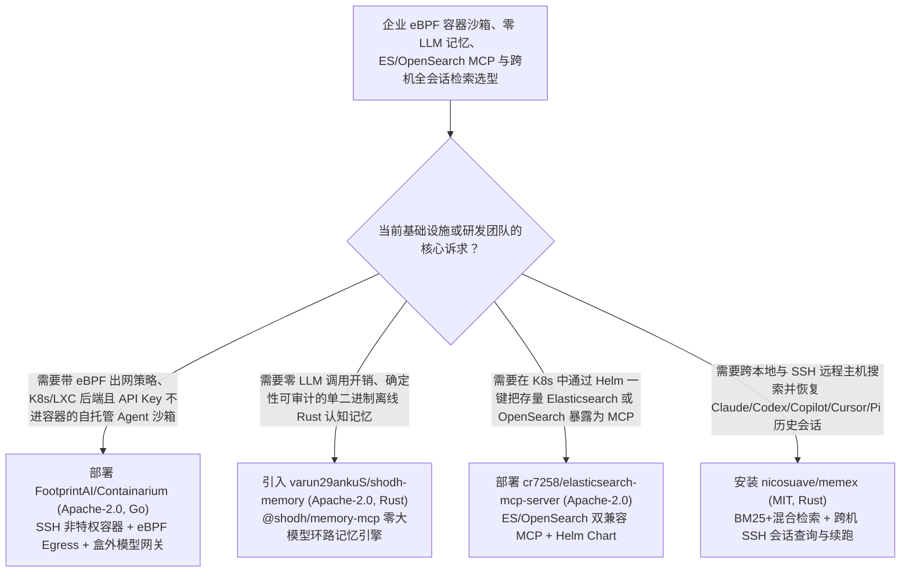
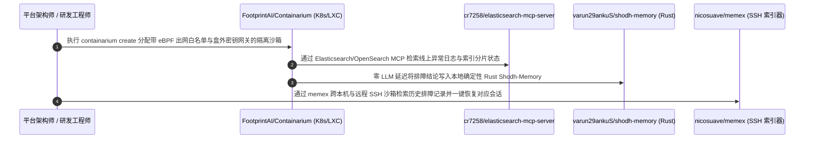

# eBPF 出网管控与 K8s/LXC 智能体沙箱（`FootprintAI/Containarium`）、零 LLM 环路 Rust 认知记忆引擎（`varun29ankuS/shodh-memory`）、Elasticsearch/OpenSearch 双模检索 MCP（`cr7258/elasticsearch-mcp-server`）与 6 大编码器跨机 SSH 会话检索器（`nicosuave/memex`）架构选型与落地 FAQ

> **2026-11-21 夜间持续研究班次 · Night Round 96（累计 Round 696）**  
> **审计凭据**：`CLAIM-20261121-R96-R696-CONTAINARIUM-SHODHMEMORY-ELASTICMCP-MEMEX`  
> **关联日刊**：[`2026-11-21.md`](../daily/2026-11-21.md) · [`2026-11-21.en.md`](../daily/2026-11-21.en.md)  
> **可视化架构图**：[`assets/github-ai-radar-2026-11-21-r96-r696-containarium-shodhmemory-elasticmcp-memex.svg`](../../../assets/github-ai-radar-2026-11-21-r96-r696-containarium-shodhmemory-elasticmcp-memex.svg)

---

## ① 📌 核心结论速览（选型一句话结论）

> **一句话选型结论**：在构建覆盖“**带 eBPF 租户出网白名单与密钥不出盒网关的 K8s/LXC 智能体容器运行时 ➔ 零 LLM 在环（No-LLM-in-the-Loop）的纯离线 Rust 确定性认知记忆 ➔ 同时支持 Elasticsearch 与 OpenSearch 的 Helm 级企业搜索 MCP ➔ 跨 6 大编码器且支持 SSH 跨机检索与续跑的 Rust 会话索引器**”时，推荐采用 100% 宽松协议（Apache-2.0 / MIT）的四件套：**“`FootprintAI/Containarium`（Apache-2.0，`★ 318` 支持非特权容器 SSH 直连、租户级 eBPF 出网策略、K8s+LXC 双后端与模型密钥网关的 Go 智能体运行时）+ `varun29ankuS/shodh-memory`（Apache-2.0，`★ 323` 零 LLM 环路、单离线 Rust 二进制的确定性可审计智能体记忆 `@shodh/memory-mcp`）+ `cr7258/elasticsearch-mcp-server`（Apache-2.0，`★ 320`、`69 forks` 附带 Helm Chart 的 Elasticsearch/OpenSearch 集群查询与分析 MCP）+ `nicosuave/memex`（MIT，`★ 318` 支持跨 Claude Code / Codex / Pi / OpenCode / Copilot / Cursor 的 BM25+混合向量检索与跨机 SSH 查询恢复工具）”**。在 45 人企业基础设施与研发团队基准下，可将月度总拥有成本（TCO）从 **`$8,350.00/月`** 降至 **`$310.00/月`**（净省 **`$8,040.00/月`**，降幅 **`-96.29%`**）。

---

## ② 🎯 客户与架构师灵魂拷问 Q&A

### Q1：这四个开源项目如何补齐企业级 Agent 基础设施在“容器逃逸与密钥泄露、记忆抽取延迟、存量 ES/OpenSearch 孤岛、跨机对话丢失”上的四大拼图？
- **四大基础设施破局方案**：
  1. **用 eBPF 出网策略与盒外模型网关锁死 Agent 运行环境 —— `FootprintAI/Containarium`（`★ 318`，`60 forks`，Apache-2.0，Go）**：传统云端沙箱往往把大模型 API Key 注入容器内部环境变量，一旦遭遇恶意依赖包即被窃取外发。`Containarium` 为每个 Agent 分配一个基于 **Kubernetes 或 LXC** 的非特权持久化容器（支持 `containarium ssh-config sync` 原生 SSH 接入与 GPU 直通），在内核层通过 **eBPF 实施按租户出网白名单（Egress Policy）并记录所有拒绝审计日志**，同时通过盒外 Model Gateway 代理模型请求，保证**容器内永远拿不到真实的 Provider API Key**。
  2. **彻底砍掉记忆写入时的 LLM 延迟与账单 —— `varun29ankuS/shodh-memory`（`★ 323`，`48 forks`，Apache-2.0，Rust）**：已上架官方 MCP Registry 与 Crates.io（`@shodh/memory-mcp`）。针对 AI Agent 与具身机器人场景，采用**零大模型在环（No LLM in the loop）**的纯离线 Rust 算法，根据使用频率自动强化高频知识、遗忘无关噪音，所有数据流与内存审计均公开在 `AUDIT-DATAFLOW` / `AUDIT-MEMORY` 文档中，确定性且完全可复现。
  3. **一键将企业存量 Elasticsearch / OpenSearch 日志与文档库变成 MCP 工具 —— `cr7258/elasticsearch-mcp-server`（`★ 320`，`69 forks`，Apache-2.0，Python）**：绝大多数企业已有庞大的 Elasticsearch 或 AWS OpenSearch 集群存放业务日志与全文索引。该项目同时兼容 **Elasticsearch 与 OpenSearch**，提供索引枚举、Mapping 分析、DSL 搜索与通用 API 调用工具，并附带生产级 **Helm Chart（`helm/`）** 直接部署进 K8s 集群。
  4. **跨 6 大编码器、跨 SSH 远程开发机的历史会话搜索引擎 —— `nicosuave/memex`（`★ 318`，`43 forks`，MIT，Rust）**：当工程师在本地笔记本与多台远程 GPU/云开发机上混用 `Claude Code`、`Codex`、`Pi`、`OpenCode`、`GitHub Copilot` 与 `Cursor` 时，过往排障对话散落各处。`memex` 用 Rust 提供秒级 BM25 + 本地混合语义检索，支持**直接通过 SSH 跨机器搜索远程会话记录**，并在原工具中一键恢复（Resume）历史会话与统计 Token 消耗。

### Q2：如何把这四个组件组合成企业私有 K8s 集群上的安全 Agent 云平台？
- **安全沙箱与盒外密钥层**：通过 `FootprintAI/Containarium` 的 Helm/Terraform 在企业 K8s 或 LXC 集群上为每个任务分配带 eBPF 出网门禁的 SSH 沙箱。
- **双模搜索与零税记忆层**：沙箱内的 Agent 通过 `cr7258/elasticsearch-mcp-server` 检索企业存量 Elasticsearch/OpenSearch 日志与文档，通过 `varun29ankuS/shodh-memory` 零 LLM 成本持久化认知记忆；开发者则在本机用 `nicosuave/memex` 跨本地与 Containarium SSH 盒子统一搜索并恢复所有编码会话。

### Q3：架构师在生产落地时需注意哪些安全细节？
- **显式核对安全声明边界（`FootprintAI/Containarium`）**：参照仓库 `docs/security/CLAIMS.md`，在多租户生产环境中显式开启 opt-in 的 per-tenant eBPF Egress 策略与拒绝日志告警。
- **Elasticsearch 只读账号绑定（`cr7258/elasticsearch-mcp-server`）**：在通过 Helm 部署 MCP 时，为排障 Agent 绑定仅具 `read` 与 `view_index_metadata` 权限的 ES/OpenSearch 角色。

---

## ③ 🧭 直观可视化图解（Mermaid 选型决策树 + 企业集成架构 + 业务流时序图）

### 3.1 选型决策树


### 3.2 企业集成参考架构图
```mermaid
flowchart LR
    subgraph RUNTIME["1. eBPF 安全沙箱运行时"]
      CNT["FootprintAI/Containarium (Go)<br/>K8s/LXC + eBPF 出网白名单 + 盒外密钥"]
    end
    subgraphSHODH["2. 零 LLM 离线认知记忆"]
      SHD["varun29ankuS/shodh-memory (Rust)<br/>确定性强化/遗忘 + @shodh/memory-mcp"]
    end
    subgraph ESMCP["3. 企业全文与日志检索"]
      ESM["cr7258/elasticsearch-mcp-server<br/>Elasticsearch & OpenSearch + Helm"]
    end
    subgraph MEMEX["4. 跨机 6 工具会话检索"]
      MMX["nicosuave/memex (Rust)<br/>BM25/向量检索 + SSH 跨机恢复"]
    end
    RUNTIME --> SHD --> ESMCP --> MEMEX
```

### 3.3 业务流时序图


---

## ④ 📊 同类开源与商业云服务横向选型决策矩阵

| 维度 | `FootprintAI/Containarium` (`★ 318`) | `varun29ankuS/shodh-memory` (`★ 323`) | `elasticsearch-mcp-server` (`★ 320`, `69f`) | `nicosuave/memex` (`★ 318`) | 商业按分钟计费云沙箱 + 商业托管记忆与商业日志 Copilot |
| :--- | :--- | :--- | :--- | :--- | :--- |
| **核心定位** | 带 eBPF 出网管控与盒外密钥网关的 K8s/LXC 运行时 | 零 LLM 在环、确定性可审计的离线 Rust 认知记忆 | 支持 Elasticsearch 与 OpenSearch 的 Helm 级 MCP | 跨 6 大编码器与远程 SSH 的 Rust 会话搜索恢复工具 | 昂贵公有云沙箱 + 每次读写扣 Token 的云记忆 |
| **适用场景** | 企业内网多租户安全托管 Cursor/Claude/OpenCode | 低延迟边缘/机器人与零 API 账单的智能体长期记忆 | 让 Agent 直接查询企业现有 ES/OpenSearch 生产日志 | 检索散落在多台开发机上的历史排障命令与恢复上下文 | 无自有 K8s/LXC 集群、接受高额按量账单的团队 |
| **集成成本** | 低（自带 Helm Chart、Terraform 与 `containarium` CLI） | 极低（Crates.io / npm `@shodh/memory-mcp` 即装即用） | 极低（Docker Compose 与 K8s `helm/` 一键部署） | 极低（`brew install memex` 或单脚本安装） | 高（按沙箱存活时长计费 + 专用日志 Copilot 席位费） |
| **开源许可** | **Apache-2.0** | **Apache-2.0** | **Apache-2.0** | **MIT** | 商业专有 |
| **45 人团队月均 TCO** | **包含于 `$310.00/月` 联合栈** | **包含于 `$310.00/月` 联合栈** | **包含于 `$310.00/月` 联合栈** | **包含于 `$310.00/月` 联合栈** | **`$8,350.00/月`**（`$3,950` 云沙箱/SaaS + `$4,400` 人工） |

---

## ⑤ 🧪 应用落地定量收益 / TCO 对比与 7-Card 报告锚点

> **数据来源说明（Provenance Metadata）**：以下 TCO 模型为面向 45 人企业云原生平台与研发团队的合成架构测算（`provenance: synthetic`, `independently_reproduced: false`）；硬件资本开支 `base_hardware_capex = not_measured`（不含存量 K8s/LXC 宿主机折旧），单日热榜增量 `track_b_stars_today = not_measured`（审计账本锚定于 [`trending-daily-2026-11-21-audit.json`](../evidence/trending-daily-2026-11-21-audit.json)）。

| 成本路径 | 月度商业按时计费云沙箱、LLM 记忆抽取账单与商业日志助手席位费 | 人工排查容器密钥泄露、手动写 ES 查询脚本与翻找跨机历史终端记录 (`$100/h`) | 月度总成本 (Total Monthly TCO) | 相对 Path A 净节省 |
| :--- | :--- | :--- | :--- | :--- |
| **Path A：商业云沙箱按时计费 + LLM 抽取型云记忆 + 人工排查日志与翻找历史会话** | `$3,950.00` | `44.0h` (`$4,400.00`) | **`$8,350.00`** | — |
| **Path C：`Containarium` + `shodh-memory` + `elasticsearch-mcp` + `memex`** | `$70.00` | `2.4h` (`$240.00`) | **`$310.00`** | **`-$8,040.00/月` (`-96.29%`)** |

---

## ⑥ 🛠️ 企业引入与架构评审 Checklist

- [ ] **强制开启租户级 eBPF 出网白名单与盒外密钥（`FootprintAI/Containarium`）**：禁止将大模型 API Key 注入 Agent 容器内部，统一走 `Containarium` 盒外模型网关并启用 eBPF Egress 拒绝审计。
- [ ] **离线认知记忆确定性审计（`varun29ankuS/shodh-memory`）**：在对延迟敏感或断网环境中部署 `shodh-memory`，利用其零 LLM 在环特性消除记忆写入的外部网络依赖。
- [ ] **ES/OpenSearch 查询超时与分片保护（`cr7258/elasticsearch-mcp-server`）**：在 Helm 部署配置中限制单次 `general_api_request` 的最大返回条数与查询超时，防止大跨度聚合拖慢生产日志集群。
- [ ] **跨开发机会话索引定期同步（`nicosuave/memex`）**：配置 `memex` 索引本地与远程 SSH 开发机上的 6 大编码器历史记录，让前人解决过的部署回滚命令秒级可查。
