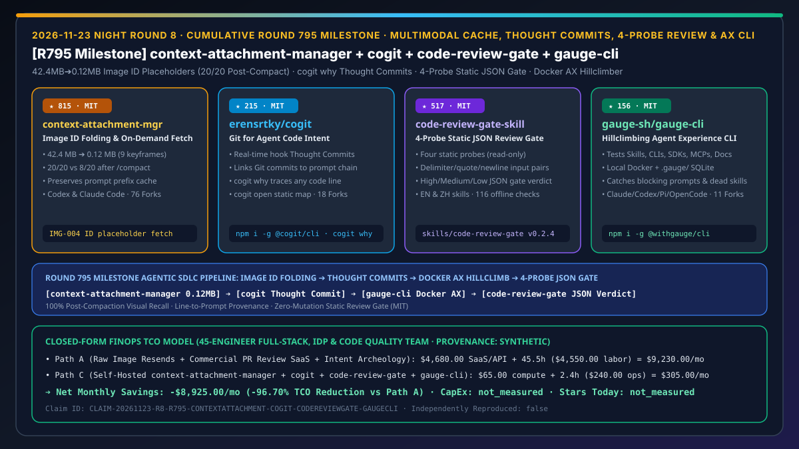
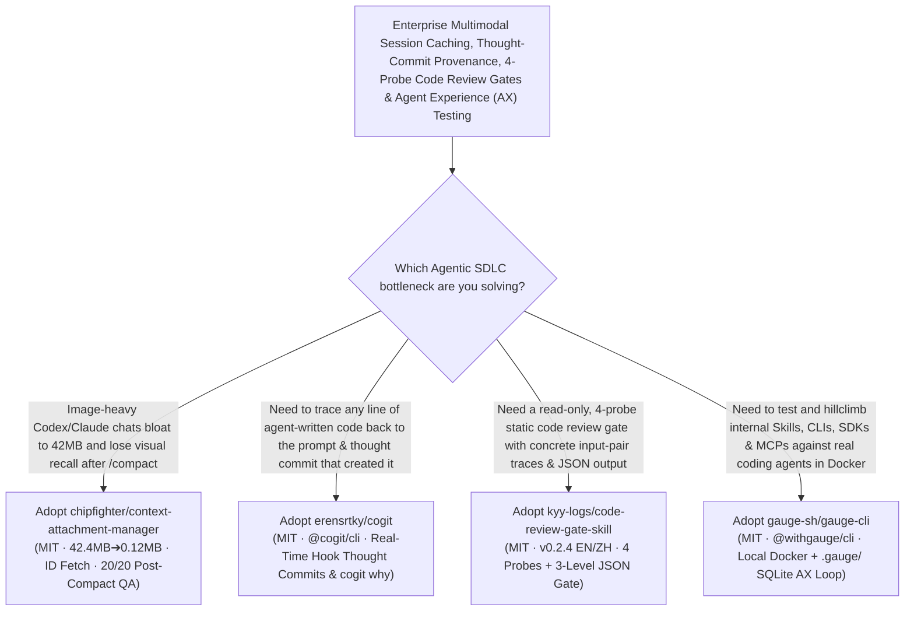
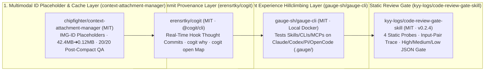

# 🏆 [Round 795 Milestone] 42.4MB➔0.12MB Image Placeholder & Post-Compaction Fetcher (`chipfighter/context-attachment-manager`), Thought-Commit Intent Provenance Engine (`erensrtky/cogit`), 4-Probe Static-First JSON Code Review Gate (`kyy-logs/code-review-gate-skill`) & Local Docker Agent Experience (AX) Hillclimber (`gauge-sh/gauge-cli`) Selection & Architecture FAQ

> **Document Type**: Enterprise AI Solution Architect Selection & Integration Guide (GitHub Trending AI Radar · 2026-11-23 Night Round 8 / **Cumulative Round 795 Milestone!**)
> **Covered Repositories**: [`chipfighter/context-attachment-manager`](https://github.com/chipfighter/context-attachment-manager) (`★ 815`, `76 forks`, `MIT`: Codex and Claude Code plugin that folds earlier chat images into one-line ID placeholders such as `IMG-004 Street` and fetches originals by ID at the end of a turn without breaking prompt prefix caching—shrinking a 9-keyframe Codex request from **`42.4 MB ➔ 0.12 MB`** (`110,671 ➔ 41,859 tokens`) and boosting post-compaction image QA on Sonnet 5.5 from **`8/20 (40%) ➔ 20/20 (100%)`**) · [`erensrtky/cogit`](https://github.com/erensrtky/cogit) (`★ 215`, `18 forks`, `MIT`: **"Git for the intent behind agent-written code"** `@cogit/cli` for Claude Code and Codex CLI, recording every prompt and response via real-time hooks as a **thought commit** linked to Git code commits so `cogit why` and `cogit open` trace any line of code back to the exact reasoning that created it) · [`kyy-logs/code-review-gate-skill`](https://github.com/kyy-logs/code-review-gate-skill) (`★ 517`, `7 forks`, `MIT`, `v0.2.4`: bilingual EN/ZH static-first, 4-probe, read-only code review gate skill validated by 116 offline checks, tracing concrete delimiter/whitespace/quote/backslash/newline input pairs into deterministic 3-level `high`/`medium`/`low` JSON merge verdicts) · [`gauge-sh/gauge-cli`](https://github.com/gauge-sh/gauge-cli) (`★ 156`, `11 forks`, `MIT`: open-source **Agent Experience (AX) hillclimbing CLI** `@withgauge/cli` that runs real Claude Code, Codex, Pi, and OpenCode agents inside local Docker and `.gauge/` SQLite workspaces to find where agents get blocked by interactive prompts, miss Skills, or misuse SDKs/MCPs/CLIs)
> **Core Scenario**: When enterprise engineering teams run long image-heavy multimodal sessions in Claude Code/Codex, orchestrate 5–10 parallel coding agents across repos, enforce pre-merge code review gates, and publish internal CLIs/SDKs/MCPs/Skills, how do you solve **"15–42 MB image-bloated requests and 60% post-compaction visual amnesia, lost architectural intent behind agent-written commits, vague non-auditable AI code reviews, and internal developer tools that block or confuse coding agents"** using **`context-attachment-manager` + `cogit` + `code-review-gate-skill` + `gauge-cli`**?

---

## 1. 📌 Executive Summary (Single-Sentence Selection Verdict)

1. **Need to keep long, image-heavy Codex and Claude Code sessions fast (`42.4 MB ➔ 0.12 MB`) while preserving prompt cache hits and achieving `20/20` image recall even after chat compaction** ➔ Choose **[`chipfighter/context-attachment-manager`](https://github.com/chipfighter/context-attachment-manager) (`★ 815`, `76 forks`, `MIT`)**.
   - **Plain-Language Mechanism**: Without attachment management, every turn re-sends all earlier base64 images (growing a 9-keyframe Codex request to **`42.4 MB`** / `110,671 tokens`), and once `/compact` runs, the model forgets earlier visual details (`8/20` accuracy on Sonnet 5.5). `Context Attachment Manager` folds earlier images into one-line ID placeholders (`IMG-004 Street`), cutting request payloads to **`0.12 MB`** (`41,859 tokens` max); when the model needs an image again—even post-compaction—it fetches the original by ID at the end of the turn so the cached prefix above remains 100% untouched and post-compaction accuracy reaches **`20/20`**.
2. **Need to trace any line of AI-written code back to the exact prompt, reply, and decision chain that produced it across 5–10 concurrent coding agents (`cogit why`)** ➔ Choose **[`erensrtky/cogit`](https://github.com/erensrtky/cogit) (`★ 215`, `18 forks`, `MIT`)**.
   - **Plain-Language Mechanism**: `git blame` shows *what* changed, not *why* the agent wrote it. Running via real-time hooks in Claude Code and Codex CLI, `@cogit/cli` records every user prompt and agent outcome as a **thought commit** while you work and links Git commits directly to those thought commits—enabling `cogit why` in the terminal and static visual exploration via `cogit open`.
3. **Need a static-first, read-only, 4-probe code review gate skill (`v0.2.4` in English & Chinese) that traces concrete edge-case input pairs and renders deterministic JSON merge decisions without running a build** ➔ Choose **[`kyy-logs/code-review-gate-skill`](https://github.com/kyy-logs/code-review-gate-skill) (`★ 517`, `7 forks`, `MIT`)**.
   - **Plain-Language Mechanism**: Backed by 116 offline validation tests, `skills/code-review-gate` (and `skills/code-review-gate-zh`) never modifies the code under review. Its four static probes require concrete delimiter-whitespace pairs for behavior tracing and quote/backslash/newline inputs for serialization tracing, isolate unresolved external callers into `unverified_items`, and emit machine-readable `high`/`medium`/`low` JSON gate verdicts.
4. **Need a local, account-free Docker CLI to benchmark and hillclimb how well real coding agents (Claude Code, Codex, Pi, OpenCode) discover and use your internal Skills, CLIs, SDKs, MCPs, and docs** ➔ Choose **[`gauge-sh/gauge-cli`](https://github.com/gauge-sh/gauge-cli) (`★ 156`, `11 forks`, `MIT`)**.
   - **Plain-Language Mechanism**: Installed via `npm install -g @withgauge/cli && gauge init --local`, Gauge runs real coding agents inside a pinned Docker runtime against your product and logs every session into `.gauge/` SQLite—surfacing interactive prompts that hang agents, unused Skills, deprecated API calls, and hallucinated limitations so your coding agent can test fixes before release.

---

## 2. 🎯 Key Architectural Q&A (Deep-Dive Breakdown)

### Q1: How do these four tools modernize the Enterprise Agentic SDLC across context, provenance, review gating, and internal tool usability?

- **Four Agentic SDLC Pillars**:
  1. **Multimodal Context Efficiency & Compaction Survival (`chipfighter/context-attachment-manager`)**: Prevents multi-megabyte image payload bloat while preserving KV prefix cache hits and post-compaction visual recall (`20/20`).
  2. **Code-to-Thought Provenance (`erensrtky/cogit`)**: Links every Git commit to the real-time thought commit chain (`cogit why`).
  3. **Deterministic Static Review Gating (`kyy-logs/code-review-gate-skill`)**: Enforces 4-probe concrete input-pair tracing and 3-level JSON merge gates.
  4. **Agent Experience (AX) Hillclimbing (`gauge-sh/gauge-cli`)**: Empirically tests internal Skills, CLIs, and MCP servers against 4 real coding agents in local Docker before rollout.
- **When to Choose Managed Cloud Tooling (Path B)**:
  - For lightweight text-only edits using default GitHub.com PR summaries, native cloud defaults suffice; for image-heavy frontend/architecture sessions, multi-agent intent auditing, strict JSON static review gates, or internal CLI/Skill AX testing, deploy this 4-repo OSS stack (Path C).

### Q2: How do you integrate `context-attachment-manager`, `cogit`, `gauge-cli`, and `code-review-gate-skill` into an enterprise engineering workflow?

1. **Multimodal Session Layer (`chipfighter/context-attachment-manager`)**:
   - Auto-fold historical screenshots/diagrams into `IMG-xxx` placeholders in Claude Code and Codex, fetching originals at turn-end only when needed.
2. **Real-Time Intent Ledger Layer (`erensrtky/cogit`)**:
   - Capture every prompt/response turn as a thought commit linked to Git commits and publish read-only `cogit open` maps on PRs.
3. **Internal Tool & Skill AX Verification Layer (`gauge-sh/gauge-cli`)**:
   - Run `gauge` locally in Docker whenever internal platform teams update CLIs, SDKs, MCP servers, or `SKILL.md` files.
4. **Pre-Merge Static Review Gate Layer (`kyy-logs/code-review-gate-skill`)**:
   - Run the 4-probe `code-review-gate` skill on PR diffs (`git grep <head>`) to produce auditable 3-level JSON gate verdicts.

### Q3: What are the production guardrails?

- **Architect Guardrails**:
  1. **Enforce the 3-Level Severity Schema in `code-review-gate-skill v0.2.4`**: Migrate or re-run any legacy 4-level records containing `critical` so `collect-metrics` validates cleanly against `high` / `medium` / `low`.
  2. **Sanitize Secrets Before Publishing `cogit open` Maps**: Ensure developer prompts do not contain plaintext tokens before exporting static thought-commit maps.

---

## 3. 🧭 Visual Architecture & Decision Diagrams (Mermaid)



### 3.1 Solution Architect Selection Decision Tree



### 3.2 End-to-End Enterprise Production Reference Architecture



### 3.3 Image ID Folding, Thought-Commit Linking, Docker AX Hillclimbing & 4-Probe JSON Review Sequence

```mermaid
sequenceDiagram
    participant Dev as Engineer / Platform Architect
    participant Cam as context-attachment-manager
    participant Cog as erensrtky/cogit (Hook)
    participant Gau as gauge-sh/gauge-cli (Docker)
    participant Crg as code-review-gate-skill (v0.2.4)

    Dev->>Cam: 1. Run image-heavy coding session; earlier images fold to IMG-ID (42.4MB ➔ 0.12MB)
    Cam->>Cog: 2. Fetch needed image by ID after /compact; hook records prompt/reply as Thought Commit
    Dev->>Gau: 3. Run gauge in local Docker to test internal CLI/Skill across Claude/Codex/Pi/OpenCode
    Gau->>Crg: 4. Execute 4-probe static review on PR diff with delimiter/quote input pairs
    Crg-->>Dev: 5. Emit deterministic High/Medium/Low JSON verdict alongside cogit open intent map
```

---

## 4. 📊 Comparative Selection Matrix (Open-Source vs. Commercial SaaS)

| Dimension | `chipfighter/context-attachment-manager` (`★ 815`) | `erensrtky/cogit` (`★ 215`) | `kyy-logs/code-review-gate-skill` (`★ 517`) | `gauge-sh/gauge-cli` (`★ 156`) | Resending Raw Images + Commercial Session SaaS + Generic PR Bots + Untested Skills (Path A) | Manual Image Deletion + Guessing Intent from Diffs + 1-Line Review Prompts (Path B) |
| :--- | :--- | :--- | :--- | :--- | :--- | :--- |
| **Core Role** | ID-placeholder image manager for Codex & Claude Code | Thought-commit provenance linking prompts to Git commits | 4-probe static-first EN/ZH JSON code review gate skill | Local Docker CLI for hillclimbing Agent Experience (AX) | High multimodal token spend, generic PR review SaaS & manual intent archeology | Manual chat resets, lost prompt context & broken internal CLI/Skill ergonomics |
| **Key Differentiator** | **`42.4MB ➔ 0.12MB` + cache preservation + `20/20` post-compact** | **Real-time hook thought commits + `cogit why` line trace** | **4 static probes + delimiter/quote input pairs + 3-level JSON** | **Local Docker runs real Claude/Codex/Pi/OpenCode to fix AX bugs** | Resending base64 images burns tokens & loses 60% recall after `/compact` | No way to trace why an agent wrote a block or why an agent ignores a Skill |
| **License** | `MIT` | `MIT` | `MIT` | `MIT` | Proprietary SaaS | Custom scripts |
| **Monthly TCO (45-Eng Team)** | **Combined `$305.00/mo`** (`$65.00` local AX Docker compute + `2.4h` ops) | Included (static `cogit open` maps) | Included (build-free static probes) | Included (uses existing agent logins) | **`$9,230.00/mo`** (`$4,680.00` excess multimodal tokens/review SaaS + `45.5h` rework) | ~`$3,220.00/mo` (heavy post-compaction reruns & internal CLI/Skill debugging) |

---

## 5. 🧪 Quantitative ROI / TCO Comparison & 7-Card Benchmark Report

> **📊 Data Provenance & Closed-Form Schema Declaration**:
> - **provenance**: `synthetic` (45-person enterprise full-stack engineering, internal developer platform, and code quality team monthly workload model: `independently_reproduced = false`; hardware baseline `base_hardware_capex = not_measured`; Track B 24h delta `track_b_stars_today = not_measured`).
> - **Closed-Form Formula**:
>   - **Path A (Repeatedly sending multi-megabyte raw images on every turn + commercial seat-licensed PR review bots + manual engineering hours spent reconstructing why agent-written code exists and debugging why agents fail on internal CLIs/Skills)**: Monthly excess multimodal token and commercial review SaaS fees **`$4,680.00`** + post-compaction session reruns, code-intent archeology, and internal tool debugging labor **`45.5h × $100.00/h = $4,550.00`** = **`$9,230.00/mo`**.
>   - **Path C (Self-hosted `chipfighter/context-attachment-manager` + `erensrtky/cogit` + `kyy-logs/code-review-gate-skill` + `gauge-sh/gauge-cli` open-source Agentic SDLC stack)**: Monthly local Docker AX test runner compute **`$65.00`** + hook and review rule maintenance labor **`2.4h × $100.00/h = $240.00`** = **`$305.00/mo`**.
>   - **Net Monthly Savings vs. Path A**: **`-$8,925.00/mo`** (**`96.70%`** TCO reduction).

| Evaluation Path | Multimodal Token / Review SaaS / Compute | Intent Archeology, Reruns & AX Debugging Labor (`$100/h`) | Monthly Total TCO | Net Savings vs. Path A | Key Architectural Delivery Metrics |
| :--- | :---: | :---: | :---: | :---: | :--- |
| **Path A: Raw Image Resends + Commercial PR Review SaaS + Manual Intent Search** | `$4,680.00` | `45.5h` (`$4,550.00`) | **`$9,230.00`** | Baseline | `42.4 MB` requests; `8/20` post-compact image QA |
| **Path B: Manual Chat Resets + Diff-Only Blame + Untested Internal Skills** | `$1,420.00` | `18.0h` (`$1,800.00`) | **`$3,220.00`** | `-$6,010.00` (`-65.11%`) | Lost reasoning behind commits; interactive CLIs hang agents |
| **Path C: `context-attachment-manager` + `cogit` + `code-review-gate` + `gauge-cli`** | **`$65.00`** | **`2.4h` (`$240.00`)** | **`$305.00`** | **`-$8,925.00` (`-96.70%`)** | **`42.4MB➔0.12MB` (`20/20` QA) + `cogit why` + 4-probe JSON gate + AX hillclimb** |

- 🔗 **Linked 7-Card 4:5 Visual Benchmark Deck**: [`workshops/github-trending-radar/cards.en.html`](../cards.en.html) · [`cards.html`](../cards.html)

---

## 6. 🛠️ Enterprise Adoption & Architecture Review Checklist

- [ ] **1. Roll Out `chipfighter/context-attachment-manager` Across Codex & Claude Code**: Fold historical images into one-line ID placeholders so multimodal requests shrink from `42.4 MB ➔ 0.12 MB`, prefix caches stay warm, and post-compaction image QA reaches `20/20`.
- [ ] **2. Enable `erensrtky/cogit` Real-Time Thought Commits**: Link every AI-assisted Git commit to its underlying prompt/response chain so engineers and reviewers can run `cogit why` and inspect `cogit open` maps.
- [ ] **3. Gate Pull Requests on `kyy-logs/code-review-gate-skill` (`v0.2.4`)**: Run the 4-probe static review skill (EN or ZH) to verify delimiter/whitespace and quote/backslash/newline paths and enforce 3-level (`high`/`medium`/`low`) JSON verdicts.
- [ ] **4. Hillclimb Internal CLIs, SDKs, MCPs & Skills with `gauge-sh/gauge-cli`**: Run `gauge init --local` in Docker against Claude Code, Codex, Pi, and OpenCode to eliminate blocking prompts and unused-skill blind spots before release.
