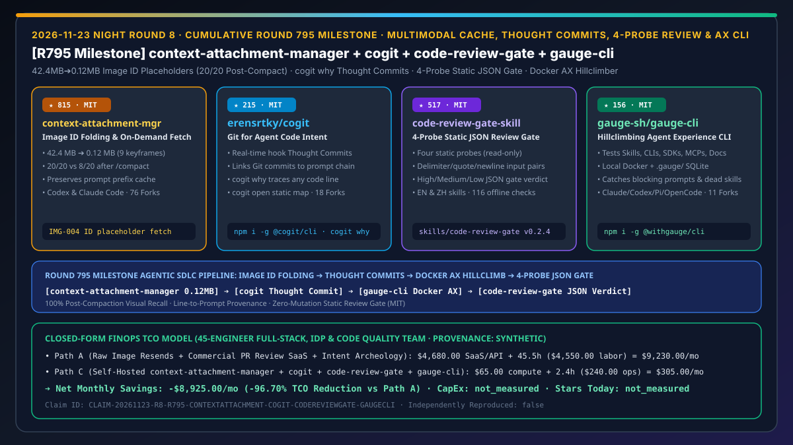
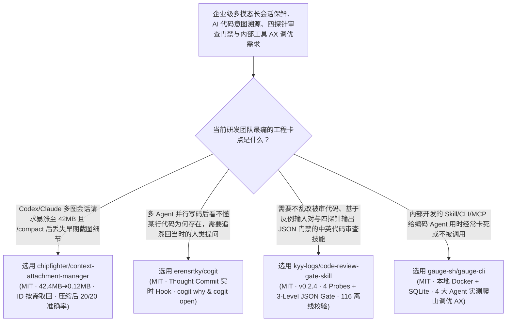
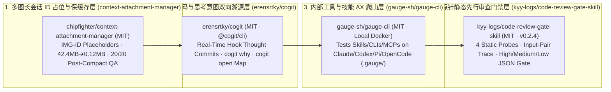
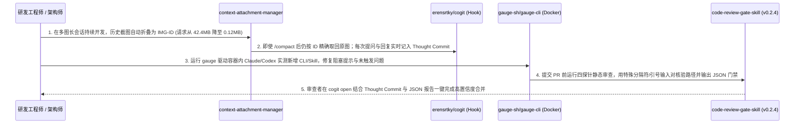

# 🏆【第 795 轮里程碑】多图长会话 42.4MB➔0.12MB 占位符按需取回插件（`chipfighter/context-attachment-manager`）、把每次提问存为 Thought Commit 的代码意图溯源引擎（`erensrtky/cogit`）、四探针静态先行 JSON 门禁代码审查技能（`kyy-logs/code-review-gate-skill`）与本地 Docker 智能体体验（AX）爬山调优 CLI（`gauge-sh/gauge-cli`）选型与集成架构 FAQ

> **文档类型**：企业 AI 解决方案架构师（AI Solution Architect）选型决策指南（GitHub Trending AI 雷达 2026-11-23 Night Round 8 / **累计第 795 轮里程碑**）
> **覆盖项目**：[`chipfighter/context-attachment-manager`](https://github.com/chipfighter/context-attachment-manager)（`★ 815`、`76 forks`、`MIT`：面向 Codex 与 Claude Code 的多图长会话附件管理插件，将历史轮次图片折叠为单行 ID 占位符如 `IMG-004 Street`，需要时由模型按 ID 在当前轮末尾按需取回而不破坏前缀缓存，实测将 9 张关键帧请求从 **`42.4 MB` 压至 `0.12 MB`**、峰值请求从 `110,671` 降至 `41,859 tokens`，并在会话压缩 `/compact` 后将图片问答准确率从 **`8/20 (40%)` 提升至 `20/20 (100%)`**）· [`erensrtky/cogit`](https://github.com/erensrtky/cogit)（`★ 215`、`18 forks`、`MIT`：记录 AI 写码背后“为什么这么写”的意图版本控制系统 `@cogit/cli`，通过实时 Agent Hook 将每次提问与回复写为 **Thought Commit** 并与代码 Git Commit 双向绑定，执行 **`cogit why`** 即可将任意一行代码追溯回最初的人类指令与决策脉络）· [`kyy-logs/code-review-gate-skill`](https://github.com/kyy-logs/code-review-gate-skill)（`★ 517`、`7 forks`、`MIT`、`v0.2.4`：双语开源的静态先行、四探针驱动且绝不乱改被审代码的证据链代码审查门禁技能，强制构造具体分隔符/空白/引号/换行输入对追踪解析与序列化路径，输出机器可读的三级严重度 JSON 门禁报告）· [`gauge-sh/gauge-cli`](https://github.com/gauge-sh/gauge-cli)（`★ 156`、`11 forks`、`MIT`：开源 **Agent Experience (AX) 智能体可用性爬山调优 CLI** `@withgauge/cli`，基于本地 Docker 与 `.gauge/` SQLite 工作区驱动真实 Claude Code / Codex / Pi / OpenCode 实测企业内部 Skill、CLI、SDK、MCP 与文档，自动抓出“交互命令卡死 Agent、Skill 闲置未触发、误用废弃 API”等体验缺陷并在发版前验证修复）
> **核心场景**：当企业研发团队在高频使用 Claude Code 与 Codex 进行多模态研发（频繁粘贴 UI 截图、架构图与报错画面）、5–10 个 Agent 并发写码以及内部平台チーム向全员分发自研 CLI/MCP/Skill 时，如何解决**“多图会话越聊越卡且 `/compact` 后模型彻底失忆看不见早期截图、Agent 写完几千行代码后没人知道某段逻辑当初为什么要这么写、AI 代码审查流于表面口水话缺乏机器可读 JSON 阻断门禁、以及团队辛辛苦苦写的内部 Skill/CLI 上线后编码 Agent 根本不会用或被交互式提示卡死”**四大工程顽疾？

---

## 一、📌 核心结论速览（选型一句话结论）

1. **想彻底解决 Claude Code 与 Codex 在连续发送十几张 UI 截图/设计稿后请求体膨胀到几十 MB、响应变慢，且一旦触发上下文压缩（Compaction）后模型就再也答不出早期图片细节的痛点** ➔ 选 **[`chipfighter/context-attachment-manager`](https://github.com/chipfighter/context-attachment-manager)（`★ 815`，`76 forks`，`MIT`）**。
   - **通俗原理**：默认情况下，编码 Agent 每发一轮新消息都会把历史所有 Base64 高清大图重复发一遍（9 张关键帧单次请求高达 **`42.4 MB`** / `110,671 tokens`），不仅慢，而且一旦会话触发 `/compact`，历史图片直接丢失（Sonnet 5.5 压缩后图片细节问答准确率暴跌至 **`8/20`**）。安装 `Context Attachment Manager` 后，早期图片自动折叠为单行 ID 占位符（如 `IMG-004 Street`），单次请求骤降至 **`0.12 MB`**（24 张图从 `15.6 MB` 降至 `1.3 MB`）；当模型需要再次核对某张旧图时，直接按 ID 将原图追加在当前轮末尾——**上方历史前缀分字未改，100% 命中 Prompt Cache**，且压缩后图片问答准确率恢复至满分 **`20/20`**！
2. **想在同时并行开着 5–10 个编码 Agent 时，永远弄得清代码库里每一行 AI 写出的代码“当初是因为哪句提问、经过哪番讨论才加进去的”** ➔ 选 **[`erensrtky/cogit`](https://github.com/erensrtky/cogit)（`★ 215`，`18 forks`，`MIT`）**。
   - **通俗原理**：手写代码时程序员脑子里有演进过程，但 Agent 写代码只留下冷冰冰的 `git diff`。`@cogit/cli` 通过 Claude Code 与 Codex CLI 的实时生命周期 Hook（边干活边记录，绝非事后根据 Diff 瞎猜），把你发给 Agent 的每条消息和它的决策存为一条 **Thought Commit（思考提交）**，并让最终的代码 Git Commit 指向对应的 Thought Commit。审查者或接手同事只需运行 **`cogit why`** 或打开静态可视化页面 **`cogit open`**，即可顺着任意一行代码倒查回完整的意图演进图谱。
3. **想在合并 PR 前运行一套不依赖编译环境、绝不擅自乱改被审代码、由四个独立探针驱动且完全基于具体反例输入对（如特殊引号/换行/空白符）输出机器可读 JSON 门禁结论的静态代码审查技能** ➔ 选 **[`kyy-logs/code-review-gate-skill`](https://github.com/kyy-logs/code-review-gate-skill)（`★ 517`，`7 forks`，`MIT`，`v0.2.4`）**。
   - **通俗原理**：原生提供英文（`skills/code-review-gate`）与中文（`skills/code-review-gate-zh`）双版本并附带 116 项离线流水线校验。它拒绝“这段代码看着有风险”的模糊废话，要求每一条发现必须同时指出**源码位置、违反的契约/调用路径、具体触发输入对（如在序列化审查中强制追踪含引号、反斜杠或换行符的输入）与三级确定性严重度（`high` / `medium` / `low`）**，未证实的外部调用边界单独归入 `unverified_items`，最终由 JSON 确定性渲染放行或阻断结论。
4. **想让企业内部平台团队开发的 CLI、SDK、MCP Server、文档与 `SKILL.md` 真正“让 AI 智能体爱用、会用、不卡壳”，在发布前用真实编码 Agent 在本地 Docker 里做可用性爬山测试（Hillclimbing Agent Experience）** ➔ 选 **[`gauge-sh/gauge-cli`](https://github.com/gauge-sh/gauge-cli)（`★ 156`，`11 forks`，`MIT`）**。
   - **通俗原理**：许多内部工具人类用着顺手，给 AI Agent 用却灾难频发——比如命令弹出了交互式 `[y/N]` 确认把无头 Agent 卡死、报错信息太含糊导致 Agent 死循环、或者写好的 `SKILL.md` 根本没被模型选中。执行 `npm install -g @withgauge/cli && gauge init --local`，它会在本地 Docker 容器内驱动真实的 Claude Code、Codex、Pi 或 OpenCode 试用你的工具，将卡点记录在 `.gauge/` SQLite 库中，让你修改 `--help` 提示、报错文案或 `SKILL.md` 后立即重跑对比，实现 **Agent Experience (AX)** 闭环优化！

---

## 二、🎯 客户与架构师灵魂拷问 Q&A（深度架构拆解）

### Q1：这四个工具如何从“多模态上下文、代码意图溯源、PR 静态审查门禁、内部工具 AX 验收”四个维度升级企业 AI 研发工程（Agentic SDLC）？

- **四大工程闭环**：
  1. **多模态上下文保鲜与防爆仓 ➔ `chipfighter/context-attachment-manager`**：用单行 ID 占位符 + 轮末按需拉取原图，同时保住 Prompt Cache 命中率与 `/compact` 后的 100% 视觉记忆。
  2. **代码与人类意图双向溯源 ➔ `erensrtky/cogit`**：用 Thought Commit 填补 `git blame` 在 AI 编程时代的空白，让代码审查者不仅看到 `What changed`，更看清 `Why it was requested`。
  3. **零副作用四探针代码门禁 ➔ `kyy-logs/code-review-gate-skill`**：静态先行、四探针取证、具体反例输入对验证与三级 JSON 严重度门禁。
  4. **内部工具与技能的 AX 准出压测 ➔ `gauge-sh/gauge-cli`**：用真实四款编码 Agent 在本地 Docker 检验 CLI/MCP/Skill 是否存在阻塞或漏触发缺陷。
- **何时直接选用云端商业工具（Path B）？**
  - 若团队仅做纯文本单轮小修小补且完全使用 GitHub.com 原生 Copilot PR Review，可直接使用云端默认配置；若高频进行多图 UI/架构长会话开发、并行调度 5–10 个本地编码 Agent、需要严格 JSON 审计门禁或自研企业内部 MCP/Skill/CLI，则部署本轮四合一开源栈（Path C）。

### Q2：典型企业级“多图占位保缓存 (`context-attachment-manager`) + 意图提交 (`cogit`) + 四探针审查门禁 (`code-review-gate-skill`) + AX 爬山验收 (`gauge-cli`)”架构怎么搭？

1. **编码会话多模态附件管理层（`chipfighter/context-attachment-manager`）**：
   - 在 Claude Code 与 Codex 会话中启用插件，自动将非当前轮截图转为 `IMG-xxx` ID 占位符，将单次请求体积从数十 MB 压至百 KB 级。
2. **实时意图捕获与代码关联层（`erensrtky/cogit`）**：
   - 通过 Agent Hook 自动记录每次交互为 Thought Commit，随 `git commit` 生成可通过 `cogit why` 与 `cogit open` 审阅的意图拓扑图。
3. **内部 CLI / MCP / Skill 可用性爬山层（`gauge-sh/gauge-cli`）**：
   - 平台团队在发布内部 SDK、CLI 或 `SKILL.md` 前，在本地 Docker 运行 `gauge` 驱动 Claude/Codex/Pi/OpenCode 实测并消除阻塞点。
4. **PR 提交前四探针静态代码门禁层（`kyy-logs/code-review-gate-skill`）**：
   - 调用中英文 `code-review-gate` 技能对 Git Diff 执行四探针边界与序列化反例推导，依据生成的三级 JSON 报告决定是否放行合并。

### Q3：这套架构的落地注意事项与合规红线是什么？

- **架构师落地红线**：
  1. **`code-review-gate-skill v0.2.4` 严重度 Schema 迁移门禁**：`v0.2.4` 严格采用三级严重度（`high`、`medium`、`low`），旧版包含 `critical` 的四级历史记录会被 `collect-metrics` 明确拒绝，升级时必须重新运行或迁移旧记录。
  2. **`cogit` 思考提交脱敏规范**：在将 `cogit open` 生成的静态意图地图分享给外部团队前，确认原始提问中未粘贴生产明文密码或客户隐私数据。

---

## 三、🧭 直观可视化图解（Mermaid 决策树 + 集成架构 + 时序图）

### 3.1 架构师选型决策树

### 3.2 企业端到端生产集成参考架构图

### 3.3 多图占位按需取回、Thought Commit 实时绑定、AX 爬山验证与四探针 JSON 门禁时序图

---

## 四、📊 同类开源与商业云服务横向选型决策矩阵

| 对比维度 | `chipfighter/context-attachment-manager` (`★ 815`) | `erensrtky/cogit` (`★ 215`) | `kyy-logs/code-review-gate-skill` (`★ 517`) | `gauge-sh/gauge-cli` (`★ 156`) | 全量重发高清原图 + 商业会话托管 SaaS + 商业 PR 审查机器人 + 人工盲调文档 (Path A) | 手动删图重传 + 事后靠 git log 猜意图 + 单句 Prompt 粗审 + 不测 Agent 体验 (Path B) |
| :--- | :--- | :--- | :--- | :--- | :--- | :--- |
| **核心能力定位** | Codex/Claude 多图会话 ID 折叠与压缩后按需取回插件 | 绑定代码 Commit 与实时 Thought Commit 的意图溯源工具 | 四探针静态先行、反例驱动的中英双语 JSON 代码审查门禁 | 本地 Docker 驱动四大 Agent 爬山优化 Skill/CLI/MCP 的工具 | 昂贵的商业多模态长上下文消耗、商业云端代码审查席位与人工维护成本 | 频繁报请求体过大错误、代码合并后无人知晓背景、内部 Skill 形同虚设 |
| **核心技术突破** | **`42.4MB ➔ 0.12MB` + 保前缀缓存 + `/compact` 后 `20/20` 准确率** | **实时 Hook 记录 Thought Commit + `cogit why` 逐行溯源意图** | **四探针 + 分隔符/转义字符具体输入对推导 + 三级 JSON 门禁** | **零账号本地 Docker 跑真 Agent 抓交互卡点与闲置 Skill** | 原图全量重发极易触发限流与高额账单；商业审查机器人常输出泛泛建议 | `/compact` 后图片细节丢失率达 60%（`8/20`）；人工凭印象写 Commit 丢失上下文 |
| **开源协议** | `MIT` | `MIT` | `MIT` | `MIT` | 闭源商业 SaaS | 内部零散脚本 |
| **月度 TCO（45 人团队）** | **组合仅 `$305.00/月`**（`$65.00` 本地 AX 测试容器分摊 + `2.4h` 维护） | 同左（静态页面零服务器成本） | 同左（零构建静态分析极省算力） | 同左（复用现有订阅免平台费） | **`$9,230.00/月`**（`$4,680.00` 多图重复 Token/商业审查席位 + `45.5h` 意图考古与排障工时） | 约 `$3,220.00/月`（大量因 `/compact` 失忆重来与内部工具卡死 Agent 的工时浪费） |

---

## 五、🧪 应用落地定量收益/TCO 对比与 7-Card 报告

> **📊 数据来源与闭式核算声明（Provenance & Closed-Form Schema）**：
> - **provenance**: `synthetic`（基于 45 人企业全栈研发、内部开发者平台（IDP）与代码质量治理团队月度工作负载模型：`independently_reproduced = false`；硬件采购基线 `base_hardware_capex = not_measured`；Track B 单日增量 `track_b_stars_today = not_measured`）。
> - **核算公式**：
>   - **Path A（多模态长会话每轮全量重发十余张高清截图消耗高额 Token + 采购商业 PR 自动审查席位 + 工程师花大量时间考古 AI 存量代码编写意图与手工排查内部 CLI/Skill 为何被 Agent 用错）**：月度多图冗余 Token 与商业审查 SaaS 账单 **`$4,680.00`** + 代码意图考古、压缩失忆重跑与内部工具适配排障人工 **`45.5h × $100.00/h = $4,550.00`** = **`$9,230.00/月`**。
>   - **Path C（自建 `chipfighter/context-attachment-manager` + `erensrtky/cogit` + `kyy-logs/code-review-gate-skill` + `gauge-sh/gauge-cli` 开源工程提效栈）**：本地 Docker AX 评测容器分摊开销 **`$65.00`** + 门禁规则与 Hook 维护人工 **`2.4h × $100.00/h = $240.00`** = **`$305.00/月`**。
>   - **净节省（Net Savings vs Path A）**：**`-$8,925.00/月`**（成本降低 **`96.70%`**）。

| 评估方案 | 多模态 Token / 审查 SaaS / 容器成本 | 意图追溯、重跑与工具调优人工（`$100/h`） | 月度总 TCO | 相对 Path A 净节省 | 关键架构交付指标 |
| :--- | :---: | :---: | :---: | :---: | :--- |
| **Path A：全量重发多图 + 商业 PR 审查 SaaS + 人工考古代码意图** | `$4,680.00` | `45.5h` (`$4,550.00`) | **`$9,230.00`** | Baseline | 9 图请求重达 `42.4 MB`；压缩后图片问答仅 `8/20` |
| **Path B：手动重传截图 + 仅看 git diff + 未实测直接发内部 Skill** | `$1,420.00` | `18.0h` (`$1,800.00`) | **`$3,220.00`** | `-$6,010.00` (`-65.11%`) | 丢失代码背后决策原因；内部 CLI 交互提示频繁卡死 Agent |
| **Path C：`context-attachment-manager` + `cogit` + `code-review-gate` + `gauge-cli`** | **`$65.00`** | **`2.4h` (`$240.00`)** | **`$305.00`** | **`-$8,925.00` (`-96.70%`)** | **`42.4MB➔0.12MB` & `20/20` 准确率 + `cogit why` + 四探针 JSON 门禁 + AX 爬山** |

- 🔗 **关联 7-Card 4:5 视觉评测报告**：[`workshops/github-trending-radar/cards.html`](../cards.html) · [`cards.en.html`](../cards.en.html)

---

## 六、🛠️ 企业引入与架构评审 Checklist

- [ ] **1. 为全体 Claude Code 与 Codex 用户安装 `chipfighter/context-attachment-manager`**：将历史图片自动转为单行 ID 占位符并在需要时按 ID 轮末取回，确保前缀缓存不断裂且 `/compact` 后图片细节问答保持 100% 准确。
- [ ] **2. 挂载 `erensrtky/cogit` 建立 AI 生成代码的“思考提交（Thought Commit）”账本**：要求多 Agent 并行研发项目启用 `@cogit/cli` Hook，使每一笔 Git Commit 均可经 `cogit why` 追溯至原始需求对话。
- [ ] **3. 引入 `kyy-logs/code-review-gate-skill` (`v0.2.4`) 执行四探针静态 PR 门禁**：使用中文或英文版技能对关键 PR 执行分隔符/空白与引号/转义反例路径推导，严格按 `high`/`medium`/`low` 三级 JSON 报告把关合并。
- [ ] **4. 使用 `gauge-sh/gauge-cli` 对企业内部自研 CLI、SDK、MCP 与 `SKILL.md` 做准出压测**：在本地 Docker 中运行 `gauge` 观察真实编码 Agent 在何处卡死或忽略技能，修复完报错提示与文档后再向全团队发布。
