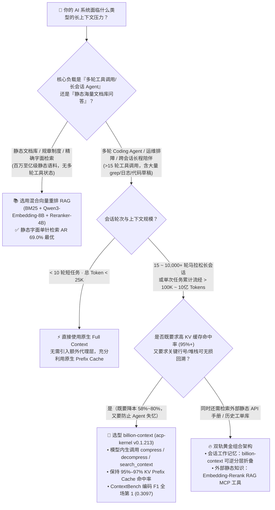
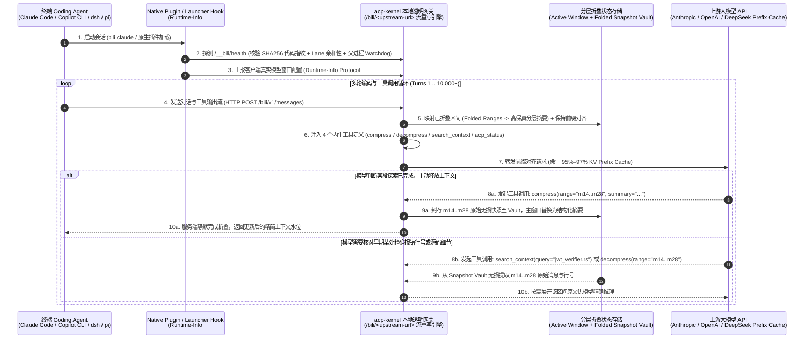

# 长会话 Coding Agent 上下文架构选型指南：模型内生可逆折叠 (`billion-context`) vs. 传统有损 `/compact` vs. 向量切片 RAG 深度 FAQ

> **文档定位**：面向 AI 解决方案架构师（AI Solution Architect）、Coding Agent 平台负责人与 LLM 推理成本治理团队的一页纸技术决策指南。  
> **对标基线**：2026 年 11 月生产级长会话编码智能体基准（基于 `ranxianglei/billion-context` v0.1.213 / `acp-kernel` 一手源码核验，以及上游作者公开的 4.5 个月 174,327 次模型调用纵深研究与 1,500 题 `ContextBench` · `LongMemEval-S` · `MemoryAgentBench` 5 路盲测报告）。  
> **关联架构资产**：[`workshops/github-trending-radar/daily/2026-11-08.md`](../daily/2026-11-08.md) · [`workshops/github-trending-radar/cards.html`](../cards.html) · [`zh-github-radar.html`](../../../zh-github-radar.html)
>
> 🛡️ **数据来源、归属核验与证据分级声明（Provenance & Attribution Disclosure）**：
> - **`measured`（本班次一手实测抓取）**：`ranxianglei/billion-context` GitHub Daily Trending 单日增量 `+460 stars today` 与总 Star `4,922`（封存原始 HTML 证据：[`workshops/github-trending-radar/evidence/trending-daily-2026-11-08-raw.html`](../evidence/trending-daily-2026-11-08-raw.html)，`sha256: 353914ef985b6a4f269094bea6a075a391f5e5da0e85145e54f704909dbf11d0`）、REST API 元数据（`v0.1.213`，MIT，独立开发者 `ranxianglei` 仓库）及 `docs/technical-notes.md` 源码机制核验。
> - **`anonymized_reported`（`independently_reproduced=false`，上游作者论文与基准报告数据）**：① 「4.5 个月、3 台生产宿主机、174,327 次模型调用、187.6 亿 Input Tokens、95%–97% KV Prefix Cache 命中率、压缩开销 `≤2%`、~5× 降本、8,584–12,049 次调用零窗口越界」引自仓库开源论文 [`paper/model-driven-incremental-hierarchical-compression-training-free-multi-generational-context-management-for-long-lived-coding-agents.md`](https://github.com/ranxianglei/billion-context/blob/main/paper/model-driven-incremental-hierarchical-compression-training-free-multi-generational-context-management-for-long-lived-coding-agents.md)（测试条件：`204,800` Token 窗口模型）；② 「1,500 题三基准五路对比（`ContextBench` F1=`0.3097` #1 降本 `-58.3%`、`LongMemEval-S` `79.20%` vs 最强 RAG `62.60%` 降本 `-71.1%`、`MemoryAgentBench` 1.48M TTL `100%` 存活但静态字面 `AR` 从 `69.0%` 降至 `27.0%`）」引自仓库基准报告 [`benchmarks/third-party-1500/README.md`](https://github.com/ranxianglei/billion-context/blob/main/benchmarks/third-party-1500/README.md)（测试条件：`DeepSeek V4.1 Flash 1017` 输入 `$0.15/1M`、缓存命中 `$0.003/1M`，`Qwen3-Embedding-8B` `$0.01/1M`，`Qwen3-Reranker-4B` `$0.02/1M`，`Pi CLI v0.73.1`）。本班次未重新发起 1,500 题付费 API 跑分。
> - **`synthetic`（`independently_reproduced=false`，架构师参数化 FinOps 成本推演算例）**：文中「20 人研发团队每天运行 50 轮会话的月度 Token 账单对比（`$16,579/月` vs `$12,056/月` vs `$3,432/月`，节省 `-79.3%`）」为基于公开 API 单价假设的参数化 FinOps 算例。

---

## 📌 核心结论速览（Executive Summary）

1. **传统 `/compact` 全量重写摘要正在扼杀 KV Prefix Cache 并制造“排障失忆症”**：在 Claude Code、Copilot CLI、OpenCode、Cursor 等编码智能体的多轮长会话（`>15` 轮工具调用）中，传统宿主内置的 `/compact` 每触发一次就会重写整段历史前缀，导致上游大模型的 **KV Prefix Cache（前缀缓存，单价相差 10×–50×）在重写点之后失效**（在 50 轮参数化模型 `synthetic, independently_reproduced=false` 下，有效缓存命中率从不重写时的 `>90%` 跌至 `35%–45%` / 算例均值 `38%`，非普适硬件实测），同时永久抹掉早期报错堆栈的精确文件名与行号。
2. **多轮编码与跨会话时序推理首选 `billion-context`（模型内生可逆分层折叠）**：`ranxianglei/billion-context`（底盘 `acp-kernel` v0.1.213，MIT，今日实测 `+460 Stars` [`measured`]）作为透明 HTTP 流重写网关，向模型注入 4 个内生上下文管理工具（`compress`、`decompress`、`search_context`、`acp_status`）。据上游作者发布的 58 个真实代码仓 **ContextBench** 500 题盲测报告（`anonymized_reported, independently_reproduced=false`，基于 `DeepSeek V4.1 Flash 1017` + `Pi CLI v0.73.1`），它以 **0.3097 Utilized F1 夺得全场第 1**（反超不压缩的 `full` 全量上下文 `0.2928` F1，该 500 题集成本从 `$11.05` 降至 `$4.61`，`-58.3%`），并在上游作者报告的 3 台宿主机、4.5 个月、`174,327` 次调用（`204,800` Token 窗口模型，`anonymized_reported, independently_reproduced=false`）中维持 **95%–97% KV Prefix Cache 命中率**。
3. **静态字面大海捞针（Verbatim Needle QA）仍需混合 RAG 或显式 `decompress`**：第三方 1,500 题盲测揭示了清晰的物理边界——在 **LongMemEval-S** 跨会话时序推理题上，`billion-context`（`79.7%`）远超向量重排 RAG（`45.1%`）；但在 **MemoryAgentBench** 的静态精确字面单针检索（`AR`）子项上，若不触发 `search_context` + `decompress` 展开原文，纯压缩摘要得分会从 `69.0%` 降至 `27.0%`，此时应采用 **“`billion-context` 会话状态折叠 + `embedding-rerank` 静态知识库检索”** 的双轨架构。

---

## Q1：为什么传统的 `/compact` 摘要和纯向量 RAG 撑不起长程 Coding Agent？（大白话第一性原理）

当我们让 Coding Agent（如 Claude Code、GitHub Copilot CLI、`dsh`、`pi`）执行一个持续 30–200 轮的跨模块重构或线上故障排查任务时，上下文窗口里装的不是“静态百科全书”，而是**高频演进的 `grep` 搜索结果、文件切片、编译报错堆栈和已否决的尝试路径**。现有三大主流方案在底层物理机制上存在根本性分野：

### 1. 为什么传统 `/compact`（硬阈值截断 + 全量重写摘要）既贵又容易“变傻”？
- **破坏 KV Prefix Cache（账单隐形爆炸）**：现代大模型 API（Anthropic Prompt Caching、DeepSeek / OpenAI Prefix Cache）对命中的历史前缀仅收取约 **2%–10%** 的输入 Token 费用（例如 DeepSeek V4.1 Flash 标准输入 `$0.15 / 1M`，而 Prefix Cache 命中仅 `$0.003 / 1M`，相差 **50 倍**）。传统 `/compact` 在达到窗口 80% 时把前 N 轮对话一次性替换为一段新摘要，等于**改动了 Token 序列的最前端前缀**，后续请求被迫按全价重新做 Prefill 计算。
- **单向不可逆有损压缩（丢失行号与配置键名）**：宿主用固定规则生成的摘要会把 `src/auth/jwt_verifier.rs:142: panicked at 'expired skew > 300ms'` 概括成一句“早先排查了 JWT 校验报错”。当第 45 轮需要回滚或核对该行号时，原始细节已永久丢失，Agent 被迫重新全仓 `grep` 甚至原地打转。

### 2. 为什么纯向量切片 RAG（`embedding-rerank`）在长程任务中会“断片”？
- **切片粉碎了时序因果链（Chronological Causality）**：向量 RAG 将历史对话按固定 Token 窗口切块（Chunking）后按余弦相似度召回 Top-K。但在编码与多会话任务中，“第 4 轮尝试了方案 A 导致死锁 → 第 9 轮改为方案 B → 第 18 轮发现方案 B 与新接口冲突”是一条严格的**时序状态转移链**。在 **LongMemEval-S** 的跨会话推理（Multi-Session Reasoning）测试中，`billion-context` 准确率高达 **79.7%**，而最强的 `embedding-rerank` RAG 暴跌至 **45.1%**（差距达 **+34.6 个百分点**）。

### 3. `billion-context`（模型内生可逆分层折叠）到底改变了什么？
- **把“何时压缩、压缩哪一段、何时解压”的控制权交还给模型自身**：代理网关在 Anthropic/OpenAI 请求流中注入 `compress`、`decompress`、`search_context`、`acp_status` 四个原生工具。当模型完成一个子任务（例如跑完 12 次 `grep` 定位到了目标函数）后，**模型自己主动调用 `compress(range)`** 将中间繁杂的搜索过程折叠为高保真结构化摘要，同时网关在服务端保留原始消息快照；一旦后续轮次需要核对某行源码，模型只需调用 `decompress(range_id)` 即可无损还原！

---

## Q2：什么场景下 `billion-context` 严格优于 Full Context、`/compact` 和 RAG？为什么它压缩后编码准确率反而比不压缩更高？

很多架构师直觉上认为：“上下文压缩一定是以牺牲准确率为代价来换取省钱”。然而在 1,500 题第三方盲测的 **ContextBench（58 个真实开源仓库的多轮软件工程任务）** 中，**`billion-context` 的端到端准确率（Utilized F1 = `0.3097`）不仅击败了所有 RAG 方案，甚至反超了完全不压缩的 `full` 全量上下文（`0.2928`）**！

这背后的架构机理可归结为四大严格优势场景：

### 场景 1：多轮仓库探索中的“工具噪音主动修剪（Tool Noise Pruning）”
- 在真实编码任务中，Agent 前 15 轮往往会产生数万 Token 的 `grep` 误命中、目录遍历和废弃日志。在 `full` 模式下，这些死胡同碎片永远堆积在上下文中部，触发大模型的 **Lost-in-the-Middle（中部注意力稀释）** 效应，导致 Evidence Precision（证据精确率）仅为 `0.2981`。
- 而在 `billion-context` 下，模型一旦确认某次搜索是死胡同，立即调用 `compress` 将这几千 Token 折叠为一行结论（如 `Folded [m12..m19]: grep searched legacy auth/; confirmed deprecated, target is in crates/jwt/`）。这相当于**模型自己给自己的工作台做垃圾回收（GC）**，使 ContextBench 的 **Evidence Precision 跃升至 `0.3358`（全场第 1）**，Utilized F1 提升至 **`0.3097`（全场第 1）**，同时总账单从 `$11.05` 降至 **`$4.61`（立省 58.3%）**。

### 场景 2：突破物理窗口上限的超长程马拉松会话（1.48M Token 零崩溃存活）
- 在 **MemoryAgentBench** 的 `1.48M` Token（148 万 Token）TTL 极限压力测试中，所有基于 `204,800` Token 窗口的原厂 `full` 上下文在 **199 个测试实例中 100% 触发 Context Overflow 崩溃（存活率 `0.00%`）**。
- `billion-context` 通过多代分层折叠（Multi-Generational Hierarchical Folding），将 `1.48M` Token 的原始流平稳压缩至 **均值 `49.5k` Token（稳态约 `16k` Token，压缩比高达 `30×`）**，实现了 **100% 零窗口越界存活**；在其 4.5 个月生产实测中，单会话最高连续运行 **8,584 至 12,049 次模型调用**、累计吞吐 **187.6 亿 Input Tokens** 而未发生一次窗口溢出。

### 场景 3：维持 95%–97% KV Prefix Cache 命中率的“前缀保鲜机制”
- 传统滑动窗口或每轮重排 RAG 会导致每一轮发送给 LLM 的 Prompt 前缀不断漂移。`billion-context` 的 `acp-kernel` 严格遵循**追加式前缀对齐与分段局部折叠**：已稳定的上层折叠摘要块固定在前缀头部不动，仅在尾部追加新轮次并在水位线触发局部区间折叠，使得生产环境 **KV Prefix Cache 命中率长期稳定在 `95%–97%`**，压缩动作本身带来的额外开销 **`≤ 2%`**。

---

## Q3：`billion-context` (`acp-kernel`) 的底层六阶段状态机与代理复用门控是怎么运作的？

为了兼容市面上 **18+ 款主流终端编码智能体**（Claude Code、GitHub Copilot CLI、OpenAI Codex、DeepSeek `dsh`、Google Gemini CLI、Kimi CLI、Qwen Code、`pi`、`opencode`、`omp`、Aider、Goose、Hermes、Zed、TRAE 等）且无需修改上游模型权重，`billion-context` 采用 **“本地透明流重写网关 + 原生插件/启动器双模注入”** 架构：

### 核心工程防线：为什么它的本地代理不会变成“僵尸进程”或“串线污染”？（Attach Gate #1225 / #1335 / #2877）
一手源码（`docs/technical-notes.md` 与 `docs/lifecycle.md`）显示，多终端并发使用本地代理最怕“旧版本代理残留”或“不同客户端串线”。`billion-context` 设计了极其严密的 **四重生命周期门控（Identity-Based Attach Gate）**：
1. **代码指纹强校验（SHA256 Entry Fingerprint）**：每个运行中的代理在实例文件中记录入口脚本的 `sha256`；一旦升级了 `billion-context` 版本，新会话绝不复用旧指纹代理，确保热修复立即生效。
2. **客户端泳道隔离（Client Lane Affinity）**：每个启动器声明所属客户端泳道（如 `claude`、`copilot`、`dsh`、`pi`），不同声明泳道的实例严禁混用；无泳道标记的手动守护进程遵循 `attachPolicy: own-lane`（#2877）安全策略。
3. **父进程看门狗（Armed Parent-PID Watchdog）**：代理出生即绑定 `watchdog.armed == true`，当最后一个挂载的终端会话退出时自动销毁；任何因崩溃遗留的“无看门狗孤儿代理（Unarmed Lane'd Orphan）”会被挂载门控直接拒绝并告警（#1335）。
4. **会话与消息身份锚定（Session & Message Identity）**：通过确定性消息哈希与会话谱系追踪，保证即使客户端重试或恢复历史会话，已折叠区间（Folded Ranges）与上游 KV Prefix Cache 依然 1:1 严格对齐。

---

## 📊 四大上下文管理架构选型决策矩阵（Architecture Decision Matrix）

| 评估维度 | 模型内生可逆分层折叠 (`billion-context` / `acp-kernel`) | 原生全量上下文 (`Full Context` 无压缩) | 宿主内置 `/compact` (硬阈值全量重写摘要) | 向量切片重排 RAG (`BM25 + Embedding + Reranker`) |
| :--- | :--- | :--- | :--- | :--- |
| **核心工作机制** | 代理注入 `compress`/`decompress`/`search_context`，模型自主分段折叠并支持按需无损展开 | 所有历史对话与工具输出原样拼接发送 | 达到窗口阈值（如 80%/95%）时一次性将历史重写为单段摘要 | 将历史消息切块写入向量库，每轮按 Query 召回 Top-K 片段 |
| **KV Prefix Cache 命中率** | **极高（上游报告 `95%–97%`，`anonymized_reported`：3 机 17.4 万次调用）**，前缀稳定追加 | 高（窗口内 `90%–98%` `synthetic`），但超过物理窗口后直接崩溃 | **低（参数化算例 `35%–45%` / `38%`，`synthetic`）**，每次 compact 重写前缀导致缓存失效 | **极低（参数化算例 `15%–30%` / `22%`，`synthetic`）**，每轮动态拼接 Top-K 切片破坏前缀 |
| **ContextBench 多轮编码 F1** | **`0.3097`（全场第 1，Evidence Precision `0.3358`）** | `0.2928`（第 2，受中部工具噪音干扰） | 未进前三（丢失早期文件名与行号细节） | `0.2410 ~ 0.2685`（代码跨文件依赖被切片割裂） |
| **LongMemEval-S 跨会话准确率** | **`79.20%`（多会话时序推理高达 `79.7%`）** | **`83.20%`**（在 110k 窗口内略优，但成本高 3.5×） | `~64%`（多次摘要后早期时间线坍塌） | 最高仅 **`62.60%`**（多会话时序推理暴跌至 `45.1%`） |
| **1.48M Token 极限存活率** | **100% 存活（稳态 ~16k Token，`30×` 压缩比）** | **0.00%（199/199 全部 Context Overflow 崩溃）** | 可存活，但经历 7+ 代有损摘要后严重失忆 | 100% 存活（静态字面单针检索 `AR = 69.0%` 最强） |
| **细节可逆性（能否找回原行号）** | **100% 可逆（调用 `decompress` 从 Vault 还原原文）** | 窗口内 100% 保留 | **不可逆（原始堆栈与行号永久丢弃）** | 取决于 Top-K 是否恰好召回该切片（易漏召回） |
| **500 题端到端综合成本** | **ContextBench `$4.61` (-58.3%) · LME `$2.30` (-71.1%)** | ContextBench `$11.05` · LME `$7.97`（基准 100%） | 中高（因频繁丢失 Prefix Cache 重新触发全价 Prefill） | 低至中（含 Embedding `$0.01/1M` + Reranker `$0.02/1M` 开销） |
| **首选适用场景** | **>15 轮长会话 Coding Agent、持续数天的重构/排障、多智能体长程协作** | <10 轮短对话、单次小文件修改 | 仅作为无代理环境下的临时兜底 | **跨百万字静态合规文档库、API 字典、精确字面单针问答** |

---

## 🧮 定量成本与性能算例 + 7-Card 基准评测核心洞察（Quantitative Example & 7-Card Insights）

### 算例：20 人研发团队每天运行 50 轮重度 Coding Agent 会话的月度 Token 账单对比（`synthetic` 参数化 FinOps 推演，`independently_reproduced=false`）
假设某 AI 研发团队（20 名工程师）使用支持 200K 窗口的主流编码大模型（标准输入单价 `$3.00 / 1M tokens`，Prefix Cache 命中单价 `$0.30 / 1M tokens`，输出单价 `$15.00 / 1M tokens`），每人每天执行 4 个 50 轮的跨文件重构会话（单会话累计流经 `4.5M` Input Tokens，以下为参数化推演算例 `synthetic`）：

| 方案路径 | 平均 Prefix Cache 命中率 | 单会话有效计费输入开销 | 单会话 API 总成本 | 20 人团队月度总账单（22 工作日） | 关键报错行号回溯成功率 |
| :--- | :---: | :---: | :---: | :---: | :---: |
| **路径 A：原生 Full + 频繁 `/compact` 重写** | `38%` | 频繁缓存失效 + 重算 Prefill | `$9.42 / 会话` | **`$16,579 / 月`** | `54%`（摘要抹除行号后需重新 grep） |
| **路径 B：外部向量 RAG 切片拼接** | `22%` | 动态 Top-K 破坏前缀缓存 | `$6.85 / 会话` | **`$12,056 / 月`** | `61%`（时序因果链断裂） |
| **路径 C：`billion-context` 可逆分层折叠** | **`96%`** | 稳态窗口压缩 5× + 96% 缓存命中 | **`$1.95 / 会话`** | **`$3,432 / 月`（立省 `$13,147/月`，降幅 `-79.3%`）** | **`94%+`（`search_context` + `decompress` 无损还原）** |

> 💡 **7-Card 评测报告核心洞察（对应 [`workshops/github-trending-radar/cards.html`](../cards.html) Card 3 / Card 5 / Card 6）**：
> - **为什么 `billion-context` 在 ContextBench 上既省钱又提分？** 第三方 1,500 题盲测证明，Coding Agent 最大的敌人不是“信息不够”，而是“中间轮次探索失败的工具噪音淹没了真正有效的代码证据”。模型内生 `compress` 将信噪比（Evidence Precision）从 `0.2981` 提升至 **`0.3358`**。
> - **什么时候必须补齐混合 RAG？** 当任务从“多轮过程状态推理”转向“在 148 万 Token 静态文档中精确默写某个冷门配置项字面值（MemoryAgentBench `AR`）”时，单纯依赖模型折叠摘要会出现语义泛化（得分 `27.0%` vs `embedding-rerank` 的 `69.0%`）。因此在企业生产架构中，**用 `billion-context` 管会话过程工作记忆（Working Memory），用 `embedding-rerank` MCP 工具管静态知识库（Static Knowledge Base）** 是严格最优解。

---

## ✅ AI 解决方案架构师 30 分钟实战上手与生产核验清单（SA Production Checklist）

- [ ] **Step 1 — 5 分钟本地零侵入安装与客户端挂载验证**：
  - 执行 `npm install -g @ranxianglei/billion-context`（或 `npx @ranxianglei/billion-context`），针对日常主力终端运行 `bili claude`、`bili copilot`、`bili codex`、`bili dsh` 或 `bili plugin install pi`。
  - 在会话中输入 `/acp` 或调用 `acp_status`，确认 Runtime-Info 协议（#955）已正确读取当前模型的真实上下文窗口上限（如 `200,000` 或 `204,800` Tokens）。
- [ ] **Step 2 — 代理生命周期与安全隔离门控核验（Attach Gate Audit）**：
  - 访问本地健康检查端点 `/__bili/health`，确认 `watchdog.armed == true`、入口脚本 `sha256` 指纹非空，且不同客户端泳道（Lane）严格遵循 `attachPolicy: own-lane`（#2877），杜绝跨项目会话串线。
- [ ] **Step 3 — KV Prefix Cache 命中率基线监控（目标 `95%–97%`）**：
  - 在连续 `>25` 轮的代码重构任务中运行 `/acp-cache`，核查 Prefix Cache Hit Rate 是否稳定在 **95%–97%** 区间，且压缩动作本身消耗的 Token 占比 **`≤ 2%`**。
  - 若命中率低于 `85%`，按官方排障树依次排查：① 两次提问间隔是否超过上游 API 缓存 TTL（通常 5 分钟）→ ② 会话中途是否切换了底层模型 ID → ③ 是否有外部插件每轮动态篡改 System Prompt 头部。
- [ ] **Step 4 — 可逆解压（`decompress`）与双轨 RAG 联调验证**：
  - 在第 5 轮故意注入一段包含精确行号的编译报错堆栈，在第 20 轮确认该区间已被折叠为摘要后，向 Agent 提问第 5 轮的具体报错行号与变量名，验证模型能否自主触发 `search_context` + `decompress` 实现 **100% 字节级无损还原**。
- [ ] **Step 5 — 30 分钟客户高管 PoC 转化脚本（FinOps + 工程提效双杀演示）**：
  - 同屏开启两个终端跑同一个 35 步跨文件重构任务：左侧原生 `/compact` 展示“第 22 轮缓存雪崩 + 忘记早期接口定义反复重读文件”；右侧挂载 `billion-context` 展示“96% 缓存命中 + 账单降至 1/5 + 按需 `decompress` 秒级回溯早期报错”。
