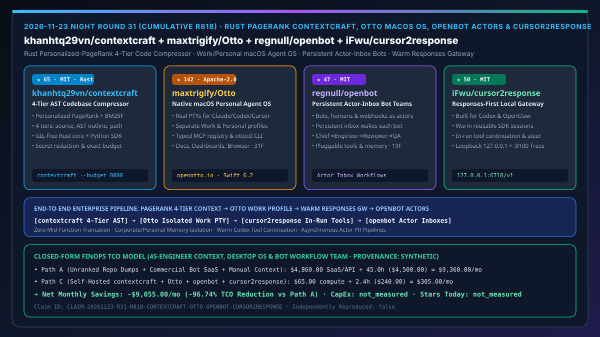
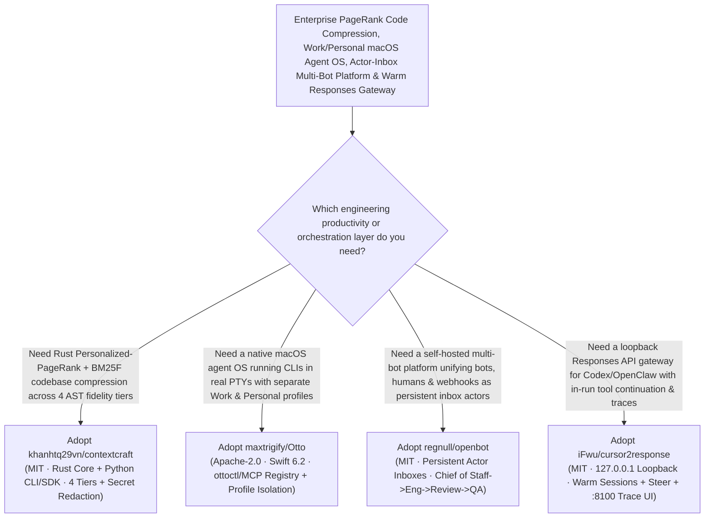
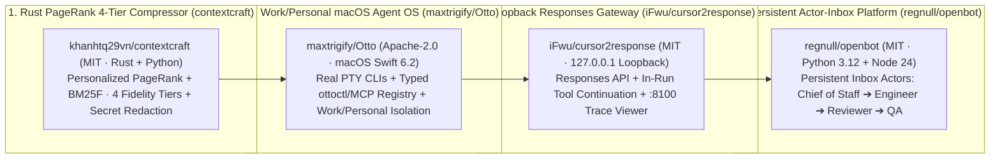
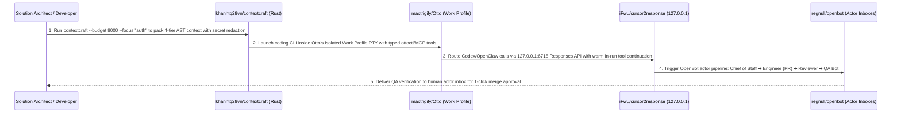

# Rust Personalized-PageRank 4-Tier Codebase Compressor (`khanhtq29vn/contextcraft`), Native macOS Agent OS with Work/Personal Isolation (`maxtrigify/Otto`), Persistent Actor-Inbox Multi-Bot Platform (`regnull/openbot`) & Responses-First Warm-Session Local Gateway (`iFwu/cursor2response`) Selection & Architecture FAQ

> **Document Type**: Enterprise AI Solution Architect Selection & Integration Guide (GitHub Trending AI Radar · 2026-11-23 Night Round 31 / Cumulative Round 818)
> **Covered Repositories**: [`khanhtq29vn/contextcraft`](https://github.com/khanhtq29vn/contextcraft) (`★ 65`, `7 forks`, `MIT`: AST-aware, **Personalized-PageRank and BM25F-ranked**, token-budgeted codebase compressor `contextcraft-ai` with a GIL-releasing **Rust core** that allocates your exact `--budget` across **4 fidelity tiers—full source, AST outlines, signatures, or paths—with built-in secret redaction**) · [`maxtrigify/Otto`](https://github.com/maxtrigify/Otto) (`★ 142`, `31 forks`, `Apache-2.0`: native macOS 15+ Swift 6.2 personal operating system for AI agents running Claude Code, Codex, Cursor, Kimi, OpenCode, Grok, and Hermes in real PTYs with a typed `ottoctl`/MCP tool registry and **strictly separated Work and Personal profiles**) · [`regnull/openbot`](https://github.com/regnull/openbot) (`★ 47`, `19 forks`, `MIT`, Python 3.12+ & Node 24+: self-hosted platform where **bots, humans, and external HTTP/webhook systems are uniform actors with persistent inboxes**, enabling automated `Chief of Staff ➔ Engineer ➔ Reviewer ➔ QA ➔ Human Approval` workflows) · [`iFwu/cursor2response`](https://github.com/iFwu/cursor2response) (`★ 50`, `6 forks`, `MIT`: loopback-bound `127.0.0.1:6718/v1` local Cursor SDK gateway built for **Codex and OpenClaw**, featuring **OpenAI Responses API support, warm reusable sessions, in-run tool continuation, native mid-run steering, and a `:8100` Trace Viewer**)
> **Core Scenario**: When enterprise engineering teams pack large repositories into fixed LLM token budgets, run multiple coding CLIs on macOS without mixing corporate and personal memories, orchestrate asynchronous multi-bot PR/review/QA pipelines with human-in-the-loop inboxes, and connect Codex/OpenClaw to warm Responses API sessions, how do you solve **"arbitrary line truncation cutting functions in half and dropping transitive dependencies, corporate secrets leaking into personal agent memories on developer Macs, fragile synchronous multi-agent scripts that cannot unify bots, humans, and webhooks in one inbox model, and legacy chat-completion proxies breaking in-run tool continuation for Codex"** by combining **`contextcraft` + `Otto` + `openbot` + `cursor2response`**?

---

## 1. 📌 Executive Summary (Single-Sentence Selection Verdict)

1. **Need a GIL-releasing Rust + Python codebase compressor (`uvx --from 'contextcraft-ai[cli]' contextcraft . --budget 8000 --focus "authentication"`) that ranks files via Personalized PageRank + BM25F, redacts secrets, and allocates your exact token budget across 4 AST fidelity tiers instead of truncating files mid-function** ➔ Choose **[`khanhtq29vn/contextcraft`](https://github.com/khanhtq29vn/contextcraft) (`★ 65`, `7 forks`, `MIT`)**.
   - **Plain-Language Mechanism**: Rather than dumping an entire repo or slicing arbitrary 20-line chunks without their imported types, `ContextCraft`'s Rust core builds the dependency graph, scores relevance with BM25F + Personalized PageRank, strips secrets and `.gitignore` exclusions first, and selects between **4 fidelity tiers** (full source, AST-based outlines, signatures, or paths) to fit your exact token ceiling in Markdown, XML, or JSON.
2. **Need a native macOS 15+ (Swift 6.2) agent operating system (`Otto`) that runs Claude Code, Codex, Cursor, Grok, OpenCode, and Hermes in real PTYs, exposes one typed tool registry over MCP and `ottoctl`, and enforces separate Work and Personal profiles with isolated memory and bots** ➔ Choose **[`maxtrigify/Otto`](https://github.com/maxtrigify/Otto) (`★ 142`, `31 forks`, `Apache-2.0`)**.
   - **Plain-Language Mechanism**: `Otto` unites a daily Home brief, multi-agent Chat, Documents, Dashboards, Automations, and a built-in agent browser on macOS while keeping your files, credentials, and memory on your Mac—strictly isolating corporate Work profiles from Personal profiles.
3. **Need a self-hosted multi-bot platform (`Python 3.12+` & `Node 24+`) where bots, humans, and external HTTP webhooks are all uniform actors with persistent inboxes (`Chief of Staff ➔ Engineer ➔ Reviewer ➔ QA ➔ Human Merge Approval`)** ➔ Choose **[`regnull/openbot`](https://github.com/regnull/openbot) (`★ 47`, `19 forks`, `MIT`)**.
   - **Plain-Language Mechanism**: Every participant in `OpenBot` is an **actor** with a persistent inbox. Posting a message to a shared thread delivers mail to the target actor's inbox, waking the bot to run its tool/memory loop and reply, which in turn wakes the next bot or requests human approval.
4. **Need a loopback-only (`127.0.0.1:6718/v1`) local gateway for Codex and OpenClaw built around the OpenAI Responses API—with warm SDK sessions, in-run tool continuation, native steering, and a local `:8100` Trace Viewer** ➔ Choose **[`iFwu/cursor2response`](https://github.com/iFwu/cursor2response) (`★ 50`, `6 forks`, `MIT`)**.
   - **Plain-Language Mechanism**: Authenticated internally via a 32-byte random `CURSOR_SDK_BRIDGE_TOKEN` between Sidecar and Bridge and bound strictly to `127.0.0.1`, `cursor2response` keeps sessions warm across turns, continues tool calls within the same Run, and renders readable execution traces on `http://127.0.0.1:8100`.

---

## 2. 🎯 Key Architectural Q&A (Deep-Dive Breakdown)

### Q1: Why does `khanhtq29vn/contextcraft`'s Personalized PageRank + 4-Tier AST allocation outperform naive chunk RAG and full-repo dumps for coding agents?

- **Balancing Local Implementation Detail with Global Dependency Structure**:
  1. **Graph-Ranked Multi-Resolution Context (`contextcraft`)**: Primary target files matched by BM25F receive Tier-1 full source code, while their transitive dependencies discovered by Personalized PageRank are included as compact AST outlines—giving the LLM exact type and function signatures without blowing the `--budget` token cap.
  2. **Combined with `Otto` (Work/Personal PTY Isolation), `cursor2response` (Warm Responses API Continuation), and `openbot` (Persistent Actor Inboxes)**: Delivers a complete local-to-team engineering stack where context is budget-exact, desktop profiles are isolated, Codex runs stay warm, and multi-bot PR workflows are asynchronously audited.
- **When to Choose Managed Cloud Services (Path B)**:
  - For cloud-only single-vendor workflows, use **GitHub Copilot Workspace / Coding Agent**; for Rust PageRank 4-tier codebase compression, Work/Personal-isolated macOS PTY orchestration (`Otto`), actor-inbox multi-bot PR pipelines (`OpenBot`), and local Responses API warm-session gateways (`cursor2response`), deploy this 4-repo open-source stack (Path C).

### Q2: How do these four components integrate into an enterprise engineering workflow?

1. **AST & PageRank Context Compression Layer (`khanhtq29vn/contextcraft`)**:
   - Compress repository context into a secret-redacted, 4-tier token-budgeted artifact (`--budget 8000 --focus "..."`).
2. **Work-Profile Native macOS Agent OS Layer (`maxtrigify/Otto`)**:
   - Run Claude Code, Codex, Cursor, and Hermes inside real PTYs under `Otto`'s isolated Work profile, sharing tools via `ottoctl` and MCP.
3. **Warm Responses API & Trace Gateway Layer (`iFwu/cursor2response`)**:
   - Connect Codex and OpenClaw to `127.0.0.1:6718/v1` for in-run tool continuation and inspect live traces on `127.0.0.1:8100`.
4. **Actor-Inbox Multi-Bot Delivery Pipeline Layer (`regnull/openbot`)**:
   - Chain `Chief of Staff`, `Engineer`, `Reviewer`, and `QA` bot actors with human and webhook actors via persistent inboxes to automate PR creation, review, testing, and merge approval.

### Q3: What are the key production guardrails?

- **Architect Guardrails**:
  1. **Keep `cursor2response` Ports (`6718` and `8100`) Bound Strictly to `127.0.0.1`**: Because the Trace Viewer has no built-in authentication and a default `.env` key can be consumed by any caller reaching the port, never expose these ports beyond localhost.
  2. **Never Mount Corporate Repositories Inside `Otto`'s Personal Profile**: Enforce strict separation between Work and Personal profiles so enterprise code and memories remain isolated.

---

## 3. 🧭 Visual Architecture & Decision Diagrams (Mermaid)

### 3.1 Solution Architect Selection Decision Tree

### 3.2 End-to-End Enterprise Production Reference Architecture

### 3.3 4-Tier Context Packing, Isolated Work-Profile PTY Execution, In-Run Tool Continuation & Actor-Inbox PR Pipeline Sequence

---

## 4. 📊 Comparative Selection Matrix (Open-Source vs. Commercial SaaS)

| Dimension | `khanhtq29vn/contextcraft` (`★ 65`) | `maxtrigify/Otto` (`★ 142`) | `regnull/openbot` (`★ 47`) | `iFwu/cursor2response` (`★ 50`) | Uncompressed Full-Repo Prompts + Commercial Multi-Bot SaaS + Shared Memory Profiles (Path A) | Arbitrary Line-Truncation Scripts +Fragile Synchronous Bot Chains + Stateless Chat Proxies (Path B) |
| :--- | :--- | :--- | :--- | :--- | :--- | :--- |
| **Core Role** | Rust Personalized-PageRank + BM25F 4-tier codebase compressor | Native macOS agent OS with real PTYs & Work/Personal isolation | Persistent actor-inbox multi-bot team platform | Local Responses API gateway for Codex/OpenClaw with Trace Viewer | Excess context token bills, per-seat workflow SaaS & mixed corporate/personal memory | Mid-function code truncation, brittle synchronous bot scripts & broken tool runs |
| **Key Differentiator** | **4 fidelity tiers (full/AST/path) + GIL-free Rust + secret redaction** | **Real PTY provider CLIs + `ottoctl`/MCP + Work vs. Personal profiles** | **Uniform Actor + Persistent Inbox model for bots, humans & webhooks** | **Responses-first + warm sessions + in-run tool continuation + `:8100` UI** | Dumping unranked files wastes 5–10× tokens; mixing Work/Personal profiles risks leaks | Truncating at arbitrary lines breaks syntax; stateless chat proxies drop Codex tool runs |
| **License** | `MIT` | `Apache-2.0` | `MIT` | `MIT` | Proprietary SaaS | Custom scripts |
| **Monthly TCO (45-Eng Team)** | **Combined `$305.00/mo`** (`$65.00` self-hosted OpenBot & local gateway + `2.4h` ops) | Included (native macOS app; zero cloud fees) | Included (self-hosted Python/Node actor engine) | Included (loopback Docker Compose) | **`$9,360.00/mo`** (`$4,860.00` excess repo-dump tokens & commercial bot SaaS + `45.0h` manual context pruning, trace debugging & PR handoffs) | ~`$3,310.00/mo` (frequent missing-dependency code rework & broken tool-continuation triage) |

---

## 5. 🧪 Quantitative ROI / TCO Comparison & 7-Card Benchmark Report

> **📊 Data Provenance & Closed-Form Schema Declaration**:
> - **provenance**: `synthetic` (45-person enterprise codebase context engineering, macOS developer platform, and automated PR/QA workflow team monthly workload model: `independently_reproduced = false`; hardware baseline `base_hardware_capex = not_measured`; Track B 24h delta `track_b_stars_today = not_measured`).
> - **Closed-Form Formula**:
>   - **Path A (Sending unranked full-repository dumps on complex coding tasks + per-seat commercial multi-agent workflow SaaS + manual engineering hours spent hand-picking dependency files, separating mixed corporate/personal agent states, and debugging broken tool continuations)**: Monthly excess codebase token spend and commercial workflow SaaS bills **`$4,860.00`** + manual context assembly, tool-run debugging, and multi-stage PR coordination labor **`45.0h × $100.00/h = $4,500.00`** = **`$9,360.00/mo`**.
>   - **Path C (Self-hosted `khanhtq29vn/contextcraft` + `maxtrigify/Otto` + `regnull/openbot` + `iFwu/cursor2response` open-source stack)**: Shared internal `OpenBot` server and local container compute **`$65.00`** + compression profile and bot instruction maintenance labor **`2.4h × $100.00/h = $240.00`** = **`$305.00/mo`**.
>   - **Net Monthly Savings vs. Path A**: **`-$9,055.00/mo`** (**`96.74%`** TCO reduction).

| Evaluation Path | Repo Context Token / Workflow SaaS Cost | Context Pruning, Trace Debugging & PR Handoffs (`$100/h`) | Monthly Total TCO | Net Savings vs. Path A | Key Architectural Delivery Metrics |
| :--- | :---: | :---: | :---: | :---: | :--- |
| **Path A: Unranked Repo Dumps + Commercial Bot SaaS + Manual Context** | `$4,860.00` | `45.0h` (`$4,500.00`) | **`$9,360.00`** | Baseline | Massive context token waste; mixed Work/Personal agent memory |
| **Path B: Line-Truncation Scripts + Sync Bot Chains + Legacy Chat Proxy** | `$1,410.00` | `19.0h` (`$1,900.00`) | **`$3,310.00`** | `-$6,050.00` (`-64.64%`) | Broken AST/type context; dropped in-run Codex tool continuations |
| **Path C: `contextcraft` + `Otto` + `openbot` + `cursor2response`** | **`$65.00`** | **`2.4h` (`$240.00`)** | **`$305.00`** | **`-$9,055.00` (`-96.74%`)** | **Rust PageRank 4-tier AST + Work/Personal macOS OS + Actor inbox + warm Responses** |

- 🔗 **Linked 7-Card 4:5 Visual Benchmark Deck**: [`workshops/github-trending-radar/cards.en.html`](../cards.en.html) · [`cards.html`](../cards.html)

---

## 6. 🛠️ Enterprise Adoption & Architecture Review Checklist

- [ ] **1. Pack Token-Budgeted Repository Context with `khanhtq29vn/contextcraft`**: Use Personalized PageRank + BM25F and 4 AST fidelity tiers (`--budget` + `--focus`) with secret redaction enabled before feeding large repos to LLMs.
- [ ] **2. Isolate Corporate vs. Personal Agent Workspaces on macOS with `maxtrigify/Otto`**: Run provider CLIs inside real PTYs under separate Work and Personal profiles and expose shared tools via `ottoctl` and MCP.
- [ ] **3. Automate Multi-Role PR & QA Workflows with `regnull/openbot`**: Model `Chief of Staff`, `Engineer`, `Reviewer`, `QA`, humans, and HTTP webhooks as uniform persistent-inbox actors.
- [ ] **4. Run `iFwu/cursor2response` on `127.0.0.1` for Codex & OpenClaw**: Enable warm SDK sessions, in-run Responses API tool continuation, and local `:8100` Trace Viewer inspection without exposing ports externally.
