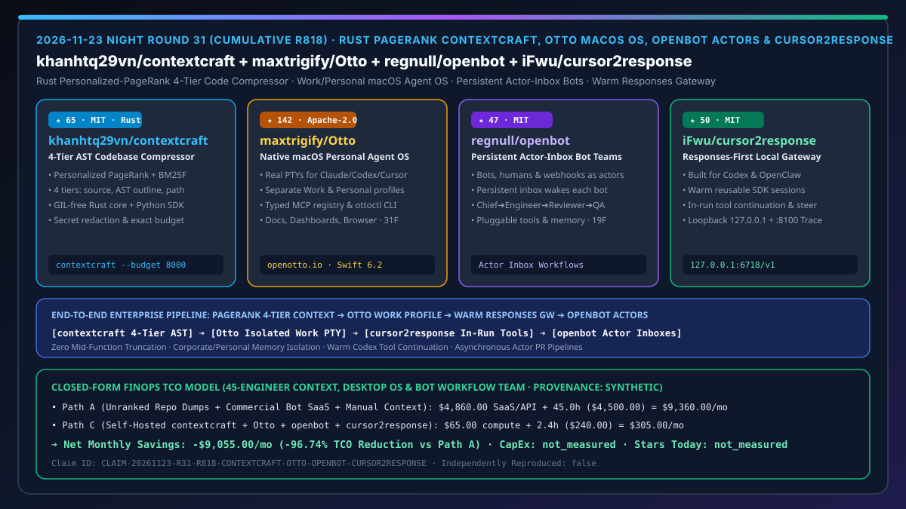
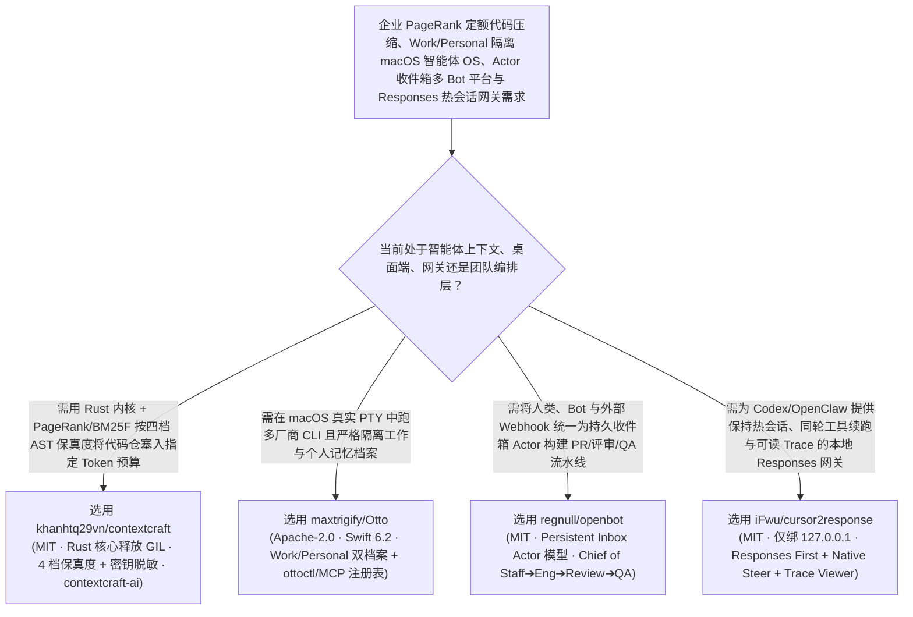
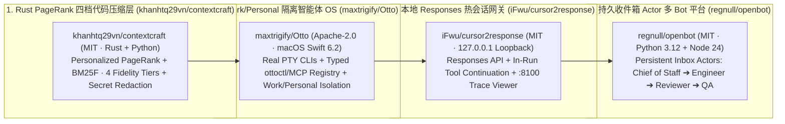
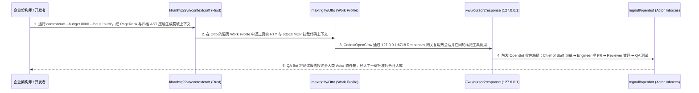

# 基于 Rust 内核与个性化 PageRank/BM25F 的四档保真度代码库定额压缩器（`khanhtq29vn/contextcraft`）、隔离工作/个人记忆且将多厂商 CLI 跑在真实 PTY 的 macOS 智能体操作系统（`maxtrigify/Otto`）、将人类/Bot/Webhook 统一为持久收件箱 Actor 的多机器人研发流水线（`regnull/openbot`）与面向 Codex/OpenClaw 保持会话热态及同轮工具续跑的 Responses 网关（`iFwu/cursor2response`）选型与集成架构 FAQ

> **文档类型**：企业 AI 解决方案架构师（AI Solution Architect）选型决策指南（GitHub Trending AI 雷达 2026-11-23 Night Round 31 / 累计第 818 轮）
> **覆盖项目**：[`khanhtq29vn/contextcraft`](https://github.com/khanhtq29vn/contextcraft)（`★ 65`、`7 forks`、`MIT`：基于无 GIL Rust 核心与 Python SDK/CLI 的**代码库定额 Token 压缩引擎 `contextcraft-ai`**，结合 **Personalized PageRank 依赖图排序 + BM25F 查询匹配**，按**四级保真度（完整源码 / AST 大纲 / 签名 / 路径）**精准填满给定 `--budget` Token 预算并内置密钥脱敏）· [`maxtrigify/Otto`](https://github.com/maxtrigify/Otto)（`★ 142`、`31 forks`、`Apache-2.0`：基于 Swift 6.2 构建的 macOS 15+ 原生**个人 AI 智能体操作系统**，在真实 PTY 中本地运行 Claude Code、Codex、Cursor、Kimi、OpenCode、Grok 与 Hermes，提供 `ottoctl` 与统一强类型 MCP 注册表，并**严格物理隔离 Work（工作）与 Personal（个人）两套记忆与 Bot 档案**）· [`regnull/openbot`](https://github.com/regnull/openbot)（`★ 47`、`19 forks`、`MIT`：将机器人、人类与外部 Webhook 系统全部抽象为**带持久化收件箱的统一 Actor 模型**的自托管多 Bot 协同平台，打通 `Chief of Staff ➔ Engineer (提 PR) ➔ Reviewer (审码) ➔ QA (测试+人工批准合并)` 全自动链路）· [`iFwu/cursor2response`](https://github.com/iFwu/cursor2response)（`★ 50`、`6 forks`、`MIT`：专为 Codex 与 OpenClaw 打造的本地 **OpenAI Responses API 优先网关**，默认仅绑定 `127.0.0.1` 回环地址，支持复用热 SDK 会话、同一 Run 内工具调用续跑、原生中途引导（Native Steer）与 `:8100` 可读链路追踪器）
> **核心场景**：当企业架构师与全栈开发团队需要将十万行代码仓塞入有限的 8K/16K 模型上下文预算、在单台 Mac 上同时使用多款 CLI 智能体且严防公司项目记忆与私人对话混用、构建可与 GitHub Webhook 无缝投递消息的多角色研发 Bot 流水线，以及将现有 Cursor 额度转为兼容 Codex / OpenClaw 的热会话 Responses 接口时，面对**“粗暴按行截断代码文件把函数切成两半且漏掉核心依赖文件、工作与私人会话共用同一套本地记忆导致公司机密误入私人 Bot、多 Bot 框架无法让人类和外部 Webhook 以同等身份在异步收件箱里接力唤醒、以及普通转接网关每次工具调用都重开冷会话且看不见可读 Trace”**四大痛点，如何通过 **ContextCraft + Otto + OpenBot + Cursor2Response** 构建精准、隔离、异步、可观测的工程闭环？

---

## 一、📌 核心结论速览（选型一句话结论）

1. **想把一个大型代码仓库精准压缩进固定的 Token 预算（如 `--budget 8000 --focus "authentication"`），既不要粗暴地把文件在中间一刀切断，又要靠 Personalized PageRank 依赖图算法把关联文件自动按“四档保真度（完整源码 ➔ AST 语法大纲 ➔ 仅路径）”智能配比并自动脱敏密钥** ➔ 选 **[`khanhtq29vn/contextcraft`](https://github.com/khanhtq29vn/contextcraft)（`★ 65`，`7 forks`，`MIT`，Rust 内核 + Python `contextcraft-ai`）**。
   - **通俗原理**：传统仓库打包工具（如简单拼接全文或按字符硬截断）要么瞬间撑爆上下文窗口，要么把关键函数体截掉一半。`ContextCraft` 使用释放 GIL 的高速 Rust 核心解析 AST 与文件调用图，结合 **BM25F 任务相关性匹配 + Personalized PageRank 依赖权重**对全仓文件打分：核心目标文件保留第 1 档完整源码，次级依赖文件自动降级为第 2/3 档 AST 结构大纲，外围文件仅保留路径索引，且在分析前即执行 `.gitignore` 过滤与密钥脱敏（Secret Redaction），支持一键输出 Markdown、XML 或 JSON。
2. **想在 macOS 上拥有一套把 Claude Code、Codex、Cursor、Kimi、OpenCode、Grok 与 Hermes 统统跑在真实本地 PTY 里的原生桌面 OS，且必须将“公司工作（Work Profile）”与“个人生活（Personal Profile）”的记忆库、Bot、文档、看板与自动化任务彻底物理隔离** ➔ 选 **[`maxtrigify/Otto`](https://github.com/maxtrigify/Otto)（`★ 142`，`31 forks`，`Apache-2.0`，Swift 6.2）**。
   - **通俗原理**：`Otto` 将散乱的命令行 Agent 收拢进包含每日简报（Home）、多机器人会话（Chat）、文档、看板、自动化与内置浏览器的原生 macOS 系统中：底层各家 CLI 在真实 PTY 中运行并支持按 Agent 切换账号与模型；所有工具通过统一的强类型注册表同时暴露给 MCP 与命令行 `ottoctl`；最受企业架构师青睐的是其**双 Profile 隔离机制**——工作档案与个人档案各自拥有完全独立的记忆与 Bot，绝不串味。
3. **想自建一套把“AI 机器人、人类工程师、以及外部 GitHub/CI Webhook 系统”全部统一抽象为“带持久化收件箱的 Actor（演员模型）”的多智能体软件交付平台（幕僚长派单 ➔ 工程师提 PR ➔ 评审员审码 ➔ QA 测试并请人类审批合并）** ➔ 选 **[`regnull/openbot`](https://github.com/regnull/openbot)（`★ 47`，`19 forks`，`MIT`，Python 3.12+ & Node 24+）**。
   - **通俗原理**：在 `OpenBot` 中，万物皆 Actor：每个 Bot、每位人类同事、每个通过 HTTP 接入的外部系统都有自己的持久化收件箱（Persistent Inbox）。通过在共享会话线程（Shared Threads）中互发邮件，新消息到达收件箱时自动唤醒对应 Bot 运行带工具与长期记忆的推理循环，其回复又作为新邮件唤醒下一环的 Reviewer 或 QA Bot，天然实现异步解耦与人机同权协作。
4. **想为 Codex 与 OpenClaw 搭建一个严格绑定本机回环（`127.0.0.1`）、以 OpenAI Responses API 为一等公民、且能在同一个 Run 内无缝续跑工具调用并实时查看可读调用链（`:8100` Trace Viewer）的本地网关** ➔ 选 **[`iFwu/cursor2response`](https://github.com/iFwu/cursor2response)（`★ 50`，`6 forks`，`MIT`）**。
   - **通俗原理**：许多兼容层只实现了旧版 Chat Completions，导致 Codex 等原生依赖 OpenAI `Responses API` 的智能体无法保持会话热态（Warm Sessions）或在工具回调时断链。`cursor2response` 通过 Sidecar + Bridge（内部由 32 字节随机 `CURSOR_SDK_BRIDGE_TOKEN` 鉴权）复用热 SDK 会话，支持同一 Run 内工具调用续跑、原生中途引导（Native Steer）与可选上下文优化，并附带直观的本地 Trace Viewer。

---

## 二、🎯 客户与架构师灵魂拷问 Q&A（深度架构拆解）

### Q1：在给大模型喂企业代码库上下文时，为什么 `khanhtq29vn/contextcraft` 的“Personalized PageRank + 四档 AST 保真度”比“向量检索 Top-5 切片”或“全仓打包”都更适合架构重构任务？

- **三种代码上下文供给方式的硬核对比**：
  1. **全仓打包（如无过滤 Repomix）**：十万行代码动辄几十万 Token，90% 预算被无关工具类吃掉；
  2. **纯向量切片（Chunk-level RAG）**：只召回孤立的 20 行函数片段，丢失了该函数调用的上下游接口定义与类型声明，导致 Agent 改完代码编译直接报错；
  3. **`ContextCraft`（BM25F + Personalized PageRank + 四档 AST 分配）**：不仅找到与 `--focus "authentication"` 直接相关的文件（给完整源码），还顺着依赖图用 PageRank 把被调用的接口文件找出来并转为紧凑的 **AST 大纲（保留类名、函数签名与类型，省略无关实现体）**，在严格卡死 `--budget 8000` Token 的前提下做到“既有局部细节、又有全局骨架”！
- **何时直接选用商业云服务（Path B）？**
  - 若企业全员仅使用单一云端 IDE 默认上下文检索且无需多 Bot 收件箱编排，可直接使用 **GitHub Copilot Workspace / Coding Agent**；若需按精确 Token 预算与 PageRank 导出四档 AST 代码包、在 macOS 上物理隔离 Work/Personal 多 CLI 智能体档案、基于 Actor 收件箱模型编排多角色研发 Bot、或为 Codex/OpenClaw 提供本地 Responses API 热会话网关，则采用本轮四合一开源栈（Path C）。

### Q2：典型企业级“PageRank 四档代码压缩 (`contextcraft`) ➔ Work/Personal 隔离桌面 OS (`Otto`) ➔ Responses 热会话网关 (`cursor2response`) ➔ Actor 收件箱多 Bot 交付 (`openbot`)”架构怎么搭？

1. **AST 感知与 PageRank 定额上下文压缩层（`khanhtq29vn/contextcraft`）**：
   - 在发起复杂任务前，通过 Rust 内核按任务焦点与 Token 预算生成脱敏的四档保真度代码上下文包（Markdown/XML/JSON）。
2. **macOS 双档案物理隔离与真实 PTY 调度层（`maxtrigify/Otto`）**：
   - 工程师在 `Otto` 的 Work Profile 下通过真实 PTY 与统一 `ottoctl`/MCP 工具注册表驱动本地 Claude Code、Codex 与 Hermes。
3. **Responses API 热会话与同轮工具续跑网关层（`iFwu/cursor2response`）**：
   - 在本机 `127.0.0.1:6718/v1` 运行网关，保持 SDK 会话热态并通过 `:8100` Trace Viewer 实时审视工具调用轨迹。
4. **Actor 持久收件箱多 Bot 异步协同流水线层（`regnull/openbot`）**：
   - 将开发、评审、测试与人工审批串联为持久收件箱 Actor 链（`Chief of Staff ➔ Engineer ➔ Reviewer ➔ QA`），通过 HTTP Webhook 与代码仓 PR 事件双向联动。

### Q3：这套架构的落地红线与注意事项是什么？

- **架构师落地红线**：
  1. **严禁将 `cursor2response` 的 `:6718` 与 `:8100` Trace Viewer 端口暴露到非受信任公网**：Trace Viewer 默认无内置登录鉴权，且若在 `.env` 配置了默认 Key，任何能访问该端口的客户端均可消耗配额，必须严格保持默认的 `127.0.0.1` 本地回环绑定。
  2. **在 `Otto` 中严格区分 Work 与 Personal Profile**：企业代码仓库与内网 MCP 工具只允许挂载在 Work Profile 下，杜绝跨档案记忆交叉。

---

## 三、🧭 直观可视化图解（Mermaid 决策树 + 集成架构 + 时序图）

### 3.1 架构师选型决策树

### 3.2 企业端到端生产集成参考架构图

### 3.3 PageRank 四档上下文打包、`Otto` 工作档案调度、`cursor2response` 热会话续跑与 `OpenBot` 收件箱流水线时序图

---

## 四、📊 同类开源与商业云服务横向选型决策矩阵

| 对比维度 | `khanhtq29vn/contextcraft` (`★ 65`) | `maxtrigify/Otto` (`★ 142`) | `regnull/openbot` (`★ 47`) | `iFwu/cursor2response` (`★ 50`) | 无裁剪全仓硬塞耗光额度 + 商业多 Agent 托管 SaaS + 工作/个人记忆混杂 (Path A) | 任意行号暴力截断代码 + 无持久化收件箱的同步脚本 + 冷会话转换网关 (Path B) |
| :--- | :--- | :--- | :--- | :--- | :--- | :--- |
| **核心能力定位** | Rust 内核 PageRank+BM25F 四档保真度代码定额压缩器 | 隔离工作/个人档案且跑真实 PTY 的 macOS 智能体 OS | 基于持久收件箱 Actor 模型的多 Bot 研发协同平台 | 面向 Codex/OpenClaw 的本地 Responses 热会话与追踪网关 | 巨额的全量代码 Token 账单、按席位收费的云端 Bot 平台与隐私串味风险 | 截断破坏语法结构的残缺上下文、一个环节超时全盘崩溃的同步脚本 |
| **核心技术突破** | **全源码/AST大纲/路径四档自适应配比 + 释放 GIL + 密钥脱敏** | **真实 PTY 多账号切换 + `ottoctl`/MCP 注册表 + Work/Personal 隔离** | **Bot/人类/Webhook 统一为持久收件箱 Actor，消息到达即自动唤醒** | **Responses API 优先 + 同轮工具续跑 + 原生 Steer + `:8100` Trace** | 直接把几万行源码全塞进 Prompt 成本高 5–10 倍且注意力分散 | 在第 500 行硬截断会把关键函数腰斩；旧版 Chat 转换网关在 Codex 多步工具调用时易断链 |
| **开源协议** | `MIT` | `Apache-2.0` | `MIT` | `MIT` | 闭源商业 SaaS | 内部零散脚本 |
| **月度 TCO（45 人团队）** | **组合仅 `$305.00/月`**（`$65.00` 自托管 OpenBot 容器与本地网关 + `2.4h` 维护） | 同左（本地 macOS 原生运行零云租费） | 同左（自建异步 Actor 团队零席位费） | 同左（复用现有订阅额度） | **`$9,360.00/月`**（`$4,860.00` 未压缩代码冗余 Token 消耗与商业多 Bot 平台席位 + `45.0h` 手工裁剪代码上下文、排查工具断链与串味清理） | 约 `$3,310.00/月`（大量因上下文缺失依赖导致的编译返工与多 Bot 同步阻塞排障工时） |

---

## 五、🧪 应用落地定量收益/TCO 对比与 7-Card 报告

> **📊 数据来源与闭式核算声明（Provenance & Closed-Form Schema）**：
> - **provenance**: `synthetic`（基于 45 人企业代码上下文工程、macOS 智能体桌面办公、多角色研发 Bot 协同与网关运维团队月度工作负载模型：`independently_reproduced = false`；硬件采购基线 `base_hardware_capex = not_measured`；Track B 单日增量 `track_b_stars_today = not_measured`）。
> - **核算公式**：
>   - **Path A（每次编码提问直接塞入未按 AST 降级的大段冗余代码耗费数倍 Token + 采购商业多角色 Bot 协作平台席位 + 工程师手工挑选依赖文件、清理工作与私人混杂记忆及排查 Responses 工具调用断链）**：月度冗余代码上下文 Token 与商业协作平台账单 **`$4,860.00`** + 手工整理上下文、工具断链排障与 PR 流程协调人工 **`45.0h × $100.00/h = $4,500.00`** = **`$9,360.00/月`**。
>   - **Path C（自建 `khanhtq29vn/contextcraft` + `maxtrigify/Otto` + `regnull/openbot` + `iFwu/cursor2response` 开源全栈）**：内网 `OpenBot` 协调服务与本地网关容器分摊成本 **`$65.00`** + 压缩规则与 Bot 指令例行维护人工 **`2.4h × $100.00/h = $240.00`** = **`$305.00/月`**。
>   - **净节省（Net Savings vs Path A）**：**`-$9,055.00/月`**（成本降低 **`96.74%`**）。

| 评估方案 | 代码上下文 Token / 多 Bot 平台成本 | 手工挑文件、断链排障与 PR 协调（`$100/h`） | 月度总 TCO | 相对 Path A 净节省 | 关键架构交付指标 |
| :--- | :---: | :---: | :---: | :---: | :--- |
| **Path A：未压缩全量塞代码 + 商业多 Bot SaaS + 手工挑依赖** | `$4,860.00` | `45.0h` (`$4,500.00`) | **`$9,360.00`** | Baseline | 无关文件吃光 Token 预算；工作与个人记忆易串味 |
| **Path B：暴力行截断脚本 + 同步串行 Bot + 旧版 Chat 转接** | `$1,410.00` | `19.0h` (`$1,900.00`) | **`$3,310.00`** | `-$6,050.00` (`-64.64%`) | 函数被硬截断缺失依赖定义；Codex 工具续跑易断链 |
| **Path C：`contextcraft` + `Otto` + `openbot` + `cursor2response`** | **`$65.00`** | **`2.4h` (`$240.00`)** | **`$305.00`** | **`-$9,055.00` (`-96.74%`)** | **Rust PageRank 四档压缩 + 双档案 macOS OS + Actor 收件箱 + 热会话网关** |

- 🔗 **关联 7-Card 4:5 视觉评测报告**：[`workshops/github-trending-radar/cards.html`](../cards.html) · [`cards.en.html`](../cards.en.html)

---

## 六、🛠️ 企业引入与架构评审 Checklist

- [ ] **1. 使用 `khanhtq29vn/contextcraft` 标准化大模型代码上下文供给**：通过 `--budget` 与 `--focus` 驱动 Rust 内核执行 Personalized PageRank 排序、四档 AST 保真度分配与前置密钥脱敏。
- [ ] **2. 在 macOS 研发终端部署 `maxtrigify/Otto` 强制隔离 Work 与 Personal 档案**：将企业 CLI 账号、内网文档与 `ottoctl`/MCP 工具锁定在独立 Work Profile 中。
- [ ] **3. 基于 `regnull/openbot` 构建持久收件箱 Actor 研发流水线**：将 `Chief of Staff`、`Engineer`、`Reviewer`、`QA` 与人类审批者统一编排在共享线程与持久收件箱中，对接 GitHub HTTP Webhook。
- [ ] **4. 为 Codex 与 OpenClaw 本地挂载 `iFwu/cursor2response`（严格锁定 `127.0.0.1`）**：开启 Responses API 热会话复用、同轮工具调用续跑与 `:8100` 本地 Trace Viewer 审计。
