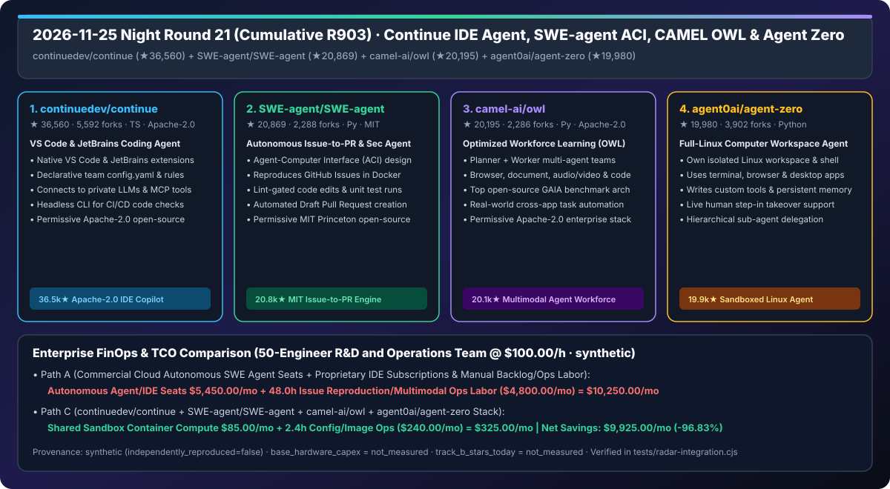
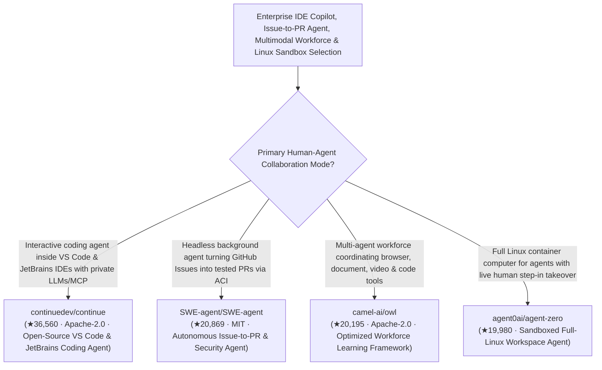
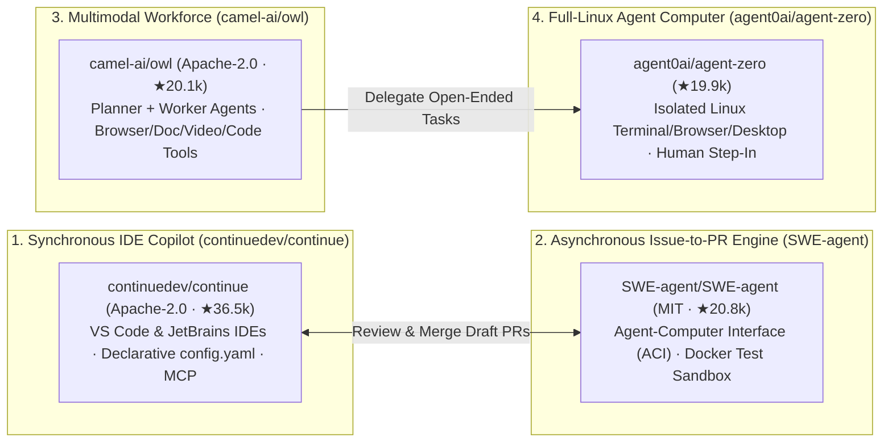
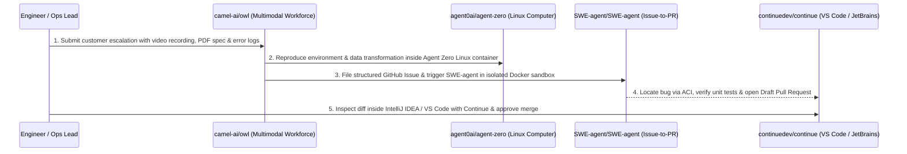

# Open-Source IDE Coding Agent (`continuedev/continue`), Autonomous Issue-to-PR Agent (`SWE-agent/SWE-agent`), Multi-Agent Workforce Automation (`camel-ai/owl`) & Full-Linux Workspace Agent (`agent0ai/agent-zero`) Selection & Integration Architecture FAQ

> **Document Type**: Enterprise AI Solution Architect Selection Decision Guide (GitHub Trending AI Radar — 2026-11-25 Night Round 21 / Cumulative Round 903)
> **Covered Repositories**: [`continuedev/continue`](https://github.com/continuedev/continue) (`★ 36,560`, `5,592 forks`, `Apache-2.0`, TypeScript: pioneering open-source coding agent across VS Code, JetBrains IDEs, and headless CLI with declarative `config.yaml` and MCP support) · [`SWE-agent/SWE-agent`](https://github.com/SWE-agent/SWE-agent) (`★ 20,869`, `2,288 forks`, `MIT`, Python: Princeton's autonomous software engineering and cybersecurity agent built on an Agent-Computer Interface [ACI] that turns GitHub issues into tested pull requests) · [`camel-ai/owl`](https://github.com/camel-ai/owl) (`★ 20,195`, `2,286 forks`, `Apache-2.0`, Python: Optimized Workforce Learning framework for real-world multi-agent task automation across browser, document, audio/video, and code tools) · [`agent0ai/agent-zero`](https://github.com/agent0ai/agent-zero) (`★ 19,980`, `3,902 forks`, Python: open-source AI agent with its own full sandboxed Linux workspace, terminal, browser, and desktop apps where humans can step in at any time)
> **Core Enterprise Scenario**: Designing a **Hybrid Synchronous + Asynchronous Enterprise Agentic Engineering & Workforce Stack**—uniting synchronous VS Code/JetBrains IDE assistants (`continue`), asynchronous CI/CD Issue-to-PR bug fixing (`SWE-agent`), multimodal business workflow automation (`camel-ai/owl`), and interactive full-Linux sandboxed workspaces (`agent-zero`).

---

## 1. 📌 Executive Summary (One-Line Selection Verdict)

1. **Need an `Apache-2.0` coding agent that works natively inside both VS Code and JetBrains IDEs (IntelliJ IDEA, PyCharm, GoLand) while connecting to private VPC models and internal MCP servers via a governed `config.yaml`** ➔ Choose **[`continuedev/continue`](https://github.com/continuedev/continue) (`★ 36,560`, `5,592 forks`, `Apache-2.0`)**.
   - **Plain-English Mechanism**: Meets enterprise developers inside their existing VS Code and JetBrains IDEs with autocomplete, multi-file agent edits, and centralized team rule packs without forcing a proprietary IDE fork.
2. **Need an `MIT`-licensed background agent that takes a GitHub/GitLab Issue, reproduces the bug in an isolated Docker container, edits code via an LLM-optimized Agent-Computer Interface (`ACI`), runs tests, and opens a PR** ➔ Choose **[`SWE-agent/SWE-agent`](https://github.com/SWE-agent/SWE-agent) (`★ 20,869`, `2,288 forks`, `MIT`)**.
   - **Plain-English Mechanism**: Replaces raw, error-prone bash commands with a structured ACI (windowed file viewer, lint-gated edits, and concise search) purpose-built for high-accuracy autonomous bug fixing and security patching.
3. **Need an `Apache-2.0` multi-agent workforce framework where Planner and Worker agents collaborate across web browsers, PDF/Office documents, audio/video files, and Python code execution** ➔ Choose **[`camel-ai/owl`](https://github.com/camel-ai/owl) (`★ 20,195`, `2,286 forks`, `Apache-2.0`)**.
   - **Plain-English Mechanism**: Coordinates specialized multi-agent teams with rich multimodal toolkits to complete complex end-to-end research and operational workflows.
4. **Need to give an autonomous agent its own full sandboxed Linux computer (terminal, browser, filesystem, and desktop apps) with human step-in takeover and self-evolving tool creation** ➔ Choose **[`agent0ai/agent-zero`](https://github.com/agent0ai/agent-zero) (`★ 19,980`, `3,902 forks`)**.
   - **Plain-English Mechanism**: Runs inside an isolated Linux container where the agent writes its own helper scripts, persists procedural memory, delegates to sub-agents, and lets operators step in live whenever needed.

---

## 2. 🎯 Architect & Customer Deep-Dive Q&A

### Q1: How do `Continue`, `SWE-agent`, `CAMEL OWL`, and `Agent Zero` divide responsibilities compared to high-cost proprietary autonomous agent seats (e.g., Devin at $500/mo + proprietary IDE seats)?

- **Four-Tier Enterprise Engineering & Operations Matrix (Path C)**:
  1. **L1 Synchronous Developer IDE Copilot ➔ `continuedev/continue`**: Runs inside VS Code and JetBrains IDEs for interactive coding, refactoring, and PR review.
  2. **L2 Asynchronous CI/CD Issue-to-PR Resolver ➔ `SWE-agent/SWE-agent`**: Automatically triages and patches backlog bugs and security issues in headless Docker sandboxes.
  3. **L3 Multimodal Business Workforce Orchestrator ➔ `camel-ai/owl`**: Automates cross-application research, document processing, and multimodal analysis.
  4. **L4 Interactive Full-Linux Sandbox Workspace ➔ `agent0ai/agent-zero`**: Provides a full Linux computer for open-ended operational tasks with live human step-in control.
- **When to choose Commercial SaaS Seats vs. Path C?**
  - Choose **Commercial Cloud Seats** when teams have no on-prem data residency constraints and high per-seat budgets.
  - Choose **Path C** when supporting large JetBrains + VS Code engineering teams on private LLM gateways (`Continue` `Apache-2.0`), running background Issue-to-PR automation inside VPC CI runners (`SWE-agent` `MIT`), and eliminating `$500/mo` cloud autonomous agent seat fees.

### Q2: How do these four systems integrate in an enterprise SDLC?

1. **Multimodal Issue Triage to Automated Draft PR (`camel-ai/owl` → `agent-zero` → `SWE-agent`)**:
   - `OWL` ingests customer bug reports (including screenshots, videos, and logs), uses `Agent Zero`'s Linux sandbox to verify environment reproduction steps, and dispatches `SWE-agent` to generate a tested fix PR.
2. **Interactive Developer Review in IDE (`SWE-agent` → `Continue`)**:
   - Engineers review and refine the `SWE-agent` Draft PR directly inside IntelliJ IDEA or VS Code using `Continue`.

### Q3: What are the production security guardrails?

- **Architect Redlines**:
  1. **Run `SWE-agent` and `Agent Zero` strictly inside unprivileged, network-scoped containers**: Never mount host Docker sockets or production credentials into autonomous coding sandboxes.
  2. **Require human approval on all `SWE-agent` Draft PRs**: Never allow autonomous agents to push directly to `main` or bypass CI test gates.

---

## 3. 🧭 Visual Architecture Diagrams (Mermaid Decision Tree + Architecture + Sequence)

### 3.1 Architect Selection Decision Tree

### 3.2 End-to-End Enterprise Integration Architecture

### 3.3 End-to-End Execution Sequence

---

## 4. 📊 Horizontal Selection Matrix

| Dimension | `continuedev/continue` (`★ 36,560`) | `SWE-agent/SWE-agent` (`★ 20,869`) | `camel-ai/owl` (`★ 20,195`) | `agent0ai/agent-zero` (`★ 19,980`) | Commercial Autonomous Agent Seats ($500/mo) + Proprietary IDE Seats (Path A) | Manual Bug Triage + Ad-Hoc Copy-Paste Coding (Path B) |
| :--- | :--- | :--- | :--- | :--- | :--- | :--- |
| **Primary Role** | `Apache-2.0` VS Code & JetBrains coding agent | `MIT` autonomous Issue-to-PR & security agent | `Apache-2.0` multimodal multi-agent workforce | Full-Linux sandbox agent with human step-in | High-cost cloud autonomous agent & IDE subscriptions | Manual issue reproduction & web chat copy-paste |
| **Key Differentiator** | **First-class JetBrains + VS Code support & governed `config.yaml`** | **LLM-friendly ACI interface for high-rate repo patching** | **Top-tier multimodal workforce (web, docs, audio/video, code)** | **Complete isolated Linux computer + dynamic tool creation** | Hosted SaaS, but steep per-seat/ACU costs & cloud code exposure | Growing bug backlog; slow manual cross-app data entry |
| **License** | **`Apache-2.0`** | **`MIT`** | **`Apache-2.0`** | Open-Source Self-Hostable | Proprietary SaaS | Unstandardized |
| **Monthly TCO (50-Eng Team)** | **`$325.00/mo` combined** (`$85.00` sandbox compute + `2.4h` ops) | Included in `$325.00/mo` stack | Included in `$325.00/mo` stack | Included in `$325.00/mo` stack | **`$10,250.00/mo`** (`$5,450.00` commercial autonomous agent & IDE seats + `48.0h` manual backlog labor) | `~$3,750.00/mo` (manual bug reproduction & repetitive ops tasks) |

---

## 5. 🧪 Quantitative FinOps & TCO Comparison (50-Engineer R&D and Operations Team)

> **📊 Provenance & Closed-Form Schema**:
> - **provenance**: `synthetic` (`independently_reproduced = false`; `base_hardware_capex = not_measured`; `track_b_stars_today = not_measured`).
> - **Closed-Form Formula**:
>   - **Path A (Commercial Cloud Autonomous SWE Agent Seats + Proprietary Per-Seat IDE Subscriptions & Manual Bug/Multimodal Ops Labor)**: **`$5,450.00`** monthly autonomous agent and IDE seat fees + **`48.0h × $100.00/h = $4,800.00`** manual issue reproduction and multimodal task labor = **`$10,250.00/mo`**.
>   - **Path C (`continuedev/continue` + `SWE-agent/SWE-agent` + `camel-ai/owl` + `agent0ai/agent-zero` Stack)**: **`$85.00`** shared sandbox container compute + **`2.4h × $100.00/h = $240.00`** IDE config and sandbox image maintenance = **`$325.00/mo`**.
>   - **Net Savings vs. Path A**: **`-$9,925.00/mo`** (**`96.83%`** TCO reduction).

| Evaluation Path | Autonomous Agent / IDE Seats & Compute | Bug Triage, Reproduction & Ops Labor (`$100/h`) | Monthly Total TCO | Net Savings vs. Path A | Key Architectural Outcome |
| :--- | :---: | :---: | :---: | :---: | :--- |
| **Path A: Commercial Cloud Autonomous Agent + Proprietary IDE Seats** | `$5,450.00` | `48.0h` (`$4,800.00`) | **`$10,250.00`** | Baseline | Expensive seat/ACU fees; source code uploaded to external clouds |
| **Path B: Manual Issue Triage + Web Chat Copy-Paste** | `$1,550.00` | `22.0h` (`$2,200.00`) | **`$3,750.00`** | `-$6,500.00` (`-63.41%`) | Unmanaged JetBrains workflows; unaddressed night bug backlog |
| **Path C: `continue` + `SWE-agent` + `owl` + `agent-zero`** | **`$85.00`** | **`2.4h` (`$240.00`)** | **`$325.00`** | **`-$9,925.00` (`-96.83%`)** | **VS Code/JetBrains copilot + ACI Issue-to-PR + full Linux agent sandbox** |

- 🔗 **7-Card 4:5 Visual Benchmark Deck**: [`workshops/github-trending-radar/cards.en.html`](../cards.en.html) · [`cards.html`](../cards.html)

---

## 6. 🛠️ Enterprise Adoption & Architecture Review Checklist

- [ ] **Distribute Standardized `config.yaml` and `.continue/rules` for `Continue`**: Connect both VS Code and JetBrains IDEs to internal LLM gateways and approved MCP tools.
- [ ] **Restrict `SWE-agent` to Draft PR Creation in Isolated Docker Runners**: Require green CI tests and human code review before merging any autonomous patch.
- [ ] **Orchestrate Multimodal Research and Document Pipelines with `camel-ai/owl`**: Scope worker agent credentials to least-privilege read access.
- [ ] **Enforce Container Resource Limits and Network Allowlists on `Agent Zero`**: Sandbox full-Linux agent workspaces with strict CPU/RAM quotas and egress filtering.
