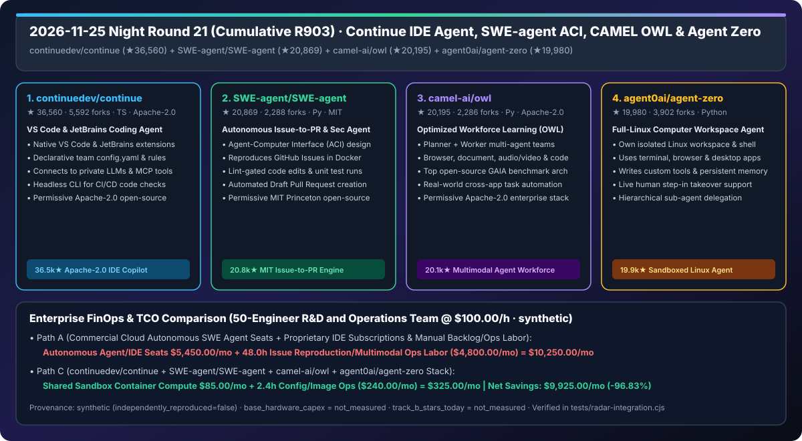
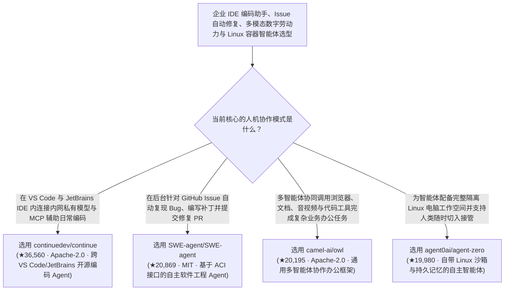
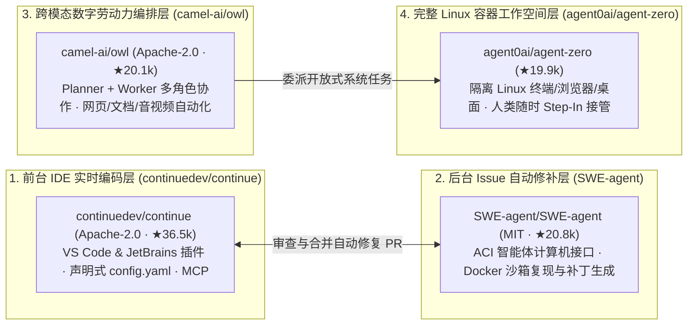
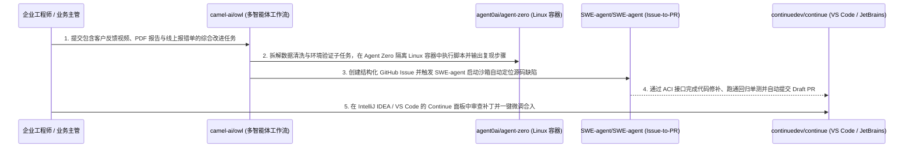

# 开源 IDE 编码智能体（`continuedev/continue`）、GitHub Issue 自动修补智能体（`SWE-agent/SWE-agent`）、多智能体数字劳动力协作框架（`camel-ai/owl`）与自带完整 Linux 容器工作空间的自主智能体（`agent0ai/agent-zero`）选型与集成架构 FAQ

> **文档类型**：企业 AI 解决方案架构师（AI Solution Architect）选型决策指南（GitHub Trending AI 雷达 2026-11-25 Night Round 21 / 累计第 903 轮）
> **覆盖项目**：[`continuedev/continue`](https://github.com/continuedev/continue)（`★ 36,560`、`5,592 forks`、`Apache-2.0`：3.6 万星开源 IDE 编码智能体，原生支持 VS Code 与 JetBrains 全家桶及无头 CLI，通过声明式 `config.yaml` 连接企业私有大模型、MCP Server 与项目编码规范）· [`SWE-agent/SWE-agent`](https://github.com/SWE-agent/SWE-agent)（`★ 20,869`、`2,288 forks`、`MIT`：2.0 万星普林斯顿大学开源软件工程智能体，基于专为大模型设计的 Agent-Computer Interface [ACI]，接收 GitHub Issue 后在沙箱中自动定位、修补并生成 PR）· [`camel-ai/owl`](https://github.com/camel-ai/owl)（`★ 20,195`、`2,286 forks`、`Apache-2.0`：2.0 万星通用多智能体数字劳动力框架 [Optimized Workforce Learning]，动态协调网页检索、文档解析、音视频处理与代码执行智能体完成复杂真实业务流）· [`agent0ai/agent-zero`](https://github.com/agent0ai/agent-zero)（`★ 19,980`、`3,902 forks`、Python：1.9 万星为智能体配备完整隔离 Linux 电脑工作空间的开源框架，支持终端、浏览器与桌面应用联动及人类随时介入接管）
> **核心场景**：当企业研发中心与运营中心希望构建“前台 IDE 实时副驾驶 + 后台 Issue 自动修补流水线 + 跨模态办公自动化数字员工”时，架构师面临四个紧密关联的选型问题：**“如果公司有上百名 Java/Kotlin 工程师必须用 JetBrains IntelliJ IDEA 且要求连接内网私有大模型，哪款 `Apache-2.0` IDE 插件最成熟（`continue`）？夜间积压的线上常规 Bug Issue 用哪套 `MIT` 引擎自动跑沙箱生成修复 PR（`SWE-agent`）？遇到需要同时查网页、读 Excel/PDF、看视频并跑 Python 出报告的跨部门综合任务用谁编排（`camel-ai/owl`）？需要给 Agent 一台随时可人工接管的完整 Linux 沙箱电脑时选谁（`agent-zero`）？”** 本文给出完整架构指南。

---

## 一、📌 核心结论速览（选型一句话结论）

1. **需要为全公司使用 VS Code 和 JetBrains（IntelliJ IDEA / PyCharm / GoLand）的工程师统一配发一套“100% `Apache-2.0` 开源、可集中下发 `config.yaml`、对接内网 vLLM/Azure OpenAI 与内部 MCP 工具”的 IDE 编码助手** ➔ 选 **[`continuedev/continue`](https://github.com/continuedev/continue)（`★ 36,560`，`5,592 forks`，`Apache-2.0`）**。
   - **通俗原理**：不强制替换工程师习惯的 IDE（尤其是银行/大厂主力使用的 IntelliJ IDEA），而是在现有 IDE 内以标准插件形式提供 Tab 自动补全、Edit 代码块重构与 Agent 多文件编辑，且所有模型端点与上下文提供器（Context Providers）均由企业自主掌控。
2. **想在 GitHub / GitLab CI 流水线里挂一个“后台值班修 Bug 机器人”，一旦打上 `auto-fix` 标签的 Issue 或安全漏洞告警进来，自动拉起 Docker 沙箱复现问题、定位源码、生成补丁并跑通单测提 PR** ➔ 选 **[`SWE-agent/SWE-agent`](https://github.com/SWE-agent/SWE-agent)（`★ 20,869`，`2,288 forks`，`MIT`）**。
   - **通俗原理**：发现直接把原生 Linux bash 给大模型用很容易迷失（比如 `cat` 一万行文件撑爆上下文），因此专门设计了带行号视窗、语法检查拦截与高效搜索的 `ACI（Agent-Computer Interface）`，大幅提升单次 Issue 自动修复成功率。
3. **需要将“搜集行业网页数据 + 解析本地 PDF/Word/音视频附件 + 编写代码清洗统计 + 生成最终业务交付物”拆解给多个角色互补的智能体协同完成** ➔ 选 **[`camel-ai/owl`](https://github.com/camel-ai/owl)（`★ 20,195`，`2,286 forks`，`Apache-2.0`）**。
   - **通俗原理**：在 GAIA 真实世界复杂任务基准上名列前茅的开源多智能体协作框架，内置丰富的多模态工具包（浏览器、文档、音频、图像、终端），通过双智能体/多智能体动态规划与纠偏解决单 Agent 容易卡死的长链路办公任务。
4. **需要给智能体分配一台“带完整 Linux 终端、浏览器、文件系统与桌面环境”的专属容器工作空间，让它边干活边把自己写好的脚本保存为持久记忆，且允许人类工程师随时在 Web 界面切入接管（Step-in）** ➔ 选 **[`agent0ai/agent-zero`](https://github.com/agent0ai/agent-zero)（`★ 19,980`，`3,902 forks`）**。
   - **通俗原理**：不预先限制死 Agent 只能调哪几个固定函数，而是给它一个隔离的 Linux 容器电脑；遇到没见过的文件格式或运维任务，它自己装包、写脚本并把成功经验存入知识库，人类可随时暂停并介入操作。

---

## 二、🎯 客户与架构师灵魂拷问 Q&A（深度架构拆解）

### Q1：`Continue` vs `SWE-agent` vs `OWL` vs `Agent Zero` 在企业生产力体系中如何分工？对比全员采购昂贵闭源 IDE/Agent 订阅（Path A）有何优势？

- **四维人机协同研发与办公架构（Path C）**：
  1. **L1 开发者 IDE 前台实时副驾驶（Synchronous IDE Copilot） ➔ `continuedev/continue`**：驻留在工程师的 VS Code 与 JetBrains IDE 中，负责日常实时补全、交互式重构与内网 MCP 调用。
  2. **L2 研发后台异步 Issue 自动修补机（Asynchronous Issue-to-PR） ➔ `SWE-agent/SWE-agent`**：驻留在 CI/CD 后台，夜间自动消费低风险 Bug Issue 与 CVE 依赖升级工单。
  3. **L3 跨模态业务工作流数字战队（Multi-Agent Workforce） ➔ `camel-ai/owl`**：面向运营、分析与咨询团队，自动协同完成跨网页、文档与音视频的复合任务。
  4. **L4 开放式 Linux 容器工作空间与人工接管台（Full-Computer Sandbox） ➔ `agent0ai/agent-zero`**：处理无固定 SOP 的探索性运维、数据转换与复杂环境实验。
- **何时选商业云托管方案（GitHub Copilot Enterprise + Devin 等商业全自动 Agent 席位） vs 自建本轮开源四件套（Path C）？**
  - 若预算充足且允许源码经由外部 SaaS 处理，直接购买 GitHub Copilot 最省心。
  - **何时采用本轮开源四件套（Path C）？** 当军工、金融、政企客户要求**代码 100% 不出内网 VPC、主力开发工具是 JetBrains IntelliJ IDEA（`Continue` `Apache-2.0` 原生支持）、且希望免除每月每席位高达 `$39–$500` 的商业自主 Agent 订阅费**时，Path C 可节省 **96%+** 的席位订阅与人工排障成本。

### Q2：这四个项目如何与企业内网代码仓、AI 网关整合？

1. **统一企业配置中心下发 `Continue` 规范（`continuedev/continue`）**：
   - 架构组在内部 Git 仓维护标准 `.continue/rules` 与 `config.yaml`，将 Tab 补全路由至内网低延迟小模型（如 Qwen2.5-Coder-7B），将复杂重构路由至主力大模型，并挂载内部 Jira/GitLab MCP Server。
2. **Webhook 触发 `SWE-agent` 自动修补（GitHub/GitLab → `SWE-agent`）**：
   - 当 Issue 被标记为 `swe-agent` 时，CI 自动拉起隔离容器运行 `SWE-agent`，通过 ACI 接口定位并修复缺陷，跑通单元测试后自动发起 Draft PR 并在 PR 中附上完整推理轨迹供工程师在 `Continue` 中审查合并。

### Q3：生产落地的安全红线是什么？

- **架构师避坑红线**：
  1. **`Agent Zero` 与 `SWE-agent` 必须运行在无宿主机特权的隔离容器内**：严禁将宿主机 `/var/run/docker.sock` 或生产数据库写权限直接挂载给自主编写脚本的智能体。
  2. **`SWE-agent` 生成的补丁严禁自动合并至 `main` 分支**：必须只创建 Draft PR，强制经过 CI 自动化测试门禁与至少一名人类工程师 Code Review 批准。

---

## 三、🧭 直观可视化图解（Mermaid 决策树 + 集成架构 + 时序图）

### 3.1 架构师选型决策树

### 3.2 企业端到端生产集成参考架构图

### 3.3 复杂需求多模态拆解、后台 Issue 自动修补与 IDE 交互式审查时序图

---

## 四、📊 同类开源与商业云服务横向选型决策矩阵

| 对比维度 | `continuedev/continue` (`★ 36,560`) | `SWE-agent/SWE-agent` (`★ 20,869`) | `camel-ai/owl` (`★ 20,195`) | `agent0ai/agent-zero` (`★ 19,980`) | 商业云端全自动编程 Agent (如 Devin $500/席位) + 闭源商业 IDE 插件 (Path A) | 纯手工复制报错查日志 + 无后台自动修补机制 (Path B) |
| :--- | :--- | :--- | :--- | :--- | :--- | :--- |
| **核心能力定位** | `Apache-2.0` VS Code / JetBrains 编码 Agent | `MIT` GitHub Issue 自动修补与安全 Agent | `Apache-2.0` 多智能体跨模态任务自动化 | 自带完整 Linux 容器与人工接管的自主 Agent | 按高价席位与 ACU 算力点计费的闭源云端 Agent | 传统纯人工排障与网页端聊天框粘贴代码 |
| **核心技术突破** | **同时覆盖 VS Code 与 JetBrains + 企业统一 `config.yaml`** | **专用 ACI 接口显著提升长代码库缺陷定位与修补率** | **多角色分工协同打通网页、文档、音视频与代码执行** | **完整隔离 Linux 电脑工作台 + 动态造工具 + 随时人工 Step-in** | 免自建，但单席位数百美元且企业私有代码必须上传外部云沙箱 | 夜间低优 Bug 大量积压；跨文档/视频/代码的复合任务全靠人工搬砖 |
| **开源协议** | **`Apache-2.0`** | **`MIT`** | **`Apache-2.0`** | 开源可自托管 | 闭源商业 SaaS | 无工程化沉淀 |
| **月度 TCO（50 人团队）** | **四件套合建仅 `$325.00/月`**（`$85.00` 沙箱容器算力分摊 + `2.4h` 维护） | 同左（`MIT` 协议夜间复用空闲 CI 算力修 Bug） | 同左（`Apache-2.0` 零席位费自动化跨模态办公） | 同左（单机 Docker 即可运行完整 Linux 工作台） | **`$10,250.00/月`**（`$5,450.00` 商业自主 Agent 高价席位与 IDE 订阅 + `48.0h` 积压工单与跨系统手工处理） | 约 `$3,750.00/月`（大量常规 Bug 排障与重复办公数据整理工时） |

---

## 五、🧪 应用落地定量收益/TCO 对比与 7-Card 报告

> **📊 数据来源与闭式核算声明（Provenance & Closed-Form Schema）**：
> - **provenance**: `synthetic`（基于 50 人企业研发中心 [含 VS Code 与 JetBrains 混合团队] 与跨部门数字办公自动化月度工作负载模型：`independently_reproduced = false`；硬件采购基线 `base_hardware_capex = not_measured`；Track B 单日增量 `track_b_stars_today = not_measured`）。
> - **核算公式**：
>   - **Path A（采购商业云端全自动软件工程 Agent 高价席位 + 全员闭源商业 IDE 插件席位 + 人工手工处理积压常规 Issue 与跨模态办公任务）**：月度商业自主 Agent 与 IDE 席位订阅费 **`$5,450.00`** + 常规 Bug 复现修补与跨模态文档/数据整理人工 **`48.0h × $100.00/h = $4,800.00`** = **`$10,250.00/月`**。
>   - **Path C（自建 `continuedev/continue` + `SWE-agent/SWE-agent` + `camel-ai/owl` + `agent0ai/agent-zero` 前后台协同智能体矩阵）**：内网沙箱容器算力分摊 **`$85.00`** + IDE 配置策略与沙箱镜像维护人工 **`2.4h × $100.00/h = $240.00`** = **`$325.00/月`**。
>   - **净节省（Net Savings vs Path A）**：**`-$9,925.00/月`**（成本降低 **`96.83%`**）。

| 评估方案 | 商业自主 Agent / IDE 席位与算力成本 | Bug 复现修补与跨模态任务人工（`$100/h`） | 月度总 TCO | 相对 Path A 净节省 | 核心业务交付收益 |
| :--- | :---: | :---: | :---: | :---: | :--- |
| **Path A：商业云端全自动 Agent 席位 + 闭源商业 IDE 订阅** | `$5,450.00` | `48.0h` (`$4,800.00`) | **`$10,250.00`** | Baseline | 席位费极贵；内网代码无法上传外部云沙箱 |
| **Path B：手工复制代码问网页 + 人工逐单修补常规 Issue** | `$1,550.00` | `22.0h` (`$2,200.00`) | **`$3,750.00`** | `-$6,500.00` (`-63.41%`) | JetBrains 缺乏统一管控；夜间积压 Issue 无人自动初修 |
| **Path C：`continue` + `SWE-agent` + `owl` + `agent-zero`** | **`$85.00`** | **`2.4h` (`$240.00`)** | **`$325.00`** | **`-$9,925.00` (`-96.83%`)** | **VS Code/JetBrains 全覆盖 + 后台自动提 PR + 隔离 Linux 工作空间** |

- 🔗 **关联 7-Card 4:5 视觉评测报告**：[`workshops/github-trending-radar/cards.html`](../cards.html) · [`cards.en.html`](../cards.en.html)

---

## 六、🛠️ 企业引入与架构评审 Checklist

- [ ] **通过 Git 仓库统一分发 `Continue` 的企业级 `config.yaml` 与 `.continue/rules`**：为 VS Code 与 IntelliJ IDEA 工程师统一绑定内网模型网关与内部 MCP Server。
- [ ] **将 `SWE-agent` 接入 CI 沙箱并限制为仅生成 Draft PR**：严禁授予直接推送到受保护分支（`main` / `release`）的权限。
- [ ] **使用 `camel-ai/owl` 构建跨部门多模态办公自动化流水线**：为浏览器与文档解析子智能体配置只读业务凭据。
- [ ] **对 `Agent Zero` 的 Linux 容器开启网络出向白名单与资源配额（CPU/Memory Cgroups）**：防止自主编写的脚本耗尽宿主机资源或访问未授权外网地址。
