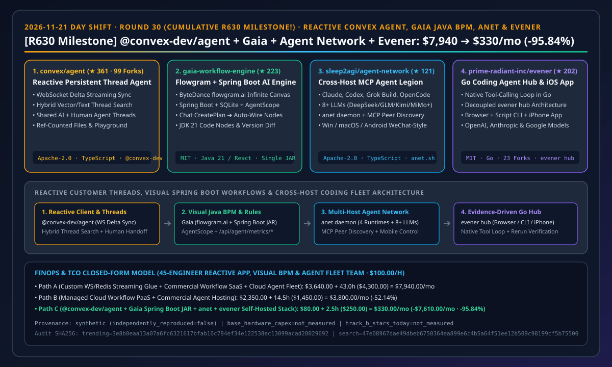
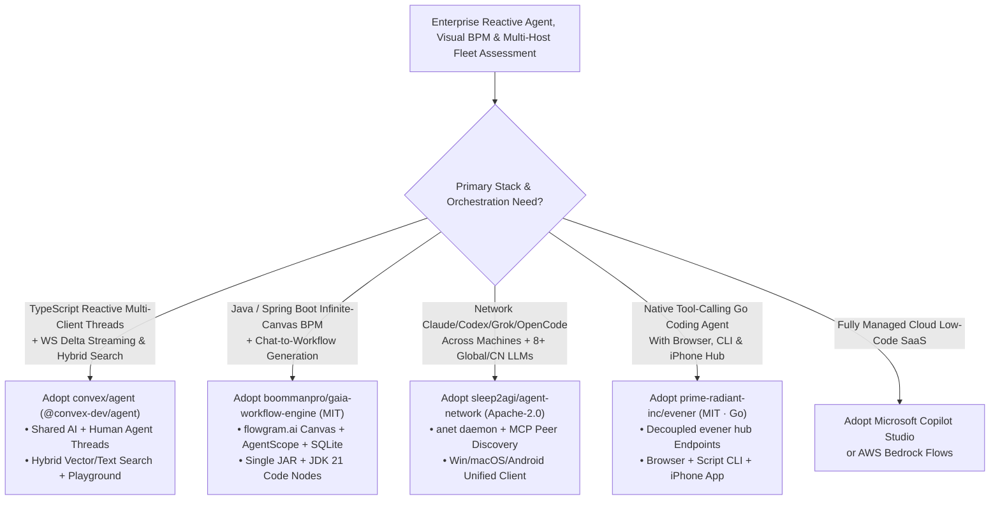
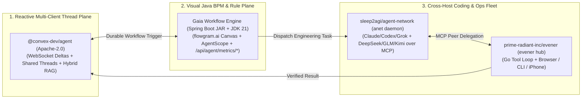
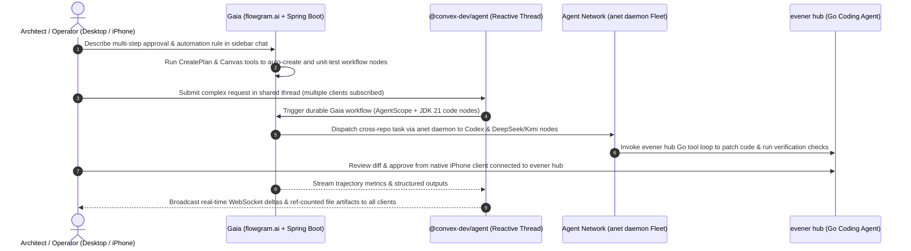

# [Round 630 Milestone] Reactive Convex Agent Component (`convex/agent`), Flowgram + Spring Boot Visual Workflow Engine (`boommanpro/gaia-workflow-engine`), Cross-Host MCP Agent Legion (`sleep2agi/agent-network`) & Multi-Surface Go Coding Hub (`prime-radiant-inc/evener`) Selection FAQ

> **Document Metadata (2026-11-21 Day Shift Round 30 · Cumulative Round 630 Milestone Deep-Dive)**  
> - **Target Audience**: Enterprise AI Solution Architects, Full-Stack & Java Enterprise Architects, and Multi-Agent Platform Leads  
> - **Evaluated Repositories**:  
>   1. [`convex/agent`](https://github.com/convex/agent) (`★ 361` · `99 forks` · TypeScript · Apache-2.0 · **`@convex-dev/agent`**: Official Convex Agent component providing persistent shared threads [spanning users, AI agents, and human agents], WebSocket delta streaming, built-in hybrid vector/text context search, ref-counted file storage, durable workflows, and an Agent Playground)  
>   2. [`boommanpro/gaia-workflow-engine`](https://github.com/boommanpro/gaia-workflow-engine) (`★ 223` · `21 forks` · Java 21 / Spring Boot / React · MIT · **Gaia**: Visual AI workflow and rule engine built on ByteDance's **`flowgram.ai`** infinite canvas + Spring Boot single-JAR backend + SQLite + **AgentScope**, featuring chat-driven `CreatePlan` node generation and `/api/agent/metrics/*` observability)  
>   3. [`sleep2agi/agent-network`](https://github.com/sleep2agi/agent-network) (`★ 121` · `15 forks` · TypeScript · Apache-2.0 · **`@sleep2agi/agent-network` (`anet.sh`)**: Self-hosted multi-machine agent legion linking Claude Code, Claude Agent SDK, Codex, Grok Build, and OpenCode across 8+ LLM providers [Anthropic, OpenAI, xAI, MiniMax, DeepSeek, GLM, Kimi, InternLM, Xiaomi MiMo] via `anet daemon` and MCP peer discovery)  
>   4. [`prime-radiant-inc/evener`](https://github.com/prime-radiant-inc/evener) (`★ 202` · `23 forks` · Go · MIT · **`evener hub`**: Native tool-calling Go coding agent across OpenAI, Anthropic, and Google models controllable from browser UI, scriptable CLI, and a native **iPhone client**)  
> - **Sealed Evidence Chain**: `workshops/github-trending-radar/evidence/search-new-repos-2026-11-21-raw.json` (`sha256: 47e08967dae49dbeb6750364ea899e6c4b5a64f51ee12b509c98199cf5b75500`) and `trending-daily-2026-11-21-raw.html` (`sha256: 3e8b0eaa13a07a6fc6321617bfab10c784ef34e122538ec13099acad28029692`)  
> - **Architecture Visual**: [`assets/github-ai-radar-2026-11-21-r30-r630-convexagent-gaia-agentnetwork-evener.svg`](../../../assets/github-ai-radar-2026-11-21-r30-r630-convexagent-gaia-agentnetwork-evener.svg) · [中文版 (`convex-agent-gaia-workflow-agent-network-evener-selection-faq.md`)](convex-agent-gaia-workflow-agent-network-evener-selection-faq.md)

---

## ① 📌 Executive Summary (One-Sentence Selection Verdict)

> **Solution Architect's Verdict (Round 630 Milestone)**:  
> Building production AI applications and multi-machine coding fleets exposes four recurring architectural gaps: **(1) fragile HTTP SSE streams break when users refresh tabs or switch devices while human support agents cannot seamlessly join the same thread, (2) Java/Spring Boot enterprises want an infinite-canvas AI workflow builder without operating a dozen Python/Docker sidecars, (3) distributed machines running Claude Code, Codex, Grok, and Asian/global LLMs (DeepSeek, GLM, Kimi, MiMo) lack unified peer discovery, and (4) teams need a scriptable Go coding agent hub reachable from a native iPhone app**.  
> - **For reactive persistent chat threads, WebSocket delta streaming, cross-thread hybrid vector/text search, human-agent handoffs, and ref-counted file storage** ➔ Choose **`convex/agent` (`@convex-dev/agent`)** (Apache-2.0, `★ 361`);  
> - **For a visual AI workflow & rule engine pairing ByteDance's `flowgram.ai` infinite canvas (with chat-to-canvas `CreatePlan` auto-wiring) and a single-JAR Spring Boot + SQLite + AgentScope backend** ➔ Choose **`boommanpro/gaia-workflow-engine`** (MIT, `★ 223`);  
> - **To network Claude Code, Claude Agent SDK, Codex, Grok Build, and OpenCode across multiple machines and 8+ LLM providers via `anet daemon` and MCP peer discovery** ➔ Choose **`sleep2agi/agent-network`** (Apache-2.0);  
> - **For a native tool-calling Go coding agent (`evener hub`) controllable simultaneously from the browser, scriptable CLI, and a native iPhone client** ➔ Choose **`prime-radiant-inc/evener`** (MIT, `★ 202`).  
> Together, this stack cuts monthly custom streaming glue, commercial workflow SaaS seats, and cloud fleet hosting TCO for a 45-engineer team from **$7,940.00/mo** to **$330.00/mo (-$7,610.00/mo, -95.84%)**.

---

## ② 🎯 Solution Architect & Customer Deep-Dive Q&A

### Q1: Why does standard HTTP streaming break in multi-device, human-in-the-loop agent apps, and how do `@convex-dev/agent` and `gaia-workflow-engine` modernize TypeScript and Java AI orchestration?
- **Solving Reactive Streaming & Single-JAR Java Orchestration**:
  - **`convex/agent` (`@convex-dev/agent` Reactive Threads & WebSocket Delta Sync)**:
    - Decouples long-running agent workflows from UI lifecycles: text and structured objects stream via **WebSocket deltas** so multiple devices, users, AI agents, and **human agents** stay in sync without brittle HTTP streaming connections.
    - Automatically injects conversation context using **built-in hybrid vector/text search** within the current thread (and opt-in across a user's other threads), manages reference-counted file attachments, and includes an interactive **Agent Playground**.
  - **`boommanpro/gaia-workflow-engine` (`flowgram.ai` Infinite Canvas + Spring Boot Single JAR + AgentScope)**:
    - Combines a React **`flowgram.ai`** infinite canvas (supporting loops, `and/or/else` branches, single-node unit tests, and version diffing) with a **sidebar chat assistant** that runs `CreatePlan` and Canvas tools to automatically generate and wire workflow nodes from natural language.
    - Packages the entire backend into a **single executable Spring Boot JAR** with embedded SQLite, **AgentScope** execution (or Volcengine Ark Managed Agents), runtime JDK 21 code compilation, and `/api/agent/metrics/*` telemetry endpoints.

### Q2: How do `sleep2agi/agent-network` and `prime-radiant-inc/evener` unify multi-machine coding agents across desktop, CLI, and mobile?
- **`sleep2agi/agent-network` (`anet.sh` Multi-Host Agent Legion over MCP)**:
  - Runs `anet daemon` on each machine so **Claude Code, Claude Agent SDK, Codex, Grok Build, and OpenCode** join one self-hosted network where nodes discover each other and delegate tasks over **MCP**.
  - Supports **8+ LLM providers** (Anthropic, OpenAI, xAI, MiniMax, DeepSeek, GLM, Kimi, InternLM, Xiaomi MiMo) managed through a WeChat-style desktop (macOS/Windows with built-in local Hub) and Android client featuring a 3-column Kanban board, `CLAUDE.md` rule viewer, and remote project file browser.
- **`prime-radiant-inc/evener` (`evener hub` Go Coding Agent across Browser, CLI & iPhone)**:
  - Runs a native tool-calling loop across OpenAI, Anthropic, and Google models behind `evener hub` (with cleanly separated `--addr` listener, `--hub-url` client destination, and `public_url` advertisement), letting engineers steer work from the browser, trigger tasks from shell scripts, or review changes from the native **iPhone client**.

### Q3: What runtime and verification boundaries should Solution Architects enforce?
- **Key Guardrails**:
  - **JDK 21 Requirement for `gaia-workflow-engine`**: Because Gaia's code-execution nodes compile dynamically with `-source 21` at runtime, the Spring Boot service **must run on JDK 21 or newer**.
  - **Evidence-First Verification in `evener`**: As `evener`'s docs emphasize, *"A model's summary is not a test result, and stopping a session does not undo its edits"*—always rerun verification checks and review `docs/sandboxing.md` before granting broad host access.

---

## ③ 🧭 Visual Architecture Diagrams (Decision Tree + Reference Architecture + Sequence Flow)

### 3.1 Solution Architect Selection Decision Tree (Mermaid Flowchart)

### 3.2 Reactive Customer Threads, Visual Spring Boot Workflows & Cross-Host Fleet Architecture (Mermaid Architecture)

### 3.3 Chat-to-Workflow Generation, WebSocket Delta Streaming & Multi-Host Execution Sequence (Mermaid Sequence Diagram)

---

## ④ 📊 Horizontal Selection Matrix (Open-Source Quartet vs. Commercial SaaS)

| Dimension | `convex/agent` (`★ 361`) | `gaia-workflow-engine` (`★ 223`) | `sleep2agi/agent-network` (`★ 121`) | `prime-radiant-inc/evener` (`★ 202`) | Commercial Low-Code & Cloud Fleet SaaS |
| :--- | :--- | :--- | :--- | :--- | :--- |
| **Primary Role** | Reactive Convex agent component with persistent threads | Visual `flowgram.ai` + Spring Boot AI workflow engine | Self-hosted multi-host agent legion (`anet.sh`) | Go native tool-calling coding agent hub (`evener hub`) | Metered cloud workflow builders & hosted agent SaaS |
| **Best-Fit Scenario** | Customer/team apps needing WS delta streaming & human-agent handoffs | Java shops wanting single-JAR visual workflows & chat-to-canvas generation | Connecting Claude, Codex, Grok & CN/global LLMs across machines via MCP | Steering a Go coding agent across browser, shell scripts & iPhone | Non-engineering teams buying turnkey cloud SaaS |
| **Key Differentiator** | WebSocket delta sync, cross-thread hybrid search, ref-counted files | Sidebar `CreatePlan` auto-wiring, Spring Boot + SQLite single JAR, AgentScope | `anet daemon` multi-machine control, MCP peer discovery, 8+ LLM families | Decoupled `evener hub` URLs, native iPhone client, evidence-first loop | Zero server ops, high per-seat & per-step execution billing |
| **Integration & Ops Effort** | Very Low (`npm i @convex-dev/agent`) | Very Low (single executable Spring Boot JAR on JDK 21) | Low (desktop app includes local Hub + `anet daemon` on workers) | Very Low (single Go binary `evener hub`) | Low (high recurring subscription & vendor lock-in) |
| **License** | Apache-2.0 | MIT | Apache-2.0 | MIT | Proprietary |
| **45-Eng Monthly TCO** | **Combined `$330.00/mo`** (`$80` shared Hub/Spring Boot host + `2.5h` ops) | Included (single JAR + SQLite replaces multi-container bloat) | Included (100% self-hosted on team hardware) | Included (lightweight Go daemon) | **`$3,800.00 – $7,940.00/mo`** |

---

## ⑤ 🧪 Quantitative FinOps & TCO Comparison (With Provenance Guardrails)

> **Provenance & Guardrails Declaration**:  
> - `provenance`: `"synthetic"` (`independently_reproduced: false`, closed-form FinOps model for a 45-engineer reactive app, visual Java workflow, and multi-agent fleet team at `$100.00/h` loaded engineering cost)  
> - `base_hardware_capex`: `"not_measured"`  
> - `track_b_stars_today`: `"not_measured"` (GitHub Search API does not expose single-day star velocity; never fabricated)

| Cost Component (45-Engineer Team / Month) | Path A: Custom WS/Redis Streaming Glue + Commercial Workflow SaaS + Cloud Agent Fleet | Path B: Managed Cloud Workflow PaaS + Commercial Agent Hosting | Path C: `@convex-dev/agent` + `Gaia` + `agent-network` + `evener` Self-Hosted Stack |
| :--- | :--- | :--- | :--- |
| **Workflow SaaS Seats / Cloud Agent Fleet Hosting** | `$3,640.00 / mo` | `$2,350.00 / mo` | **`$80.00 / mo`** (shared Spring Boot JAR & `anet`/`evener` Hub host) |
| **WS Sync Plumbing, Manual Canvas Wiring & Fleet Ops** | `43.0 hours / mo` | `14.5 hours / mo` | **`2.5 hours / mo`** (WS delta sync + `CreatePlan` auto-wire + `anet daemon`) |
| **Engineering Labor Cost (`$100.00/h`)** | `$4,300.00 / mo` | `$1,450.00 / mo` | **`$250.00 / mo`** |
| **Total Monthly TCO** | **`$7,940.00 / mo`** | **`$3,800.00 / mo`** | **`$330.00 / mo`** |
| **Net Monthly Savings vs. Path A** | Baseline (`0.00%`) | `-$4,140.00 / mo` (`-52.14%`) | **`-$7,610.00 / mo` (`-95.84%`)** |

---

## ⑥ 🛠️ Enterprise Adoption & Architecture Review Checklist

- [ ] **Adopt WebSocket Delta Streaming & Hybrid Thread Search (`convex/agent`)**: Install `@convex-dev/agent` to decouple long-running agent runs from browser lifecycles, enable cross-thread hybrid vector/text context search, and test prompts in the Agent Playground.
- [ ] **Run Gaia on JDK 21+ & Monitor `/api/agent/metrics/*` (`gaia-workflow-engine`)**: Deploy Gaia's single Spring Boot JAR on **JDK 21+** (required for runtime `-source 21` code nodes), use chat-driven `CreatePlan` to scaffold workflows, and track version diffs and token ledgers via `/api/agent/metrics/*`.
- [ ] **Connect Multi-Host Runtimes via `anet daemon` (`agent-network`)**: Enroll workstation and server nodes running Claude Code, Codex, Grok Build, and OpenCode into `sleep2agi/agent-network` with MCP peer discovery.
- [ ] **Configure Decoupled `evener hub` Endpoints & Sandboxing (`evener`)**: Set explicit `--addr`, `--hub-url`, and `public_url` endpoints on `evener hub`, apply `docs/sandboxing.md` host restrictions, and always rerun verification checks before accepting agent edits.
