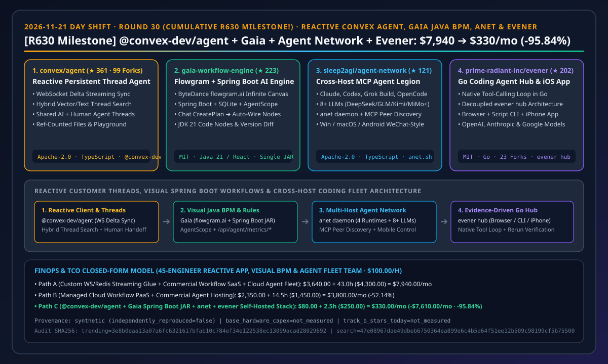
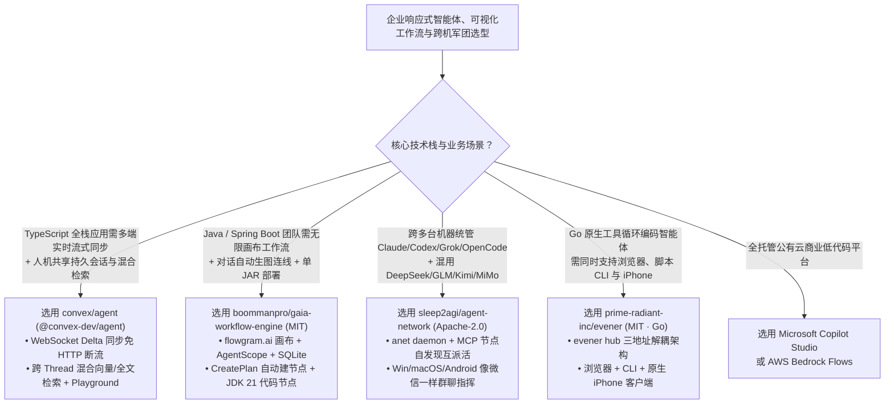
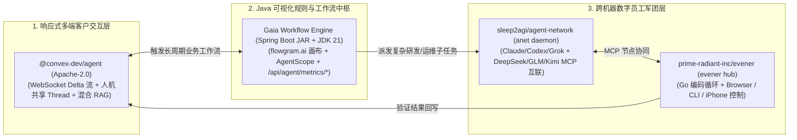
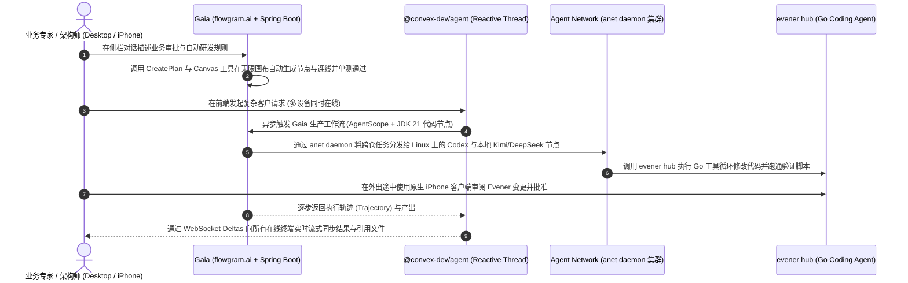

# 【第 630 轮里程碑】Convex 响应式持久会话组件（`convex/agent`）、Flowgram + Spring Boot 可视化工作流引擎（`boommanpro/gaia-workflow-engine`）、跨机器一行组网 AI 军团（`sleep2agi/agent-network`）与三端联动 Go 编码中枢（`prime-radiant-inc/evener`）选型 FAQ

> **文档元数据（2026-11-21 白班 Day Round 30 · 累计第 630 轮里程碑深潜专题）**  
> - **面向对象**：企业 AI 解决方案架构师（AI Solution Architect）、全栈与 Java 企业架构师、多机智能体平台负责人  
> - **本轮核心评估对象**：  
>   1. [`convex/agent`](https://github.com/convex/agent)（`★ 361` · `99 forks` · TypeScript · Apache-2.0 · **`@convex-dev/agent`**：基于 Convex 的响应式智能体组件，支持多用户/多 Agent/人类坐席共享持久会话、WebSocket Delta 同步流、跨会话混合向量/全文检索、引用计数文件存储与内置 Agent Playground）  
>   2. [`boommanpro/gaia-workflow-engine`](https://github.com/boommanpro/gaia-workflow-engine)（`★ 223` · `21 forks` · Java 21 / Spring Boot / React · MIT · 基于字节跳动 `flowgram.ai` 无限画布 + Spring Boot 单体可执行 JAR + SQLite + **AgentScope** 的可视化 AI 工作流平台，支持侧栏对话 `CreatePlan` 自动画图连线与运行态 `-source 21` 代码编译）  
>   3. [`sleep2agi/agent-network`](https://github.com/sleep2agi/agent-network)（`★ 121` · `15 forks` · TypeScript · Apache-2.0 · **`@sleep2agi/agent-network` (`anet.sh`)**：通过 `anet daemon` 与 MCP 节点自发现，将多台机器上的 Claude Code、Claude Agent SDK、Codex、Grok Build、OpenCode 与 8+ 家主流大模型连成“像微信一样群聊派活”的私有 Agent 军团）  
>   4. [`prime-radiant-inc/evener`](https://github.com/prime-radiant-inc/evener)（`★ 202` · `23 forks` · Go · MIT · 基于 `evener hub` 解耦架构的原生工具调用 Go 编码智能体，支持通过浏览器、脚本 CLI 与原生 **iPhone 客户端**随时随地督导代码修改与验证）  
> - **关联检索证据链**：`workshops/github-trending-radar/evidence/search-new-repos-2026-11-21-raw.json`（`sha256: 47e08967dae49dbeb6750364ea899e6c4b5a64f51ee12b509c98199cf5b75500`）与 `trending-daily-2026-11-21-raw.html`（`sha256: 3e8b0eaa13a07a6fc6321617bfab10c784ef34e122538ec13099acad28029692`）  
> - **高清架构图**：[`assets/github-ai-radar-2026-11-21-r30-r630-convexagent-gaia-agentnetwork-evener.svg`](../../../assets/github-ai-radar-2026-11-21-r30-r630-convexagent-gaia-agentnetwork-evener.svg) · [English Version (`convex-agent-gaia-workflow-agent-network-evener-selection-faq.en.md`)](convex-agent-gaia-workflow-agent-network-evener-selection-faq.en.md)

---

## ① 📌 核心结论速览（选型一句话结论）

> **架构师一句话选型结论（第 630 轮里程碑）**：  
> 当企业构建生产级 AI 应用与研发舰队时，常常卡在四个工程断层：**（1）前端用普通 HTTP SSE 流式输出，用户一刷新页面或切手机端整个长任务流就断了、（2）Java 后端团队想上类似 Dify/Coze 的无限画布工作流，却被迫引入复杂的 Python/Docker 几十个微服务容器、（3）多台机器上的 Claude Code、Codex、Grok 与国产大模型（DeepSeek / GLM / Kimi / MiMo）无法在同一个群聊/看板里互相发现和派活、（4）缺乏轻量可脚本化且带原生 iPhone 客户端的 Go 编码中枢**。  
> - **需要“长耗时 Agent 任务与 UI 彻底解耦、基于 WebSocket Delta 多端实时同步、自带跨线程混合向量/文本检索与人类坐席无缝接管”的前后端一体化底座** ➔ 选 **`convex/agent`（`@convex-dev/agent`）**（Apache-2.0，`★ 361`）；  
> - **Java / Spring Boot 团队需要“前端 `flowgram.ai` 无限画布（支持侧栏对话自动生图连线）+ 后端单个 Spring Boot 可执行 JAR（内置 SQLite 与 AgentScope 引擎）”** ➔ 选 **`boommanpro/gaia-workflow-engine`**（MIT，`★ 223`）；  
> - **需要用一行 `anet daemon` 把多台机器上的 4 大 Agent 运行时与 8+ 家海内外大模型组建成可在 Windows / macOS / Android 上像微信一样指挥的数字员工军团** ➔ 选 **`sleep2agi/agent-network`**（Apache-2.0）；  
> - **需要一个基于 Go 原生工具调用循环、通过 `evener hub` 同时向浏览器、自动化脚本 CLI 与原生 iPhone 客户端暴露控制面的编码智能体** ➔ 选 **`prime-radiant-inc/evener`**（MIT，`★ 202`）。  
> 四者组合可将 45 人企业应用与平台研发团队的自研流式同步胶水层、商业低代码工作流 SaaS 与云端多智能体托管总成本从 **$7,940.00/月** 降至 **$330.00/月（节省 $7,610.00/月，降幅 95.84%）**。

---

## ② 🎯 客户与架构师灵魂拷问 Q&A（业务痛点 · 架构集成 · 边界取舍）

### Q1：为什么用传统 HTTP Streaming 做多智能体客服或协同工作台，一遇到网络抖动、多设备同时打开或“AI 转人工坐席”就会丢消息？`@convex-dev/agent` 与 `gaia-workflow-engine` 分别在 TypeScript 和 Java 栈怎么解决？
- **传统 HTTP Streaming 与重型工作流的两大痛点**：
  1. **点对点 HTTP 流无状态共享**：一个异步后台函数生成的流很难同时实时推给同一个用户的网页端和手机端，也无法让人类客服坐席（Human Agent）直接插话进同一个 Thread。
  2. **可视化工作流后端运维太重**：许多开源画布工具强依赖十几个中间件容器，Java 团队很难将其直接打包进现有的 Spring Boot 体系。
- **TypeScript 与 Java 双栈解法**：
  - **`convex/agent`（`@convex-dev/agent`：WebSocket Delta 响应式同步 + 跨会话混合检索）**：
    - 长周期 Agent 工作流在后台独立持久运行，文本与结构化对象通过 **WebSocket Deltas** 实时广播给所有订阅该 Thread 的客户端（无需脆弱的 HTTP Streaming），即使从异步后台函数发起也能实时流式展现。
    - 每个 **Thread** 可由多个用户、多个 AI Agent 以及**人类坐席（Human Agents）**共同参与；每次调用大模型前自动检索当前会话及可选跨会话的**混合向量/全文上下文（Hybrid Vector/Text Search）**，自带引用计数（ref-counting）文件存储与可视化 **Agent Playground**。
  - **`boommanpro/gaia-workflow-engine`（`flowgram.ai` 无限画布 + Spring Boot 单 JAR + AgentScope）**：
    - 前端基于字节跳动开源的 **`flowgram.ai`** 打造无限缩放画布（支持多分支 `and/or/else`、循环、节点单测与小地图），并支持在**侧栏对话描述需求 ➔ AI 通过 `CreatePlan` 与 Canvas 工具自动创建节点和连线 ➔ 直接试运行**！
    - 后端是极简的 **Spring Boot 单体应用 + 内置 SQLite + AgentScope 执行引擎**（亦可切换火山方舟 Managed Agents），直接打包为单个可执行 JAR 部署，提供工作流版本 Diff 与 `/api/agent/metrics/*` 账本监控。

### Q2：如何把分散在多台开发机上的 Claude Code、Codex、Grok 与国产大模型（DeepSeek / GLM / Kimi / 书生 / 小米 MiMo）串成一个网络？`agent-network` 与 `evener` 怎么分工？
- **`sleep2agi/agent-network`（`anet.sh`：像微信群聊一样指挥跨机器 Agent 军团）**：
  - 每台机器只需运行一个 `anet daemon`，即可将 **Claude Code、Claude Agent SDK、Codex、Grok Build、OpenCode** 作为节点接入同一私有网络，各节点之间通过 **MCP 互相发现、互相派活**。
  - 原生兼容 **8+ 家国内外主流大模型**（Anthropic、OpenAI、xAI、MiniMax、DeepSeek、GLM、Kimi、书生 InternLM、小米 MiMo），在 macOS / Windows 桌面端（内置本地 Hub）或 Android 手机端统一进行聊天派活、三列看板管任务、查看节点日志与编辑节点的 `CLAUDE.md` 规则文件。
- **`prime-radiant-inc/evener`（`evener hub`：三端联动的 Go 原生编码智能体）**：
  - 采用纯 Go 编写原生工具调用循环（跨 OpenAI、Anthropic、Google 模型），通过 `evener hub` 将监听地址（`--addr` / `EVENER_HUB_LISTEN_ADDR`）、客户端目标地址（`--hub-url`）与外部公告地址（`public_url`）清晰解耦。
  - 工程师既可以在浏览器里实时观察和引导、在自动化脚本里通过 CLI 批处理调用，也可以在离开办公桌时用**原生 iPhone 客户端**随时连回 Hub 审阅代码变更并重跑验证命令。

### Q3：落地这四个项目时有哪些运行时版本与安全边界要注意？
- **关键工程边界**：
  - **`gaia-workflow-engine` 的 JDK 21 强制要求**：虽然项目部分模块兼容 Java 17，但画布中的**代码执行节点在运行时以 `-source 21` 动态编译**，因此生产环境**必须使用 JDK 21 或更高版本**启动 Spring Boot 服务端。
  - **`evener` 的诚实证据守则**：“A model's summary is not a test result, and stopping a session does not undo its edits.” 在接受 `evener` 的修改前务必重跑测试校验，对不熟悉的外部仓库务必先配置 `docs/sandboxing.md` 沙箱隔离。

---

## ③ 🧭 直观可视化图解（选型决策树 + 企业集成架构 + 业务流时序图）

### 3.1 架构师选型决策树（Mermaid Flowchart）

### 3.2 企业响应式前端、Java 可视化工作流与跨机编码军团参考架构图（Mermaid Architecture）

### 3.3 对话自动生成工作流、WebSocket Delta 同步与跨机军团协同流转时序图（Mermaid Sequence Diagram）

---

## ④ 📊 同类开源与商业云服务横向选型决策矩阵

| 评估维度 | `convex/agent` (`★ 361`) | `gaia-workflow-engine` (`★ 223`) | `sleep2agi/agent-network` (`★ 121`) | `prime-radiant-inc/evener` (`★ 202`) | 商业低代码工作流 SaaS + 云托管 Agent |
| :--- | :--- | :--- | :--- | :--- | :--- |
| **核心定位** | Convex 响应式持久会话与跨线程 RAG 组件 | `flowgram.ai` + Spring Boot 可视化工作流引擎 | 跨机器 4 运行时 + 8+ 大模型组网协作平台 | 带 Browser/CLI/iPhone 三端的 Go 编码中枢 | 按席位与执行步数计费的闭源云平台 |
| **最适用场景** | 构建多端实时同步、支持人类坐席随时接管的生产级 AI 应用 | Java 团队零代码拖拽或通过对话自动生成并运维 AI 工作流 | 把多台电脑上的 Claude/Codex/Grok 与国产模型连成私有员工军团 | 脚本化或移动端远程督导的轻量级 Go 编码智能体 | 无研发运维团队的纯 SaaS 采购 |
| **关键差异化机制** | WebSocket Delta 同步、跨 Thread 混合检索、引用计数文件、Playground | 对话自动建画布节点、Spring Boot + SQLite 单 JAR、AgentScope 引擎 | `anet daemon` 跨机管理、MCP 互发现、支持 DeepSeek/GLM/Kimi/MiMo | `evener hub` 三地址解耦、原生 iPhone 客户端、证据优先准则 | 免部署，但无法私有化纳管本地开发机且按量收费高 |
| **集成与运维成本** | 极低（`npm i @convex-dev/agent`） | 极低（单个 Spring Boot 可执行 JAR + JDK 21，无需外置 DB） | 低（桌面端自带本地 Hub，远端机器跑一行 `anet daemon`） | 极低（单 Go 二进制 `evener hub`） | 低（高额月度席位费与工作流执行配额费） |
| **开源协议** | Apache-2.0 | MIT | Apache-2.0 | MIT | 商业专有 |
| **45 人团队月均 TCO** | **组合方案 `$330.00/月`**（含共享 Hub 与 Spring Boot 节点 `$80` + 运维 `2.5h`） | 同左（单 JAR + SQLite 省去十几个微服务容器开销） | 同左（完全私有化运行在自有机器，无 SaaS 抽成） | 同左（Go 原生高并发极省内存） | **`$3,800.00 ~ $7,940.00/月`** |

---

## ⑤ 🧪 应用落地定量收益 / FinOps TCO 对比（含数据血缘声明）

> **数据血缘与严谨性声明（Provenance & Guardrails）**：  
> - `provenance`: `"synthetic"`（`independently_reproduced: false`，基于 45 人企业应用、Java 工作流与多智能体研发团队在 `$100.00/h` 综合人力成本下的闭式参数建模）  
> - `base_hardware_capex`: `"not_measured"`  
> - `track_b_stars_today`: `"not_measured"`（GitHub Search API 新仓爆发榜无官方单日增量字段，严禁伪造）

| 成本分项（45 人团队 / 月） | Path A：自研 WS/Redis 同步胶水 + 商业工作流 SaaS + 云端托管军团 | Path B：托管云工作流 PaaS + 商业 Agent 托管服务 | Path C：`@convex-dev/agent` + `Gaia` + `agent-network` + `evener` 自建栈 |
| :--- | :--- | :--- | :--- |
| **商业工作流与 Agent 托管 SaaS 费** | `$3,640.00 / 月` | `$2,350.00 / 月` | **`$80.00 / 月`**（共享 Spring Boot 单 JAR 与 `anet`/`evener` Hub 节点） |
| **流式断连重连开发、手工排布画布与跨机调度工时** | `43.0 小时 / 月` | `14.5 小时 / 月` | **`2.5 小时 / 月`**（WS Delta 自动同步 + `CreatePlan` 自动画图 + `anet` 组网） |
| **折算工程人力成本（`$100.00/h`）** | `$4,300.00 / 月` | `$1,450.00 / 月` | **`$250.00 / 月`** |
| **月度总拥有成本（Total Monthly TCO）** | **`$7,940.00 / 月`** | **`$3,800.00 / 月`** | **`$330.00 / 月`** |
| **相对 Path A 净节省额与降幅** | 基准线（`0.00%`） | `-$4,140.00 / 月`（`-52.14%`） | **`-$7,610.00 / 月`（`-95.84%`）** |

---

## ⑥ 🛠️ 企业引入与架构评审 Checklist

- [ ] **使用 WebSocket Delta 与跨线程混合检索构建对话底座（`convex/agent`）**：通过 `npm i @convex-dev/agent` 将长耗时 Agent 执行与前端 UI 解耦，开启同用户跨 Thread 混合向量/文本检索与人类坐席（Human Agents）平滑接管。
- [ ] **以 JDK 21 启动单 JAR 可视化工作流并接入运行观测（`gaia-workflow-engine`）**：确保生产主机安装 **JDK 21+**（满足代码节点 `-source 21` 动态编译要求），利用侧栏 `CreatePlan` 快速生成画布原型，并将 `/api/agent/metrics/*` 接入企业监控。
- [ ] **通过 `anet daemon` 组建跨机器混合模型军团（`agent-network`）**：在团队开发机与构建机部署 `anet daemon`，将 Claude Code、Codex、Grok Build、OpenCode 与高性价比国产模型（DeepSeek / GLM / Kimi / MiMo）纳入统一三列看板与 MCP 互发现网络。
- [ ] **规范 `evener hub` 三地址配置与沙箱边界（`evener`）**：在部署 `evener hub` 时明确区分监听地址（`--addr`）、客户端连接地址（`--hub-url`）与外部 `public_url`，并参照 `docs/sandboxing.md` 为非受信任仓库配置执行沙箱。
