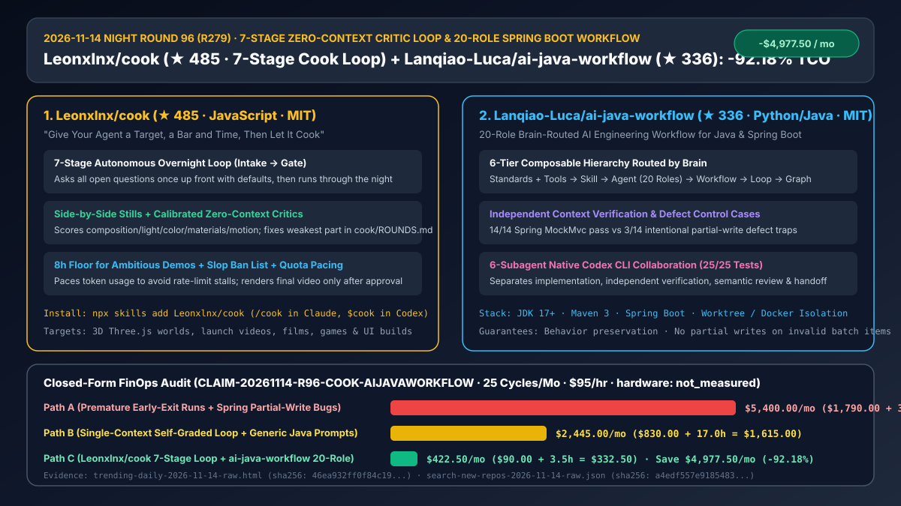
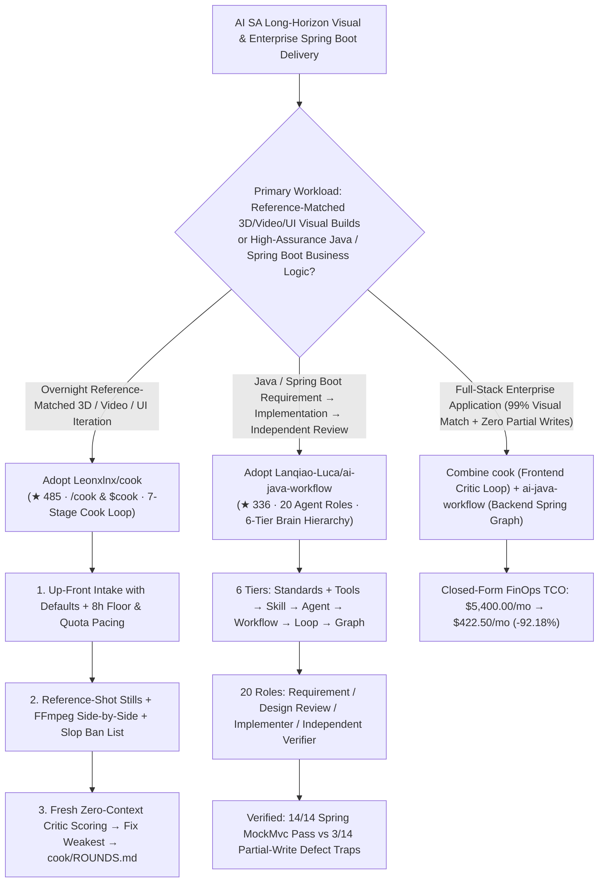

# 7-Stage Zero-Context Critic Visual Build Loop (`Leonxlnx/cook`) & 20-Role Brain-Routed Java/Spring Boot Workflow (`Lanqiao-Luca/ai-java-workflow`) Selection & Architecture FAQ

> **Track**: GitHub AI Trending & High-Velocity Breakout Selection Guide · 2026-11-14 Night Round 96 (Cumulative Round 279 / R279)  
> **Benchmark Standard**: Modeled after `ib-vs-ethernet-roce-selection-faq.md` (Plain-Language Essence + First Principles + 6-Part Structure + Closed-Form FinOps Audit)  
> **Claim ID**: `CLAIM-20261114-R96-COOK-AIJAVAWORKFLOW`  
> **Architecture Visual**: [`assets/github-ai-radar-2026-11-14-r96-cook-aijavaworkflow.svg`](../../../assets/github-ai-radar-2026-11-14-r96-cook-aijavaworkflow.svg)  
> **中文版本**: [阅读中文版 (`cook-ai-java-workflow-7-stage-zero-context-critic-loop-20-role-brain-routed-spring-boot-workflow-selection-faq.md`)](./cook-ai-java-workflow-7-stage-zero-context-critic-loop-20-role-brain-routed-spring-boot-workflow-selection-faq.md)

---

## 📌 1. Executive Summary (What Are They & What Pain Points Do They Solve?)

1. **Plain-Language Breakdown**:
   - **`Leonxlnx/cook` (`★ 485`, JavaScript, MIT License)** is an **autonomous overnight visual-build agent skill (`/cook` in Claude Code, `$cook` in Codex via `npx skills add Leonxlnx/cook`)** designed for ambitious 3D worlds, films, launch videos, games, and UIs that must match reference images or videos. It executes the **7-stage Cook Loop (`Intake → Target → Bar → Rules → Time → Loop → Gate`)**: asking all open questions once up front with defaults, enforcing an **8-hour minimum floor for complex demos** with usage pacing so runs never stall on rate limits, rendering stills at exact reference camera shots, comparing side-by-side via FFmpeg, and **scoring with fresh zero-context critics** (calibrated against model self-overrating) to fix the weakest dimension in `cook/ROUNDS.md` until the bar (`99.9%` or `≥ 9/10`) is met.
   - **`Lanqiao-Luca/ai-java-workflow` (`★ 336`, Python + Java/Spring Boot, MIT License)** is a **20-role, 6-tier composable AI engineering workflow for Java and Spring Boot development (`Standards + Tools → Skill → Agent → Workflow → Loop → Graph`, routed by `Brain`)**. It separates requirement clarification, design review, implementation, **independent-context verification**, and semantic/principle review—validated on a runnable JDK 17 + Maven 3 Spring Boot batch-archiving case (`14/14` passing MockMvc tests vs `3/14` intentional partial-write defect traps) and a 6-subagent Codex CLI workflow (`25/25` passing offline Spring tests).
2. **Quantified FinOps Impact (`CLAIM-20261114-R96-COOK-AIJAVAWORKFLOW`)**:
   - Evaluated across **25 monthly long-horizon visual and Spring Boot delivery cycles** at an AI Solution Architect rate of **$95.00/hr** (local workstation hardware telemetry: `not_measured`):
   - **Path A (Premature Early-Exit Self-Graded Visual Runs + Un-Isolated Spring Boot Partial-Write Bugs)**: **$1,790.00/mo** in repeated babysitting prompts and failed CI reruns + **38.0 hrs/mo ($3,610.00)** manually nudging visual fidelity and debugging Spring transaction partial-write defects = **$5,400.00/mo**.
   - **Path B (Single-Context Loop Without Fresh Critic + Generic Java Prompts)**: **$830.00/mo** in token/CI spend + **17.0 hrs/mo ($1,615.00)** in manual QA = **$2,445.00/mo**.
   - **Path C (`Leonxlnx/cook` 7-Stage Zero-Context Critic Loop + `ai-java-workflow` 20-Role Spring Workflow)**: **$90.00/mo** in paced overnight and isolated-verifier tokens + **3.5 hrs/mo ($332.50)** of morning review = **$422.50/mo**, delivering **$4,977.50/mo in net savings (-92.18%, $59,730.00/yr annualized, and -90.79% engineering hours)**.



---

## 🔍 2. Core Architectural Q&A (Q1–Q3 First-Principles Deep Dive)

### Q1: Why do coding agents quit after 30 minutes on ambitious visual builds and give themselves 9.5/10, and how does `Leonxlnx/cook` enforce overnight convergence?
- **The 7-Stage Cook Loop**:
  1. **Up-Front `Intake` + Paced `Time` Floor (8h Minimum)**: Resolves all questions once with defaults so the agent never blocks overnight, while pacing API consumption to prevent rate-limit lockouts.
  2. **Side-by-Side Stills + Calibrated `Zero-Context Critics`**: Renders stills at exact reference angles, stitches side-by-side comparison frames with Node/FFmpeg, and evaluates composition, light, color, materials, detail, and motion using fresh zero-context critics and a strict slop ban list (`cook/ROUNDS.md`).

### Q2: How does `Lanqiao-Luca/ai-java-workflow` prevent subtle Spring Boot transaction bugs (like partial writes on invalid batch items)?
- **6-Tier Composable Hierarchy + Independent-Context Verification**:
  1. **`Standards + Tools → Skill → Agent → Workflow → Loop → Graph`**: Places atomic engineering standards (`standards/behavior-preservation.md`) on equal footing with execution tools, allowing `Brain` to route tasks to the exact required abstraction tier.
  2. **20 Specialized Roles & Defect Control Suites**: Separates the implementer from the independent-context verifier and semantic/principle reviewers, proving that the 14-test Spring MockMvc suite catches all 3 intentional partial-write defect traps while passing `14/14` on the clean implementation.

### Q3: How should AI Solution Architects combine `cook` and `ai-java-workflow`?
- **Independent-Context Verification Across Frontend & Backend**: Use `/cook` to run unattended overnight zero-context-critic loops for high-craft 3D/visual frontends, and use `ai-java-workflow` to enforce multi-role independent verification and behavior preservation on enterprise Java/Spring Boot backends.

---

## 🧭 3. Mermaid Selection Decision Tree & Architecture Flow



---

## 📊 4. Peer Comparison Matrix

| Evaluation Dimension | `Leonxlnx/cook` | `Lanqiao-Luca/ai-java-workflow` | Single-Context Self-Graded Loops | Manual Babysitting & Ad-Hoc Tests |
| :--- | :--- | :--- | :--- | :--- |
| **Target Domain** | Reference-matched 3D scenes, films, games & UI | Java / Spring Boot enterprise engineering | Simple scripts | Manual full-stack development |
| **Anti-Bias Verification** | **Fresh zero-context critics + side-by-side FFmpeg stills** | **Independent-context verifier + intentional defect control cases** | Authoring agent grades its own output | Manual human code/visual review |
| **Long-Horizon Endurance** | **Up-front intake + 8h floor + rate-limit pacing** | **`Brain` routes across Graph, Loop, Workflow & Agent** | Quits early or stalls on mid-run prompts | Requires constant human nudging |
| **Audit Trail** | Round-by-round scores logged in `cook/ROUNDS.md` | Explicit input/output/verification contracts per role | Buried in chat scrollback | Ad-hoc commits |
| **Monthly TCO (25 Cycles)** | **Combined Path C: $422.50/mo (incl. 3.5h review)** | **Combined Path C: $422.50/mo (incl. 3.5h review)** | Path B: $2,445.00/mo (incl. 17.0h rework) | Path A: $5,400.00/mo (incl. 38.0h babysitting) |

---

## 🧮 5. Quantitative Insights & Closed-Form FinOps Audit (`CLAIM-20261114-R96-COOK-AIJAVAWORKFLOW`)

> **Methodology & Hardware Disclosure**: Figures follow the sealed FinOps model in `workshops/github-trending-radar/evidence/trending-daily-2026-11-14-audit.json` across 25 monthly visual and Spring Boot delivery cycles at `$95.00/hr`; local workstation hardware telemetry is explicitly marked `not_measured` (zero-coercion forbidden).

| Architecture Path | Monthly Rerun Token & CI Spend (USD) | Monthly Engineering Labor (Hours @ $95.00/hr) | Monthly Engineering Labor Cost (USD) | Total Monthly TCO (USD) | Net Savings vs Path A (USD / %) |
| :--- | :---: | :---: | :---: | :---: | :---: |
| **Path A: Premature Early-Exit Runs + Spring Partial-Write Bugs** | `$1,790.00` | `38.0 hrs` | `$3,610.00` | **`$5,400.00`** | Baseline (`0.00%`) |
| **Path B: Single-Context Self-Graded Loop + Generic Java Prompts** | `$830.00` | `17.0 hrs` | `$1,615.00` | **`$2,445.00`** | `-$2,955.00` (`-54.72%`) |
| **Path C: `Leonxlnx/cook` 7-Stage Loop + `ai-java-workflow` 20-Role** | **`$90.00`** | **`3.5 hrs`** | **`$332.50`** | **`$422.50`** | **`-$4,977.50` (`-92.18%`)** |

- **Closed-Form Verification Identities**:
  - $\text{Path A Total} = \$1,790.00 + 38.0 \times \$95.00 = \$1,790.00 + \$3,610.00 = \$5,400.00/\text{mo}$
  - $\text{Path B Total} = \$830.00 + 17.0 \times \$95.00 = \$830.00 + \$1,615.00 = \$2,445.00/\text{mo}$
  - $\text{Path C Total} = \$90.00 + 3.5 \times \$95.00 = \$90.00 + \$332.50 = \$422.50/\text{mo}$
  - $\text{Monthly Savings} = \$5,400.00 - \$422.50 = \$4,977.50/\text{mo}\ (-92.18\%)$, $\text{Annualized Savings} = \$59,730.00/\text{yr}$

---

## 🛠️ 6. 15-Minute AI SA Actionable Adoption Checklist

1. **Install `Leonxlnx/cook` and Launch a Reference-Matched Visual Loop**:
   ```bash
   npx skills add Leonxlnx/cook
   ```
   - **Verification Gate**: Invoke `/cook` (Claude Code) or `$cook` (Codex) with reference images, confirm up-front intake completion, and inspect `cook/ROUNDS.md` and side-by-side comparison stills.
2. **Run `Lanqiao-Luca/ai-java-workflow`'s Spring Boot Batch-Archiving Suite**:
   ```bash
   git clone https://github.com/Lanqiao-Luca/ai-java-workflow.git
   cd ai-java-workflow/examples/design-to-spring
   mvn test
   ```
   - **Verification Gate**: Verify `14/14` passing tests on the clean candidate versus `3/14` expected failures on the partial-write defect candidate.
3. **Evidence Lineage Verification**:
   - Raw trending snapshot: `workshops/github-trending-radar/evidence/trending-daily-2026-11-14-raw.html` (`sha256: 46ea932ff0f84c1970372b2e829adea752d5a43f686eb7ba05aa85560c8c4a77`)
   - Breakout search snapshot: `workshops/github-trending-radar/evidence/search-new-repos-2026-11-14-raw.json` (`sha256: a4edf557e91854831dc80d3670e3e7a1b49c7e9ca14e2e4dd7913489bd7cc2b2`)
