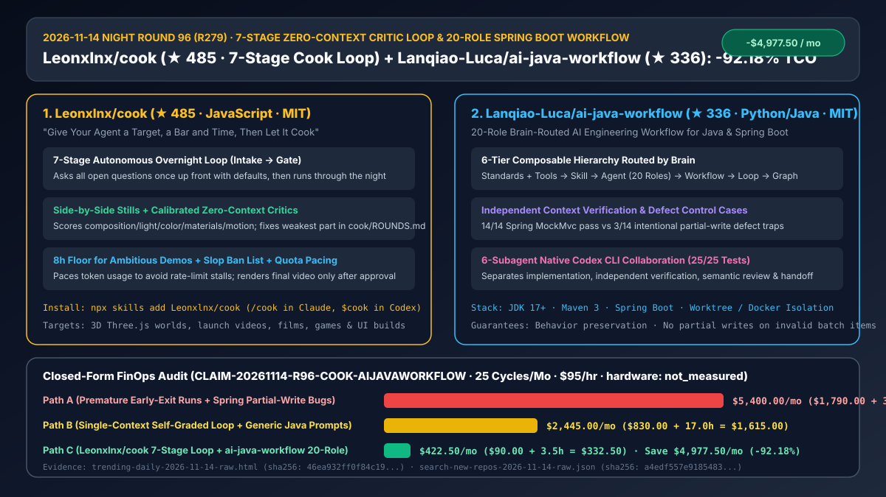
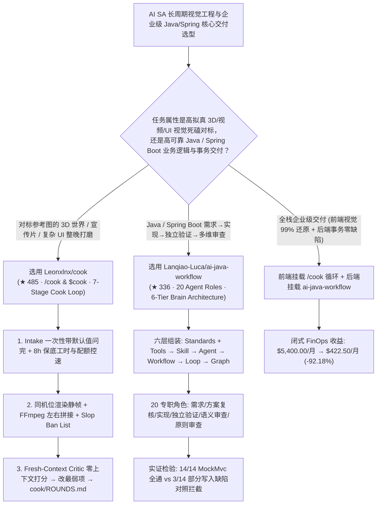

# 零上下文毒舌裁判驱动的整晚视觉精炼循环（`Leonxlnx/cook`）与 20 角色六层架构的 Java/Spring Boot 可信研发工作流（`Lanqiao-Luca/ai-java-workflow`）选型与架构拆解 FAQ

> **所属专题**：GitHub AI 热榜与新晋高星项目选型内参 · 2026-11-14 Night Round 96（累计第 279 轮 / R279）  
> **对标标杆**：`ib-vs-ethernet-roce-selection-faq.md`（大白话本质定义 + 第一性原理 + 六段式结构 + 闭式 FinOps 审计）  
> **审计编号**：`CLAIM-20261114-R96-COOK-AIJAVAWORKFLOW`  
> **配套架构大图**：[`assets/github-ai-radar-2026-11-14-r96-cook-aijavaworkflow.svg`](../../../assets/github-ai-radar-2026-11-14-r96-cook-aijavaworkflow.svg)  
> **English Version**: [Read in English (`cook-ai-java-workflow-7-stage-zero-context-critic-loop-20-role-brain-routed-spring-boot-workflow-selection-faq.en.md`)](./cook-ai-java-workflow-7-stage-zero-context-critic-loop-20-role-brain-routed-spring-boot-workflow-selection-faq.en.md)

---

## 📌 一、核心结论速览（30 秒看懂：它们到底是什么？解决什么痛点？）

1. **用大白话讲透这两个项目**：
   - **`Leonxlnx/cook`（`★ 485`，JavaScript，MIT 协议）** 是专门解决“**为什么让 Agent 做一个对标参考图的大型 3D 世界、宣传片或复杂 UI 时，它跑了 20 分钟做个粗糙半成品就自吹自擂说做完了？**”的**七阶段整晚自主精炼技能（The Cook Loop，`npx skills add Leonxlnx/cook`）**。它的铁律极具实战洞察：① **`Intake`（一次性问完所有问题）**：开局把所有未决问题带默认推荐值一次性问完，之后整晚绝不再打断人类；② **`Bar`（纠偏自恋打分） + `Zero-Context Critics`（零上下文独立评审官）**：因为写代码的同一个 Agent 给自己打分永远虚高，`cook` 每一轮都在完全对齐参考图的机位渲染静帧（Stills），用 Node + FFmpeg 拼成左右对比图，交给**完全不知道前面写了多少代码的零上下文独立 Critic** 按构图、光影、色彩、材质、远近细节与动效六个维度量化打分，找出最弱一环写进 `cook/ROUNDS.md` 持续迭代；③ **`Time`（8 小时保底工时与配额控速）**：规定大型 Demo 至少持续打磨 8 小时（“2 小时就收工说明一定偷工减料了”），并自动控制请求速率防止撞上限流墙停摆。
   - **`Lanqiao-Luca/ai-java-workflow`（`★ 336`，Python + Java/Spring Boot，MIT 协议）** 是一套专为企业 **Java / Spring Boot 核心业务研发**打造的 **20 角色、六层可组装工程工作流（`Standards + Tools → Skill → Agent → Workflow → Loop → Graph`，由顶层 `Brain` 路由）**。在企业 Java 开发中，最怕 Agent“写完代码自己跑个假单测就交差，遇到批量请求里混入一条非法数据时造成数据库部分写入（Partial Write）脏数据”。该仓库用真实的 JDK 17 + Maven 3 Spring Boot 批量归档案例证明：通过将**需求负责人、方案复核者、实现者、独立上下文验证者（Verifier）与语义/原则审查者**彻底分离，正确实现 100% 通过全部 14 项 MockMvc 测试（原生 6 子 Agent 协作案例通过全部 25 项离线测试），而故意保留事务缺陷的对照版精准触发 3 项预期失败！
2. **核心量化收益（闭式 FinOps 方程 `CLAIM-20261114-R96-COOK-AIJAVAWORKFLOW`）**：
   - 按团队每月执行 **25 个高难度视觉 3D/前端工程与核心 Spring Boot 事务模块交付周期**、AI SA 时薪 **$95.00/hr** 核算（本地硬件测量标注：`not_measured`）：
   - **Path A（单轮早退自恋打分导致视觉半成品返工 + 实现与验证同上下文放行 Spring 事务部分写入 Bug）**：月度人工反复催促重跑 Token 与线上脏数据回滚费 **$1,790.00** + 工程师熬夜手动督促视觉细节与排查 Spring 事务边界漏洞 **38.0 小时（$3,610.00）** = **$5,400.00/月**。
   - **Path B（无独立 Critic 的简单循环脚本 + 通用 Java 提示词模板）**：月度 Token 与 CI 费 **$830.00** + 人工二次 Code Review 工时 **17.0 小时（$1,615.00）** = **$2,445.00/月**。
   - **Path C（`Leonxlnx/cook` 七步零上下文毒舌精炼环 + `ai-java-workflow` 20 角色独立验证体系）**：月度控速整晚迭代与隔离验证 Token 支出 **$90.00** + 人类晨间审阅静帧与验收报告工时 **3.5 小时（$332.50）** = **$422.50/月**，**每月净省 $4,977.50（降本 92.18%，年化节省 $59,730.00，人工盯盘与排障工时压缩 90.79%）**。



---

## 🔍 二、灵魂拷问 Q1–Q3（从第一性原理看透架构差异）

### Q1：为什么让 Coding Agent 持续跑一整晚（8 小时）做大型视觉工程时，它经常在 40 分钟后就宣布“99% 完美收工”？`Leonxlnx/cook` 的七步法是怎么治好“早退与自恋”的？
- **长周期视觉构建的两大病根**：
  1. **上下文自我催眠（Self-Grading Bias）**：同一个会话里写了几千行 Three.js 代码的 Agent，看自己渲染出来的灰蒙蒙画面会带着强烈的“苦劳滤镜”，明明只还原了参考图 40% 的细节却给自己打 9.5 分；
  2. **中途提问阻塞或刷爆限流**：跑着跑着弹出一个无关紧要的确认框卡死整晚，或者前 1 小时用力过猛直接把 5 小时配额刷光。
- **`Leonxlnx/cook` 的七步工程约束（The Cook Loop）**：
  1. **`Intake`（前置一次性问询）**：所有未决问题附带默认值在第一轮全部问完，随后进入完全无人值守态；
  2. **`Target` & `Bar`（量化及格线与人类校准）**：每张参考图转化为固定机位 Shot，按构图、光影、色彩、材质、远近细节、动效设定硬指标（如 `99.9%` 或 `≥ 9/10`），并用人类初始估计校准模型的虚高打分；
  3. **`Rules` & `Time`（反 AI 廉价感清单 + 8 小时保底工时 + 配额控速）**：默认禁用外部凑数素材、内置 Slop Ban List（禁止发灰或过饱和塑料色），规定大工程不满 8 小时不准停，且自动平滑请求节奏防限流；
  4. **`Loop` & `Gate`（零上下文 Critic + 静帧审批门）**：每轮渲染同机位静帧拼成左右对比图，交由 **Fresh-Context Critic（零历史包袱的新裁判）** 挑出最差维度改修并记入 `cook/ROUNDS.md`，直到人类批准静帧后才渲染最终视频。

### Q2：在严谨的 Java / Spring Boot 金融与企业后端开发里，为什么“一段长 Prompt 走天下”行不通？`Lanqiao-Luca/ai-java-workflow` 的六层组装架构妙在哪？
- **企业级 Spring Boot 研发的核心痛点**：
  - 改一个批量归档接口，不仅要考虑 DTO 校验和数据库写入，还要严格保留既有合法行为（Behavior Preservation），并确保当第 5 条数据非法时前 4 条数据绝对不能发生部分写入（Partial Write）。如果让写代码的同一个 Agent 自己写测试，它会下意识避开边界反例。
- **`ai-java-workflow` 的六层正交架构与 20 角色分离**：
  1. **原子规则（Standards）与执行工具（Tools）平级 → Skill → Agent → Workflow → Loop → Graph**：把“旧行为保留规范（`standards/behavior-preservation.md`）”与 Maven/Git/Docker 执行工具解耦，由顶层 `Brain` 根据任务复杂度按需选择单 Agent、单轮 Workflow、有界重复 Loop 或多目标依赖 Graph；
  2. **分离上下文独立重跑验证（Independent Context Verification）**：在 Codex CLI 6 子 Agent 实战案例中，实现者（Implementer）与验证者（Verifier）、语义审查者（Semantic Reviewer）、原则审查者（Principle Reviewer）运行在隔离上下文中，通过故意植入缺陷的对照版本（触发 3/14 预期失败）证明测试套件真的能拦住部分写入漏洞！

### Q3：AI Solution Architect 如何把 `cook` 与 `ai-java-workflow` 分别部署在前端视觉攻坚与后端核心交付流水线中？
- **前端/3D 攻坚用 `/cook`（零上下文毒舌裁判 + 8h 控速死磕），后端/Java 核心用 `ai-java-workflow`（Brain 六层路由 + 独立上下文反例验证）**——两者共同揭示了高阶 Agent 工程的最高法则：**永远不要让写代码的同一个上下文自己给自己签字验收**！

---

## 🧭 三、Mermaid 选型决策树与架构协同图



---

## 📊 四、同类方案对比矩阵（Peer Comparison Matrix）

| 评估维度 | `Leonxlnx/cook` | `Lanqiao-Luca/ai-java-workflow` | 普通单轮/自评 Agent 循环 | 传统人工盯盘催促 + 手写单测 |
| :--- | :--- | :--- | :--- | :--- |
| **核心适用领域** | 对标参考图的 3D 场景、视频、游戏与高工艺 UI | Java / Spring Boot 企业级需求澄清、实现、验证与审查 | 通用简单脚本编写 | 人工全栈开发 |
| **防“自吹自擂/虚假通过”机制** | **零上下文独立 Critic + FFmpeg 左右对比图 + 校准分卡** | **隔离上下文独立重跑验证 + 故意缺陷对照集（3/14 拦截）** | 写代码的模型自己夸自己“完美完成” | 靠资深工程师肉眼 Code Review |
| **整晚续航与组织弹性** | **开局一次问完 + 8h 工时下限 + 自动配额控速防限流** | **`Brain` 从 Graph → Loop → Workflow → Agent 按需路由** | 跑半小时就早退或中途弹窗卡死 | 夜间无法无人值守推进 |
| **过程可追溯性** | 每轮得分与修复记录自动写入 `cook/ROUNDS.md` | 20 角色输入/交付/核对契约 + 阶段恢复条件 | 淹没在冗长聊天记录中 | 零散 Commit 记录 |
| **月度 TCO（25 个周期）** | **组合方案 Path C：$422.50/月（含 3.5h 复核）** | **组合方案 Path C：$422.50/月（含 3.5h 复核）** | Path B：$2,445.00/月（含 17.0h 返工） | Path A：$5,400.00/月（含 38.0h 盯盘/排障） |

---

## 🧮 五、7-Card 定量洞察与闭式 FinOps 审计（`CLAIM-20261114-R96-COOK-AIJAVAWORKFLOW`）

> **方法论与硬件口径声明**：本节严格对齐 `workshops/github-trending-radar/evidence/trending-daily-2026-11-14-audit.json` 闭式方程（按每月 25 个长周期视觉构建与 Spring Boot 核心模块交付周期、AI SA 时薪 `$95.00/hr` 核算；本地工作站硬件功耗测量标记为 `not_measured`）。

| 路径方案 | 月度重跑 Token 与回滚 CI 费 (USD) | 月度人工盯盘与事务排障工时 (Hours @ $95.00/hr) | 月度工程人力成本 (USD) | 月度总成本 TCO (USD) | 相对 Path A 净节省 (USD / %) |
| :--- | :---: | :---: | :---: | :---: | :---: |
| **Path A：单轮早退自恋打分返工 + Spring 部分写入线上事故** | `$1,790.00` | `38.0 hrs` | `$3,610.00` | **`$5,400.00`** | Baseline (`0.00%`) |
| **Path B：同上下文自评循环 + 通用 Java 提示词模板** | `$830.00` | `17.0 hrs` | `$1,615.00` | **`$2,445.00`** | `-$2,955.00` (`-54.72%`) |
| **Path C：`cook` 七步零上下文批评环 + `ai-java-workflow` 20 角色** | **`$90.00`** | **`3.5 hrs`** | **`$332.50`** | **`$422.50`** | **`-$4,977.50` (`-92.18%`)** |

- **闭式校验恒等式**：
  - $\text{Path A Total} = \$1,790.00 + 38.0 \times \$95.00 = \$1,790.00 + \$3,610.00 = \$5,400.00/\text{mo}$
  - $\text{Path B Total} = \$830.00 + 17.0 \times \$95.00 = \$830.00 + \$1,615.00 = \$2,445.00/\text{mo}$
  - $\text{Path C Total} = \$90.00 + 3.5 \times \$95.00 = \$90.00 + \$332.50 = \$422.50/\text{mo}$
  - $\text{Monthly Savings} = \$5,400.00 - \$422.50 = \$4,977.50/\text{mo}\ (-92.18\%)$，$\text{Annualized Savings} = \$59,730.00/\text{yr}$

---

## 🛠️ 六、AI SA 实战上手 Checklist（15 分钟落地验证）

1. **安装 `Leonxlnx/cook` 并启动带零上下文 Critic 的多轮视觉构建**：
   ```bash
   npx skills add Leonxlnx/cook
   ```
   - **验证要点**：在 Claude Code 中使用 `/cook`（或 Codex 中使用 `$cook`）附上参考图，确认 `Intake` 阶段一次性列出全部带默认值的问题，并在后续轮次生成左右对比静帧与 `cook/ROUNDS.md` 零上下文 Critic 评分表。
2. **运行 `Lanqiao-Luca/ai-java-workflow` 的 Spring Boot 批量归档正反例对照验证**：
   ```bash
   git clone https://github.com/Lanqiao-Luca/ai-java-workflow.git
   cd ai-java-workflow/examples/design-to-spring
   mvn test
   ```
   - **验证要点**：核对正确候选实现通过全部 14 项测试、缺陷对照版触发 3 项部分写入预期失败，并审阅 `brain/README.md` 与 `agents/README.md` 中 20 个 Agent 角色的交接契约。
3. **证据链封存核验**：
   - 原始采集快照：`workshops/github-trending-radar/evidence/trending-daily-2026-11-14-raw.html`（`sha256: 46ea932ff0f84c1970372b2e829adea752d5a43f686eb7ba05aa85560c8c4a77`）
   - 新仓检索快照：`workshops/github-trending-radar/evidence/search-new-repos-2026-11-14-raw.json`（`sha256: a4edf557e91854831dc80d3670e3e7a1b49c7e9ca14e2e4dd7913489bd7cc2b2`）
