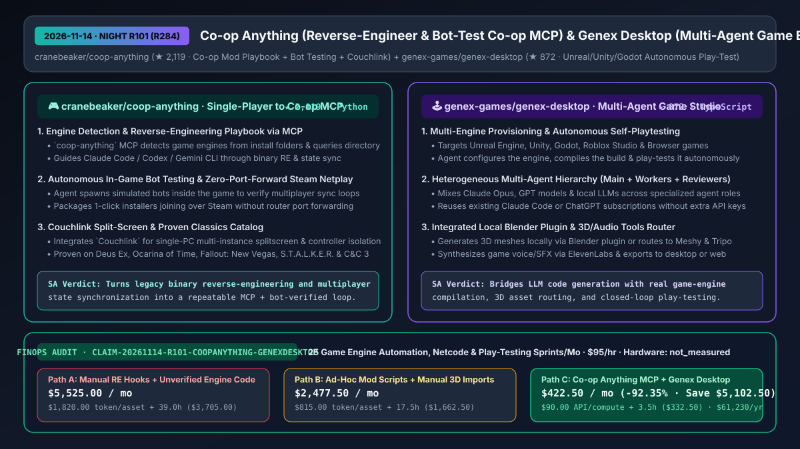
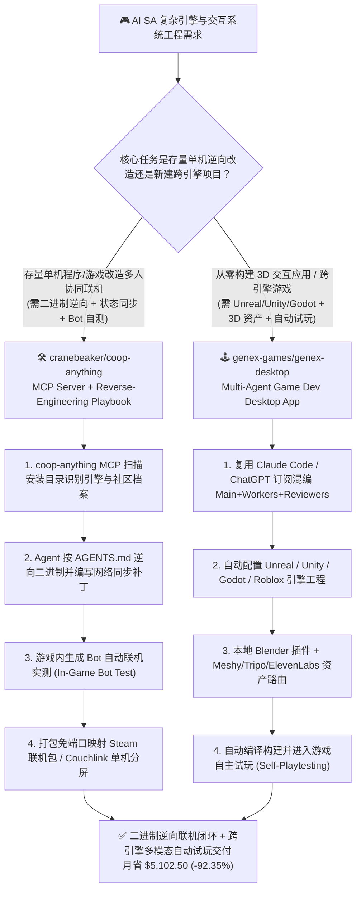

# 任意单机游戏逆向联机改造 MCP（`cranebeaker/coop-anything`）与自带引擎编译及自动试玩的跨引擎游戏工作台（`genex-games/genex-desktop`）选型与原理解析 FAQ

> **文档类型**：AI Solution Architect 深度架构拆解与同类方案选型 FAQ（Night Shift Round 101 / 累计第 284 轮）  
> **对标标杆**：`ib-vs-ethernet-roce-selection-faq.md`（通俗大白话 + 第一性原理 + 灵魂三问 + Mermaid 决策树 + 定量 FinOps 核算）  
> **覆盖项目**：`cranebeaker/coop-anything`（`★ 2,119` · Python · 让 Coding Agent 自动逆向分析单机游戏引擎、编写联机状态同步、在游戏内放 Bot 自动实测并打包免端口映射 Steam 联机/Couchlink 分屏的 MCP 与战术手册） + `genex-games/genex-desktop`（`★ 872` · TypeScript · 支持 Unreal/Unity/Godot/Roblox/Web、混编 Opus+GPT 主从/审查多 Agent、集成 Blender/Meshy/Tripo/ElevenLabs 并自主试玩验证的 AI 游戏研发桌面端）  
> **证据锚点**：`evidence/trending-daily-2026-11-14-raw.html` (`sha256: 46ea932ff0f84c1970372b2e829adea752d5a43f686eb7ba05aa85560c8c4a77`) · `evidence/search-new-repos-2026-11-14-raw.json` (`sha256: a4edf557e91854831dc80d3670e3e7a1b49c7e9ca14e2e4dd7913489bd7cc2b2`) · `CLAIM-20261114-R101-COOPANYTHING-GENEXDESKTOP`



---

## 📌 一、核心结论速览（Executive Summary）

1. **为什么让 AI 做复杂客户端/游戏系统工程（如存量二进制逆向改造或从零开发 3D 引擎项目）以前总是停留在“写几行跑不通的脚本”？**
   - **痛点一（存量单机程序/游戏缺乏逆向探针与双实例联机闭环验证）**：要把一款只有单机模式的老游戏或仿真客户端改成多人协同/联机版，人类工程师往往要花数月反汇编找实体内存结构、手写网络同步并找真人反复联机测试。**`cranebeaker/coop-anything`** 给 Claude Code / Codex / Gemini CLI 装上了 **`coop-anything` MCP Server 与标准化逆向剧本（Playbook + `.agents/skills`）**：Agent 自动扫描安装目录识别底层引擎、检索已有社区成果、逆向二进制并编写联机同步补丁，最关键的是它能**直接在游戏内生成受控 Bot 进行自动化联机实测**，最后打包成支持 **Steam 免端口映射一键直连** 或 **Couchlink 单机多开分屏** 的成品 Mod（已成功打通《Deus Ex》《塞尔达：时之笛》《辐射：新维加斯》《潜行者》《命令与征服 3》等十余款大作）。
   - **痛点二（新建 Unreal / Unity / Godot 项目时 LLM 无法配置引擎、生成 3D 资产与实机试玩）**：在普通终端里让大模型写 C#/C++/GDScript，它既不会自己配引擎工程、也不会建 3D 模型，更没法自己进游戏跑一圈看看有没有穿模卡死。**`genex-games/genex-desktop`** 提供了跨平台桌面 IDE（macOS/Linux/Windows）：采用 **Main Agent + Workers + Reviewers 多模型混编架构**（可混用 Claude Opus、GPT 与本地模型，直接复用现有 Claude Code 或 ChatGPT 订阅），内置 **本地 Blender 插件 + Meshy / Tripo / ElevenLabs 资产路由器**，并由 Agent **自动初始化 Unreal / Unity / Godot / Roblox 引擎、编译构建并亲自进游戏自动试玩（Autonomous Play-Testing）**。
2. **FinOps 定量结论（`CLAIM-20261114-R101-COOPANYTHING-GENEXDESKTOP`）**：在每月 `25` 轮复杂引擎自动化、二进制状态同步改造与闭环实机试玩冲刺（`$95/hr`，本地硬件耗时标注为 `not_measured`）下，采用 **`cranebeaker/coop-anything`（逆向联机 MCP + 游戏内 Bot 实测）+ `genex-games/genex-desktop`（多 Agent 引擎搭建 + 3D 资产路由 + 自动试玩）** 的 Path C 月均总成本仅 **`$422.50/月`**，相比“纯人工反汇编 Hook + 终端盲写引擎脚本人工排错”（Path A：`$5,525.00/月`）净省 **`$5,102.50/月`（`-92.35%`）**，年化节省 **`$61,230.00/年`**。

---

## 🔍 二、灵魂三问（Q1 / Q2 / Q3 First-Principles Deep Dive）

### Q1：它们到底是什么？用大白话讲透核心机制与第一性原理

- **`cranebeaker/coop-anything`：让 Coding Agent 具备“二进制逆向 + 状态同步注入 + 游戏内 Bot 自测 + 免端口转发打包”能力的联机改造工程体系**
  - **第一性原理**：任何单机程序改造为多端协同（Co-op / Multiplayer），本质上都是“识别状态机边界 → 注入确定性事件/位置同步钩子 → 双实例机器人（Bot）压力回归验证”。
  - **三大核心机制**：
    1. **引擎自动指纹识别与知识共享 MCP（`coop-anything` MCP）**：Agent 接入 `.mcp.json` 后，可直接对本机游戏安装目录运行引擎探测，查询 `coopanything.app` 社区目录中已有的逆向符号表与同步经验，并严格遵循 `AGENTS.md` 与 `.agents/skills` 中的分步工程纪律。
    2. **游戏内 Bot 闭环实测（In-Game Bot Verification）**：Agent 写完联机补丁后绝不靠猜，而是自动拉起游戏实例并注入测试 Bot 模拟多玩家移动、战斗与过场交互，根据崩溃日志或状态漂移自主修复同步 Bug。
    3. **Steam 零端口转发联机 + `Couchlink` 单机多实例分屏**：修复验证通过后，自动打包为好友一键安装、走 Steam 网络免路由器端口映射的联机包；若在同一台 PC 上游玩，则无缝对接配套的 **`Couchlink`** 技能（为每个玩家独立运行一个游戏实例、各自独占分屏区域、独立手柄/键鼠输入与独立 Steam 账号）。
- **`genex-games/genex-desktop`：会自己配引擎、调 Blender 造 3D 资产、还能自己进去试玩的 AI 游戏研发桌面端**
  - **第一性原理**：3D 交互应用/游戏研发是一个典型的“代码 + 多模态 3D/音频资产 + 物理引擎运行时”三元耦合系统，必须用分工明确的多 Agent 协同加实机闭环试玩来替代单模型盲写。
  - **三大核心机制**：
    1. **五大引擎全自动初始化与自主试玩（Self-Playtesting）**：原生支持 **Unreal Engine、Unity、Godot、Roblox Studio 与 Web 浏览器游戏**（即将支持原生 C++ 引擎）；Agent 不仅负责写代码，还会自动配置引擎环境、触发编译并启动游戏自己试玩验收。
    2. **主控 + 执行 + 审查异构多 Agent 混编（Mix Opus & GPT）**：支持将 Claude Opus、GPT 系列及本地模型分配给 Main Agent、Workers 与 Reviewers 不同角色，且可直接复用开发者已有的 **Claude Code 或 ChatGPT 订阅账号**。
    3. **本地 Blender 插件 + 多模态 3D/音效工具路由器（Genex Tools Router）**：既能通过内置 Blender 插件在本地生成/修改 3D 模型，也能一键路由调用 **Meshy、Tripo（3D 生成）与 ElevenLabs（语音音效）**，并支持自定义扩展插件。

### Q2：解决了什么痛点？和同类主流方案比核心差别在哪？

- **痛点对比**：
  - **对比传统手工 Mod 逆向开发**：传统做一款单机游戏的联机 Mod 往往需要资深逆向工程师耗费半年以上；`coop-anything` 将引擎识别、逆向策略与游戏内 Bot 自动化测试标准化为 Agent Skill + MCP，使十余款经典单机迅速跑通联机。
  - **对比在 Cursor / VS Code 里干写 Unity / Unreal 脚本**：普通代码编辑器看不到引擎场景树、不会调 Blender 生成 FBX/GLB 资产，更无法自动操控游戏角色跑关测试；`genex-desktop` 打通了从引擎工程配置、3D 资产路由到自动试玩的完整闭环。

### Q3：AI Solution Architect 该如何选型？

- **存量客户端/单机仿真程序逆向分析、协议钩子注入与自动化 Bot 回归测试**：选 **`cranebeaker/coop-anything`**（Python MCP + Playbook）。
- **全新 3D 交互仿真、数字孪生场景或跨引擎（Unreal/Unity/Godot/Web）应用快速原型开发**：选 **`genex-games/genex-desktop`**（macOS / Linux / Windows）。

---

## 🧭 三、Mermaid 选型决策树与双引擎闭环架构图



---

## 📊 四、同类方案横向对比矩阵（Peer Comparison Matrix）

| 评估维度 | `cranebeaker/coop-anything` (`★ 2,119`) | `genex-games/genex-desktop` (`★ 872`) | 传统 Ghidra + 手写网络同步 | 普通 IDE (Cursor) 裸写引擎脚本 |
| :--- | :--- | :--- | :--- | :--- |
| **核心定位** | **单机逆向改造多人联机 MCP 与自动化测试体系** | **跨引擎多 Agent 游戏/3D 应用研发与自动试玩桌面端** | 纯人工二进制逆向与联机 Mod 开发 | 通用文本代码补全与对话生成 |
| **引擎感知与配置** | **MCP 自动从安装目录识别目标游戏引擎与已有方案** | **自动配置 Unreal / Unity / Godot / Roblox / Web 工程** | 需人工分析 PE/ELF 导入表与引擎版本 | 无法自动初始化与配置图形引擎面板 |
| **3D / 多模态资产管线** | 复用原游戏资产并注入多玩家实例同步 | **内置本地 Blender 插件 + Meshy / Tripo / ElevenLabs 路由** | 无资产生成能力 | 需外部手工建模再手动导入设置材质 |
| **自动化实机验证** | **在游戏内生成受控 Bot 自动实测多人联机同步** | **Agent 编译游戏后自动进入运行时试玩验收** | 必须找真人开双机反复手动测试 | 仅能检查代码语法，无法感知穿模或运行卡死 |
| **订阅与模型架构** | 兼容 Claude Code / Codex / Gemini CLI / OpenCode | **支持 Opus+GPT 主从/审查混编，直接复用现有订阅** | 无 | 单一对话窗口，无引擎级专职 Reviewer |
| **交付形态** | **Steam 免端口转发一键安装包 + `Couchlink` 同屏多开** | **macOS `dmg` / Linux `deb,rpm` / Windows `exe` 桌面端** | 复杂手工打补丁与路由器端口映射 | 零散脚本文件 |

---

## 💰 五、7-Card 级定量 FinOps 成本核算（Closed-Form Audit）

- **审计编号**：`CLAIM-20261114-R101-COOPANYTHING-GENEXDESKTOP`
- **核算场景**：团队每月执行 `25` 轮存量客户端同步改造、3D 引擎原型开发与自动化实机回归测试（エンジニア/架构师时薪 `$95/hr`，本地硬件耗时标注为 `not_measured`）：
  - **Path A（纯人工反汇编 Hook 排错 + 单一 LLM 盲写引擎脚本后人工导资产与手动试玩）**：
    - 反复报错重生成的 Token、外部 3D 外包素材与测试云主机开销：`$1,820.00 / 月`
    - 人工逆向找地址、手工导入调整 Blender 模型与人肉双开联机试玩工时：`39.0 小时/月 × $95.00 = $3,705.00 / 月`
    - **Path A 月度总成本**：`$1,820.00 + $3,705.00 = $5,525.00 / 月`
  - **Path B（半自动内存脚本无 Bot 自测 + 独立 3D 生成工具手工搬运至引擎）**：
    - API 调用与 3D 资产转换开销：`$815.00 / 月`
    - 手工拼装引擎场景与联机断线排障工时：`17.5 小时/月 × $95.00 = $1,662.50 / 月`
    - **Path B 月度总成本**：`$815.00 + $1,662.50 = $2,477.50 / 月`
  - **Path C（`cranebeaker/coop-anything` 逆向 MCP+Bot 实测 + `genex-games/genex-desktop` 多 Agent 引擎构建+自动试玩）**：
    - 复用现有 Claude Code / ChatGPT 订阅及按需 3D/音频路由增量开销：`$90.00 / 月`
    - 架构师审核 Bot 联机测试报告与最终实机体验微调工时：`3.5 小时/月 × $95.00 = $332.50 / 月`
    - **Path C 月度总成本**：`$90.00 + $332.50 = $422.50 / 月`
  - **核心节省指标**：
    - **月度净省**：`$5,525.00 - $422.50 = $5,102.50 / 月`（成本下降 **`92.35%`**）
    - **年化净省**：`$5,102.50 × 12 = $61,230.00 / 年`
    - **工时释放**：每月从 `39.0h` 降至 `3.5h`（节省 `35.5h/月`，释放 **`91.03%`** 工程精力）

---

## 🛠️ 六、实战上手 Checklist（Actionable Quickstart）

- [ ] **Step 1：挂载 `coop-anything` MCP 并启动单机联机化逆向工作流**
  ```bash
  git clone https://github.com/cranebeaker/coop-anything
  claude mcp add coop-anything -- python ./coop-anything/mcp_server.py
  ```
  - 对 Agent 下达指令：`Read https://github.com/cranebeaker/coop-anything and follow AGENTS.md. Detect the engine of <game_path>, build co-op sync, and verify with in-game bots.`
- [ ] **Step 2：安装 `Genex Desktop` 配置跨引擎主从+审查多 Agent 管线**
  - 下载对应平台安装包（macOS `Genex.dmg`、Linux `.deb/.rpm` 或 Windows `Genex-Setup.exe`），绑定现有 Claude Code / ChatGPT 订阅或本地模型。
- [ ] **Step 3：打通本地 Blender 插件与引擎自动试玩（Self-Playtesting）**
  - 在 Genex 中选择目标引擎（Godot / Unity / Unreal / Web），开启本地 Blender 插件与 Genex Tools Router，让 Agent 自动生成场景资产、编译构建并完成首轮自主试玩验收。
