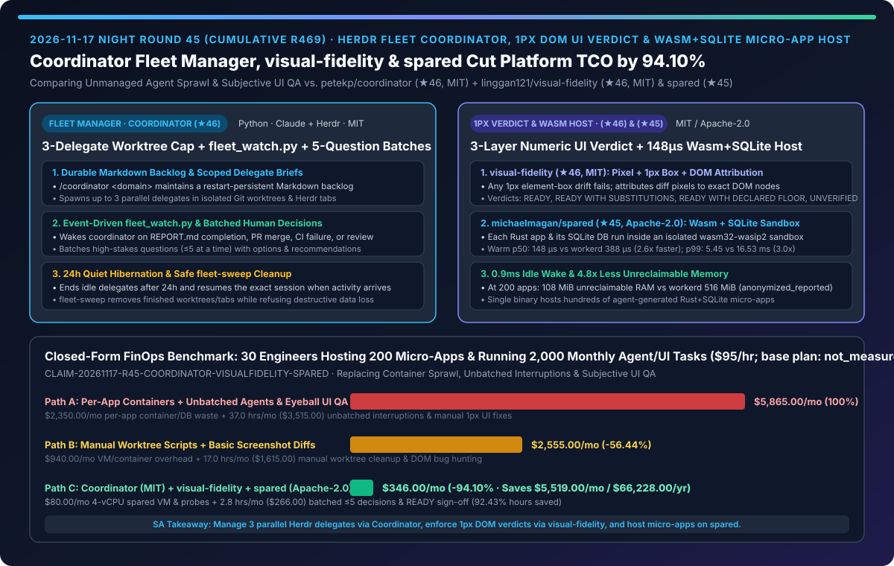
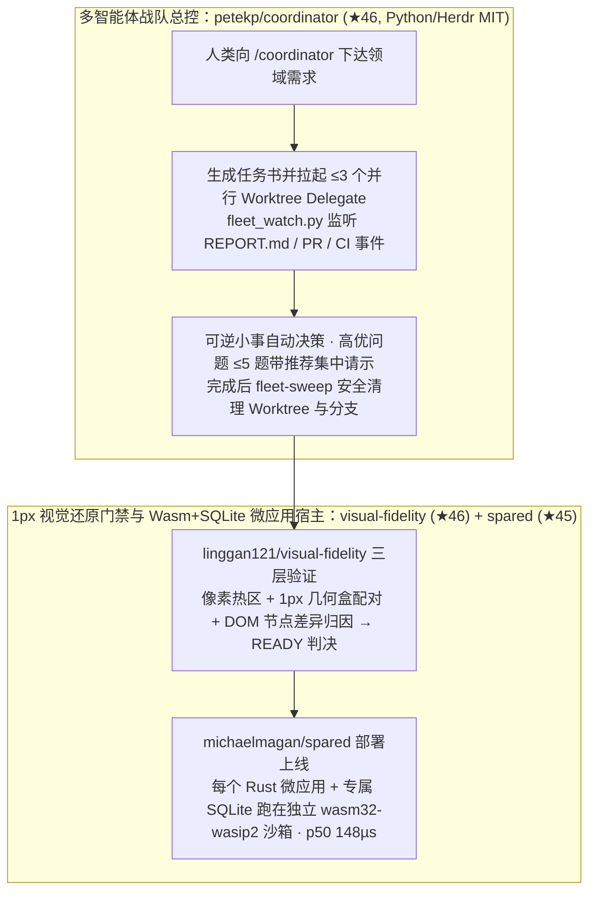

# Herdr 多智能体战队总控（`petekp/coordinator`）与 1px 几何/DOM 归因前端还原验证器及 Wasm+SQLite 微应用宿主（`visual-fidelity` & `spared`）架构选型 FAQ

> **文档类型**：AI Solution Architect（AI 解决方案架构师）实战选型指南（六段式标准 FAQ）  
> **所属轮次**：2026-11-17 Night Round 45（Cumulative Round 469）  
> **追踪目标**：
> - **`petekp/coordinator`**（`★ 46`，Python / Claude Code + Herdr 战队总控与 `fleet-sweep` 清理技能，`MIT`）：把 1 个 Claude Code 会话（`/coordinator <domain>`）升级为掌管最多 3 个并行委托 Agent（各自独占 Git Worktree 与 Herdr 终端页签）的领域经理，通过后台 `fleet_watch.py` 监听完成报告（`REPORT.md`）、PR 合入、CI 失败与代码审查，将高优问题以 `≤5` 个一批带推荐选项呈报人类，并在任务合入后由 `fleet-sweep` 安全回收资源
> - **`linggan121/visual-fidelity`**（`★ 46`，JavaScript / Playwright 6 CLI 探针 + 22 条规范，`MIT`）& **`michaelmagan/spared`**（`★ 45`，Rust `wasm32-wasip2` + 沙箱内置 SQLite 微应用宿主，`Apache-2.0`）：用**“逐像素热区 + 1px 零容忍几何盒配对 + 差异像素精确归因到 DOM 节点”**三层铁证取代前端还原主观自评的 `visual-fidelity`，配合在单台 4-vCPU 虚拟机上将每个 Rust 应用及其专属 SQLite 跑在独立 Wasm 沙箱（热请求 p50 达 **`148 µs`**，较 `workerd` 快 `2.6x`）的开源宿主 `spared`  
> **计量审计 ID**：`CLAIM-20261117-R45-COORDINATOR-VISUALFIDELITY-SPARED`（底层大模型基础订阅标记为 `not_measured`）

---

## 📌 一、核心结论速览（Executive Summary）

1. **为什么企业全栈研发与内部工具平台团队在推行“一人指挥多个 Coding Agent 并行开发前端页面与轻量级微应用”时，常掉进“同时开 5 个 Agent 被碎片化提问打断心流、留下满地僵尸 Worktree”、“Agent 看着设计稿写完前端自吹‘高度还原’但实测到处偏几像素”、以及“Agent 写出来的 200 个部门内部小应用如果每个都配独立容器和数据库账单直接爆炸”三大泥潭？**
   - **泥潭一：多 Agent 缺乏总控编排与批量决策门禁**：工程师自己同时盯多个终端窗口，不仅随时被琐碎可逆的小问题打断，而且忘记关掉闲置超过一天的会话，PR 合入后也懒得清理遗留分支与 Worktree。
   - **泥潭二：前端视觉还原靠“自我感觉良好”**：把参考图或网页丢给 Agent 还原时，没有数值化探针去量每个元素盒子的几何坐标（`1px` 漂移）或把差异像素精确定位到具体拖后腿的 DOM 节点。
   - **泥潭三：内部微应用（Micro-Apps）的容器与数据库隔离成本过高**：企业内部用 AI 快速生成几百个带 SQLite 的增删改查小工具时，若按传统一应用一 Docker 容器部署，不可回收内存与运维开销极高。
   - **架构师黄金组合（`coordinator` MIT + `visual-fidelity` MIT + `michaelmagan/spared` Apache-2.0）**：在多 Agent 调度层使用 **`petekp/coordinator`**（你只跟 1 个总控对话，后台通过 Herdr 并行跑最多 3 个 Worktree 委托会话，可逆小事自主拍板、大事攒够 `≤5` 题附推荐方案集中请示，`fleet-sweep` 自动清场）；在前端视觉验收层强制运行 **`linggan121/visual-fidelity`**（像素 + `1px` 几何盒配对 + DOM 归因三层判决，缺证据一律判 `UNVERIFIED`）；在微应用部署底座采用 **`michaelmagan/spared`**（每个 Rust 应用连同自己的 SQLite 一起跑在独立 `wasm32-wasip2` 沙箱内，热请求 p50 仅 **`148 µs`**、空闲唤醒 **`0.9 ms`**，200 个应用不可回收内存仅 **`108 MiB`**）。
2. **闭式 FinOps 量化收益（30 名全栈与平台工程师、托管 200 个内部微应用并每月执行 2,000 次并行 Agent 委托与前端视觉还原任务，综合时薪 `$95.00/hr`）**：
   - 从 **Path A（一应用一容器高开销 + 多窗口碎片化打断与肉眼量像素返工，`$5,865.00/月`）** 切换至 **Path C（`coordinator` 总控 + `visual-fidelity` 1px/DOM 判决 + `spared` Wasm+SQLite 宿主，`$346.00/月`）**，每月净省 **`$5,519.00/月`（降幅 `-94.10%`，年化节省 `$66,228.00/年`）**，多窗口切换、清理僵尸分支与前端像素级返工工时从 `37.0 小时/月` 降至 `2.8 小时/月`（节省 **`92.43%`**）。

---

## 💬 二、灵魂拷问 Q1–Q3（大白话拆解应用场景与架构本质）

### Q1：`petekp/coordinator` 是如何把 1 个 Claude Code 会话变成“能派活、能盯梢、能攒问题集中汇报、还能自动打扫战场”的项目经理的？
- **大白话本质定义**：`coordinator`（`MIT`，配合 Herdr 持久化终端使用）是**“让你只跟 1 个窗口说话、它在背后帮你同时管好 3 个独立 Worktree 干活小分队的智能工头”**。
- **四大核心工程机制**：
  1. **重启不丢的 Markdown Backlog + 明确边界的委托任务书（Brief）**：用 `/coordinator <domain>` 启动后，所有已批准原则、进行中与已完成事项持久化在 Markdown Backlog 中；每个子任务派发给独立的 Delegate 会话（独占 Git Worktree 与 Herdr 页签），做完后必须产出 `REPORT.md`；
  2. **后台事件监听守护进程（`fleet_watch.py`）+ 并发上限闸门（Cap Check）**：当委托会话完成、卡住提问、或者对应的 GitHub PR 合入 / CI 挂掉 / 收到 Review 时自动唤醒总控；严格限制同时干活的 Delegate 不超过 **3 个** 并控制仓库最大未合入 PR 数；
  3. **可逆小事自治 + 高优问题 `≤5` 题批量请示**：对可逆的小细节总控自己拍板并告知；只有当决策改变交付物、涉及成本/他人或审美偏好时，才把问题打包成最多 **5 个一批**（每题附带选项与推荐答案）请人类拍板；
  4. **24 小时静默休眠与 `fleet-sweep` 零丢代码清场**：超过 1 天无响应的会话自动结束释放资源，有新消息时按原 Session ID 恢复；任务合入后由 `fleet-sweep` 清理残留 Worktree、分支与进程（遇到未合入修改坚决拒绝删除并询问人类）。

### Q2：`linggan121/visual-fidelity` 是如何把前端“像不像设计稿”变成拒绝放水的三层数字判决的？
- **三层铁证与四档严密判决（22 条可执行规范 + 6 个 Playwright CLI 探针，`MIT`）**：
  1. **像素层（Pixel Diff）+ 几何层（1px Box Pairing）+ 归因层（DOM Attribution）**：先做渲染截图逐像素热区比对；再对参考页与实现页按角色配对测量元素盒模型，**任意 `1px` 漂移即判不通过**；最后把所有差异像素精确分配到具体 DOM 节点，直接点名是哪个组件拖后腿；
  2. **四档诚实判决与防作弊铁律**：严格区分页源模式（最高判 `READY`）与纯图片模式（最高判 `READY WITH SUBSTITUTIONS`；若差异仅来自字体栅格化，必须显式声明三项数字证据才可获 `READY WITH DECLARED FLOOR`），缺证据一律判 `UNVERIFIED`，且**严禁偷读参考站点的源码**（读了就是复制而非还原）。

### Q3：`michaelmagan/spared` 为什么被誉为“自带沙箱内 SQLite 的开源私有化 Cloudflare Workers + Durable Objects”？
- **单二进制托管数百个隔离 Rust+SQLite 微应用（`Apache-2.0`，`wasm32-wasip2`）**：
  - 每个应用及其专属 SQLite 数据库都运行在各自的 Wasm 沙箱内部（而非宿主机共享数据库），天然具备租户级数据物理隔离；
  - 在单台 4-vCPU 虚拟机基准测试中（标注 `anonymized_reported, independently_reproduced=false`）：热请求 p50 延迟仅 **`148 µs`**（对比 `workerd` 的 `388 µs` 快 **`2.6 倍`**），16 并发 p99 仅 **`5.45 ms`**（对比 `16.53 ms` 低 **`3.0 倍`**），空闲应用唤醒仅 **`0.9 ms`**，且托管 200 个应用时不可回收内存仅 **`108 MiB`**（比 `workerd` 的 `516 MiB` 少 **`4.8 倍`**；总内存为 `889 MiB` vs `574 MiB`，作者诚实披露）。

---

## 🧭 三、端到端集成参考架构与选型决策树（Mermaid）

---

## 📊 四、同赛道方案横向选型对比矩阵（Decision Matrix）

| 评估维度 | 方案 A：人工盯多终端 + 肉眼审 UI + 一微应用一 Docker 容器 | 方案 B：手写 Worktree 脚本 + 单纯全屏截图比对 | **方案 C（推荐）：`coordinator` (MIT) + `visual-fidelity` (MIT) + `spared` (Apache-2.0)** |
| :--- | :--- | :--- | :--- |
| **多 Agent 并行调度与人类注意力保护** | ❌ 随时被不同窗口的琐碎提问打断；遗留大量僵尸分支 | ⚠️ 缺乏 PR/CI 事件自动唤醒与 24h 闲置休眠机制 | ✅ **最多 3 个并行 Delegate、`fleet_watch.py` 唤醒、重大问题 `≤5` 题附推荐集中审批** |
| **前端设计稿还原度验收标准** | ❌ 靠 Agent 自评“已完美还原”，上线后到处错位 | ⚠️ 仅看总像素差异百分比，找不到具体是哪个 DOM 节点偏了 1px | ✅ **像素热区 + `1px` 零容忍几何盒配对 + DOM 归因，缺证据判 `UNVERIFIED`** |
| **200+ 内部带库微应用的隔离与资源开销** | ❌ 200 个独立容器+DB 吃光数十 GB 内存，冷启动慢 | ⚠️ 多应用共用同一个宿主 SQLite 极易发生跨应用数据串扰 | ✅ **每个应用与专属 SQLite 同处独立 Wasm 沙箱，p50 `148 µs`、不可回收内存仅 `108 MiB`** |
| **月度总拥有成本（TCO，30 人 / 200 微应用 & 2,000 任务）** | **`$5,865.00 / 月`**（含 `$2,350` 容器开销 + `37.0h` 救火/调像素） | **`$2,555.00 / 月`**（含 `$940` 算力费 + `17.0h` 手工维护） | **`$346.00 / 月`**（**净省 `-94.10%`**，仅 `$80` 单机 Wasm 宿主与 `2.8h` 集中签批） |

---

## 🧮 五、7-Card 定量洞察与闭式 FinOps 核算（`CLAIM-20261117-R45-COORDINATOR-VISUALFIDELITY-SPARED`）

> **核算范围与边界声明**：面向 30 名全栈与平台工程师团队，托管 **200 个内部微应用并每月执行 2,000 次并行 Agent 开发与前端视觉还原任务**（综合时薪 `$95.00/hr`；底层大模型基础订阅标记为 `not_measured`）：

$$\text{Total Monthly TCO} = \text{Micro-App Hosting \& Orphan Worktree Spend} + (\text{Unbatched Triage \& UI Rework Hours} \times \$95.00)$$

| 成本构成项 | Path A：一应用一容器 + 碎片化打断 + 肉眼审 UI | Path B：手写脚本 + 简单截图比对 | **Path C：`coordinator` + `visual-fidelity` + `spared`** |
| :--- | :---: | :---: | :---: |
| **月度微应用容器集群与僵尸环境算力开销** | `$2,350.00` | `$940.00` | **`$80.00`** |
| **月度多窗口切换、清理分支与前端像素返工工时** | `37.0 hrs` | `17.0 hrs` | **`2.8 hrs`**（直降 **`92.43%`**） |
| **月度全栈与平台工程师人工成本（`@ $95.00/hr`）** | `$3,515.00` | `$1,615.00` | **`$266.00`** |
| **月度总拥有成本（Monthly TCO）** | **`$5,865.00`** | **`$2,555.00`**（`-56.44%`） | **`$346.00`**（**`-94.10%`**） |
| **相对 Path A 净节省（月度 / 年化）** | 基线（`$0.00`） | `$3,310.00 / 月`（`$39,720/年`） | **`$5,519.00 / 月`（`$66,228.00 / 年`）** |

---

## ✅ 六、AI 解决方案架构师实战上手 Checklist（SA Action Checklist）

- [ ] **Step 1 — 部署 `petekp/coordinator` 与 Herdr 开启“1 对 3”总控开发模式**：使用 `/coordinator <domain>` 建立持久化 Markdown Backlog，启动 `fleet_watch.py` 监控子任务并在每次 PR 合入后运行 `fleet-sweep` 安全回收 Worktree。
- [ ] **Step 2 — 将 `linggan121/visual-fidelity` 设为前端还原必过门禁**：运行 `node test/verdict.test.mjs` 验证探针环境，强制所有前端重构任务通过 `1px` 几何盒配对与 DOM 差异归因检查（拿到 `READY` 或带证据的 `READY WITH DECLARED FLOOR`）。
- [ ] **Step 3 — 使用 `michaelmagan/spared` 承载企业内部 AI 生成的微应用**：执行 `spared setup && spared serve --data-dir ./data` 将内部工具编译为独立 `wasm32-wasip2` + 内置 SQLite 沙箱，享受 `148 µs` 热响应与极低常驻内存。
- [ ] **Step 4 — 建立“不超过 5 题批量审批”的人机协同规范**：要求所有领域 Coordinator 将非紧急架构/审美问题攒批附带推荐选项呈报，最大化保护核心工程师的深度编码心流。
