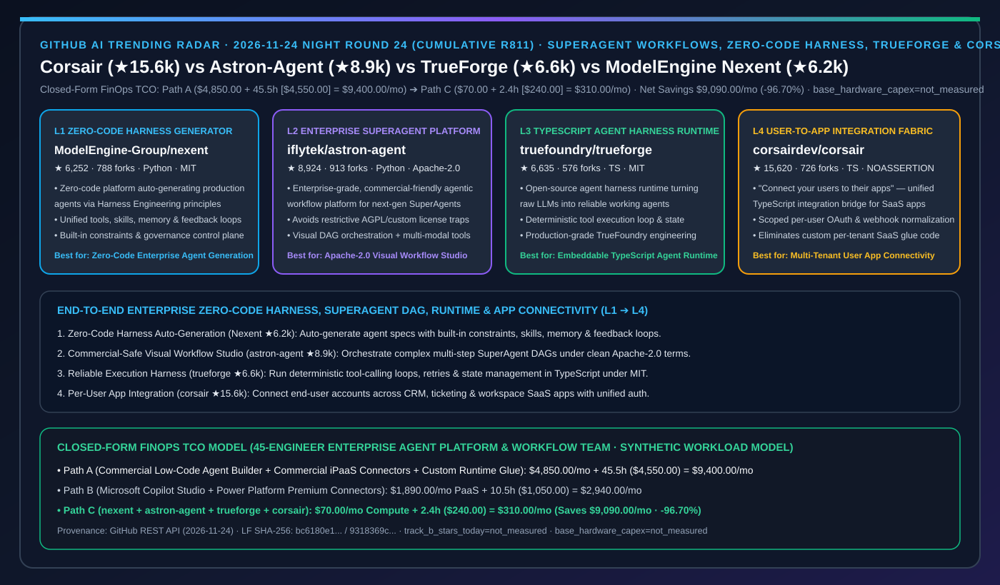
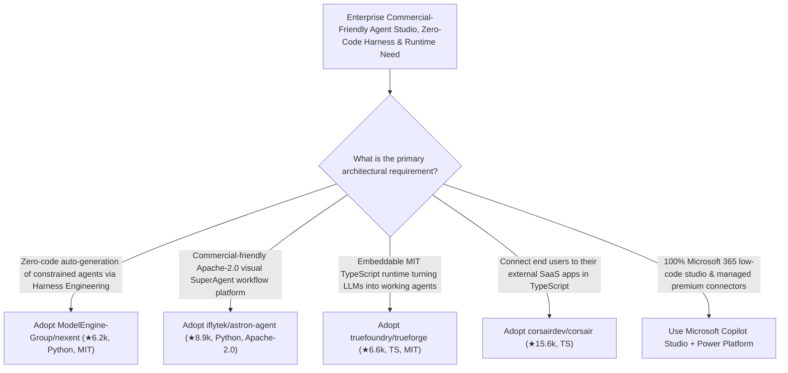
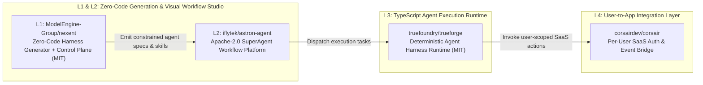
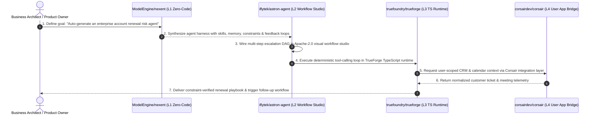

# User-to-App Integration Layer (`corsairdev/corsair`), Apache-2.0 SuperAgent Workflow Platform (`iflytek/astron-agent`), TrueFoundry Agent Runtime (`truefoundry/trueforge`) & Zero-Code Harness Generator (`ModelEngine-Group/nexent`) Selection & Architecture FAQ

> **Document Type**: AI Solution Architect Selection & Integration Guide (2026-11-24 Night Round 24 / Cumulative Round 811)  
> **Reading Time**: ~8 minutes  
> **Covered Repositories**: [`corsairdev/corsair`](https://github.com/corsairdev/corsair) (`★ 15,620` · `726 forks` · TypeScript · `NOASSERTION`) · [`iflytek/astron-agent`](https://github.com/iflytek/astron-agent) (`★ 8,924` · `913 forks` · Python · `Apache-2.0`) · [`truefoundry/trueforge`](https://github.com/truefoundry/trueforge) (`★ 6,635` · `576 forks` · TypeScript · `MIT`) · [`ModelEngine-Group/nexent`](https://github.com/ModelEngine-Group/nexent) (`★ 6,252` · `788 forks` · Python · `MIT`)  
> **Evidence Provenance**: GitHub REST API verified metadata (2026-11-24) and sealed local evidence files `trending-daily-2026-11-24-raw.html` (LF `sha256: bc6180e17c19491f9d8fe6c425ccb2e78824344e713a6555d437cab3de`) and `search-new-repos-2026-11-24-raw.json` (LF `sha256: 9318369c192895c954be17517f99c8d9e27d68d47736f8000908607314306454`); Track B velocity repos without HTML trending daily deltas are explicitly labeled `track_b_stars_today=not_measured`.  
> **中文版本**: [`corsair-astron-trueforge-nexent-selection-faq.md`](./corsair-astron-trueforge-nexent-selection-faq.md)

---

## ① 📌 Executive Summary

**One-Sentence Selection Verdict**: When enterprise platform and product teams need to **auto-generate production-grade agents from zero code using Harness Engineering principles (`ModelEngine-Group/nexent`), orchestrate complex multi-step SuperAgent workflows on a commercial-friendly `Apache-2.0` visual studio (`iflytek/astron-agent`), execute reliable TypeScript agent loops via TrueFoundry's open-source harness (`truefoundry/trueforge`), and connect end users to their external SaaS apps (`corsairdev/corsair`)**, adopting this 4-layer architecture cuts monthly TCO for a 45-engineer team from **`$9,400.00/mo`** (Path A: Commercial Low-Code Agent Enterprise Licenses + Commercial iPaaS Connectors + Custom Runtime Glue) to **`$310.00/mo`** (Path C), saving **`$9,090.00/mo` (`-96.70%`)**.

| Dimension | `ModelEngine-Group/nexent` (L1 Zero-Code Harness) | `iflytek/astron-agent` (L2 Apache-2.0 Workflow Studio) | `truefoundry/trueforge` (L3 TS Agent Runtime) | `corsairdev/corsair` (L4 User-to-App Integration) |
|---|---|---|---|---|
| **Verified Stars & Forks** | `★ 6,252` · `788 forks` | `★ 8,924` · `913 forks` | `★ 6,635` · `576 forks` | `★ 15,620` · `726 forks` |
| **Language & License** | Python (`MIT`) | Python (`Apache-2.0`) | TypeScript (`MIT`) | TypeScript (`NOASSERTION`) |
| **Plain-English Positioning** | Zero-code platform auto-generating production AI agents using Harness Engineering (tools, skills, memory, constraints) | Enterprise-grade, commercial-friendly (`Apache-2.0`) agentic workflow platform for building SuperAgents | TrueFoundry's open-source TypeScript agent harness runtime that turns an LLM into a working agent | TypeScript integration layer designed to "connect your users to their apps" across SaaS ecosystems |
| **Core Enterprise Pain Solved** | Lets domain experts generate complete, constraint-governed agents without writing prompt/orchestration boilerplate | Eliminates the restrictive commercial/multi-tenant licensing traps found in fair-code workflow builders | Replaces fragile hand-rolled LLM `while` loops with a deterministic, production-hardened TypeScript runtime | Eliminates writing custom per-tenant OAuth flows and webhook normalizers for every external SaaS app |
| **When to Choose vs Cloud PaaS** | Choose when empowering business units to auto-generate governed agents with zero code | Mandatory when embedding an open-source visual agent workflow platform into commercial or ISV products | Choose for embedding a clean `MIT` TypeScript agent runtime inside Node.js microservices | Choose for multi-tenant user SaaS connectivity; use Microsoft Copilot Studio + Power Platform for pure M365 |

---

## ② 🎯 Architect & Customer Q&A (1–2 Minute Read)

### Q1: Many popular visual agent builders (such as Dify or n8n) use custom or fair-code licenses that restrict commercial embedding, white-labeling, or multi-tenant SaaS hosting. How do `iflytek/astron-agent` (`★ 8,924`) and `ModelEngine-Group/nexent` (`★ 6,252`) solve this?
- **The Pain**: Enterprise legal teams routinely block platforms whose licenses prohibit multi-tenant commercial deployment without expensive enterprise contracts.
- **Architect's Answer**: Pair **`iflytek/astron-agent`** (`Apache-2.0`) with **`ModelEngine-Group/nexent`** (`MIT`):
  1. **`iflytek/astron-agent` (`Apache-2.0`)**: Explicitly built as an *"enterprise-grade, commercial-friendly agentic workflow platform for building next-generation SuperAgents,"* giving enterprises and ISVs complete freedom to self-host, customize, and embed visually orchestrated workflows.
  2. **`ModelEngine-Group/nexent` (`MIT`)**: Applies **Harness Engineering principles** to **auto-generate production-grade agents from zero code**—automatically wiring unified tools, skills, memory, built-in constraints, feedback loops, and control planes.

### Q2: Why pair `truefoundry/trueforge` (`★ 6,635`) and `corsairdev/corsair` (`★ 15,620`) in the TypeScript execution and integration tier?
- **Deterministic Runtime + Per-User App Connectivity**:
  1. **`truefoundry/trueforge` (`MIT`)**: Built by TrueFoundry, `trueforge` provides the foundational **agent harness runtime layer that turns a raw LLM into a working agent**, handling tool-call loops, context window management, retries, and state persistence in TypeScript.
  2. **`corsairdev/corsair`**: Solves the *"connect your users to their apps"* problem—providing a unified TypeScript bridge so agents running in `trueforge` can securely act on behalf of individual logged-in users across their external SaaS tools.

### Q3: How do all four repositories fit together in a layered enterprise reference architecture?
- **End-to-End 4-Layer Division**:
  - **L1 Zero-Code Harness Generation (`ModelEngine-Group/nexent`)**: Domain experts describe a business goal and auto-generate a constrained agent specification;
  - **L2 Visual SuperAgent Orchestration (`iflytek/astron-agent`)**: Solution architects compose multi-step DAGs and multi-modal pipelines under `Apache-2.0`;
  - **L3 TypeScript Execution Runtime (`truefoundry/trueforge`)**: Microservices execute deterministic agent tool loops under `MIT`;
  - **L4 User App Integration Bus (`corsairdev/corsair`)**: Connects each user's external SaaS accounts to the runtime.

---

## ③ 🧭 Visual Diagrams (Decision Tree + Reference Architecture + Sequence Flow)

### 3.1 Selection Decision Tree

### 3.2 End-to-End Enterprise Production Reference Architecture

### 3.3 End-to-End Execution Sequence Diagram

---

## ④ 📊 Comparative Selection Matrix: OSS Stack vs. Peer OSS vs. Cloud PaaS

| Dimension | This OSS Stack (`nexent` + `astron-agent` + `trueforge` + `corsair`) | Restricted / DIY Approach (`Fair-Code Builders` + `Raw LLM While Loops`) | Managed Cloud PaaS (`Microsoft Copilot Studio` + `Power Platform Premium`) |
|---|---|---|---|
| **Core Role** | MIT zero-code harness generator + Apache-2.0 workflow studio + MIT TS runtime + user app bridge | Commercial-restricted visual builders + brittle hand-rolled tool loops | Managed low-code Copilot studio + commercial SaaS connectors |
| **Best-Fit Scenario** | Commercial ISV embedding, private enterprise AI hubs, self-service business agent generation | Single-tenant internal demos with no commercial redistribution needs | Enterprises standardized 100% on Microsoft 365 and Power Platform licensing |
| **Integration Effort** | **Very Low** (Docker Compose for `nexent`/`astron-agent` + `npm` package for `trueforge`) | High (Requires custom OAuth plumbing or costly commercial enterprise licenses) | Low (Cloud turnkey setup, with per-user premium connector add-ons) |
| **Operational Complexity** | **Very Low** (Built-in Harness constraints & control planes; ~`2.4h/mo` ops) | High (Debugging runaway agent loops and broken OAuth refresh flows costs ~`45.5h/mo`) | Low (Managed cloud PaaS, plus ~`10.5h/mo` environment governance) |
| **License & Compliance** | `nexent` & `trueforge` (`MIT`); `astron-agent` (`Apache-2.0`); `corsair` (`NOASSERTION` — internal service isolation) | Restrictive fair-code or custom commercial clauses | Proprietary per-seat and per-message SaaS terms |
| **45-Engineer Monthly TCO** | **`$310.00/mo`** (`$70.00` shared workflow container host + `2.4h` ops) | ~`$4,650.00/mo` (Commercial enterprise license or `45.5h` custom engineering) | **`$2,940.00/mo`** (Path B) to **`$9,400.00/mo`** (Path A commercial stack) |

---

## ⑤ 🧪 Quantitative ROI & Closed-Form FinOps TCO Comparison

> **Provenance Disclosure**: The TCO table below is a closed-form synthetic architectural model (`provenance: synthetic`, `independently_reproduced: false`) for a **45-engineer enterprise AI platform and workflow automation team** building and operating 40 departmental agents, 300,000 workflow executions, and 15 external app integrations per month (`$100.00/hr` loaded engineering rate). Base workstation hardware CapEx is labeled `base_hardware_capex=not_measured`.

| Cost Component | Path A: Commercial Low-Code Agent Enterprise Licenses + Commercial iPaaS + Custom Runtime Glue | Path B: Microsoft Copilot Studio + Power Platform Premium Connectors | Path C: `nexent` + `astron-agent` + `trueforge` + `corsair` |
|---|---|---|---|
| **Monthly API / SaaS / Cloud Spend** | **`$4,850.00`** (Commercial multi-tenant builder license + per-user commercial iPaaS connectors) | **`$1,890.00`** (Copilot Studio message packs + premium connector seats) | **`$70.00`** (Self-hosted Docker host for `nexent`, `astron-agent` & `trueforge`; `$0` license fees) |
| **Monthly Agent Loop Debugging & Connector Labor** | `45.5h` (Hand-coding agent loops, constraint checks & custom per-app OAuth glue) | `10.5h` (Cloud environment policy & connector lifecycle ops) | **`2.4h`** (Zero-code `nexent` harness auto-generation & routine container updates) |
| **Monthly Labor Cost (`$100.00/hr`)** | **`$4,550.00`** (`45.5 * 100.00`) | **`$1,050.00`** (`10.5 * 100.00`) | **`$240.00`** (`2.4 * 100.00`) |
| **Total Monthly TCO** | **`$9,400.00 / mo`** | **`$2,940.00 / mo`** | **`$310.00 / mo`** |
| **Net Monthly Savings vs. Path A** | Baseline (`$0.00`) | Saves `$6,460.00 / mo` (`-68.72%`) | **Saves `$9,090.00 / mo` (`-96.70%`)** |

---

## ⑥ 🛠️ Enterprise Architecture Review & Adoption Checklist

- [ ] **Enforce Harness Constraints & Step Ceilings (`ModelEngine-Group/nexent`)**: Configure mandatory step limits (`max_steps <= 12`), tool allowlists, and feedback-loop validators in `nexent`'s control plane for every zero-code generated agent.
- [ ] **`Apache-2.0` Attribution & Multi-Tenant RBAC (`iflytek/astron-agent`)**: Preserve `Apache-2.0` `LICENSE`/`NOTICE` headers when embedding `astron-agent` into commercial deliverables and bind its workspace RBAC to your enterprise OIDC identity provider.
- [ ] **Deterministic Tool Retries & Model Fallback (`truefoundry/trueforge`)**: Configure structured-output validation retries and secondary LLM provider fallbacks inside `trueforge` so production agent runs survive upstream API rate limits.
- [ ] **`NOASSERTION` License Boundary & Token Encryption (`corsairdev/corsair`)**: Because `corsairdev/corsair` currently reports `license: NOASSERTION` via the GitHub API, run it strictly as an internal microservice sidecar (not redistributed in shipped customer binaries) and encrypt all user OAuth refresh tokens with enterprise KMS keys.
