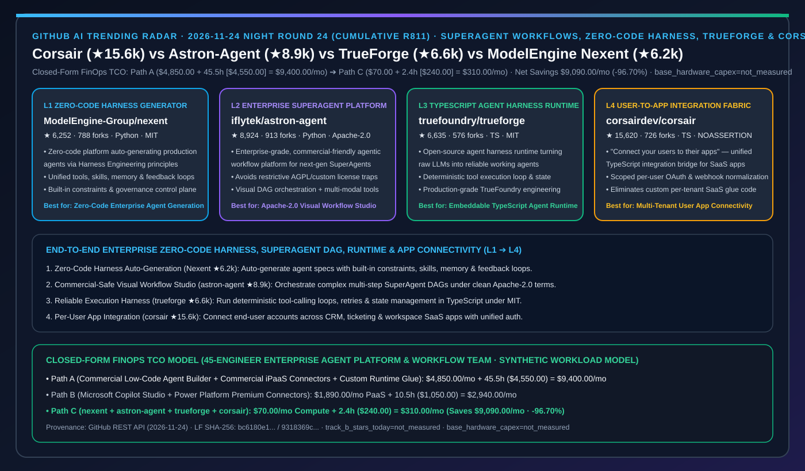
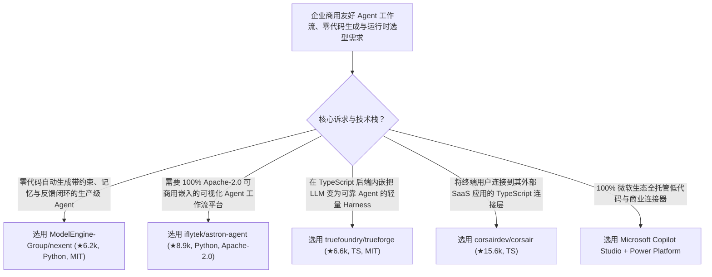
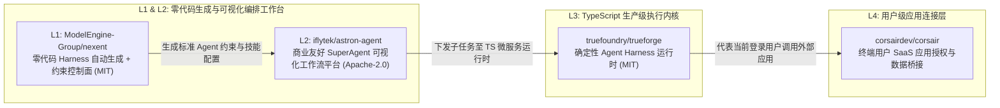
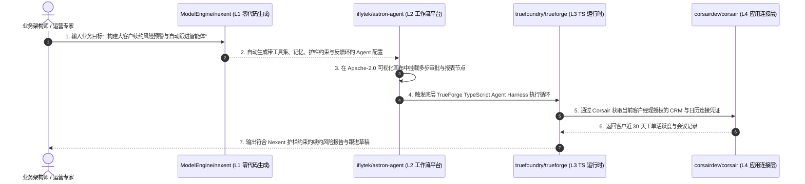

# 用户应用连接总线（`corsairdev/corsair`）、Apache-2.0 企业级超级智能体工作流平台（`iflytek/astron-agent`）、TrueFoundry 开源智能体运行时（`truefoundry/trueforge`）与零代码 Harness 工程生成平台（`ModelEngine-Group/nexent`）选型与集成 FAQ

> **文档类型**：AI 解决方案架构师（AI Solution Architect）选型决策指南（2026-11-24 Night Round 24 / 累计第 811 轮）  
> **阅读耗时**：约 8 分钟  
> **覆盖项目**：[`corsairdev/corsair`](https://github.com/corsairdev/corsair)（`★ 15,620` · `726 forks` · TypeScript · `NOASSERTION`） · [`iflytek/astron-agent`](https://github.com/iflytek/astron-agent)（`★ 8,924` · `913 forks` · Python · `Apache-2.0`） · [`truefoundry/trueforge`](https://github.com/truefoundry/trueforge)（`★ 6,635` · `576 forks` · TypeScript · `MIT`） · [`ModelEngine-Group/nexent`](https://github.com/ModelEngine-Group/nexent)（`★ 6,252` · `788 forks` · Python · `MIT`）  
> **证据溯源**：GitHub REST API 实测元数据（2026-11-24）与本地冻结证据文件 `trending-daily-2026-11-24-raw.html`（LF `sha256: bc6180e17c19491f9d8fe6c425ccb2e78824344e713a6555d437cab3de`）、`search-new-repos-2026-11-24-raw.json`（LF `sha256: 9318369c192895c954be17517f99c8d9e27d68d47736f8000908607314306454`）；Track B 仓库无 HTML 榜单对应的单日增量，统一标记为 `track_b_stars_today=not_measured`。  
> **English Version**: [`corsair-astron-trueforge-nexent-selection-faq.en.md`](./corsair-astron-trueforge-nexent-selection-faq.en.md)

---

## ① 📌 核心结论速览（Executive Summary）

**选型一句话结论**：当企业需要构建一套既能让业务专家**通过零代码自动生成符合 Harness Engineering 规范的生产级 Agent（`ModelEngine-Group/nexent`）**、又能用 **100% 商业友好的 `Apache-2.0` 可视化工作流编排复杂多模态流程（`iflytek/astron-agent`）**、在底层依托 **TrueFoundry 开源的轻量级 TypeScript Agent 运行时（`truefoundry/trueforge`）** 并通过 **统一用户级应用连接层（`corsairdev/corsair`）** 打通外部业务系统时，采用这套四层架构可将 45 人团队的月度 TCO 从商业低代码平台企业版许可 + 商业 iPaaS 连接器 + 手写运行时胶水代码（Path A）的 **`$9,400.00/月`** 降至 **`$310.00/月`**（净省 **`$9,090.00/月`**，降幅 **`-96.70%`**）。

| 评估维度 | `ModelEngine-Group/nexent` (L1 零代码 Harness 生成) | `iflytek/astron-agent` (L2 Apache-2.0 工作流平台) | `truefoundry/trueforge` (L3 TS 智能体运行时) | `corsairdev/corsair` (L4 用户应用连接总线) |
|---|---|---|---|---|
| **GitHub 实测热度** | `★ 6,252` · `788 forks` | `★ 8,924` · `913 forks` | `★ 6,635` · `576 forks` | `★ 15,620` · `726 forks` |
| **实现语言与开源协议** | Python (`MIT`) | Python (`Apache-2.0`) | TypeScript (`MIT`) | TypeScript (`NOASSERTION`) |
| **一句话通俗定位** | 基于 Harness Engineering 原则、自动生成带约束与反馈闭环生产级 Agent 的零代码平台 | 科大讯飞开源的企业级、商业友好（`Apache-2.0`）下一代 SuperAgent 工作流编排平台 | TrueFoundry 开源的“把裸 LLM 转化为可靠工作智能体”的 TypeScript Agent Harness 运行时 | 帮助应用将终端用户无缝连接到其各类 SaaS 与业务工具的 TypeScript 集成连接层 |
| **解决的核心业务痛点** | 消除业务人员不懂 Prompt 与工具编排、而程序员手写 Agent 缺乏内置约束与反馈环的鸿沟 | 解决主流低代码 AI 平台（如 Dify/n8n）采用自定义商业限制条款、不允许免费改Logo/商用嵌入的法律痛点 | 解决直接调 OpenAI/Anthropic SDK 时需重复手写工具循环、错误重试、上下文裁剪与状态持久化的痛点 | 免除为每个终端用户单独开发外部 SaaS 账号绑定、Token 刷新与 Webhook 归一化的繁重工作 |
| **何时选它 vs 云托管** | 需要让业务部门一句话自动生成带护栏与控制面的完整 Agent 时必选 | 需要商业可自由修改分发的 `Apache-2.0` 企业级可视化 Agent 工作流平台时必选 | 需要在 Node.js / TypeScript 微服务中内嵌极简可靠的 Agent 执行内核时选它 | 需要为内部多租户应用打通用户个人外部 SaaS 账号时选它；纯微软生态选 Power Platform 连接器 |

---

## ② 🎯 客户与架构师灵魂拷问 Q&A（1–2 分钟速读）

### Q1：很多政企和 ISV 软件商想在自己的商业产品里内嵌一套可视化 Agent 工作流引擎，但发现 Dify 和 n8n 都有严格的商业附加条款（不能随便去水印或多租户商用），怎么选替代方案？
- **痛点**：非标准开源许可证（Fair-code 或带多租户商用限制的衍生协议）在企业法务合规审查中经常被一票否决，采购商业企业版动辄每年数万美元。
- **架构师解答**：直接选用 **`iflytek/astron-agent`**（`★ 8,924`，**标准 `Apache-2.0` 协议**）搭配 **`ModelEngine-Group/nexent`**（`★ 6,252`，**标准 `MIT` 协议**）：
  1. **`iflytek/astron-agent`（`Apache-2.0`）**：明确定位为 *"Enterprise-grade, commercial-friendly agentic workflow platform"*，提供完整的可视化工作流画布、多模态工具链与 SuperAgent 编排能力，且 `Apache-2.0` 协议允许企业合法合规地私有化部署、深度魔改并打包进商业发行版。
  2. **`ModelEngine-Group/nexent`（`MIT`）**：更进一步将 **Harness Engineering（马具工程）** 原则产品化为**零代码自动生成平台**——用户只需描述业务目标，`nexent` 自动装配统一工具、技能、记忆、边界约束（Constraints）与反馈闭环（Feedback Loops）。

### Q2：如果我们的核心业务后端是 TypeScript / Node.js 技术栈，为什么推荐引入 `truefoundry/trueforge`（`★ 6,635`）与 `corsairdev/corsair`（`★ 15,620`）？
- **执行内核 + 用户连接器的黄金搭档**：
  1. **`truefoundry/trueforge`（`MIT`）提供“把裸大模型变成可靠打工人”的运行时层**：由知名 AI 基础设施团队 TrueFoundry 打造，专门解决大模型在真实生产环境中的工具调用死循环、上下文窗口溢出、结构化输出重试与执行追踪问题。
  2. **`corsairdev/corsair` 提供“Connect your users to their apps”的用户级应用集成层**：当 `trueforge` 驱动的 Agent 需要代表当前登录的员工去读取其個人的日程、工单或外部 SaaS 数据时，`corsair` 负责统一处理繁琐的用户级应用连接与事件归一化。

### Q3：这四个开源项目如何在同一个企业 AI 平台中分层协同？
- **四层清晰分工**：
  - **L1 零代码智能体孵化层（`ModelEngine-Group/nexent`）**：面向业务专家，零代码自动生成带约束和记忆的 Agent 定义；
  - **L2 可视化复杂工作流编排层（`iflytek/astron-agent`）**：面向解决方案架构师，用 `Apache-2.0` 可视化画布编排跨部门多步 DAG；
  - **L3 嵌入式高可靠执行运行时（`truefoundry/trueforge`）**：面向全栈工程师，在 TypeScript 微服务中提供确定性的 Agent Harness 循环；
  - **L4 用户级应用连接总线（`corsairdev/corsair`）**：打通终端用户在各业务系统中的账号授权与数据读写。

---

## ③ 🧭 直观可视化图解（Mermaid 决策树 + 集成架构 + 时序图）

### 3.1 技术选型决策树

### 3.2 企业端到端生产集成参考架构图

### 3.3 业务流全链路时序图

---

## ④ 📊 同类开源与商业云服务横向选型决策矩阵

| 对比维度 | 本轮开源组合 (`nexent` + `astron-agent` + `trueforge` + `corsair`) | 受限商业开源/裸写方案 (`商用受限低代码平台` + `裸写 OpenAI 循环`) | 云厂商全托管 PaaS (`Microsoft Copilot Studio` + `Power Platform Premium Connectors`) |
|---|---|---|---|
| **功能定位** | MIT 零代码 Harness 生成 + Apache-2.0 工作流平台 + MIT TS 运行时 + 用户应用连接层 | 限制多租户商用的画布 + 缺乏错误恢复的手写 while 循环 | 微软云托管低代码 Copilot 构建器 + 1,000+ 商业连接器 |
| **适用场景** | ISV 商业产品内嵌、政企私有化智能体中台、业务部门零代码自助孵化 Agent | 仅内部极小范围试用、不涉及商业分发的原型 | 100% 购买了 Microsoft 365 与 Power Platform 高级许可的企业 |
| **集成成本** | **极低**（Docker 一键拉起 `nexent`/`astron-agent`，`npm` 接入 `trueforge`） | 高（若用于商业多租户需重写规避许可证限制，或支付高昂企业版授权） | 低（云端即开即用，但高级连接器需按活跃用户额外付费） |
| **运维复杂度** | **极低**（内置 Harness 约束与控制面，月均维护仅 `2.4h`） | 高（手写 Agent 循环经常陷入死循环或格式报错，月均排障 `45.5h`） | 低（全托管云服务，月均环境治理约 `10.5h`） |
| **开源协议与合规** | `nexent`、`trueforge` 为 `MIT`；`astron-agent` 为 `Apache-2.0`；`corsair` 为 `NOASSERTION`（仅限内部独立服务调用） | 含附加商用限制条款 | 商业闭源按席位/按消息包计费 |
| **45 人团队月度 TCO** | **`$310.00/月`**（含 `$70.00` 共享工作流容器节点 + `2.4h` 运维） | 约 `$4,650.00/月`（含商业版授权或 `45.5h` 自研维护工时） | **`$2,940.00/月`**（Path B）至 **`$9,400.00/月`**（Path A 商业全栈） |

---

## ⑤ 🧪 应用落地定量收益 / TCO 对比（Closed-Form FinOps 模型）

> **数据性质声明（Provenance Metadata）**：以下 TCO 模型为面向 **45 人企业智能体平台与业务数字化团队**（每月孵化与维护 40 个部门级业务 Agent、执行 300,000 次工作流节点流转并连接 15 种内部/SaaS 应用，工程师折算时薪 `$100.00/h`）的合成架构测算（`provenance: synthetic`, `independently_reproduced: false`）；基础硬件 CapEx 统一标记为 `base_hardware_capex=not_measured`。

| 成本构成项 | Path A：商业低代码平台企业版授权 + 商业 iPaaS 连接器 + 手写运行时维护 | Path B：Microsoft Copilot Studio + Power Platform 高级连接器 | Path C：`nexent` + `astron-agent` + `trueforge` + `corsair` |
|---|---|---|---|
| **API / SaaS / 云资源月费** | **`$4,850.00`**（商业低代码平台多租户许可 + 商业连接器按活跃用户订阅） | **`$1,890.00`**（Copilot Studio 消息容量包 + Power Platform 席位） | **`$70.00`**（内网 Docker 部署 `nexent`、`astron-agent` 与 `trueforge` 共享节点，`$0` 授权费） |
| **月度手写 Agent 排障、护栏调优与连接器开发工时** | `45.5h`（手写每个业务 Agent 的工具循环与重试逻辑 + 手写 OAuth 胶水代码） | `10.5h`（云端环境策略与自定义连接器维护） | **`2.4h`**（`nexent` 零代码自动生成 Harness 约束，仅需例行版本升级） |
| **人工运维成本（`$100.00/h`）** | **`$4,550.00`** (`45.5 * 100.00`) | **`$1,050.00`** (`10.5 * 100.00`) | **`$240.00`** (`2.4 * 100.00`) |
| **月度总拥有成本（Total Monthly TCO）** | **`$9,400.00 / 月`** | **`$2,940.00 / 月`** | **`$310.00 / 月`** |
| **相对 Path A 净节省** | 基准线 (`$0.00`) | 节省 `$6,460.00 / 月` (`-68.72%`) | **净省 `$9,090.00 / 月` (`-96.70%`)** |

---

## ⑥ 🛠️ 企业引入与架构评审 Checklist

- [ ] **零代码生成 Agent 的约束与反馈环基线审查（`ModelEngine-Group/nexent`）**：启用 `nexent` 控制面中的内置约束（Constraints），为每个自动生成的业务 Agent 设定最大工具调用步数（如 `max_steps <= 12`）与敏感词拦截策略。
- [ ] **`Apache-2.0` 合规二开与多租户权限隔离（`iflytek/astron-agent`）**：在将 `astron-agent` 嵌入企业内部门户或商业交付方案时，保留原始 `Apache-2.0` 版权声明文件（`NOTICE` / `LICENSE`），并对接企业统一 OIDC/SSO 实现部门级工作流空间隔离。
- [ ] **运行时超时熔断与结构化输出降级（`truefoundry/trueforge`）**：在 `trueforge` 运行时层配置工具调用的指数退避重试与备选模型自動切换（Fallback），确保主模型 API 抖动时业务 Agent 不中断。
- [ ] **`NOASSERTION` 许可证边界与用户凭证加密存储（`corsairdev/corsair`）**：鉴于 `corsairdev/corsair` 当前 GitHub 元数据未声明标准 SPDX 许可证（`NOASSERTION`），在企业法务确认其完整商业授权条款前，仅将其作为内部独立网关进程调用（不打包进对外售卖的软件发行包），并使用 KMS 加密存储所有终端用户的第三方 OAuth 刷新令牌。
