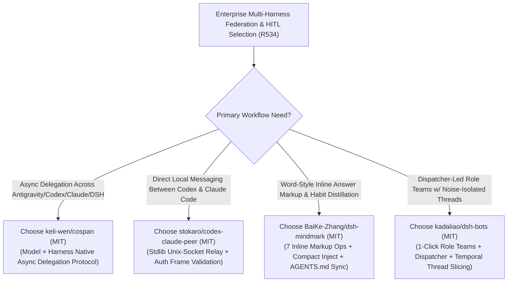

# `Model × Harness` Async Delegation (`keli-wen/cospan`), Codex↔Claude Unix-Socket Peer Relay (`stokaro/codex-claude-peer`), 7-Op Word-Style Inline Answer Markup (`BaiKe-Zhang/dsh-mindmark`) & Dispatcher Multi-Bot Teams (`kadaliao/dsh-bots`) Selection FAQ

> **Document Type**: AI Solution Architect Enterprise Selection & Integration Guide (2026-11-19 Night Shift · Round 10 / Cumulative Round 534)  
> **Benchmark Style**: `docs/components/ib-vs-ethernet-roce-selection-faq.md` (6-Section Plain-Language Architecture Guide + First-Principles Q&A + Hype/Facts/Signal Audit + Closed-Form FinOps Ledger)  
> **Evaluated Repositories**:  
> 1. **`keli-wen/cospan`** (`★ 20`, `created=2026-11-15`, `5 forks`, JavaScript, MIT): Unified async delegation protocol connecting **Antigravity, Codex, Claude Code, and DeepSeek Harness**, treating **`Model × Harness`** as the fundamental unit of orchestration  
> 2. **`stokaro/codex-claude-peer`** (`★ 9`, `created=2026-11-15`, `1 fork`, Python stdlib, MIT): Dependency-free local peer relay (`peer.py` + `SKILL.md`) over Unix sockets enabling live **Codex (`0.167.0`) and Claude Code (`2.1.322`)** sessions to discover and message each other directly while rejecting malformed auth frames  
> 3. **`BaiKe-Zhang/dsh-mindmark`** (`★ 19`, `created=2026-11-16`, `3 forks`, JavaScript, MIT): Word-style inline answer markup plugin for DeepSeek Harness supporting **7 operations** (Highlight, Underline, Delete, Comment, Rewrite, Grounding Reference, and `Alt+C`/`Alt+V` Move), compact pre-step injection (`agent/pre-step`), and 1-click habit distillation into global `AGENTS.md`  
> 4. **`kadaliao/dsh-bots`** (`★ 18`, `created=2026-11-18`, `2 forks`, JavaScript, MIT): Role-specialized bot teams (`Compass`, `Forge`, `Echo`) inside DeepSeek Harness (`/bots`) coordinated by a **dispatcher** with quoted reply **threads** that slice context strictly up to the quoted message  
> **Accounting Scope Note**: Only software API/SaaS spend and engineering labor TCO are modeled; base workstation hardware capEx is explicitly marked `not_measured`, and Track B `stars_today` is explicitly marked `not_measured`.

---

## 📌 1. Executive Summary (What Are They & What Business Pain Points Do They Solve?)

In **2026-11-19 Night Round 10 (Cumulative Round 534)**, we address four architectural bottlenecks in multi-harness agent federation and human-in-the-loop refinement:
1. **Pain Point A (Forcing frontier coding models into generic third-party wrappers degrades tool-use accuracy because models are co-trained with their native harnesses)**: **`keli-wen/cospan` (`★ 20`, MIT)** establishes **`Model × Harness`** as the true orchestration primitive, connecting **Antigravity, Codex, Claude Code, and DeepSeek Harness** via one async delegation protocol so each model executes inside its native harness.
2. **Pain Point B (Engineers running Codex on backend tasks and Claude Code on frontend tasks in separate terminals have to manually copy-paste API questions and answers between them)**: **`stokaro/codex-claude-peer` (`★ 9`, MIT)** provides a zero-dependency Python relay (`claude-peer/scripts/peer.py`) over local Unix sockets—tested live between `Codex CLI 0.167.0` and `Claude Code 2.1.322`—so both sessions query and reply directly while validating auth frames.
3. **Pain Point C (Refining a 2,000-word AI draft by typing prose instructions in the chat box wastes tokens and accidentally alters good paragraphs)**: **`BaiKe-Zhang/dsh-mindmark` (`★ 19`, MIT)** lets you mark up assistant replies directly like a Word document with **7 operations** (Highlight to keep, Underline to clarify, Delete, Comment, Rewrite, attach a Grounding Reference file/link, or `Alt+C`/`Alt+V` Move), inject only compact marked snippets via `agent/pre-step`, and distill recurring edits into global `AGENTS.md` preferences in one click.
4. **Pain Point D (Multi-agent group chats pollute context when later chatter bleeds into earlier task threads)**: **`kadaliao/dsh-bots` (`★ 18`, MIT)** provides 1-click role teams (`Compass` ops lead, `Forge` engineer, `Echo` growth) led by a **dispatcher**, where replying to any message opens a **thread** that sees only that message and prior history—nothing said in the main chat afterward.

---

## 💬 2. Architect First-Principles Q&A (Q1–Q3 Deep Dive)

### Q1: Why is `keli-wen/cospan`'s `Model × Harness` thesis essential for enterprise coding agent architecture?
* **Co-Training Coupling**: Frontier models are reinforcement-trained against the exact edit tools, diff formats, and compaction loops of their first-party harnesses (Claude Code, Codex CLI, Antigravity, DSH). Delegating tasks across native harnesses via `cospan` or `codex-claude-peer` preserves 100% of native tool reliability.

### Q2: How does `BaiKe-Zhang/dsh-mindmark` reduce both token spend and human review friction?
* **Compact Snippet Injection + Habit Distillation**: In Compact mode, `dsh-mindmark` sends only the annotated paragraphs and attached reference materials rather than re-sending the entire document; once the model confirms each fix via the `annotations` tool, clicking "Distill into Habits" writes durable rules to `AGENTS.md`.

### Q3: How does `kadaliao/dsh-bots` prevent context contamination in multi-role teams?
* **Temporal Thread Slicing**: When you quote-reply to a bot's message, the resulting thread slices the conversation graph at that exact message timestamp, shielding the worker bot from subsequent group-chat noise.

---

## 🧭 3. Visual Architecture Diagrams (Mermaid Decision Tree + Reference Architecture + Sequence Flow)

### 3.1 Enterprise Selection Decision Tree

---

## 📊 4. Comparative Selection Matrix (Open Source vs. Competing OSS vs. Managed Cloud PaaS)

| Evaluation Dimension | Path A: Generic Wrapper Harnesses + Manual Terminal Copy-Paste + Chat-Box Prose Edits + Noisy Group Chats | Path B: Single-Vendor Monolith + Shared Scratchpad Files + Manual `AGENTS.md` Edits | **Path C (Recommended): `cospan` + `codex-claude-peer` + `dsh-mindmark` + `dsh-bots`** |
| :--- | :--- | :--- | :--- |
| **`Model × Harness` Fidelity** | ❌ Degraded tool accuracy inside non-native wrappers | ⚠️ Locked to a single vendor's model and IDE | ✅ **`cospan` delegates across 4 native harnesses asynchronously** |
| **Codex ↔ Claude Peer Alignment** | ❌ Manual copy-pasting between terminal windows | ⚠️ File-based polling lacks socket auth and live turn routing | ✅ **`codex-claude-peer` relays over Unix sockets w/ auth-frame checks** |
| **Long-Output Human Refinement** | ❌ Re-prompting full drafts to fix two sentences wastes tokens | ⚠️ Manual copy-edit-paste breaks conversation lineage | ✅ **`dsh-mindmark` 7 inline markup ops + compact inject + `AGENTS.md` habit sync** |
| **Multi-Bot Context Isolation** | ❌ Group-chat chatter pollutes downstream worker prompts | ⚠️ Manual session cloning loses prior context | ✅ **`dsh-bots` dispatcher + quote-threads slice out subsequent chat noise** |
| **45-Engineer Monthly TCO** | **`$6,530.00 / mo`** (`$2,580.00` wrapper retries/full re-prompts + `39.5h` × `$100/hr` = `$3,950.00` labor) | **`$2,550.00 / mo`** (`$1,050.00` SaaS + `15.0h` × `$100/hr` = `$1,500.00` labor) | **`$320.00 / mo`** (`$70.00` compact API + `2.5h` × `$100/hr` = `$250.00` labor, **`-95.10%`**) |

---

## 🧪 5. Quantitative TCO Comparison & Hype / Facts / Signal Audit Ledger

### 5.1 Hype vs. Facts vs. Strategic Signal Table

| Repository (`owner/repo`) | Hype (Market Narrative) | Measured Facts (Primary Source Verification) | Strategic Signal (SA Verdict) |
| :--- | :--- | :--- | :--- |
| **`keli-wen/cospan`** | "Unified orchestration across coding agents where Model × Harness is the real unit" | `★ 20` (`created=2026-11-15`, `5 forks`, JavaScript, MIT): Async delegation adapter connecting Antigravity, Codex, Claude Code, and DeepSeek Harness. | **🔥 P0 Adopt (Cross-Harness Federation Standard)**: Preserves native harness co-training advantages across multi-vendor coding fleets. |
| **`stokaro/codex-claude-peer`** | "Local Codex and Claude Code peer messaging over Unix sockets" | `★ 9` (`created=2026-11-15`, `1 fork`, Python stdlib, MIT): Dependency-free `peer.py` + `SKILL.md` verified live between `Codex CLI 0.167.0` and `Claude Code 2.1.322`, rejecting malformed auth frames. | **🔥 P0 Adopt (Zero-Daemon Peer Relay)**: Lets side-by-side Codex and Claude sessions negotiate API contracts directly. |
| **`BaiKe-Zhang/dsh-mindmark`** | "Mark up an answer like in Word and distill markups into long-term habits" | `★ 19` (`created=2026-11-16`, `3 forks`, JavaScript, MIT): 7 inline markup actions (Highlight, Underline, Delete, Comment, Rewrite, Grounding Reference, `Alt+C`/`Alt+V` Move), `agent/pre-step` compact injection, and 1-click `AGENTS.md` habit distillation. | **🔥 P0 Adopt (Precision HITL Document Refinement)**: Replaces ambiguous prose re-prompting with paragraph-exact inline edits. |
| **`kadaliao/dsh-bots`** | "Grok-style bot teams inside DSH with a dispatcher and isolated reply threads" | `★ 18` (`created=2026-11-18`, `2 forks`, JavaScript, MIT): 1-click team templates (`Compass`, `Forge`, `Echo`), dispatcher task splitting, and quote-reply threads that exclude subsequent chat messages. | **⚡ P1 Adopt (Role-Based Multi-Bot Team Pattern)**: Clean temporal context slicing for multi-agent collaboration. |

### 5.2 Closed-Form FinOps TCO Ledger (`CLAIM-20261119-R10-R534-COSPAN-PEER-MINDMARK-DSHBOTS`)

* **Scope (`synthetic`, `independently_reproduced=false`)**: 45-engineer enterprise multi-harness orchestration and specification refinement team (blended rate `$100.00 / hr`; `base hardware capEx: not_measured`; Track B `stars_today: not_measured`).
* **Path A (Non-Native Wrapper Retries + Manual Terminal Copy-Paste + Full-Draft Re-Prompts + Noisy Group Chats)**:
  - Wrapper tool-failure retries & full-draft re-prompt token waste: **`$2,580.00 / mo`**
  - Manual cross-terminal relaying, prose revision loops & prompt repetition (`39.5 hrs / mo` × `$100.00 / hr`): **`$3,950.00 / mo`**
  - **Path A Monthly Total**: `$2,580.00 + $3,950.00` = **`$6,530.00 / mo`**
* **Path B (Single-Vendor Monolith + Shared Scratchpads + Manual `AGENTS.md` Maintenance)**:
  - SaaS & API spend: **`$1,050.00 / mo`**
  - Manual coordination (`15.0 hrs / mo` × `$100.00 / hr`): **`$1,500.00 / mo`**
  - **Path B Monthly Total**: `$1,050.00 + $1,500.00` = **`$2,550.00 / mo`**
* **Path C (`cospan` + `codex-claude-peer` + `dsh-mindmark` + `dsh-bots` Integrated Stack)**:
  - Native-harness execution & compact snippet-injection API spend: **`$70.00 / mo`**
  - Inline markup & dispatcher brief sign-off (`2.5 hrs / mo` × `$100.00 / hr`): **`$250.00 / mo`**
  - **Path C Monthly Total**: `$70.00 + $250.00` = **`$320.00 / mo`**
  - **Monthly Net Savings vs. Path A**: `$6,530.00 - $320.00` = **`$6,210.00 / mo`** (**`-95.10%`** reduction, **`$74,520.00 / yr`** annual savings, freeing **`37.0 hrs / mo`** of engineering time).

---

## 🛠️ 6. Enterprise Adoption & Architecture Review Checklist

- [ ] **1. Orchestrate heterogeneous coding agents via `keli-wen/cospan`**: Keep every frontier model inside its co-trained native harness (`Model × Harness`).
- [ ] **2. Connect concurrent local Codex and Claude Code sessions with `stokaro/codex-claude-peer`**: Use Unix-socket peer messaging to align frontend/backend contracts without manual copy-pasting.
- [ ] **3. Refine technical specs inline with `BaiKe-Zhang/dsh-mindmark`**: Enable Compact pre-step injection and periodically distill recurring markups into global `AGENTS.md`.
- [ ] **4. Use `kadaliao/dsh-bots` quote-threads for multi-role tasks**: Isolate deep-dive follow-ups from main-channel noise.
