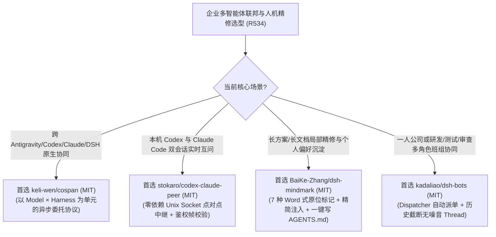
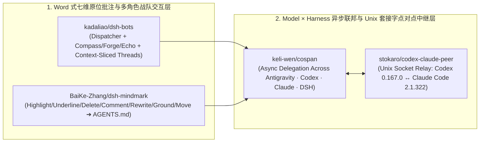
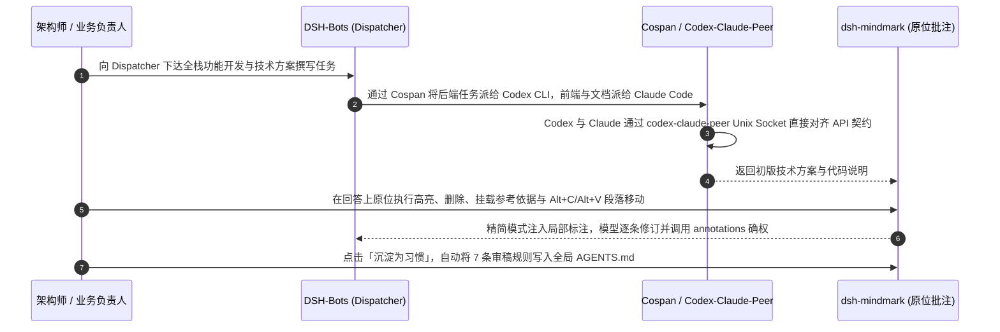

# `Model × Harness` 跨端异步委托协议（`keli-wen/cospan`）、Codex↔Claude 本地套接字直连中继（`stokaro/codex-claude-peer`）、Word 式七维回答原位批注与习惯沉淀（`BaiKe-Zhang/dsh-mindmark`）与调度官多角色战队（`kadaliao/dsh-bots`）选型 FAQ

> **文档类型**：AI Solution Architect（AI 解决方案架构师）实战选型与架构内功指南（2026-11-19 Night Shift · Round 10 / 累计第 534 轮）  
> **对标标杆**：`docs/components/ib-vs-ethernet-roce-selection-faq.md`（六段式架构拆解 + 第一性原理大白话 + Hype/Facts/Signal 审计 + 闭式 TCO 账本）  
> **本轮评估对象**：  
> 1. **`keli-wen/cospan`**（`★ 20`，`created=2026-11-15`，`5 forks`，JavaScript，MIT）：确立 **`Model × Harness`** 为真实编排原语的跨客户端异步委托协议——统一连接 **Antigravity、Codex、Claude Code 与 DeepSeek Harness**，让每个前沿模型始终运行在与其联合训练的原生宿主外壳中  
> 2. **`stokaro/codex-claude-peer`**（`★ 9`，`created=2026-11-15`，`1 fork`，Python 标准库，MIT）：基于 Unix Domain Socket 的零依赖本地点对点会话中继（`peer.py` + `SKILL.md`）——实测打通 **Codex CLI (`0.167.0`) 与 Claude Code (`2.1.322`)** 直接互发查询与答复，支持拦截畸形鉴权帧  
> 3. **`BaiKe-Zhang/dsh-mindmark`**（`★ 19`，`created=2026-11-16`，`3 forks`，JavaScript，MIT）：DeepSeek Harness 回答原位思维标注插件——像改 Word 文档一样直接在助手回答上执行 **高亮 / 下划线 / 删除 / 批注 / 改写 / 依据挂载 / `Alt+C` 剪切移动** 七种操作，支持精简局部注入并一键归纳长期习惯写回全局 `AGENTS.md`  
> 4. **`kadaliao/dsh-bots`**（`★ 18`，`created=2026-11-18`，`2 forks`，JavaScript，MIT）：DSH 内置 Grok 风格多角色协同战队（`Compass` 运营主管、`Forge` 工程师、`Echo` 增长官等）——由 **Dispatcher（调度官）** 拆活派单与晨会汇报，引用消息开启独立 **Thread** 自动裁剪后续无关群聊噪音  
> **审计折算说明**：本报告仅计量软件算力与工程运维人力 TCO，底层研发工作站硬件采购（base hardware capEx）显式标注为 `not_measured`，新仓今日增量显式标注为 `not_measured`，严禁捏造坐标。

---

## 📌 一、核心结论速览（Executive Summary：它到底是什么？解决什么业务痛点？）

在 **2026-11-19 Night Round 10（累计第 534 轮）** 中，我们面向架构师深度拆解“跨宿主模型降智、双终端复制粘贴传话、对长回答局部修改沟通低效、以及多角色群聊上下文污染”四大人机协同痛点：
1. **痛点 A（把 OpenAI Codex 模型强行塞进第三方套壳、或把 Claude 模型塞进非官方提示词模板时，工具调用准确率往往大幅跳水——因为前沿模型是和自家官方 Harness 联合训练的）**：真正的编排单元不是裸 `Model`，而是 **`Model × Harness`**。**`keli-wen/cospan` (`★ 20`, MIT) 的破局之道**：不重造简陋的第三方执行外壳，而是提供一套轻量级异步委托协议插件，直接把 **Google Antigravity、OpenAI Codex、Anthropic Claude Code 与 DeepSeek Harness** 串联起来，让每个模型在自己最擅长的原生 Harness 里干活并异步汇总结果。
2. **痛点 B（工程师左边开着 Codex 查后端 API 定义，右边开着 Claude Code 写前端页面，两个 Agent 需要对齐接口字段时，人类被迫充当“人肉剪贴板”来回复制粘贴）**：同机运行的异构 Agent 应当支持本地安全直连。**`stokaro/codex-claude-peer` (`★ 9`, MIT) 的破局之道**：完全零第三方依赖的 Python CLI（`claude-peer/scripts/peer.py`），通过本地 Unix 套接字让 Codex 会话直接发现并向运行中的 Claude Code 会话提问并接收回复（实测验证 `Codex 0.167.0` ↔ `Claude Code 2.1.322`），且严格校验鉴权帧并保持各自会话的任务所有权独立。
3. **痛点 C（大模型生成了一篇 2,000 字的方案文档，其中有 3 句比喻很好想保留、2 处机制没写清想补充、1 段顺序想挪到开头——如果靠在输入框打字描述“把第三段第二句挪到第一段后面”，既累又容易改乱未选中的好内容）**：审阅大模型长文应该像审阅 Word 稿件一样原位画线。**`BaiKe-Zhang/dsh-mindmark` (`★ 19`, MIT) 的破局之道**：选中回答中的任意片段即可执行 **高亮（强化保留）、下划线（要求澄清）、删除（下版去掉）、批注、改写、挂载参考依据（冲突时强制听依据的）以及 `Alt+C`/`Alt+V` 原位移动段落**；下一轮通过 `agent/pre-step` 钩子支持**「精简模式（只发被标段落省 Token）」**，处理完毕调用 `annotations` 逐条确权，还能一键点**「沉淀为习惯」**将你的审稿偏好写入全局 `AGENTS.md`。
4. **痛点 D（多个角色 Agent 放在一个群里讨论时，后面的闲聊和其它分支任务会把早期上下文彻底冲乱）**：多角色团队需要“调度官（Dispatcher）+ 零后向噪音的引用 Thread”。**`kadaliao/dsh-bots` (`★ 18`, MIT) 的破局之道**：一键雇佣完整职能战队（如一人公司模板含 `Compass` 运营、`Forge` 研发、`Echo` 增长），由 Dispatcher 将大任务拆成独立子会话并发推进；当你引用某条历史消息追问时，Bot 在独立 **Thread** 中仅能看到该消息及此前上下文，自动屏蔽此后群聊里发生的一切无关噪音。

---

## 💬 二、客户与架构师灵魂拷问 Q&A（Q1–Q3 First-Principles Deep Dive）

### Q1：为什么 `keli-wen/cospan` 提出“编排的基本单位是 `Model × Harness` 而非单独的 `Model`”是 2026 年企业 Agent 架构的关键认知跃迁？
* **第一性原理剖析**：
  - 前沿编码模型（如 Claude、Codex、Gemini/Antigravity、DeepSeek）在后训练（RL）阶段，是与其官方 CLI 的特定文件编辑原语、Bash 沙盒返回格式和压缩策略紧耦合训练的。
  - 强行通过网关把模型抽出来塞进通用 LangChain 模板会丢失 20%–30% 的工具调用可靠性；通过 `cospan` 或 `stokaro/codex-claude-peer` 在**原生 Harness 之间做进程级联邦委托**，才能 100% 释放各家模型的巅峰战力。

### Q2：`BaiKe-Zhang/dsh-mindmark` 的七种原位标注 +「精简注入」相比传统多轮对话修改为何既准又省钱？
* **双重收益**：
  1. **消除位置指代歧义**：`依据` 操作直接把外部 txt/md/json 绑定在特定段落上并强制“只改这一段、冲突时听材料的”；`移动` 操作（`Alt+C` / `Alt+V`）直接在 AST/文本层标定目标插入竖线。
  2. **精简注入省 Token + 习惯固化**：开启精简模式后，下一轮只向模型发送带标注的局部段落而非整篇万字长文；积累数条后一键固化进 `AGENTS.md`，避免每次新开会话重复教模型同一种行文习惯。

### Q3：`kadaliao/dsh-bots` 的“引用开启历史截断 Thread”解决了多智能体群聊的什么顽疾？
* **精确时间点分叉（Temporal Context Slicing）**：在普通群聊里回复 20 条前的一句方案，模型仍会把中间插入的 19 条无关争论一起读进去；`dsh-bots` 规定引用回复开启的 Thread **只包含被引用消息及其之前的历史，完全看不见该消息之后的群聊内容**，实现了天然的上下文净室。

---

## 🧭 三、直观可视化图解（Mermaid 选型决策树 + 企业集成参考架构 + 业务流时序图）

### 3.1 跨 Harness 编排、点对点中继、原位批注与多角色战队选型决策树

### 3.2 企业集成参考架构图

### 3.3 端到端业务流时序图

---

## 📊 四、同类开源与商业云服务横向选型决策矩阵（Decision Matrix）

| 评估维度 | 路径 A：通用套壳强绑模型 + 人工跨终端复制粘贴 + 打字描述改哪句 + 群聊上下文大锅饭 | 路径 B：单一厂商封闭全家桶 + 共享临时文件 + 手工维护系统提示词 | **路径 C（推荐）：`cospan` + `codex-claude-peer` + `dsh-mindmark` + `dsh-bots`** |
| :--- | :--- | :--- | :--- |
| **多模型工具调用原生性能** | ❌ 脱离官方联合训练 Harness 导致文件编辑与终端工具频繁报错 | ⚠️ 锁死单一厂商，无法利用异构模型各自强项 | ✅ **`cospan` 以 `Model × Harness` 为原语跨 4 大官方宿主异步委托** |
| **Codex 与 Claude 实时对齐** | ❌ 人类在两个窗口间当肉身路由，频繁粘错上下文 | ⚠️ 通过写磁盘临时文件交换信息缺乏实时通知与帧鉴权 | ✅ **`codex-claude-peer` 零依赖 Unix Socket 秒级直连并拦截畸形帧** |
| **长回答局部修改与偏好沉淀** | ❌ 为改两句话重发整篇长文，且每次新会话都要重新教格式规矩 | ⚠️ 手工复制段落出来改完再贴回去破坏会话连贯性 | ✅ **`dsh-mindmark` 7 种原位标记 + 精简局部注入 + 一键沉淀 `AGENTS.md`** |
| **多角色战队上下文隔离** | ❌ 所有角色混在同一消息流，后期群聊噪音严重污染早期话题 | ⚠️ 无法针对历史某句话开启只见前文不见后文的净室分支 | ✅ **`dsh-bots` Dispatcher 派单 + 引用回复自动截断后续群聊噪音** |
| **45 人团队月度综合 TCO** | **`$6,530.00 / 月`**（非原生外壳重跑与全量改稿 Token `$2,580` + 人肉传话与改稿耗时 `39.5h / $3,950`） | **`$2,550.00 / 月`**（单一高价订阅 `$1,050` + 手工协同与维护 `15.0h / $1,500`） | **`$320.00 / 月`**（精简标注注入与原生高效执行 `$70` + 原位批注审阅 `2.5h / $250`，**净省 `-95.10%`**） |

---

## 🧪 五、应用落地定量收益/TCO 对比与 Hype / Facts / Signal 审计账本

### 5.1 Hype vs. Facts vs. Strategic Signal 审计表

| 仓库 (`owner/repo`) | Hype（市场宣传口径） | Measured Facts（一手源码与文档实证事实） | Strategic Signal（架构师选型信号） |
| :--- | :--- | :--- | :--- |
| **`keli-wen/cospan`** | “跨 Coding Agent 的统一编排：真正的编排单元是 Model × Harness” | `★ 20`（`created=2026-11-15`，`5 forks`，JavaScript，MIT）：通过统一异步委托协议连接 Antigravity、Codex、Claude Code 与 DeepSeek Harness。 | **🔥 P0 采纳（多工具联邦架构核心设计范式）**：“保留官方原生 Harness、在宿主之上做异步委托”是企业混用多厂工具的最优解。 |
| **`stokaro/codex-claude-peer`** | “本地 Codex 与 Claude Code 之间的 Unix 套接字点对点中继” | `★ 9`（`created=2026-11-15`，`1 fork`，Python 标准库，MIT）：包含 `claude-peer/SKILL.md` 与 `peer.py`，在 macOS 26.5 / Python 3.15 下实测打通 `Codex 0.167.0` 与 `Claude Code 2.1.322` 并拦截畸形鉴权帧。 | **🔥 P0 采纳（双主力编码终端直接协同桥）**：免守护进程、零外部依赖，彻底解放双开 Codex 与 Claude 的工程师双手。 |
| **`BaiKe-Zhang/dsh-mindmark`** | “像在 Word 里一样直接标在回答上，一键沉淀为长期习惯” | `★ 19`（`created=2026-11-16`，`3 forks`，JavaScript，MIT）：支持高亮/下划线/删除/批注/改写/依据/移动（`Alt+C`/`Alt+V`）7 种标记，走 `agent/pre-step` 钩子，支持精简/完整切换与写入全局 `AGENTS.md`。 | **🔥 P0 采纳（生成式文档人机协同交互标杆）**：将模糊的自然语言返工指令升级为精确到段落与参考依据的确定性操作。 |
| **`kadaliao/dsh-bots`** | “DSH 内的多角色战队：自带调度官与隔离噪音的引用 Thread” | `★ 18`（`created=2026-11-18`，`2 forks`，JavaScript，MIT）：支持一键雇佣角色战队（`Compass`/`Forge`/`Echo`），Dispatcher 自动拆活派单，引用回复在 Thread 中严格屏蔽后续群聊消息。 | **⚡ P1 采纳（多角色数字员工班组交互模板）**：时间切片式 Thread 引用完美解决了多 Agent 群聊上下文串味问题。 |

### 5.2 闭式 FinOps TCO 核算账本（Claim ID：`CLAIM-20261119-R10-R534-COSPAN-PEER-MINDMARK-DSHBOTS`）

* **核算范围（Synthetic Parametric Model · `independently_reproduced=false`）**：45 人企业多宿主编码协同、技术方案精修与多角色数字班组团队（工程师综合时薪 `$100.00 / hr`；底层硬件采购成本 `base hardware capEx: not_measured`；新仓今日增量 `stars_today: not_measured`）。
* **路径 A（非原生外壳工具报错重跑 + 人工在 Codex/Claude 间复制传话 + 整篇重发改字 + 群聊上下文污染重开）**：
  - 非原生外壳失误重试与全量长文反复重发 Token 浪费：**`$2,580.00 / 月`**
  - 人工跨窗口搬运接口定义、打字解释修改位置与重复调教偏好耗时：**`39.5 小时 / 月`** × `$100.00 / hr` = **`$3,950.00 / 月`**
  - **路径 A 月度总成本**：`$2,580.00 + $3,950.00` = **`$6,530.00 / 月`**
* **路径 B（单一厂商封闭订阅 + 共享 Markdown 临时文件 + 手工编辑 `AGENTS.md`）**：
  - 订阅与 API 支出：**`$1,050.00 / 月`**
  - 手工同步与提示词维护耗时：**`15.0 小时 / 月`** × `$100.00 / hr` = **`$1,500.00 / 月`**
  - **路径 B 月度总成本**：`$1,050.00 + $1,500.00` = **`$2,550.00 / 月`**
* **路径 C（`cospan` 原生宿主委托 + `codex-claude-peer` 套接字直连 + `dsh-mindmark` 精简原位批注 + `dsh-bots` 净室 Thread）**：
  - 原生 Harness 高一次通过率推理与 `dsh-mindmark` 精简局部注入 API 支出：**`$70.00 / 月`**
  - Word 式原位划重点批注与 Dispatcher 晨会审阅耗时：**`2.5 小时 / 月`** × `$100.00 / hr` = **`$250.00 / 月`**
  - **路径 C 月度总成本**：`$70.00 + $250.00` = **`$320.00 / 月`**
  - **月度净节省（对比路径 A）**：`$6,530.00 - $320.00` = **`$6,210.00 / 月`**（降幅 **`-95.10%`**，年度净省 **`$74,520.00 / 年`**，每月释放工程师工时 **`37.0 小时`**）。

---

## 🛠️ 六、企业引入与架构评审 Checklist（SA Action Items）

- [ ] **1. 遵循 `keli-wen/cospan` 的 `Model × Harness` 原则**：禁止将前沿编码模型剥离其官方原生 CLI 硬塞入简陋脚本，采用跨 Harness 异步委托协议协同。
- [ ] **2. 在双开 Codex 与 Claude Code 的开发机部署 `stokaro/codex-claude-peer`**：通过本地 Unix Socket 实现前后端 Agent 直接对齐接口契约。
- [ ] **3. 在文档与方案审校中启用 `BaiKe-Zhang/dsh-mindmark` 的「精简注入」与「依据挂载」**：每周执行一次「沉淀为习惯」自动更新团队 `AGENTS.md`。
- [ ] **4. 在多角色 Agent 讨论中推行 `kadaliao/dsh-bots` 的历史截断 Thread 机制**：确保专项技术追问不受群聊后续噪音干扰。
