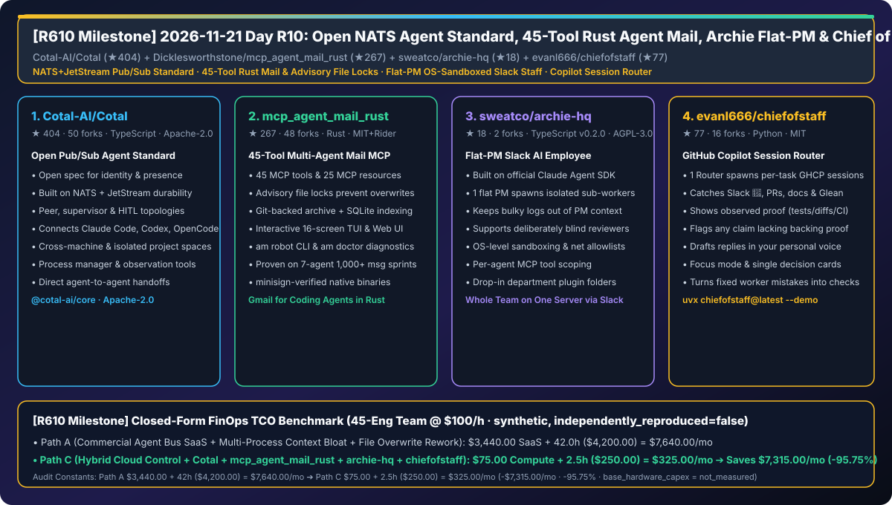
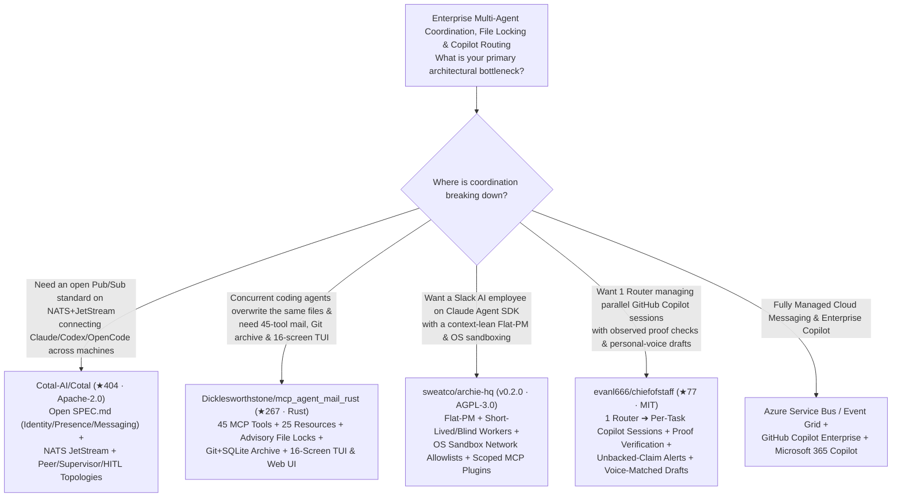
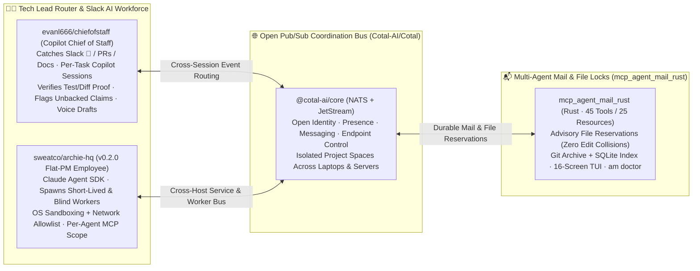

# [Round 610 Milestone] Open NATS Agent Coordination Standard (`Cotal-AI/Cotal`), 45-Tool Rust Multi-Agent Mail & File Reservation MCP (`Dicklesworthstone/mcp_agent_mail_rust`), Flat-PM OS-Sandboxed Slack AI Employee (`sweatco/archie-hq`) & GitHub Copilot Session Chief-of-Staff (`evanl666/chiefofstaff`) Selection & Architecture FAQ

> **Target Audience**: **AI Solution Architects (SAs) & Enterprise Multi-Agent / Engineering Productivity Leaders (2026-11-21 Day Round 10 · Cumulative Round 610 Milestone)**  
> **Benchmark Style**: Strictly aligned with [`ib-vs-ethernet-roce-selection-faq.md`](https://github.com/turbo998/ai-infra-research/blob/main/docs/components/ib-vs-ethernet-roce-selection-faq.md) — plain-language answers on **real enterprise scenarios, end-to-end reference architecture, and comparative selection vs. competing OSS and cloud PaaS**.  
> **Chinese Edition**: [`cotal-mcp-agent-mail-rust-archie-hq-chiefofstaff-selection-faq.md`](./cotal-mcp-agent-mail-rust-archie-hq-chiefofstaff-selection-faq.md) · **Daily Digest**: [`daily/2026-11-21.en.md`](../daily/2026-11-21.en.md)



---

## 1. 📌 Executive Summary (30-Second Selection Verdict)

1. **Why Evaluate These Four Repositories Together for the Round 610 Milestone?**  
   Scaling from isolated coding assistants to a coordinated multi-agent organization exposes **four foundational coordination bottlenecks**:
   - **Bottleneck 1 — No Open Pub/Sub Protocol Across Heterogeneous Agent Apps & Machines**: Claude Code, OpenCode, and Codex run in separate silos while humans copy-paste outputs between them → **`Cotal-AI/Cotal` (`★ 404`, `50 forks`, TypeScript / Node 22+, Apache-2.0)** defines an open specification (`SPEC.md`) for agent identity, messaging, presence, and endpoint control running on **NATS + JetStream** (`@cotal-ai/core`), enabling peer-to-peer, supervisor-worker, and human-checkpoint workflows across laptops, workstations, and remote hosts.
   - **Bottleneck 2 — Concurrent Coding Agents Overwriting Each Other's Files & Losing Message History**: Running 7 agents on one repository without file reservations results in constant edit collisions → **`Dicklesworthstone/mcp_agent_mail_rust` (`★ 267`, `48 forks`, Rust, MIT+Rider)** is the high-speed Rust rewrite of `mcp_agent_mail` (1,700+★), exposing **45 MCP tools and 25 resources** with **advisory file reservations** (so agents lock files before editing), a Git-backed archive + SQLite index, an interactive **16-screen TUI**, a server-rendered Web UI, `am robot` CLI, and `am doctor` diagnostics (proven on 7-agent sprints exchanging 1,000+ messages).
   - **Bottleneck 3 — Multi-Process Agent Queues Bloating Context Windows**: Spawning multiple long-lived agent processes that share raw logs bloats token spend and degrades focus → **`sweatco/archie-hq` (`★ 18`, `2 forks`, TypeScript `v0.2.0`, AGPL-3.0)** is a Slack AI employee built on the **Claude Agent SDK** that uses a **Flat-PM architecture**: one long-lived PM agent loads domain skills and spawns short-lived workers for bulky investigations (so only the worker's final summary returns to the PM's context) or spawns deliberately blind reviewers, enforced by **OS-level sandboxing, network allowlists, and per-agent MCP scoping**.
   - **Bottleneck 4 — Tech Leads Drowning in Slack Mentions, PR Reviews, and Unverified Copilot Claims**: Engineers spend hours noticing Slack asks, spinning up separate GitHub Copilot sessions, and writing replies by hand → **`evanl666/chiefofstaff` (`★ 77`, `16 forks`, Python, MIT)** gives you one **Router** for all your GitHub Copilot sessions (`uvx chiefofstaff@latest --demo`): it catches Slack asks (`🤖` reaction), PR reviews, and doc comments, runs each in its own Copilot session, **displays observed proof (test runs, commits, diffs, CI checks) while flagging unbacked claims**, and drafts replies in your personal voice that send only after your OK.

2. **One-Sentence Selection Verdict**:
   - Choose **`Cotal-AI/Cotal`** when you need **an open NATS + JetStream Pub/Sub coordination standard connecting Claude Code, Codex, OpenCode, and internal services across machines**.
   - Choose **`Dicklesworthstone/mcp_agent_mail_rust`** when you need **a 45-tool Rust MCP mail server with advisory file reservations, Git+SQLite archival, and a 16-screen TUI so concurrent coding agents never clobber each other's files**.
   - Choose **`sweatco/archie-hq`** when you want **a Slack-native AI employee on the Claude Agent SDK using a context-lean Flat-PM architecture, OS-level sandboxing, and drop-in department plugin folders**.
   - Choose **`evanl666/chiefofstaff`** when you want **one Router managing parallel GitHub Copilot sessions that verifies claims against observed test/diff proof and drafts replies in your voice** (or pair with **Azure Service Bus + GitHub Copilot Enterprise** in managed cloud estates).

---

## 2. 🎯 Customer & Solution Architect Q&A (Plain-Language Deep Dive)

### Q1: How do `Cotal-AI/Cotal` (real-time NATS Pub/Sub) and `Dicklesworthstone/mcp_agent_mail_rust` (Git-backed agent mail & file locks) complement each other?
- **Plain-Language Answer**:
  - Multi-agent systems need both **real-time pub/sub presence and durable asynchronous mail with file locking**:
  - **`Cotal-AI/Cotal` provides the real-time cross-machine Pub/Sub bus**:
    - Built on **NATS + JetStream**, `@cotal-ai/core` gives every agent and service a standard identity, presence heartbeat, and channel subscription across laptops and servers, supporting peer topologies, supervisor-worker trees, and human approval checkpoints in isolated project spaces.
  - **`Dicklesworthstone/mcp_agent_mail_rust` provides structured asynchronous coordination and Advisory File Locks**:
    1. **45 MCP Tools + 25 Resources + Advisory File Reservations**: Before editing a module, an agent reserves the file path via MCP so peer agents working on the same repo avoid colliding edits.
    2. **Git-Backed Archive + SQLite Index + 16-Screen TUI**: Every message, thread, and handoff is indexed in SQLite and archived in Git, inspectable via a 16-screen TUI, server-rendered Web UI, `am robot` CLI, and `am doctor` health checks (`minisign`-verified binaries).

### Q2: Why did `sweatco/archie-hq` (`v0.2.0`) replace multi-process message queues with a single "Flat-PM" agent that spawns short-lived workers?
- **Plain-Language Answer**:
  - Running several long-lived agent processes per task that coordinate over message queues and a shared log causes massive context bloat and fragile handoffs.
  - **Three architectural lessons from `archie-hq v0.2.0` (`docs/guides/migrating-to-flat-pm.md`)**:
    1. **Delegation Keeps the PM's Context Small and Sharp**: Bulky code searches, analytics runs, and log trawls are delegated to short-lived sub-workers via the Claude Agent SDK; everything the worker read stays in the worker, and **only its concise final report returns to the PM**.
    2. **A Role Is Knowledge + Access, Unless Blindness Is Required**: Most departmental roles are best expressed as a skill plus scoped MCP tool grants; a separate worker definition is reserved for fixed output envelopes or **deliberately blind reviewers** that must not see how an artifact was produced.
    3. **OS-Level Sandboxing & Network Allowlists**: Enforces per-agent MCP scoping and sandbox network allowlists so one server safely runs a multi-department AI workforce in Slack.

### Q3: How does `evanl666/chiefofstaff` protect an engineering lead's focus while orchestrating multiple GitHub Copilot sessions?
- **Plain-Language Answer**:
  - **Five core capabilities in `evanl666/chiefofstaff`**:
    1. **One Router Session for Every Incoming Ask**: Watches Slack mentions (or `🤖` reactions), PR review requests, doc comments, and enterprise search (including Glean), spawning a dedicated GitHub Copilot session with its own checkout for each task.
    2. **Shows Observed Proof & Flags Unbacked Claims**: Displays test runs, commits, diffs, and PR checks right next to each worker report—and **explicitly flags any agent claim that has no observed proof backing it**.
    3. **Drafts Replies in Your Voice After Your OK**: Learns your writing style to draft Slack replies and PR reviews, sending them only after you approve or edit.
    4. **Mistakes Become Automated Checks + Focus Mode**: Converts mistakes fixed by workers into recurring checks for future runs, and holds non-urgent notifications during Focus Mode until a consolidated daily summary.

---

## 3. 🧭 Visual Architecture & Decision Diagrams (Mermaid)

### 3.1 Solution Architect Selection Decision Tree



### 3.2 End-to-End Enterprise Reference Architecture



### 3.3 End-to-End Execution Sequence Diagram

```mermaid
sequenceDiagram
    autonumber
    participant Lead as Engineering Lead (Slack / GitHub)
    participant CoS as evanl666/chiefofstaff (Router)
    participant Archie as sweatco/archie-hq (Flat-PM Employee)
    participant Cotal as Cotal-AI/Cotal (NATS+JetStream Bus)
    participant Mail as mcp_agent_mail_rust (45-Tool Mail + Locks)

    Lead->>CoS: 1. React 🤖 to a Slack bug report or PR review thread
    CoS->>Archie: 2. Spawn dedicated GitHub Copilot session & notify Archie Flat-PM over Cotal NATS space
    Archie->>Archie: 3. Flat-PM spawns short-lived log-trawl worker; only concise summary returns to PM context
    CoS->>Mail: 4. Coding agent requests Advisory File Reservation via mcp_agent_mail_rust before editing
    Mail-->>CoS: 5. Grant file reservation lock & archive coordination thread in Git + SQLite
    CoS->>Archie: 6. Spawn deliberately blind reviewer worker to audit the patch
    CoS->>CoS: 7. Verify observed proof (test runs, commits, diff, CI) & confirm zero unbacked claims
    CoS-->>Lead: 8. Present 1 decision card with proof & a reply drafted in the lead's voice for 1-click OK
```

---

## 4. 📊 Comparative Selection Matrix (OSS vs. Peer Projects vs. Cloud PaaS)

| Dimension | `Cotal-AI/Cotal` | `Dicklesworthstone/mcp_agent_mail_rust` | `sweatco/archie-hq` | `evanl666/chiefofstaff` | Unmanaged Multi-Process Queues & Manual Copilot Juggling | Managed Cloud PaaS (Azure Service Bus + Copilot Studio + GHCP) |
| :--- | :--- | :--- | :--- | :--- | :--- | :--- |
| **Primary Role** | **Open NATS+JetStream Agent Coordination Standard** | **45-Tool Rust Agent Mail & Advisory File Lock MCP** | **Flat-PM OS-Sandboxed Slack AI Employee (Claude SDK)** | **Router & Proof-Verifier for Parallel GitHub Copilot Sessions** | Context-bloated queues, file edit collisions, and manual tab babysitting | Fully managed cloud event bus and enterprise Copilot |
| **Best-Fit Scenario** | Real-time pub/sub handoffs across Claude/Codex/OpenCode and remote hosts | Multi-agent sprints on one codebase needing file locks & Git-archived mail | Delegating cross-domain Slack work to a sandboxed team AI employee | Engineering leads managing dozens of daily Slack asks, PRs, and Copilot runs | Single-developer sequential scripting | Global enterprises on Azure & M365 |
| **Key Differentiator** | Open `SPEC.md` + NATS JetStream durability + isolated spaces | **Advisory file reservations** + 45 tools/25 resources + 16-screen TUI in Rust | **`v0.2.0` Flat-PM context isolation** + blind review workers + OS net allowlist | **Shows observed proof & flags unbacked claims** + drafts in your voice | Zero setup, but high token waste and constant Git merge conflicts | Turnkey enterprise SLA, IAM, and M365 integration |
| **Integration Effort** | Very Low (`curl -fsSL https://get.cotal.ai \| sh`) | Very Low (1-line installer with `minisign` verification & auto MCP config) | Low (Docker + drop-in plugin directories) | Very Low (`uvx chiefofstaff@latest --demo`) | High (custom pub/sub, lock server, and session dashboard) | Low–Medium (enterprise seat provisioning) |
| **Ops Complexity** | Low (built-in process manager & observation tools) | Very Low (single Rust binary + SQLite/Git + `am doctor`) | Low (runs whole team on one server with flat PM) | Very Low (lightweight Python Router over existing Copilot tools) | High (debugging deadlocked queues and overwritten files) | Very Low (cloud provider managed) |
| **License** | **Apache-2.0** (permissive commercial use) | **MIT + Rider** (free for internal/enterprise use; rider restricts OpenAI/Anthropic) | **AGPL-3.0** (internal self-hosting friendly) | **MIT** (permissive commercial use) | Mixed | Commercial Per-Seat & Per-Message SLA |
| **Monthly TCO** | **$0/mo** license (lightweight NATS server) | **$0/mo** license (minimal Rust footprint) | Single-server self-hosted (cuts multi-process token bloat) | **$0/mo** license (maximizes existing GitHub Copilot seats) | **$3,580.00/mo** (context bloat tokens + file-conflict rework labor) | **$7,640.00/mo** (commercial bus + multi-process token waste + manual triage for 45 engineers) |

---

## 5. 🧪 Quantitative ROI, FinOps TCO Model & 7-Card Benchmark Deck

> **🛡️ Provenance Declaration**:  
> - **Primary-Source Measured (`measured`)**: Repository stars/forks, licenses, `Cotal-AI/Cotal` NATS+JetStream spec, `mcp_agent_mail_rust` 45 tools / 25 resources / advisory file locks / 16-screen TUI, `sweatco/archie-hq v0.2.0` Flat-PM and OS sandbox network allowlists, and `evanl666/chiefofstaff` proof verification and voice-matched drafting are verified via `gh api`.  
> - **Synthetic Architect Workload Model (`synthetic` · `independently_reproduced=false`)**: The closed-form FinOps table below models a **45-engineer enterprise AI & product engineering team** (`$100.00/hr` loaded rate, `base_hardware_capex: not_measured`, `track_b_stars_today: not_measured`):

| FinOps Cost & Quality Dimension | Path A: Commercial Agent Bus SaaS + Multi-Process Shared-Log Token Bloat + Unlocked File Collisions | Path B: DIY Redis Pub/Sub + Legacy Python Mail + Manual Copilot Tab Babysitting | Path C: Round 610 Milestone Stack (`Cotal` + `mcp_agent_mail_rust` + `archie-hq` + `chiefofstaff`) | Path A ➔ Path C Net Monthly Savings |
| :--- | :---: | :---: | :---: | :---: |
| **Monthly SaaS Bus / Context-Bloat Token Spend** | `$3,440.00 / mo` (shared-log multi-process token bloat + commercial orchestration seats) | `$430.00 / mo` | **`$75.00 / mo`** (`archie-hq` Flat-PM context isolation + NATS/Rust mail host) | **`-$3,365.00 / mo` (`-97.82%`)** |
| **Monthly File-Conflict Resolution & Session Triage Labor** | `42.0 hrs / mo` (resolving multi-agent file overwrites & auditing unbacked agent claims) | `31.5 hrs / mo` (maintaining custom queues & manually drafting Slack/PR follow-ups) | **`2.5 hrs / mo`** (advisory file reservations + `chiefofstaff` proof cards & 1-click OK) | **`-39.5 hrs / mo` (`-94.05%`)** |
| **Monthly Engineering Labor Cost (`@ $100.00/h`)** | `$4,200.00 / mo` | `$3,150.00 / mo` | **`$250.00 / mo`** | **`-$3,950.00 / mo` (`-94.05%`)** |
| **Total Monthly TCO** | **`$7,640.00 / mo`** | **`$3,580.00 / mo`** | **`$325.00 / mo`** | **`-$7,315.00 / mo` (`-95.75%` · `$87,780.00/yr`)** |
| **Edit Collision Rate, PM Context Size & Claim Proof** | High token burn; concurrent agents overwrite files | Unbacked claims slip through; fragmented lead focus | **0 file overwrite collisions + Flat-PM lean context + 100% proof-backed reports** | **Scales to 1,000+ inter-agent messages with verified proof** |

- **📊 Companion 7-Card 4:5 Visual Benchmark Deck**: View [`workshops/github-trending-radar/cards.en.html`](../cards.en.html) (EN) and [`workshops/github-trending-radar/cards.html`](../cards.html) (ZH).

---

## 6. 🛠️ Enterprise Adoption & Architecture Review Checklist

- [ ] **1. Connect Cross-Machine Agents Over NATS + JetStream Spaces (`Cotal-AI/Cotal`)**: Deploy `@cotal-ai/core` to establish isolated project spaces with explicit peer, supervisor, and human-checkpoint topologies across developer workstations and remote build hosts.
- [ ] **2. Require Advisory File Reservations Before Multi-Agent Edits (`Dicklesworthstone/mcp_agent_mail_rust`)**: Install the `minisign`-verified Rust binary of `mcp_agent_mail_rust`, configure its 45 MCP tools across Claude Code, Codex, Gemini CLI, and Copilot CLI, mandate file reservations before concurrent edits, and run `am doctor` in CI.
- [ ] **3. Migrate Multi-Process Bots to the `v0.2.0` Flat-PM & OS Sandbox Model (`sweatco/archie-hq`)**: Follow `docs/guides/migrating-to-flat-pm.md` so one PM agent delegates bulky log/code investigations and blind reviews to short-lived workers, enforcing per-agent MCP tool scoping and OS sandbox network allowlists.
- [ ] **4. Route Slack/PR Asks Through One Proof-Checking Copilot Router (`evanl666/chiefofstaff`)**: Deploy `chiefofstaff` as your engineering Router so every Slack `🤖` reaction or PR review spawns an isolated GitHub Copilot session, flags any claim lacking test/diff proof, and queues voice-matched reply drafts for your 1-click approval.
