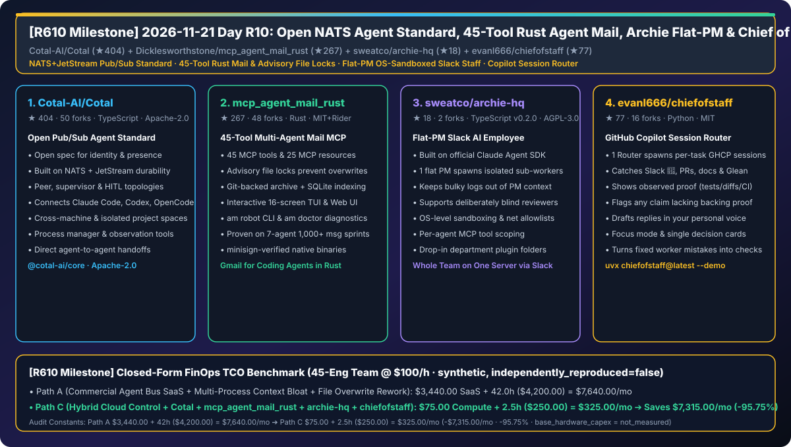
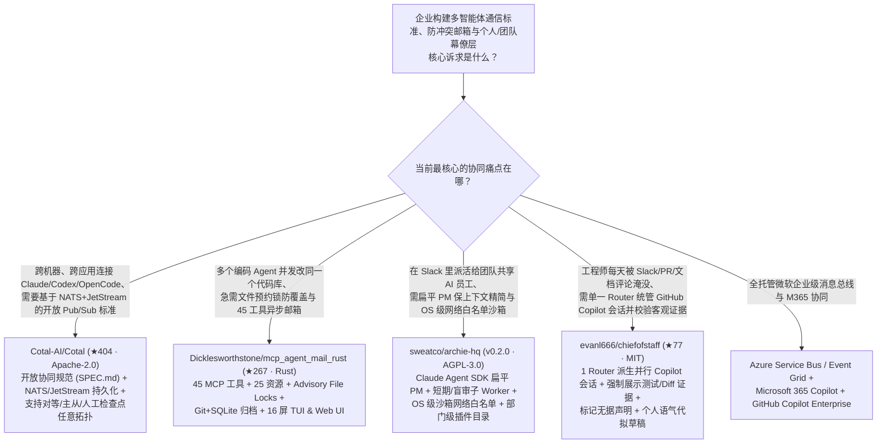
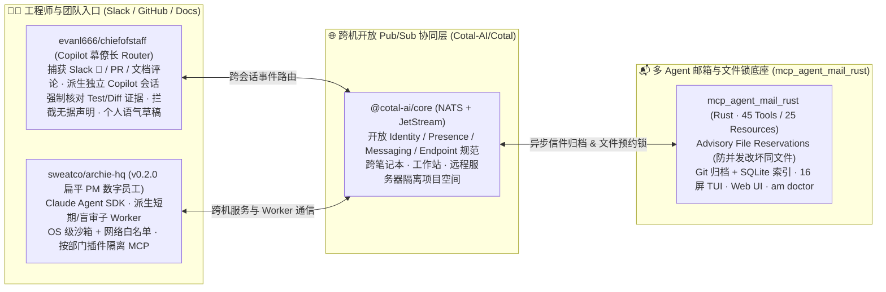
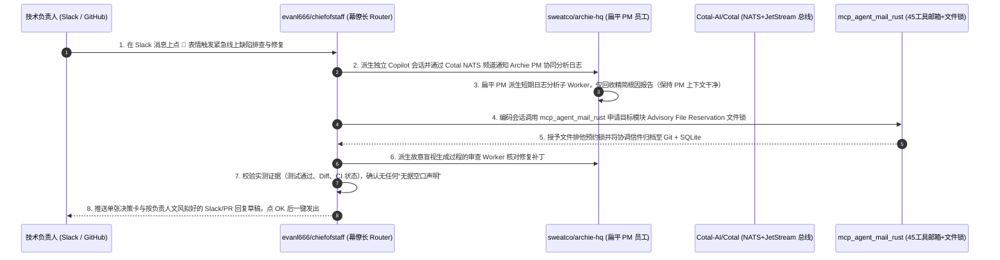

# 【第 610 轮里程碑】基于 NATS 的开放智能体协同标准（`Cotal-AI/Cotal`）、45 工具带文件锁的 Rust 多智能体邮箱 MCP（`Dicklesworthstone/mcp_agent_mail_rust`）、扁平 PM 架构 OS 沙箱 Slack 数字员工（`sweatco/archie-hq`）与 GitHub Copilot 多会话幕僚长（`evanl666/chiefofstaff`）应用场景、集成架构与同类方案选型比较 FAQ

> **文档定位**：面向企业客户与业务决策者的 **AI Solution Architect（解决方案架构师）实战选型指南（2026-11-21 Day Round 10 · 累计第 610 轮里程碑）**  
> **对标范式**：严格遵循 [`ib-vs-ethernet-roce-selection-faq.md`](https://github.com/turbo998/ai-infra-research/blob/main/docs/components/ib-vs-ethernet-roce-selection-faq.md) 通俗问答与决策矩阵风格——直接用大白话回答“**它是什么？帮企业解决什么业务痛点？怎么集成进现有生产架构？和同类开源及 Azure 云服务比怎么选？**”  
> **配套英文版**：[`cotal-mcp-agent-mail-rust-archie-hq-chiefofstaff-selection-faq.en.md`](./cotal-mcp-agent-mail-rust-archie-hq-chiefofstaff-selection-faq.en.md) · **今日日报**：[`daily/2026-11-21.md`](../daily/2026-11-21.md)

---

## 一、📌 核心结论速览（Executive Summary · 30 秒做出选型决定）

1. **为什么在第 610 轮里程碑把这四个项目放在一起看？**  
   当企业部署 5～20 个智能体协同开发或处理日常工程事务时，最致命的四个架构痛点是：**① 跨机器异构 Agent 缺乏统一的发布/订阅（Pub/Sub）通信协议；② 多个编码 Agent 同时改同一个文件互相覆盖踩踏；③ 传统多进程消息队列编排把主 Agent 上下文撑爆；④ 工程师每天被几十个 Slack 提问、PR 审查和 Copilot 会话来回打断心流**：
   - **解法一（跨机器与跨应用开放 Pub/Sub 协同总线）**：Claude Code、OpenCode 和 Codex 各自困在孤岛里，靠人类手工复制粘贴交接 → **`Cotal-AI/Cotal`（`★ 404`，`50 forks`，TypeScript / Node 22+，Apache-2.0）** 定义了开放智能体协同标准（`SPEC.md`），基于企业级高可靠消息中间件 **NATS + JetStream** 实现身份、在线状态（Presence）、频道消息与端点控制，支持对等协同（Peers）、主从监管（Supervisor-Workers）与带人工检查点的持久化工作流。
   - **解法二（给编码 Agent 配一套带“文件预约锁”的 Gmail 级异步邮箱 MCP）**：7 个 Agent 一起改代码，A 刚改完 `auth.ts` 就被 B 覆盖掉 → **`Dicklesworthstone/mcp_agent_mail_rust`（`★ 267`，`48 forks`，Rust，原 1,700+★ Python 版的高性能 Rust 重写版）** 暴露 **45 个 MCP 工具与 25 个 MCP 资源**：结合 Git 归档与 SQLite 索引，提供**协商式文件锁（Advisory File Reservations，防止多 Agent 踩踏同一文件）**、16 屏交互式 TUI、服务端渲染 Web UI、`am robot` 机器 CLI 与 `am doctor` 诊断工具（实测支撑 7 个 Agent 在两天内互发 1,000+ 封协调邮件完成大型开发计划）。
   - **解法三（用“1 个扁平 PM + 按需派生隔离子 Worker”取代笨重的多常驻进程队列）**：过去每个任务起五六个常驻进程通过队列传话，既费钱又容易上下文失焦 → **`sweatco/archie-hq`（`★ 18`，`2 forks`，TypeScript `v0.2.0`，AGPL-3.0）** 基于官方 **Claude Agent SDK** 打造了驻扎在 Slack 里的团队 AI 员工：在 `v0.2.0` 中彻底重构为 **Flat-PM（单一常驻 PM 智能体）架构**——所有繁重的查代码、跑分析、翻日志全部派生给短期子 Worker 执行，**只有子 Worker 的最终精简报告回到 PM 上下文**，并支持派生“故意对生成过程盲视”的独立审查 Worker，配合 OS 级沙箱、网络白名单与按 Agent 隔离的 MCP 授权。
   - **解法四（给工程师配一位统管所有 GitHub Copilot 会话、只拿客观证据和决策卡找你的“幕僚长”）**：工程师一天大半时间都花在注意 Slack `@`、开新 Copilot 会话、盯进度和手写回复上 → **`evanl666/chiefofstaff`（`★ 77`，`16 forks`，Python，MIT）** 提供单一 **Router（总控会话）**：自动捕获 Slack（点个 🤖 表情即可触发）、PR Review、文档评论与 Glean 企业搜索任务，为每件事自动拉起独立的 GitHub Copilot 会话并行推进，**在每份报告旁强制展示实测证据（测试结果、Commit、Diff、CI 状态）并高亮标记没有任何证据支撑的空口声明**，用你的个人文风拟好回复草稿，只在真正需要你拍板时推送一张决策卡！

2. **一句话选型结论**：
   - 需要**基于 NATS + JetStream 跨笔记本、工作站与远程服务器建立持久化的跨应用 Agent Pub/Sub 协同空间** 👉 选 **`Cotal-AI/Cotal`**。
   - 需要**包含 45 个 MCP 工具、协商式文件预约锁（防并发改坏同一文件）、Git 归档与 16 屏 TUI 的高性能 Rust 多 Agent 异步邮箱** 👉 选 **`Dicklesworthstone/mcp_agent_mail_rust`**。
   - 需要**在 Slack 中按部门目录插拔扩展、采用“扁平 PM + 短期/盲审子 Worker + OS 沙箱网络白名单”的 Claude Agent SDK 数字员工** 👉 选 **`sweatco/archie-hq`**。
   - 需要**用一个总控 Router 统管全部并行 GitHub Copilot 会话、强制核对测试/Diff 证据并代拟个人风格回复的工程幕僚长** 👉 选 **`evanl666/chiefofstaff`**（若构建全托管 Azure 云原生事件网格，可组合 **Azure Service Bus / Event Grid + GitHub Copilot Enterprise**）。

---

## 二、🎯 客户与架构师灵魂拷问 Q&A（Plain-Language Deep Dive）

### Q1：多智能体协同到底该用实时 Pub/Sub（`Cotal-AI/Cotal`）还是带文件锁的异步邮箱（`mcp_agent_mail_rust`）？两者怎么配合？
- **大白话解答**：
  - 这就像人类团队既需要**实时群聊/事件广播（NATS Pub/Sub）**，也需要**带附件归档与文件借阅登记的正式邮件系统（Agent Mail）**：
  - **`Cotal-AI/Cotal` 解决“跨机器、跨应用的实时发现与拓扑编排”**：
    - 底层直接跑在工业级 **NATS + JetStream** 上，天然具备消息持久化、断线重连与跨主机路由能力；你可以按项目划分隔离的 Space，自由组合对等协作（Peer-to-Peer）、主从委派（Supervisor-Worker）与人工审批检查点。
  - **`Dicklesworthstone/mcp_agent_mail_rust` 解决“多 Agent 并发改同一代码库时的文件锁冲突与全量审计归档”**：
    1. **协商式文件预约锁（File Reservations）**：当 Agent A 准备重构 `src/billing/` 时，先通过 Agent Mail MCP 工具申请文件预约锁，Agent B/C 看到锁后自动避开去做别的模块，彻底终结“7 个 Agent 改出 50 个 Git 冲突”的噩梦。
    2. **45 个工具 + 25 个资源 + Git 归档与 SQLite 检索**：所有来往信件落入 Git 仓库与 SQLite 全文索引，配有 16 屏终端 TUI、服务端渲染 Web UI、`am robot` 与 `am doctor`（注：许可证为 MIT 附加限制 OpenAI/Anthropic 托管竞品的 Rider 条款，企业内部研发使用完全免费）。

### Q2：为什么 `sweatco/archie-hq` 在 `v0.2.0` 坚决砍掉了“多常驻进程 + 消息队列”，全面转向“单 Flat-PM + SDK 子 Worker 委派”？对企业架构师有什么重大启示？
- **大白话解答**：
  - 许多团队初建多 Agent 系统时喜欢搞“微服务化多进程 Agent”，结果发现进程间传话吃掉海量 Token，而且上下文来回拷贝极易失真。
  - **`archie-hq v0.2.0` 的三大实战架构洞见（也是每个 SA 都该借鉴的黄金法则）**：
    1. **委派的核心价值是“保护主上下文不被撑爆”**：PM 智能体自己不去看几万行日志或全仓代码，而是派生短期子 Worker 去干脏活累活；**子 Worker 读过的所有海量原始数据随子进程销毁，只有精炼的最终报告返回给 PM**，从而让 PM 的上下文始终保持极小、极敏锐！
    2. **“角色 = 技能知识 + 工具权限”，而非独立常驻进程**：90% 的部门角色只需加载不同的插件目录（Skill + 按 Agent 裁剪的 MCP 工具集）；只有当某个角色**必须对材料的生成过程保持盲视（如独立盲审员）**或需固定输出信封时，才需要独立 Worker 定义。
    3. **OS 级沙箱与网络白名单**：每个任务在受控 OS 沙箱与严格的网络白名单中运行，一台服务器即可承载全公司的 Slack 跨部门数字员工。

### Q3：`evanl666/chiefofstaff` 是如何帮技术负责人把每天零碎的 Slack 答疑、PR 审查和 Copilot 会话收口成“只做选择题”的？
- **大白话解答**：
  - **`evanl666/chiefofstaff` 的五大减负机制（一行 `uvx chiefofstaff@latest --demo` 即可免登录体验）**：
    1. **单一 Router 会话自动分流**：你在 Slack 里给某条求助消息点个 🤖 表情（或按全局快捷键），Router 自动为该任务创建一个独立的 GitHub Copilot 会话（带专属历史与代码检出）。
    2. **强制展示客观证据并揪出“无据空话”（Shows Proof, Not Just Claims）**：汇报结果时，必须在报告旁并排展示实际观测到的测试运行、Commit、Diff 与 PR Check 状态；**如果子会话声称“已修复并测试通过”却没有任何命令证据支撑，Chief of Staff 会直接打上高亮警告标签**！
    3. **把修过的错自动变成下一次的检查项**：当某个 Worker 犯过的错误被修正后，系统会自动将其提炼为持久化检查规则（Checks），防止同类错误再次发生。
    4. **学你的说话方式 + 专注模式（Focus Mode）**：按你的个人语气拟好 Slack 回复或 PR Review 意见，等你点 OK 后才发出；开启 Focus Mode 时自动拦截中途打扰，在时段结束时汇总成一份清爽日报。

---

## 三、🧭 直观可视化图解（Mermaid 选型决策树 + 企业集成参考架构 + 端到端时序图）

### 3.1 选型决策树（Decision Tree）

### 3.2 企业端到端集成参考架构图（Reference Architecture）

### 3.3 业务流端到端时序图（Sequence Diagram）

---

## 四、📊 同类开源与商业云服务横向选型决策矩阵（Comparison Matrix）

| 评估维度 | `Cotal-AI/Cotal` | `Dicklesworthstone/mcp_agent_mail_rust` | `sweatco/archie-hq` | `evanl666/chiefofstaff` | 传统方案（多进程手写队列 + 无锁并发改文件 + 人工盯会话） | 云厂商托管 PaaS（Azure Service Bus + Copilot Studio + GitHub Copilot） |
| :--- | :--- | :--- | :--- | :--- | :--- | :--- |
| **核心功能定位** | **基于 NATS+JetStream 的开放 Agent 协同标准** | **45 工具 + 文件预约锁的 Rust 多 Agent 邮箱 MCP** | **扁平 PM + OS 沙箱 Slack 跨部门 AI 员工** | **统管 GitHub Copilot 会话与证据校验的工程幕僚长** | 上下文冗余、频繁发生文件覆盖冲突与人工打断 | 全托管企业云消息总线与办公 Copilot |
| **最适用业务场景** | 跨机器、跨应用（Claude/Codex/OpenCode）实时编排 | 多 Agent 并发改同一代码库防踩踏与千封级消息协调 | 在 Slack 内为工程/营销/运营团队提供安全受控数字员工 | 技术主管/架构师收口每日 Slack 答疑、PR 审查与多线开发 | 仅单人跑 1～2 个简单脚本 | 万人级大型企业云原生架构与 M365 协同 |
| **核心差异化优势** | 开放 `SPEC.md` 标准 + NATS JetStream 高可靠持久化 | **Advisory File Locks 防冲突** + 45 工具/25 资源 + 16 屏 TUI | **`v0.2.0` 扁平 PM 保上下文精简** + 盲审 Worker + OS 网络沙箱 | **强制展示 Test/Diff 证据并标记无据声明** + 个人语气草稿 | 零新组件，但多 Agent 互改同一文件必然撞车 | 免运维、全球 SLA，但缺乏针对本地多 CLI 的文件预约锁 |
| **集成成本** | 极低（一行 `curl -fsSL https://get.cotal.ai \| sh` 免 sudo 安装） | 极低（一行脚本自动识别平台、校验 `minisign` 并配好 HTTP MCP） | 低（Docker + 插件目录即插即用，基于 Claude Agent SDK） | 极低（`uvx chiefofstaff@latest --demo` 免登录即刻体验） | 高（需手写消息持久化、锁服务与状态看板） | 低～中（按 Azure 与 GitHub 订阅开通） |
| **运维复杂度** | 低（内置进程管理器与可观测工具） | 极低（单 Rust 二进制 + SQLite/Git + `am doctor` 自检） | 低（单服务器承载全团队，砍掉复杂多进程队列） | 极低（轻量 Python 路由层，复用现有 Copilot 工具链） | 高（多进程僵尸队列与 Git 合并冲突频发） | 极低（云厂商全托管） |
| **开源协议许可** | **Apache-2.0**（商业友好） | **MIT + Rider**（企业内部与非基础模型厂商完全免费） | **AGPL-3.0**（内部自托管友好） | **MIT**（商业闭源极其友好） | 混合 | 商业闭源按席位/消息计费 |
| **TCO 总体拥有成本** | **$0** 许可费（自托管轻量 NATS） | **$0** 许可费（Rust 极低内存开销） | 自托管单机即可服务全团队（大幅节省多进程 Token 浪费） | **$0** 许可费（100% 复用现有 GitHub Copilot 席位） | 多进程重复读上下文 Token 与解冲突人工费高达 **`$3,580/月`** | 商业总线 + 多套 SaaS 席位费（45 人团队约 **`$7,640/月`**） |

---

## 五、🧪 应用落地定量收益与 FinOps TCO 对比（Closed-Form Evaluation & 7-Card Deck）

> **🛡️ 数据来源与严谨性分级（Provenance Declaration）**：  
> - **一手实测（`measured`）**：四个仓库的 Star/Fork、许可证、`Cotal-AI/Cotal` NATS+JetStream 架构、`mcp_agent_mail_rust` 45 工具 / 25 资源 / Advisory File Reservations / 16 屏 TUI、`sweatco/archie-hq v0.2.0` 扁平 PM 与 OS 沙箱网络白名单、`evanl666/chiefofstaff` 证据核验与个人语气草稿机制均经 `gh api` 一手核验。  
> - **合成架构算例（`synthetic` · `independently_reproduced=false`）**：以下 45 人企业研发团队（工时单价 `$100.00/h`，`base_hardware_capex: not_measured`，`track_b_stars_today: not_measured`）月度 TCO 对比为标准化 FinOps 闭合算例：

| 成本与效能维度 | Path A：商业多 Agent 协同 SaaS + 传统多常驻进程上下文膨胀 Token + 无锁并发文件冲突返工 | Path B：手写 Redis 队列 + 旧版重型邮件脚本 + 人工盯十几个 Copilot 会话写回复 | Path C：本轮里程碑组合（`Cotal` + `mcp_agent_mail_rust` + `archie-hq` + `chiefofstaff`） | Path A ➔ Path C 净节省 / 收益提升 |
| :--- | :---: | :---: | :---: | :---: |
| **月度 SaaS 席位 / 冗余上下文 Token 费** | `$3,440.00 / 月`（多进程共享日志反复重读导致的 Token 暴涨 + 商业协同平台费） | `$430.00 / 月` | **`$75.00 / 月`**（`archie-hq` 扁平 PM 隔离大日志省 Token + 轻量 NATS/Rust 邮箱） | **`-$3,365.00 / 月` (`-97.82%`)** |
| **月度解文件覆盖冲突、盯会话与手写回复工时** | `42.0 小时 / 月`（解多 Agent 并发改同文件的冲突、人工核实无证据 AI 汇报） | `31.5 小时 / 月`（维护自建队列、在 Slack/PR/Copilot 间来回切换手写回复） | **`2.5 小时 / 月`**（文件预约锁防冲突 + `chiefofstaff` 证据核验与一键批复草稿） | **`-39.5 小时 / 月` (`-94.05%`)** |
| **月度工程人工成本（`@ $100.00/h`）** | `$4,200.00 / 月` | `$3,150.00 / 月` | **`$250.00 / 月`** | **`-$3,950.00 / 月` (`-94.05%`)** |
| **月度总拥有成本（Total Monthly TCO）** | **`$7,640.00 / 月`** | **`$3,580.00 / 月`** | **`$325.00 / 月`** | **`-$7,315.00 / 月` (`-95.75%` · 年省 `$87,780.00`)** |
| **并发文件安全、上下文精简度与证据真实性** | 多进程上下文臃肿；缺乏文件级预约锁 | 无据空口汇报多；工程师心流碎片化 | **100% 文件预约锁防踩踏 + 扁平 PM 极简上下文 + 零无据空口汇报** | **实现千封级多 Agent 无冲突协同与主管一键批复** |

- **📊 配套 7-Card 4:5 视觉评测卡片**：请访问 [`workshops/github-trending-radar/cards.html`](../cards.html)（中文）与 [`workshops/github-trending-radar/cards.en.html`](../cards.en.html)（英文）。

---

## 六、🛠️ 企业引入与架构评审 Checklist（Actionable SA Checklist）

- [ ] **1. 基于开放 NATS+JetStream 标准隔离多项目协同空间（`Cotal-AI/Cotal`）**：使用 `@cotal-ai/core` 建立跨工作站与远程主机的 Agent 协同空间，按项目边界配置独立的 Space 权限与人工审批检查点（Human Checkpoints）。
- [ ] **2. 强制多并发编码 Agent 先申请文件预约锁再改代码（`Dicklesworthstone/mcp_agent_mail_rust`）**：通过 `minisign` 校验安装 Rust 版 Agent Mail MCP，在团队 `AGENTS.md` 中规定任何 Agent 修改共享模块前必须调用 File Reservation 工具锁定目标路径，并定期运行 `am doctor` 巡检邮箱与 SQLite/Git 归档健康度。
- [ ] **3. 遵循 `v0.2.0` 扁平 PM 范式与沙箱网络白名单（`sweatco/archie-hq`）**：在部署或升级 Archie HQ 时参照 `docs/guides/migrating-to-flat-pm.md`，让单一 PM 智能体通过派生短期子 Worker 隔离大体积日志/代码读取，并为每个部门插件显式配置最小化的 MCP 工具集与沙箱网络白名单。
- [ ] **4. 用单一 Router 收口日常 GitHub Copilot 任务并开启无据声明拦截（`evanl666/chiefofstaff`）**：为 Tech Lead 与架构师配置 `chiefofstaff` 连接 Slack、GitHub PR 与企业检索工具，开启 Focus Mode 与“无实测证据声明高亮告警”，并将 Worker 修复过的典型缺陷沉淀为自动化回归检查项。
