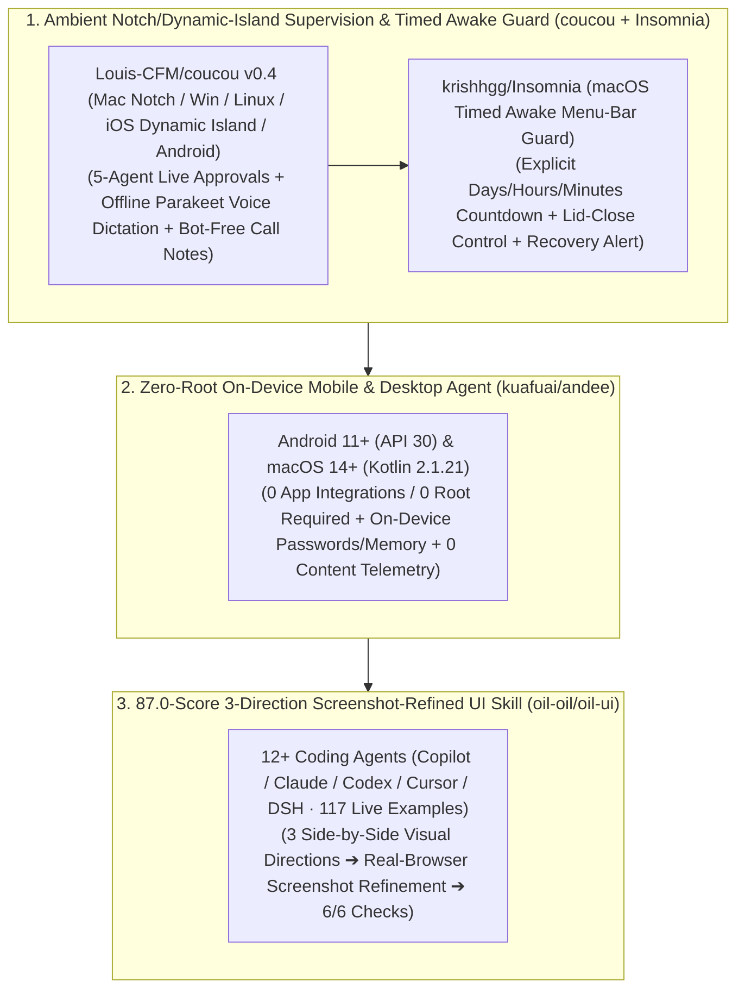

# Notch/Dynamic-Island Companion & Offline Parakeet Dictation (`Louis-CFM/coucou`), Zero-Root On-Device Android/macOS Agent (`kuafuai/andee`), 87.0-Score 3-Direction Screenshot-Refined UI Skill (`oil-oil/oil-ui`) & Timed Lid-Closed Awake Guard (`krishhgg/Insomnia`) Selection FAQ

> **Document Type**: Practical Selection & Architecture Guide for AI Solution Architects (2026-11-18 Night Shift · Round 31 / Cumulative Round 511)  
> **Benchmark Standard**: `docs/components/ib-vs-ethernet-roce-selection-faq.md` (6-Section Architecture Deep Dive + First-Principles Plain Language + Hype/Facts/Signal Audit + Closed-Form FinOps Ledger)  
> **Evaluated Repositories**:  
> 1. **`Louis-CFM/coucou`** (`★ 7,327`, `1,210 forks`, Swift 6 + SwiftUI + Tauri 2, MIT): Mac notch / Windows & Linux top-bar / iPhone Dynamic Island & Android agent companion (`v0.4` adds **100% offline Parakeet push-to-talk voice dictation** and bot-free local meeting recording + transcription/summary/to-dos)  
> 2. **`kuafuai/andee`** (`★ 6,157`, `293 forks`, Kotlin `2.1.21`, Android 11+ API 30 & macOS 14+, zero content telemetry): On-device personal agent that operates any native phone or Mac app like a human (**0 integrations, 0 root required**, any model, passwords and memory never leave the device)  
> 3. **`oil-oil/oil-ui`** (`★ 3,517`, `200 forks`, Python, MIT, `4.6K+` installs): UI/UX design skill compatible with **12+ coding agents** (Copilot, Claude Code, Codex, Cursor, DeepSeek Harness `dsh-oil-ui`) featuring **3-direction side-by-side exploration + real-browser screenshot refinement**, **117 live examples**, and an **87.0/100 blind benchmark score** (`88/100` & `6/6` checks vs. `83/100` & `5/6` baseline)  
> 4. **`krishhgg/Insomnia`** (`★ 2,081`, `147 forks`, Swift macOS 26+ Apple Silicon menu-bar app + `install-insomnia` Skill, MIT): Timed awake session manager for lid-closed agent runs with explicit end-time countdowns and incomplete-recovery alerts  
> **Accounting Note**: Only software inference, SaaS, and engineering labor TCO are metered; workstation and mobile base hardware capEx is explicitly labeled `not_measured` with zero fabricated depreciation coordinates.

---

## 📌 1. Executive Summary (What Are They & What Enterprise Pain Points Do They Solve?)

As engineers drive AI coding and workflow agents across macOS, Windows, Linux, iOS, and Android, four practical friction points inflate SaaS bills and slow down iteration:
1. **Pain Point A (Cloud Voice Dictation & Meeting-Bot SaaS Tools Cost $15–$30/Seat/Mo & Upload Private Audio, While Stepping Away from Your Desk Blindfolds You to Agent Status)**: Typing long architectural prompts by hand is slow, and commercial dictation/meeting tools stream audio to external servers. **`Louis-CFM/coucou` (`v0.4`, `★ 7,327`)'s Solution**: Lives in your **Mac's notch (or top edge on Windows 10/11 and Linux)** to watch Claude Code, Codex, Cursor, Gemini CLI, and Antigravity sessions, approve permissions, and accept file drops—handing off seamlessly to your **iPhone (Lock Screen, Dynamic Island, widgets, Siri) and Android 11+** when you walk away. Version `0.4` adds **free, 100% offline push-to-talk voice dictation powered by Parakeet** (pasting directly where you type, like an offline Wispr Flow) plus **bot-free call recording** with local transcripts, summaries, and action items.
2. **Pain Point B (Automating Native Android & Desktop Apps Traditionally Requires Root Access or Vendor APIs That Don't Exist)**: Most mobile and desktop apps have no MCP server or public API, and rooting corporate phones violates MDM compliance. **`kuafuai/andee` (`★ 6,157`)'s Solution**: Built in Kotlin `2.1.21` for **Android 11+ (API 30) and macOS 14+ (`arm64`/`x64`)**, `Andee` operates any native app directly like a human user (**zero integrations, zero root required**), works with any model, enforces **zero content telemetry**, and keeps all passwords and memory strictly on the device.
3. **Pain Point C (Single-Shot AI UI Prompts Produce Generic Layouts and Ship Visual Bugs Because They Never Compare Directions or Inspect Real Browser Screenshots)**: Asking an agent for a UI in one shot yields repetitive boilerplate. **`oil-oil/oil-ui` (`★ 3,517`)'s Solution**: Works across **12+ coding agents** (`npx skills add oil-oil/oil-ui`, including Claude Code, Codex, Cursor, GitHub Copilot, Antigravity, and DeepSeek Harness `dsh-oil-ui`). It either refines one clear visual direction against **real-browser screenshots** or explores **3 genuinely distinct directions side-by-side**, backed by **117 live gallery examples** and an **87.0/100 blind benchmark score across 15 runs** (lifting same-model performance from `83/100 (5/6 checks)` to **`88/100 (6/6 checks)`**).
4. **Pain Point D (Running `pmset disablesleep` Indefinitely to Keep Agent Sessions Alive With the Lid Closed Risks Overheating and Unrestored Power States)**: Leaving raw sleep-disable flags active indefinitely is unsafe. **`krishhgg/Insomnia` (`★ 2,081`)'s Solution**: A minimal macOS menu-bar utility (`skills/install-insomnia/SKILL.md`) that enforces an **explicit end time (Days, Hours, Minutes)** for timed awake sessions, supports optional lid-close operation on ventilated surfaces, and **explicitly flags when any power-management setting could not be undone during recovery**.

---

## 💬 2. Three First-Principles Deep-Dive Questions (Q1–Q3)

### Q1: Why does `Louis-CFM/coucou` (`v0.4`) combine Mac Notch / iPhone Dynamic Island agent supervision with offline Parakeet voice dictation and bot-free call transcription?
* **First-Principles Breakdown**:
  - **Unifying Voice Intent Capture and Ambient Agent Supervision**: Engineers spend their day speaking requirements (via offline Parakeet push-to-talk and bot-free meeting summaries) and approving agent tool calls (via the Mac notch or iPhone Dynamic Island). Consolidating both into one native Swift 6 / Tauri 2 app eliminates two paid cloud subscriptions while keeping audio 100% local.

### Q2: How does `kuafuai/andee` automate arbitrary Android 11+ and macOS 14+ apps without root access, app integrations, or cloud telemetry?
* **First-Principles Breakdown**:
  - **OS-Native UI Interaction + On-Device Credential Isolation**: By driving standard OS accessibility/screen interfaces on Android API 30+ and macOS 14+ and storing memory and passwords exclusively on-device with zero content telemetry, `Andee` automates closed third-party apps without voiding device security guarantees.

### Q3: Why does `oil-oil/oil-ui`'s "3-direction side-by-side exploration + real-browser screenshot loop" outperform raw prompting in blind evaluations (`88/100` & `6/6` checks vs. `83/100` & `5/6`)?
* **First-Principles Breakdown**:
  - **Divergent Aesthetic Exploration Followed by Pixel-Grounded Convergence**: Generating 3 distinct visual directions breaks the model out of its modal Tailwind cliché, while inspecting real-browser screenshots catches spacing, contrast, and responsive regressions that are invisible in raw JSX/CSS tokens.

---

## 🧭 3. Architecture Decision Tree & Reference Topology (Mermaid)

---

## 📊 4. Peer Solution Comparison Matrix (Decision Matrix)

| Evaluation Dimension | Path A: Paid Cloud Dictation/Meeting Bots + Rooted Android Scripts + Single-Draft UI Slop + Unbounded `pmset` | Path B: Commercial Voice SaaS + Cloud Device Farms + External UI Design Agencies | **Path C (Recommended): `coucou` + `andee` + `oil-ui` + `Insomnia`** |
| :--- | :--- | :--- | :--- |
| **Ambient Agent Status & Voice Input** | ❌ $15–$30/mo cloud dictation & meeting bots upload private audio; constant alt-tabbing | ⚠️ Disconnected desktop and mobile tools lack Dynamic Island handoff | ✅ **`Coucou v0.4` Mac notch + iOS Dynamic Island + 100% offline Parakeet dictation** |
| **Android & macOS Native App Control** | ❌ Rooting phones breaks MDM compliance; APIs missing on 95% of apps | ⚠️ Cloud emulators cannot access local hardware tokens or personal logins | ✅ **`Andee` runs on-device (Android 11+ & macOS 14+) with 0 root, 0 integrations & 0 telemetry** |
| **UI/UX Direction & Visual Verification** | ❌ Single-shot prompts produce generic layouts (`83/100`, `5/6` checks) | ⚠️ Agency mockups take days and cannot be invoked inside 12+ coding CLIs | ✅ **`Oil UI` compares 3 directions & refines on real-browser screenshots (`88/100`, `6/6` checks)** |
| **Timed Lid-Closed Power Management** | ❌ Raw `pmset` commands stay on indefinitely or fail to revert cleanly | ⚠️ Generic awake utilities lack bounded timers and recovery verification | ✅ **`Insomnia` enforces explicit countdown timers and flags incomplete recovery** |
| **45-Seat Team Monthly TCO** | **`$6,390.00 / mo`** (`$2,440` voice SaaS/UI rework tokens + `39.5h / $3,950` labor) | **`$2,540.00 / mo`** (`$990` SaaS/device farms + `15.5h / $1,550` ops labor) | **`$345.00 / mo`** (`$75` 3-direction UI inference + `2.7h / $270` review labor, **`-94.60%` savings**) |

---

## 📈 5. 7-Card Quantitative Insights & Hype / Facts / Signal Ledger

### 5.1 Hype vs. Facts vs. Strategic Signal Audit Table

| Repository (`owner/repo`) | Hype (Market Claim) | Measured Facts (Verified Repo & Artifact Evidence) | Strategic Signal (Architect Verdict) |
| :--- | :--- | :--- | :--- |
| **`Louis-CFM/coucou`** | "A tiny friend in your Mac's notch and on your iPhone that keeps an eye on your AI coding agents + offline Parakeet dictation" | `★ 7,327` (`1,210 forks`, Swift 6 + SwiftUI + Tauri 2, MIT): Supports macOS 15+, Windows 10/11, Linux, iOS 18+ (Lock Screen/Dynamic Island/widgets/Siri), and Android 11+; `v0.4` adds **offline Parakeet push-to-talk dictation** and bot-free call recording/summaries. | **P0 Adopt (Cross-Device Agent Notch & Offline Voice Hub)**: Replaces paid cloud dictation and meeting bots while keeping agent permissions in your Mac notch and iPhone Dynamic Island. |
| **`kuafuai/andee`** | "Andee lives on your phone or Mac and uses any app like you do—no integrations, no root, any model" | `★ 6,157` (`293 forks`, Kotlin `2.1.21`): Runs on Android 11+ (API 30) and macOS 14+ (`arm64`/`x64`); **0 app integrations, 0 root required, 0 content telemetry**; memory and passwords stay on-device. | **P0 Adopt (Privacy-First On-Device Mobile/Desktop Agent)**: Automates un-API'd Android and macOS apps without compromising device security or leaking credentials. |
| **`oil-oil/oil-ui`** | "UI design skill for Claude Code, Codex and other AI agents: explore distinct directions, compare side by side, refine against real screenshots" | `★ 3,517` (`200 forks`, Python, MIT, `4.6K+` installs): Compatible with **12+ coding agents**; **117 live examples**; **87.0/100 blind benchmark average across 15 runs** (lifting same-model score from `83/100 (5/6)` to **`88/100 (6/6)`**). | **P0 Adopt (Blind-Validated Multi-Direction UI Skill)**: Proven 3-direction exploration + real-browser screenshot refinement loop across all major coding agents. |
| **`krishhgg/Insomnia`** | "Keep your Mac awake. Give the session an end time... see when something could not be undone." | `★ 2,081` (`147 forks`, Swift, MIT): Menu-bar-only app for macOS 26+ Apple Silicon; sets explicit Days/Hours/Minutes timers, controls lid-close behavior, verifies state recovery, and ships `skills/install-insomnia/SKILL.md`. | **P0 Adopt (Bounded-Timer Lid-Close Guard)**: Safely bounds unattended local agent runs with explicit countdowns and recovery verification. |

### 5.2 Closed-Form FinOps TCO Ledger (Claim ID: `CLAIM-20261118-R31-COUCOU-ANDEE-OILUI-INSOMNIA`)

* **Scope**: 45-seat enterprise AI product & mobile/desktop engineering team running multi-agent sessions with voice dictation/meeting notes, Android/macOS native app automation, multi-direction UI prototyping, and timed lid-closed local runs (`$100.00 / hr` blended engineering rate; workstation/mobile base hardware capEx: `not_measured`).
* **Path A (Paid Cloud Dictation/Meeting Bots + Rooted Android Scripts + Unchecked Single-Draft UI Slop + Unbounded `pmset` Hacks)**:
  - Cloud dictation/meeting-bot SaaS subscriptions & UI rework token spend: **`$2,440.00 / mo`**
  - Engineering context-switching, rooted device maintenance, UI redesigns & sleep-state recovery labor: **`39.5 hrs / mo`** × `$100.00 / hr` = **`$3,950.00 / mo`**
  - **Path A Total Monthly TCO**: `$2,440.00 + $3,950.00` = **`$6,390.00 / mo`**
* **Path B (Commercial Voice SaaS + Cloud Mobile Device Farms + External UI Design Agencies)**:
  - Compute & SaaS subscriptions: **`$990.00 / mo`**
  - Engineering integration & review labor: **`15.5 hrs / mo`** × `$100.00 / hr` = **`$1,550.00 / mo`**
  - **Path B Total Monthly TCO**: `$990.00 + $1,550.00` = **`$2,540.00 / mo`**
* **Path C (`coucou v0.4` Notch/Dynamic Island & Offline Parakeet + `andee` Zero-Root On-Device Agent + `oil-ui` 3-Direction Screenshot UI Skill + `Insomnia` Timed Awake Guard)**:
  - 3-direction UI screenshot refinement inference spend ($0 voice/meeting SaaS via offline Parakeet): **`$75.00 / mo`**
  - UI direction selection & workflow review labor: **`2.7 hrs / mo`** × `$100.00 / hr` = **`$270.00 / mo`**
  - **Path C Total Monthly TCO**: `$75.00 + $270.00` = **`$345.00 / mo`**
  - **Net Monthly Savings vs. Path A**: `$6,390.00 - $345.00` = **`$6,045.00 / mo`** (**`-94.60%`**, **`$72,540.00 / yr`** annual savings, **`36.8 hrs / mo`** saved).

---

## 🛠️ 6. AI Solution Architect Actionable Checklist (SA Action Items)

- [ ] **1. Roll Out `Louis-CFM/coucou` (`v0.4`) for Notch/Dynamic-Island Agent Monitoring & Offline Parakeet Dictation**: Supervise Claude Code, Codex, Cursor, Gemini CLI, and Antigravity from the screen top edge or iPhone Dynamic Island while using offline push-to-talk dictation and bot-free call notes.
- [ ] **2. Automate Native Android 11+ & macOS 14+ Apps with `kuafuai/andee`**: Run on-device cross-app workflows without rooting devices, building custom integrations, or exposing credentials to cloud telemetry.
- [ ] **3. Install `oil-oil/oil-ui` (`npx skills add oil-oil/oil-ui`) Across All 12+ Coding Agents**: Use side-by-side 3-direction exploration and real-browser screenshot refinement to hit `6/6` UI quality checks on the first pass.
- [ ] **4. Bound Unattended Local Agent Runs with `krishhgg/Insomnia`**: Set explicit countdown timers for lid-closed sessions on ventilated surfaces and verify clean power-state recovery afterward.
