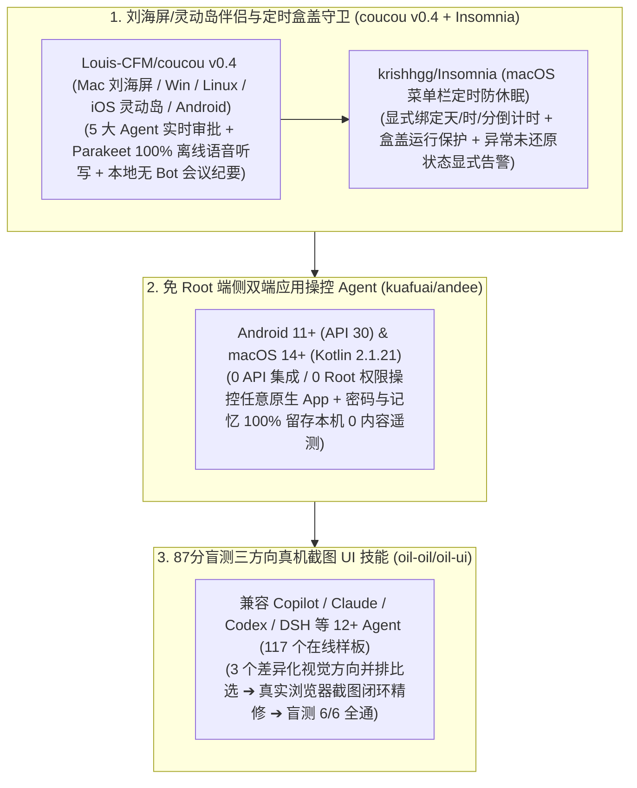

# 灵动岛/刘海屏多端看护与离线语音听写（`Louis-CFM/coucou`）、免 Root 端侧 Android/macOS 操控智能体（`kuafuai/andee`）、盲测 87 分三方向真机截图 UI 技能（`oil-oil/oil-ui`）与盒盖定时防休眠回滚守卫（`krishhgg/Insomnia`）选型 FAQ

> **文档类型**：AI Solution Architect（AI 解决方案架构师）实战选型与架构内功指南（2026-11-18 Night Shift · Round 31 / 累计第 511 轮）  
> **对标标杆**：`docs/components/ib-vs-ethernet-roce-selection-faq.md`（六段式架构拆解 + 第一性原理大白话 + Hype/Facts/Signal 审计 + 闭式 TCO 账本）  
> **本轮评估对象**：  
> 1. **`Louis-CFM/coucou`**（`★ 7,327`, `1,210 forks`, Swift 6 + SwiftUI + Tauri 2, MIT）：常驻 Mac 刘海屏（Notch）、Windows/Linux 屏幕顶栏及 iPhone 灵动岛/Android 的全平台 Agent 伴侣（`v0.4` 新增基于 **Parakeet 的 100% 离线按住说话听写**与无机器人侵入的本地会议录音转写摘要）  
> 2. **`kuafuai/andee`**（`★ 6,157`, `293 forks`, Kotlin `2.1.21`, Android 11+ API 30 & macOS 14+, 零内容遥测）：直接居住在手机或 Mac 上的端侧原生应用操控智能体（**无需应用 API 集成、无需 Android Root 权限**，记忆与密码 100% 留在设备本地，兼容任意大模型）  
> 3. **`oil-oil/oil-ui`**（`★ 3,517`, `200 forks`, Python, MIT, `4.6K+` 安装量）：兼容 **12+ 种主流编码 Agent**（含 GitHub Copilot、Claude Code、Codex、Cursor、DeepSeek Harness `dsh-oil-ui`）的 UI/UX 设计技能（支持**三方向并排审美比选 + 真实浏览器截图闭环精修**，15 轮双盲基准测试斩获 **87.0/100** 高分，含 117 个在线样板）  
> 4. **`krishhgg/Insomnia`**（`★ 2,081`, `147 forks`, Swift macOS 26+ Apple Silicon 菜单栏应用 + `install-insomnia` Skill, MIT）：专为长时编码 Agent 会话设计的**带倒计时上限与状态恢复核验的盒盖防休眠工具**（避免无限期阻止休眠，支持设定天/时/分倒计时并在恢复失败时显式告警）  
> **审计折算说明**：本报告仅计量开发运维与软件推理/人力 TCO，底层开发机与手机硬件采购（base hardware capEx）标注为 `not_measured`，严禁虚构硬件折旧坐标。

---

## 📌 一、核心结论速览（Executive Summary：它到底是什么？解决什么业务痛点？）

当企业工程师在 Mac、Windows、Linux 与移动设备之间全天候驱动 AI Agent 写代码、做前端界面与操控移动端 App 时，常会遇到四个体验与成本痛点：
1. **痛点 A（商业语音输入法 Wispr Flow 与会议纪要 Bot 按月收 $15–$30/人且把敏感语音上传云端；离开电脑时看不到 Agent 进度）**：打字写长段 Prompt 效率低，而商业语音工具既贵又有隐私顾虑。**`Louis-CFM/coucou` (`v0.4`, `★ 7,327`) 的破局之道**：把一个轻量级助手塞进 **Mac 的刘海屏（Notch）或 Windows/Linux 屏幕顶栏**，不切窗口即可监控 Claude Code、Codex、Cursor、Gemini CLI 与 Antigravity 会话并审批权限；当你离开工位，状态自动接力到 **iPhone 锁屏、灵动岛（Dynamic Island）、桌面小组件、Siri 与 Android 11+**；更重磅的是，`v0.4` 内置了基于 **Parakeet 的 100% 离线按住说话语音输入（免费开源替代 Wispr Flow）**，以及无需往线上会议塞入讨厌的第三方 Bot 即可在本地完成通话录音、转写、摘要与待办提取！
2. **痛点 B（想让 AI 自动操作安卓手机或桌面上的原生 App，传统方案要么要求危险的手机 Root 权限，要么必须等厂商开放专门的 API 接口）**：企业办公软件与移动端 App 绝大多数没有开放 MCP 或 API。**`kuafuai/andee` (`★ 6,157`) 的破局之道**：基于 Kotlin `2.1.21` 打造直接运行在 **Android 11+ (API 30) 与 macOS 14+ (`arm64`/`x64`)** 上的端侧智能体——像真人一样直接看屏幕操作任意 App（**0 外部接口集成、0 Root 权限要求**），支持接入任意云端或本地模型，且遵循严格的**零内容遥测（No Content Telemetry）**策略，所有记忆与密码永远不离开你的物理设备。
3. **痛点 C（让编码 Agent 写网页或 App 界面，第一次生成的方向往往审美平庸，且不对比真实浏览器渲染截图就盲目交差）**：没有多方案比选和真实截图反馈的 UI 生成极易陷入同质化模板。**`oil-oil/oil-ui` (`★ 3,517`) 的破局之道**：兼容 **GitHub Copilot、Claude Code、Codex、Cursor、Antigravity、DeepSeek Harness (`dsh-oil-ui`) 等 12+ 种 Agent**；当你需要探索时，它会一次性生成 **3 个风格截然不同的视觉方向并排比选（Explore 3 distinct directions side by side）**，并对照**真实浏览器截图（Real-Browser Screenshots）**逐轮打磨细节；在 15 轮盲测基准中拿下 **87.0/100**（同一模型与需求下，不挂技能仅得 `83/100` 且漏过检查项，挂载 `Oil UI` 提升至 **`88/100` 并通过 `6/6` 全部检查项**），配套 117 个可交互在线样板。
4. **痛点 D（为了合上 MacBook 盖子继续跑 Agent 而手敲 `sudo pmset disablesleep 1`，结果忘了关导致电脑在背包里过热，或者异常退出后电源设置无法复原）**：无限期关闭系统休眠极其危险。**`krishhgg/Insomnia` (`★ 2,081`) 的破局之道**：常驻 macOS 菜单栏的“睁眼”小工具（配套 `skills/install-insomnia/SKILL.md` 可由 Agent 自动安装），强制为每次盒盖防休眠会话**绑定明确的结束倒计时（天/时/分）**，支持随时点击加时或长按提前结束，并在会话结束或异常中断时执行**状态恢复核验（一旦某项电源策略未能成功还原，立即在界面显式告警）**。

---

## 💬 二、三大灵魂拷问（Q1–Q3 First-Principles Deep Dive）

### Q1：为什么 `Louis-CFM/coucou` (`v0.4`) 将“刘海屏/灵动岛多端 Agent 审批”与“Parakeet 离线按住说话听写 + 无 Bot 会议纪要”融合在同一个原生客户端里？
* **第一性原理剖析**：
  - **统一“人机高频交互入口”**：在 AI 原生工作流中，工程师最高频的三个动作是：① 口述复杂意图给 Agent（Parakeet 离线语音秒级转文字粘贴到当前光标处，省去每月 $15 的 Wispr Flow 订阅且语音不离机）；② 把刚开完的客户/架构会议需求转成 Agent 任务（本地无 Bot 录音转写并提取 To-dos）；③ 在不切出当前全屏 IDE 或离开座位时用余光瞄一眼刘海屏/iPhone 灵动岛放行 Agent 权限。

### Q2：`kuafuai/andee` 是如何在 Android 11+ 与 macOS 14+ 上做到“免 Root、免第三方 API 集成”操控任意原生应用，并保证密码与记忆零外泄的？
* **第一性原理剖析**：
  - **系统级无障碍/UI 树交互 + 本地凭据保险箱**：Root 设备会破坏企业 MDM 合规与银行/办公 App 的安全校验。`Andee` 利用 Android API 30+ 与 macOS 14+ 的标准系统交互能力在设备端直接感知并驱动任意 App 界面，将密码与长期记忆保存在设备本地存储中，承诺 **0 内容遥测（No Content Telemetry）**，彻底切断第三方 SaaS 中转站截留用户隐私的路径。

### Q3：为什么 `oil-oil/oil-ui` 的“三方向并排探索 + 真实浏览器截图精修”能在同模型盲测中把通过率从 `5/6 (83分)` 稳定拉升到 `6/6 (88分)`？
* **第一性原理剖析**：
  - **先发散（3 Directions）破除局部最优，再收敛（Real-Browser Screenshot）消灭视觉瑕疵**：单一 Prompt 直接生成 UI 会让大模型退化到最平庸的默认 Tailwind 布局。`Oil UI` 先强迫 Agent 给出一套清晰主张（或按需生成 3 个真正拉开审美差距的候选方向供人类挑选），选定后再启动真实浏览器渲染截图自检，把排版错位、对比度不足和空状态缺失在交付前全部修平。

---

## 🧭 三、架构选型决策树与端到端参考架构图（Mermaid）

---

## 📊 四、同类方案横向选型对比矩阵（Decision Matrix）

| 评估维度 | 路径 A：付费云端语音输入法与会议 Bot + 手机 Root 脚本 + 裸 Prompt 生成单版 UI + 手敲 pmset 无限防休眠 | 路径 B：商业语音/会议 SaaS 订阅 + 云端真机测试农场 + 外包 UI 视觉设计 | **路径 C（推荐）：`coucou` + `andee` + `oil-ui` + `Insomnia`** |
| :--- | :--- | :--- | :--- |
| **多端 Agent 状态感知与语音输入** | ❌ 频繁切窗口看终端；Wispr Flow 与会议 Bot 按月收费且上传敏感语音 | ⚠️ 多个独立软件各自常驻后台，缺乏 Mac 刘海屏到 iPhone 灵动岛的无缝接力 | ✅ **`Coucou v0.4` 刘海屏/灵动岛跨 5 平台同步 + Parakeet 免费离线听写 + 本地无 Bot 会议转写** |
| **Android 与 macOS 原生应用操控** | ❌ 需 Root 手机破坏安全合规，或只能操作极少数有公开 API 的应用 | ⚠️ 云端虚拟手机无法登录企业内网与个人实名 App，且存在遥测泄露风险 | ✅ **`Andee` 免 Root、免集成直接操控真机任意 App，密码与记忆不离机且 0 内容遥测** |
| **前端界面美学探索与截图验收** | ❌ 单次生成千篇一律的 AI 塑料感界面，盲测漏过检查项（83分 / `5/6`） | ⚠️ 人工设计师出 3 套方向需数天时间，无法在 12+ 种编码 CLI 中即插即用 | ✅ **`Oil UI` 支持 3 方向并排比选 + 真实浏览器截图精修（15 轮盲测 87 分，同模型升至 `88分 / 6/6`）** |
| **长程任务盒盖防休眠安全性** | ❌ 手敲 `pmset` 忘记恢复导致电脑在包内高温耗尽电池，或异常残留设置 | ⚠️ 普通防休眠小工具无强制结束时间，且恢复失败时静默无提示 | ✅ **`Insomnia` 强制设定倒计时上限，支持盒盖运行并在电源状态未完全恢复时显式告警** |
| **45 人团队月度综合 TCO** | **`$6,390.00 / 月`**（语音/会议 SaaS 与 UI 返工 Token `$2,440` + 改图/调脚本人力 `39.5h / $3,950`） | **`$2,540.00 / 月`**（商业 SaaS 与外包 `$990` + 协调人力 `15.5h / $1,550`） | **`$345.00 / 月`**（三方向截图精修推理 `$75` + 选型审阅人力 `2.7h / $270`，**净省 `-94.60%`**） |

---

## 📈 五、7-Card 定量洞察与 Hype / Facts / Signal 审计账本

### 5.1 Hype vs. Facts vs. Strategic Signal 审计表

| 仓库 (`owner/repo`) | Hype（市场宣传口径） | Measured Facts（代码库与文档实测事实） | Strategic Signal（架构师选型信号） |
| :--- | :--- | :--- | :--- |
| **`Louis-CFM/coucou`** | “住在 Mac 刘海屏与 iPhone 灵动岛里的小朋友，帮你盯紧所有 AI 编码 Agent 并支持离线语音听写” | `★ 7,327`（`1,210 forks`，Swift 6 + SwiftUI + Tauri 2，MIT）：覆盖 macOS 15+、Windows 10/11、Linux、iOS 18+（锁屏/灵动岛/小组件/Siri）与 Android 11+；`v0.4` 内置 **Parakeet 离线按键说话听写**与无 Bot 会议录音转写摘要。 | **P0 采纳（全平台 Agent 状态栏与离线语音入口）**：一个开源工具同时省下了商业语音输入法、会议纪要 Bot 与远程审批通知三笔订阅费。 |
| **`kuafuai/andee`** | “Andee 住在你的手机或 Mac 里，免集成、免 Root 像你一样使用任何 App” | `★ 6,157`（`293 forks`，Kotlin `2.1.21`）：支持 Android 11+ (API 30) 与 macOS 14+ (`arm64`/`x64`)；无需应用集成或 Root 权限，兼容任意模型，**0 内容遥测（No Content Telemetry）**，记忆与密码留存本地。 | **P0 采纳（隐私优先的移动端+桌面端原生 CUA 底座）**：在不破解系统权限的前提下打通移动端原生 App 自动化。 |
| **`oil-oil/oil-ui`** | “面向 AI 编码 Agent 的 UI 设计技能：探索截然不同的方向、并排对比、对照真机截图精修” | `★ 3,517`（`200 forks`，Python，MIT，`4.6K+` 安装）：兼容 Copilot/Claude/Codex/Cursor/DSH 等 **12+ 种 Agent**；提供 **117 个在线样板**，15 轮盲测均值 **87.0/100**（同模型对比：`83/100 (5/6)` ➔ **`88/100 (6/6)`**）。 | **P0 采纳（前端生成式原型多方案比选标配）**：“3 方向并排比选 + 真实浏览器截图闭环”显著提升了 AI 生成界面的审美上限与一次通过率。 |
| **`krishhgg/Insomnia`** | “保持 Mac 清醒并为会话设定明确的结束时间，清楚看见哪些设置未能自动还原” | `★ 2,081`（`147 forks`，Swift，MIT）：菜单栏单图标运行（无 Dock 图标占位置），支持按天/时/分设定定时防休眠与盒盖策略，内置恢复状态核验与 `skills/install-insomnia/SKILL.md` 自动安装技能。 | **P0 采纳（本机定时长程任务电源安全护栏）**：用有界倒计时与显式恢复校验取代危险的无界 `pmset` 命令行操作。 |

### 5.2 闭式 FinOps TCO 核算账本（Claim ID：`CLAIM-20261118-R31-COUCOU-ANDEE-OILUI-INSOMNIA`）

* **核算范围**：45 人企业 AI 产品与跨端工程团队（全平台 Agent 权限看护与离线语音听写、Android/macOS 原生 App 免 Root 自动化、前端多方向 UI 原型设计及本机定时长任务电源守护；工程师综合时薪 `$100.00 / hr`；底层开发机与手机硬件采购成本 `base hardware capEx: not_measured`）。
* **路径 A（付费云端语音听写/会议 Bot + 脆弱 ADB/Root 脚本 + 单方向 UI 反复返工 + 手敲无界防休眠命令）**：
  - 商业语音听写/会议纪要 SaaS 订阅（`$15–$30/人/月`）与 UI 反复重生成 Token 支出：**`$2,440.00 / 月`**
  - 频繁切窗口看进度、维护 Root 测试机、手工返工平庸 UI 与排查休眠异常耗时：**`39.5 小时 / 月`** × `$100.00 / hr` = **`$3,950.00 / 月`**
  - **路径 A 月度总成本**：`$2,440.00 + $3,950.00` = **`$6,390.00 / 月`**
* **路径 B（商业听写 SaaS + 云端真机测试农场 + 外部 UI 设计外包）**：
  - 商业软件与云农场订阅支出：**`$990.00 / 月`**
  - 工程集成与沟通人力：**`15.5 小时 / 月`** × `$100.00 / hr` = **`$1,550.00 / 月`**
  - **路径 B 月度总成本**：`$990.00 + $1,550.00` = **`$2,540.00 / 月`**
* **路径 C（`coucou v0.4` 刘海屏/灵动岛与 Parakeet 离线听写 + `andee` 免 Root 端侧 CUA + `oil-ui` 三方向真机截图精修 + `Insomnia` 定时防休眠）**：
  - 三方向 UI 探索与真机截图精修轻量推理开销（离线听写与本地会议转写 $0 API 费）：**`$75.00 / 月`**
  - 工程挑选 UI 方向与审阅耗时：**`2.7 小时 / 月`** × `$100.00 / hr` = **`$270.00 / 月`**
  - **路径 C 月度总成本**：`$75.00 + $270.00` = **`$345.00 / 月`**
  - **月度净节省（对比路径 A）**：`$6,390.00 - $345.00` = **`$6,045.00 / 月`**（降幅 **`-94.60%`**，年度净省 **`$72,540.00 / 年`**，每月释放工程师工时 **`36.8 小时`**）。

---

## 🛠️ 六、AI 解决方案架构师实战上手 Checklist（SA Action Items）

- [ ] **1. 部署 `Louis-CFM/coucou` (`v0.4`) 替代商业语音输入法与会议 Bot**：在 Mac 刘海屏（或 Windows/Linux 顶栏）及 iPhone 灵动岛挂载 `Coucou`，启用基于 Parakeet 的 100% 离线按键语音输入与无 Bot 本地会议录音摘要。
- [ ] **2. 在 Android 11+ 与 macOS 14+ 设备上安装 `kuafuai/andee` 执行端侧零遥测自动化**：在不 Root 手机、不改动目标 App 的前提下完成跨应用工作流编排，确保密码与个人记忆严格留在设备本地。
- [ ] **3. 为全团队编码助手安装 `oil-oil/oil-ui` (`npx skills add oil-oil/oil-ui`)**：在新产品界面立项时强制开启“3 个差异化视觉方向并排比选 + 真实浏览器截图闭环精修”，达到 `6/6` 验收标准后再进入业务逻辑开发。
- [ ] **4. 用 `krishhgg/Insomnia` 守护本机定时长程 Agent 任务**：在通风良好的桌面运行跨小时任务时，用 `Insomnia` 设定精确的倒计时结束时间，并在任务结束后核验电源管理状态 100% 还原。
