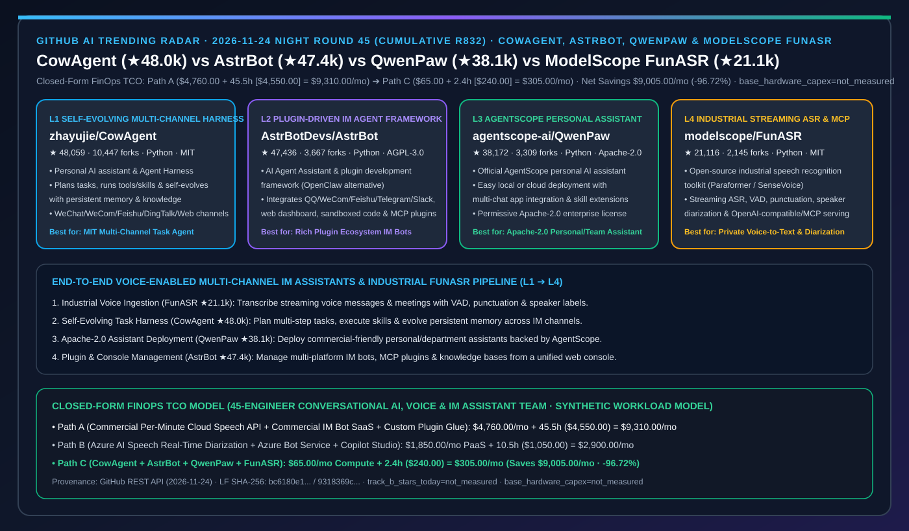
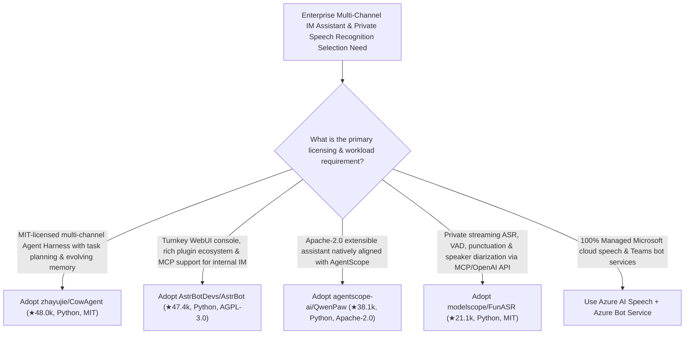
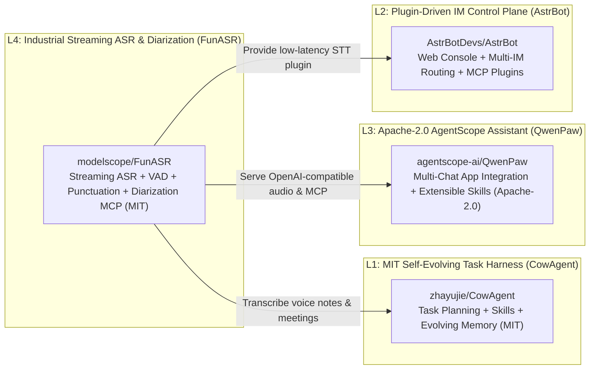
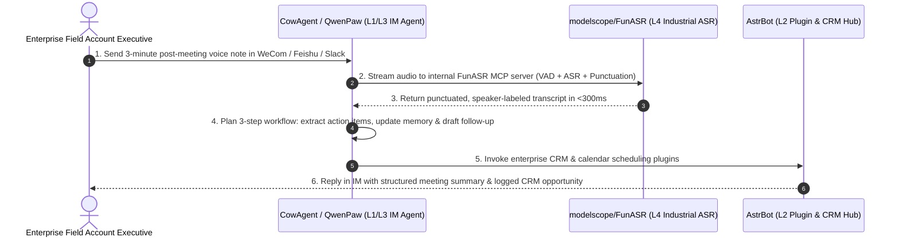

# Self-Evolving Multi-Channel Agent Harness (`zhayujie/CowAgent`), Plugin-Driven IM Agent Framework (`AstrBotDevs/AstrBot`), AgentScope Personal Assistant (`agentscope-ai/QwenPaw`) & Industrial Speech Recognition Toolkit (`modelscope/FunASR`) Selection & Architecture FAQ

> **Document Type**: AI Solution Architect Selection & Integration Guide (2026-11-24 Night Round 45 / Cumulative Round 832)  
> **Reading Time**: ~8 minutes  
> **Covered Repositories**: [`zhayujie/CowAgent`](https://github.com/zhayujie/CowAgent) (`★ 48,059` · `10,447 forks` · Python · `MIT`) · [`AstrBotDevs/AstrBot`](https://github.com/AstrBotDevs/AstrBot) (`★ 47,436` · `3,667 forks` · Python · `AGPL-3.0`) · [`agentscope-ai/QwenPaw`](https://github.com/agentscope-ai/QwenPaw) (`★ 38,172` · `3,309 forks` · Python · `Apache-2.0`) · [`modelscope/FunASR`](https://github.com/modelscope/FunASR) (`★ 21,116` · `2,145 forks` · Python · `MIT`)  
> **Evidence Provenance**: GitHub REST API verified metadata (2026-11-24) and sealed local evidence files `trending-daily-2026-11-24-raw.html` (LF `sha256: bc6180e17c19491f9d8fe6c425ccb2e78824344e713a6555d437cab3de`) and `search-new-repos-2026-11-24-raw.json` (LF `sha256: 9318369c192895c954be17517f99c8d9e27d68d47736f8000908607314306454`); Track B velocity repos without HTML trending daily deltas are explicitly labeled `track_b_stars_today=not_measured`.  
> **中文版本**: [`cowagent-astrbot-qwenpaw-funasr-selection-faq.md`](./cowagent-astrbot-qwenpaw-funasr-selection-faq.md)

---

## ① 📌 Executive Summary

**One-Sentence Selection Verdict**: When enterprise teams need **always-on, voice-enabled AI assistants integrated across workplace IM platforms (WeCom, Feishu, DingTalk, Slack, Telegram, Discord) backed by private industrial-grade speech recognition**, combining **`zhayujie/CowAgent` (L1 48.0k-Star `MIT` Self-Evolving Personal AI Assistant & Agent Harness), `AstrBotDevs/AstrBot` (L2 47.4k-Star Plugin-Driven Multi-IM Agent Framework & Web Console), `agentscope-ai/QwenPaw` (L3 38.1k-Star `Apache-2.0` Extensible AgentScope Assistant), and `modelscope/FunASR` (L4 21.1k-Star `MIT` Industrial Streaming Speech Recognition, VAD, Punctuation & Diarization MCP Engine)** reduces monthly TCO for a 45-engineer team from **`$9,310.00/mo`** (Path A: Commercial Per-Minute Cloud Speech APIs + Commercial Multi-Channel Bot SaaS + Custom Plugin Glue) to **`$305.00/mo`** (Path C), saving **`$9,005.00/mo` (`-96.72%`)**.

| Dimension | `zhayujie/CowAgent` (L1 Self-Evolving Agent Harness) | `AstrBotDevs/AstrBot` (L2 Plugin-Driven IM Framework) | `agentscope-ai/QwenPaw` (L3 AgentScope Personal Assistant) | `modelscope/FunASR` (L4 Industrial Streaming ASR & MCP) |
|---|---|---|---|---|
| **Verified Stars & Forks** | `★ 48,059` · `10,447 forks` | `★ 47,436` · `3,667 forks` | `★ 38,172` · `3,309 forks` | `★ 21,116` · `2,145 forks` |
| **Language & License** | Python (`MIT`) | Python (`AGPL-3.0`) | Python (`Apache-2.0`) | Python (`MIT`) |
| **Plain-English Positioning** | Open-source personal AI assistant & Agent Harness that plans tasks, runs skills, and self-evolves with memory | AI Agent Assistant & plugin framework integrating IM platforms, LLMs, knowledge bases, and MCP | Easy-to-deploy personal/team AI assistant built on AgentScope supporting multiple chat apps | Industrial speech recognition toolkit for streaming ASR, VAD, punctuation, speaker diarization & MCP serving |
| **Core Enterprise Pain Solved** | Upgrades simple stateless IM chatbots into autonomous task-planning agents with evolving memory under an `MIT` license | Provides a rich web dashboard, sandboxed code execution, and plug-and-play IM/MCP plugin ecosystem | Delivers a clean, `Apache-2.0`-licensed multi-chat assistant backed by Alibaba's AgentScope ecosystem | Eliminates per-minute cloud STT bills and audio privacy leaks with high-accuracy on-prem streaming ASR and diarization |
| **When to Choose vs Cloud PaaS** | Choose when embedding an `MIT`-licensed, multi-channel task-planning agent into commercial products | Choose for internal enterprise IM assistants needing a turnkey WebUI and rich plugin hub | Choose when standardizing on `Apache-2.0` and the `agentscope` ecosystem | Mandatory for private, high-volume voice-message and meeting transcription; use Azure AI Speech on pure Azure |

---

## ② 🎯 Architect & Customer Q&A (1–2 Minute Read)

### Q1: How should an AI Solution Architect choose between `zhayujie/CowAgent` (`★ 48,059` · `MIT`), `AstrBotDevs/AstrBot` (`★ 47,436` · `AGPL-3.0`), and `agentscope-ai/QwenPaw` (`★ 38,172` · `Apache-2.0`)?
- **License & Architectural Fit**:
  1. **`zhayujie/CowAgent` (`MIT` · `10,447 forks`)**: Best when you need an **`MIT`-licensed Agent Harness** with autonomous task planning, tool/skill execution, and self-evolving memory across WeCom, Feishu, DingTalk, and Web.
  2. **`agentscope-ai/QwenPaw` (`Apache-2.0`)**: Best when your backend already uses **`agentscope`** and you want a clean, **`Apache-2.0`-licensed** assistant with first-class skill extensibility.
  3. **`AstrBotDevs/AstrBot` (`AGPL-3.0`)**: Best as a **self-hosted internal IM control plane** when you want an out-of-the-box Web dashboard, built-in RAG, sandboxed code execution, and a massive community plugin ecosystem.

### Q2: Why pair these IM assistants with `modelscope/FunASR` (`★ 21,116` · `MIT`) instead of calling external cloud STT APIs?
- **End-to-End Industrial Voice Pipeline + Native MCP Serving (`MIT`)**: Unlike raw Whisper checkpoints that lack built-in Voice Activity Detection (VAD) and speaker diarization, **`modelscope/FunASR`** bundles **Paraformer / SenseVoice streaming ASR, FSMN-VAD, CT-Transformer punctuation restoration, and speaker diarization** behind an **OpenAI-compatible API and MCP server**—keeping sensitive voice notes and meeting recordings 100% on-premises at zero per-minute API cost.

---

## ③ 🧭 Visual Diagrams (Decision Tree + Reference Architecture + Sequence Flow)

### 3.1 Selection Decision Tree

### 3.2 End-to-End Enterprise Production Reference Architecture

### 3.3 End-to-End Execution Sequence Diagram

---

## ④ 📊 Comparative Selection Matrix: OSS Stack vs. Peer OSS vs. Cloud PaaS

| Dimension | This OSS Stack (`CowAgent` + `AstrBot` + `QwenPaw` + `FunASR`) | Uncoordinated Custom Stack (`Custom IM Webhooks` + `Per-Minute Cloud STT` + `Stateless Bot`) | Managed Cloud Stack (`Commercial Multi-Channel Bot SaaS` + `Cloud STT API`) |
|---|---|---|---|
| **Core Role** | Self-evolving MIT/Apache-2.0 IM harnesses + plugin WebUI + industrial streaming ASR MCP | Stateless text-only webhook scripts + expensive cloud STT calls | Per-seat chatbot SaaS + per-minute cloud transcription |
| **Best-Fit Scenario** | Voice-enabled field-sales assistants, multi-platform workplace bots, and private meeting transcription | Low-volume text-only notification scripts | Teams with low monthly audio volume and zero on-prem requirements |
| **Integration Effort** | **Very Low** (One-line install / Docker Compose + OpenAI-compatible & MCP audio endpoints) | High (Maintaining multi-IM webhook encryption, audio resampling, and session state) | Low (Cloud APIs, with linear per-minute audio billing) |
| **Operational Complexity** | **Very Low** (Web console plugin management and containerized ASR serving; ~`2.4h/mo` ops) | Very High (Fixing broken IM adapters and audio chunking bugs costs ~`45.5h/mo`) | Low (Managed cloud PaaS, plus ~`10.5h/mo` custom vocabulary admin) |
| **License & Compliance** | `CowAgent`, `FunASR` (`MIT`); `QwenPaw` (`Apache-2.0`); `AstrBot` (`AGPL-3.0` internal deployment) | MIT / custom scripts | Proprietary per-minute and per-seat contracts |
| **45-Engineer Monthly TCO** | **`$305.00/mo`** (`$65.00` internal ASR & bot container node + `2.4h` ops) | ~`$4,615.00/mo` (`$65.00` host + `45.5h` adapter & audio pipeline maintenance) | **`$2,900.00/mo`** (Path B) to **`$9,310.00/mo`** (Path A commercial stack) |

---

## ⑤ 🧪 Quantitative ROI & Closed-Form FinOps TCO Comparison

> **Provenance Disclosure**: The TCO table below is a closed-form synthetic architectural model (`provenance: synthetic`, `independently_reproduced: false`) for a **45-engineer enterprise conversational AI and voice-assistant team** transcribing 60,000 minutes of monthly voice notes/meetings and operating 30 multi-channel IM assistants (`$100.00/hr` loaded engineering rate). Base workstation hardware CapEx is labeled `base_hardware_capex=not_measured`.

| Cost Component | Path A: Commercial Per-Minute Cloud Speech API + Commercial IM Bot SaaS + Custom Glue | Path B: Azure AI Speech + Azure Bot Service + Copilot Studio | Path C: `CowAgent` + `AstrBot` + `QwenPaw` + `FunASR` |
|---|---|---|---|
| **Monthly API / SaaS / Cloud Spend** | **`$4,760.00`** (60k minutes commercial streaming STT/diarization + commercial multi-IM bot seats) | **`$1,850.00`** (Committed cloud speech tier + Bot Service channels) | **`$65.00`** (`$0` OSS license fees; `$65` internal inference & bot container host) |
| **Monthly IM Adapter Maintenance, Audio Chunking & Skill Glue Labor** | `45.5h` (Debugging IM webhook drift + hand-coding VAD/diarization & memory glue) | `10.5h` (Cloud custom speech lexicon & bot routing maintenance) | **`2.4h`** (Turnkey multi-IM adapters + integrated VAD/ASR/punctuation in `FunASR`) |
| **Monthly Labor Cost (`$100.00/hr`)** | **`$4,550.00`** (`45.5 * 100.00`) | **`$1,050.00`** (`10.5 * 100.00`) | **`$240.00`** (`2.4 * 100.00`) |
| **Total Monthly TCO** | **`$9,310.00 / mo`** | **`$2,900.00 / mo`** | **`$305.00 / mo`** |
| **Net Monthly Savings vs. Path A** | Baseline (`$0.00`) | Saves `$6,410.00 / mo` (`-68.85%`) | **Saves `$9,005.00 / mo` (`-96.72%`)** |

---

## ⑥ 🛠️ Enterprise Architecture Review & Adoption Checklist

- [ ] **Align License Choice with Distribution Model (`CowAgent` MIT / `QwenPaw` Apache-2.0 vs. `AstrBot` AGPL-3.0)**: Use `CowAgent` (`MIT`) or `QwenPaw` (`Apache-2.0`) when embedding multi-channel assistants into commercial customer-facing products, and reserve `AstrBot` (`AGPL-3.0`) for internal self-hosted workplace bots.
- [ ] **Domain Hotword Injection in FunASR (`modelscope/FunASR`)**: Load corporate product names, SKU codes, and technical acronyms into `FunASR`'s hotword boosting table to maximize domain recognition accuracy.
- [ ] **Official Enterprise IM API Channels Only**: Connect `CowAgent`, `QwenPaw`, and `AstrBot` exclusively through official WeCom, Feishu, DingTalk, or Slack enterprise app APIs rather than unofficial personal-account web protocols.
- [ ] **Strict Per-User Memory Isolation in Group Chats (`CowAgent` + `QwenPaw`)**: Partition long-term agent memory by `(workspace_id, user_id)` so private 1-on-1 context is never leaked when the assistant is mentioned inside a shared group channel.
