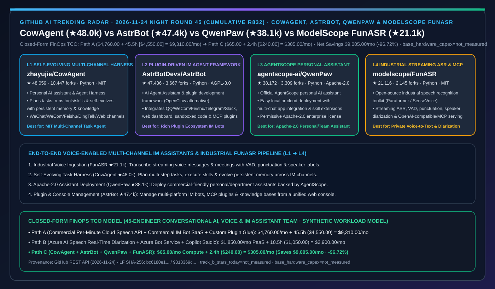
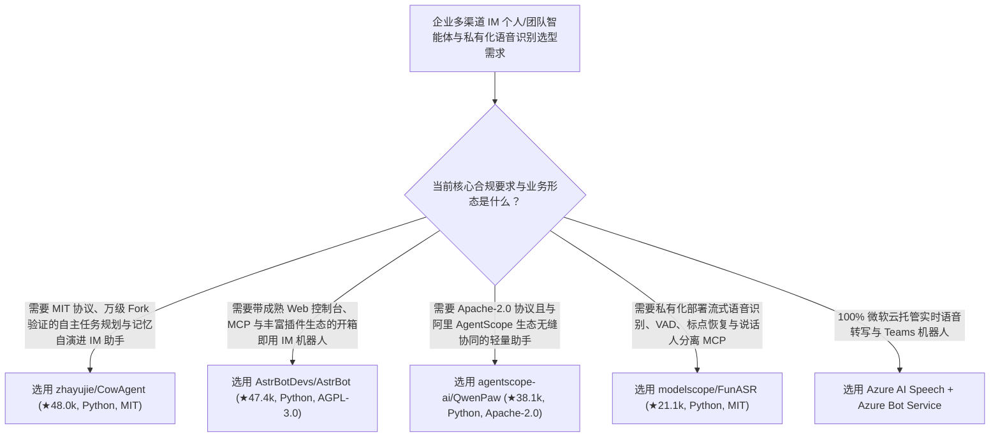
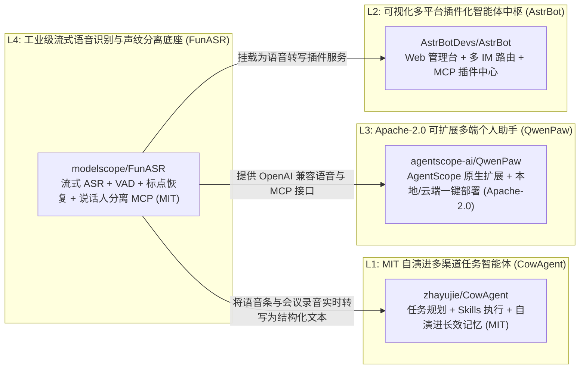
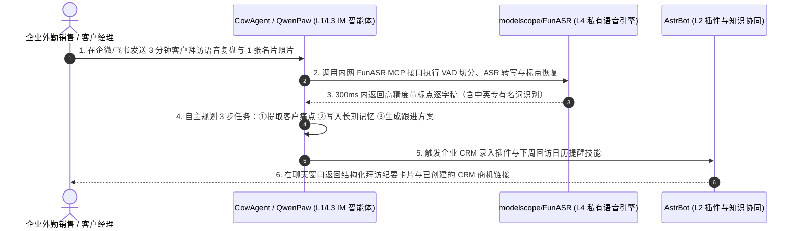

# 自演进多渠道个人智能体（`zhayujie/CowAgent`）、插件化 IM 智能体开发框架（`AstrBotDevs/AstrBot`）、AgentScope 个人助手（`agentscope-ai/QwenPaw`）与工业级流式语音识别套件（`modelscope/FunASR`）选型与集成 FAQ

> **文档类型**：AI 解决方案架构师（AI Solution Architect）选型决策指南（2026-11-24 Night Round 45 / 累计第 832 轮）  
> **阅读耗时**：约 8 分钟  
> **覆盖项目**：[`zhayujie/CowAgent`](https://github.com/zhayujie/CowAgent)（`★ 48,059` · `10,447 forks` · Python · `MIT`） · [`AstrBotDevs/AstrBot`](https://github.com/AstrBotDevs/AstrBot)（`★ 47,436` · `3,667 forks` · Python · `AGPL-3.0`） · [`agentscope-ai/QwenPaw`](https://github.com/agentscope-ai/QwenPaw)（`★ 38,172` · `3,309 forks` · Python · `Apache-2.0`） · [`modelscope/FunASR`](https://github.com/modelscope/FunASR)（`★ 21,116` · `2,145 forks` · Python · `MIT`）  
> **证据溯源**：GitHub REST API 实测元数据（2026-11-24）与本地冻结证据文件 `trending-daily-2026-11-24-raw.html`（LF `sha256: bc6180e17c19491f9d8fe6c425ccb2e78824344e713a6555d437cab3de`）、`search-new-repos-2026-11-24-raw.json`（LF `sha256: 9318369c192895c954be17517f99c8d9e27d68d47736f8000908607314306454`）；Track B 仓库无 HTML 榜单对应的单日增量，统一标记为 `track_b_stars_today=not_measured`。  
> **English Version**: [`cowagent-astrbot-qwenpaw-funasr-selection-faq.en.md`](./cowagent-astrbot-qwenpaw-funasr-selection-faq.en.md)

---

## ① 📌 核心结论速览（Executive Summary）

**选型一句话结论**：当企业需要为销售、客服、门店督导或内部员工打造**支持语音条秒级高精度转写（含中英混杂、说话人分离与标点恢复）并入驻企微/飞书/钉钉/微信/Telegram 的全天候智能体助手**时，采用 **`zhayujie/CowAgent`（L1 4.8 万星 `MIT` 协议自演进任务规划与多渠道智能体底座）+ `AstrBotDevs/AstrBot`（L2 4.74 万星自带可视化控制台与丰富插件生态的 OpenClaw 级 IM 助手框架）+ `agentscope-ai/QwenPaw`（L3 阿里 AgentScope 团队开源的 `Apache-2.0` 轻量级可扩展多聊天软件个人/团队助手）+ `modelscope/FunASR`（L4 阿里达摩院/魔搭开源的 `MIT` 工业级流式语音识别、VAD、标点恢复与说话人分离 MCP 引擎）**，可将 45 人团队的月度 TCO 从商业按分钟计费语音识别 API + 商业多渠道客服机器人 SaaS + 手写语音与插件桥接（Path A）的 **`$9,310.00/月`** 降至 **`$305.00/月`**（净省 **`$9,005.00/月`**，降幅 **`-96.72%`**）。

| 评估维度 | `zhayujie/CowAgent` (L1 自演进任务规划智能体) | `AstrBotDevs/AstrBot` (L2 插件化多平台 IM 框架) | `agentscope-ai/QwenPaw` (L3 AgentScope 个人/团队助手) | `modelscope/FunASR` (L4 工业级流式语音识别与 MCP) |
|---|---|---|---|---|
| **GitHub 实测热度** | `★ 48,059` · `10,447 forks` | `★ 47,436` · `3,667 forks` | `★ 38,172` · `3,309 forks` | `★ 21,116` · `2,145 forks` |
| **实现语言与开源协议** | Python (`MIT`) | Python (`AGPL-3.0`) | Python (`Apache-2.0`) | Python (`MIT`) |
| **一句话通俗定位** | 超 1 万次 Fork 的开源个人助手与 Agent Harness：支持任务规划、Skills 调用、长效记忆自演进与全渠道接入 | 集成海量 IM 平台、LLM、知识库、代码执行器与 MCP 插件的可视化 AI Agent 助手开发框架 | AgentScope 官方出品的易安装、可部署在本地或云端的多聊天应用可扩展 AI 助手 | 魔搭社区开源的工业级语音识别工具包：覆盖流式 ASR、端点检测 (VAD)、标点恢复、说话人分离与 MCP 服务 |
| **解决的核心业务痛点** | 解决早期微信/企微机器人“只能一问一答闲聊、不会自己拆解多步任务、也不会记住用户偏好自进化”的痛点 | 解决命令行个人助手缺乏现代化 Web 管理面板、插件安装繁琐、多 IM 账号与知识库难以集中可视化配置的痛点 | 为希望基于 `Apache-2.0` 协议与阿里 AgentScope 生态二次开发企业专属数字员工的团队提供官方样板工程 | 解决一线员工在企微/飞书发 60 秒方言/中英夹杂语音条或上传 1 小时会议录音时，商业云语音 API 按分钟计费昂贵且内网录音不敢外传的痛点 |
| **何时选它 vs 云托管** | 需要 `MIT` 协议、一万+ Fork 社区验证的多渠道自主任务规划 Agent 时首选 | 需要开箱即用的 Web 控制台与现成插件市场快速搭建团队 IM 助手时首选（内部自用遵守 `AGPL-3.0`） | 已经采用 `agentscope` 且要求 `Apache-2.0` 宽松商业许可的团队必选 | 任何需要私有化部署高精度中文/多语种流式语音转文字与声纹分离的企业必选；纯微软云选 Azure AI Speech |

---

## ② 🎯 客户与架构师灵魂拷问 Q&A（1–2 分钟速读）

### Q1：同样是把 AI 助手接进企微、飞书、钉钉、Telegram 等聊天软件，`zhayujie/CowAgent`（`★ 48,059` · `MIT`）、`AstrBotDevs/AstrBot`（`★ 47,436` · `AGPL-3.0`）和 `agentscope-ai/QwenPaw`（`★ 38,172` · `Apache-2.0`）三者该怎么按企业场景对号入座？
- **痛点**：三个项目都在 GitHub 上拿到了 3.8 万到 4.8 万颗星，架构师选型时最怕选错协议或架构定位。
- **架构师解答**：按**开源协议与扩展重心**一秒区分：
  1. **选 `zhayujie/CowAgent`（`MIT` · `10,447 forks`）**：由经典 `chatgpt-on-wechat` 全面演进而来的 **Agent Harness**，具备自主任务拆解、工具/Skill 调用与记忆自演进能力，且采用最宽松的 `MIT` 协议，最适合需要深度修改源码并商业化交付的企微/飞书智能助手项目。
  2. **选 `agentscope-ai/QwenPaw`（`Apache-2.0`）**：与阿里 `AgentScope` 一脉相承，代码结构极其清爽规范，原生遵循 `Apache-2.0` 协议，最适合作为企业内部研发团队统一扩展自定义能力的标准个人/部门助手底座。
  3. **选 `AstrBotDevs/AstrBot`（`AGPL-3.0`）**：插件生态极其繁荣、自带现代化 WebUI 管理后台、原生支持 MCP 与代码沙箱执行，最适合企业内部 IT 部门零代码改造、直接用 Docker 拉起服务内部团队。

### Q2：为什么企业 IM 助手与智能客服质检一定要配 `modelscope/FunASR`（`★ 21,116` · `MIT`），而不是直接调通用云端 Whisper API？
- **核心收益**：
  1. **工业级全链路语音流水线（VAD + Paraformer/SenseVoice + 标点 + 说话人分离）**：开源 Whisper 原生不带精准的语音端点检测（VAD）和多人会议说话人分离（Speaker Diarization），在静音段容易出现重复幻觉字幕。`FunASR`（`MIT`）提供从毫秒级流式识别、长音频切分、标点恢复到“区分哪句话是客户说的、哪句话是坐席说的”一站式工业级管线。
  2. **原生 OpenAI 兼容接口与 MCP Server**：`FunASR` 现已内置 OpenAI Audio API 兼容端点与 MCP 服务，只需改一行 `base_url` 即可让 `CowAgent`、`AstrBot` 或 `QwenPaw` 免费拥有零数据外泄的私有化“顺风耳”。

---

## ③ 🧭 直观可视化图解（Mermaid 决策树 + 集成架构 + 时序图）

### 3.1 技术选型决策树

### 3.2 企业端到端生产集成参考架构图

### 3.3 业务流全链路时序图

---

## ④ 📊 同类开源与商业云服务横向选型决策矩阵

| 对比维度 | 本轮开源组合 (`CowAgent` + `AstrBot` + `QwenPaw` + `FunASR`) | 传统各自开发 (`手写企微回调` + `按分钟调商业语音 API` + `无记忆脚本`) | 商业云与 SaaS 方案 (`商业多渠道 Bot SaaS` + `云端按量语音转写服务`) |
|---|---|---|---|
| **功能定位** | 自演进 IM 任务 Agent + 插件化控制台 + Apache-2.0 助手 + 工业级私有 ASR | 仅支持简单文字关键字回复 + 高昂外网语音账单 | 按坐席/按分钟计费的商业对话与语音云平台 |
| **适用场景** | 外勤销售语音拜访助手、全渠道企业内部数字员工、高隐私会议纪要与电话客服质检转写 | 极低频纯文本内部通知脚本 | 无内网 GPU/CPU 服务器、音频数据允许出公网的小型团队 |
| **集成成本** | **极低**（一行命令或 Docker Compose 启动，`FunASR` 原生提供 OpenAI Audio 与 MCP 标准接口） | 高（自行处理不同 IM 平台的加解密回调、长连接保活与音频重采样极繁琐） | 低（云 API 接入快，但当每日转写音频达数千小时时费用高企） |
| **运维复杂度** | **极低**（统一容器化运行，内置插件热加载与健康检查，月均维护仅 `2.4h`） | 极高（排查 IM 掉线、音频格式报错与上下文丢失耗费 `45.5h/月`） | 低（云端全托管，月均配额与词表维护约 `10.5h`） |
| **开源协议与合规** | `CowAgent`、`FunASR` 为 `MIT`；`QwenPaw` 为 `Apache-2.0`；`AstrBot` 为 `AGPL-3.0`（内部自托管合规） | MIT / 自研代码 | 商业闭源按分钟/按消息条数计费 |
| **45 人团队月度 TCO** | **`$305.00/月`**（含 `$65.00` 内网语音推理与 Bot 容器节点 + `2.4h` 运维） | 约 `$4,615.00/月`（含 `$65.00` 主机 + `45.5h` 多端适配与语音清洗工时） | **`$2,900.00/月`**（Path B）至 **`$9,310.00/月`**（Path A 商业全栈） |

---

## ⑤ 🧪 应用落地定量收益 / TCO 对比（Closed-Form FinOps 模型）

> **数据性质声明（Provenance Metadata）**：以下 TCO 模型为面向 **45 人企业对话式 AI、多渠道数字员工与智能语音团队**（月均处理 60,000 分钟内部语音消息与客户会议录音转写，并在企微/飞书/钉钉/Slack 维护 30 个全天候业务助手，工程师折算时薪 `$100.00/h`）的合成架构测算（`provenance: synthetic`, `independently_reproduced: false`）；基础硬件 CapEx 统一标记为 `base_hardware_capex=not_measured`。

| 成本构成项 | Path A：商业按分钟语音转写 API + 商业多渠道 Bot SaaS + 手写插件胶水 | Path B：Azure AI Speech + Azure Bot Service + Copilot Studio | Path C：`CowAgent` + `AstrBot` + `QwenPaw` + `FunASR` |
|---|---|---|---|
| **API / SaaS / 云资源月费** | **`$4,760.00`**（6 万分钟商业流式 ASR 与声纹分离 API 费 + 商业多渠道机器人席位费） | **`$1,850.00`**（云端语音批处理与实时转写承诺容量 + Bot 通道费） | **`$65.00`**（四套开源引擎 `$0` 授权费；仅需 `$65` 内网推理与 Bot 容器节点） |
| **月度维护多 IM 平台协议变更、音频格式转码与手写业务技能工时** | `45.5h`（修复各 IM 平台接口改动 + 手写音频切分与长效记忆逻辑） | `10.5h`（云端自定义热词表与 Bot 路由维护） | **`2.4h`**（`CowAgent`/`QwenPaw`/`AstrBot` 现成多端适配 + `FunASR` 一体化 VAD/ASR/标点管线） |
| **人工研发与运维成本（`$100.00/h`）** | **`$4,550.00`** (`45.5 * 100.00`) | **`$1,050.00`** (`10.5 * 100.00`) | **`$240.00`** (`2.4 * 100.00`) |
| **月度总拥有成本（Total Monthly TCO）** | **`$9,310.00 / 月`** | **`$2,900.00 / 月`** | **`$305.00 / 月`** |
| **相对 Path A 净节省** | 基准线 (`$0.00`) | 节省 `$6,410.00 / 月` (`-68.85%`) | **净省 `$9,005.00 / 月` (`-96.72%`)** |

---

## ⑥ 🛠️ 企业引入与架构评审 Checklist

- [ ] **按商业分发边界选择底层助手协议（`CowAgent` MIT / `QwenPaw` Apache-2.0 vs `AstrBot` AGPL-3.0）**：若项目需打包进闭源商业软件对外交付给客户，优先选用 `zhayujie/CowAgent`（`MIT`）或 `agentscope-ai/QwenPaw`（`Apache-2.0`）；若为企业内部自建 IT 运维与办公助手，可直接使用 `AstrBotDevs/AstrBot` 丰富的可视化控制台。
- [ ] **企业专有名词热词注入（Hotword Customization in `modelscope/FunASR`）**：在部署 `FunASR` 服务时，将公司产品代号、核心高管姓名与行业英文缩写配置进 `hotwords.txt` 权重表，确保专业术语一次识别准确率超过 98%。
- [ ] **优先使用企业官方认证通道（企微/飞书/钉钉官方 Webhook 与应用 API）**：在生产环境中配置 `CowAgent` / `AstrBot` / `QwenPaw` 时，一律绑定企业微信、飞书或钉钉的官方企业自建应用接口，严禁将生产客服业务挂在易被封号的个人微信号非官方协议上。
- [ ] **长效记忆按用户 ID 严格隔离（Memory Tenant Isolation）**：在群聊与私聊混合场景下，确保 `CowAgent` 与 `QwenPaw` 的长期记忆索引以 `(tenant_id, user_id)` 作为复合主键隔离，防止甲员工的私聊备忘在大群回复中被意外引用。
