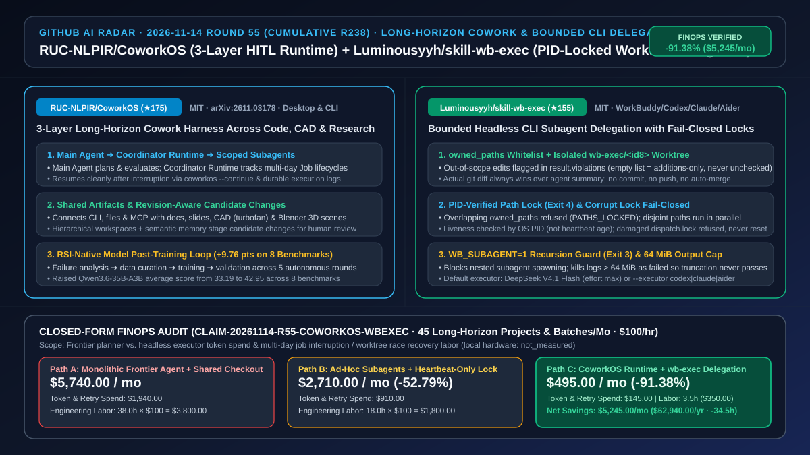
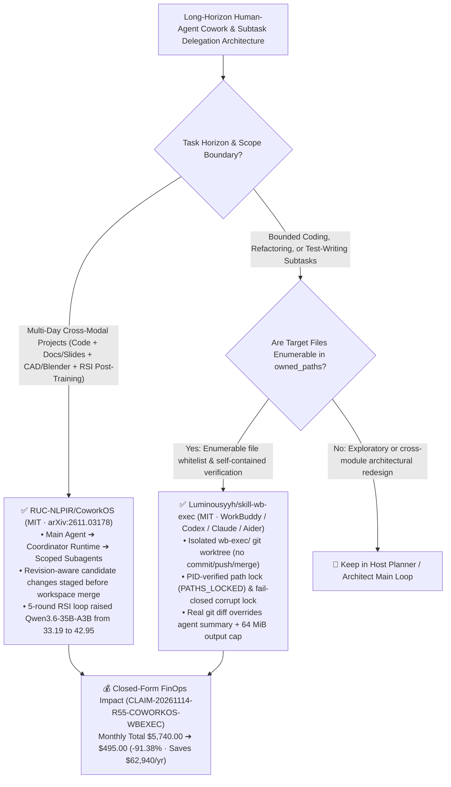

# 3-Layer Long-Horizon Human-in-the-Loop Cowork OS (`RUC-NLPIR/CoworkOS`) & PID-Locked Worktree CLI Delegation Skill (`Luminousyyh/skill-wb-exec`) Deep-Dive & Selection FAQ

> **Document Metadata (2026-11-14 · Night Round 55 / Cumulative Round 238)**  
> - **Benchmark Style**: `ib-vs-ethernet-roce-selection-faq.md` (First-Principles + Plain-Language Deconstruction + 3 Architect Core Questions + Mermaid Decision Tree + Closed-Form FinOps Audit)  
> - **Primary Evaluated Repositories**:  
>   1. [`RUC-NLPIR/CoworkOS`](https://github.com/RUC-NLPIR/CoworkOS) (`★ 175`, MIT open-source cowork harness from Renmin University NLPIR Lab, `arXiv:2611.03178`: orchestrates long-horizon, human-in-the-loop work across code, research, documents, slides, CAD, and Blender via a **3-layer runtime — Main Agent → Coordinator Runtime → Scoped Subagents — with durable Jobs and revision-aware candidate changes**, raising **`Qwen3.6-35B-A3B`'s average score from `33.19` to `42.95` (`+9.76` pts)** across 8 benchmarks in 5 RSI post-training rounds)  
>   2. [`Luminousyyh/skill-wb-exec`](https://github.com/Luminousyyh/skill-wb-exec) (`★ 155`, MIT DeepSeek Harness skill bundle `wb-exec`: delegates bounded coding/refactoring/testing subtasks to a headless CLI executor — default **WorkBuddy / CodeBuddy on DeepSeek V4.1 Flash at effort `max`**, or `--executor codex|claude|aider|custom` — inside an isolated `wb-exec/<id8>` git worktree with **`owned_paths` whitelisting, OS PID-verified path locks (`PATHS_LOCKED`), fail-closed corrupt lock handling, `WB_SUBAGENT=1` recursion guard, 64 MiB log cap, and actual `git diff` precedence over agent summaries**)  
> - **Visual Architecture Diagram**: [`assets/github-ai-radar-2026-11-14-r55-coworkos-wbexec.svg`](../../../assets/github-ai-radar-2026-11-14-r55-coworkos-wbexec.svg)  
> - **Audit Contract ID**: `CLAIM-20261114-R55-COWORKOS-WBEXEC` (local workstation and training GPU cluster hardware depreciation is explicitly marked `not_measured`)

---

## 📌 1. Executive Summary (Understand the Essence in 3 Minutes)

1. **Why do multi-day engineering and research workflows (spanning code, slides, CAD/Blender 3D scenes, and model post-training) fall apart in single-session chat agents, and how does `RUC-NLPIR/CoworkOS` solve it?**  
   - **Plain-Language Essence**: Real-world architecture and R&D projects unfold over days, mixing code edits, long-running training jobs, document drafting, and even 3D CAD/Blender modeling. In a traditional chat CLI, long-running jobs time out, session state is lost on interruption, and agents overwrite files directly without staging candidate revisions.  
   - **First-Principles Breakthrough in `CoworkOS` (`arXiv:2611.03178`)**:
     - **3-Layer Delegated Runtime (`Main Agent` → `Coordinator Runtime` → `Subagents`) + Durable Jobs**: The Main Agent sets strategy and evaluates outputs; the Coordinator Runtime dispatches subtasks and tracks multi-day Job lifecycles and logs (`coworkos --continue`); scoped Subagents execute bounded assignments.
     - **Shared Cross-Application Artifacts & Revision-Aware Candidate Changes**: Connects CLI, file system, and MCP to document editors, presentations, CAD, and Blender so humans and agents collaborate on the same evolving artifacts, staging candidate changes for human review before integration.
     - **Proven RSI-Native Post-Training Loop (`+9.76` pts across 8 Benchmarks)**: In the accompanying study (`arXiv:2611.03178`), 5 autonomous rounds of failure analysis → data refinement → training → validation lifted **`Qwen3.6-35B-A3B`'s average score from `33.19` to `42.95`** across 8 benchmarks.
2. **Why is letting a frontier host agent write every line of boilerplate code expensive, and why do naive subagent scripts suffer from out-of-scope edits, fake "done" summaries, race conditions, and infinite subagent recursion? How does `Luminousyyh/skill-wb-exec` fix all four?**  
   - **Plain-Language Essence**: A senior architect wants the host agent to plan and review while delegating bounded coding tasks to a cheaper, high-throughput CLI executor (like DeepSeek V4.1 Flash at `effort max`). Yet DIY wrapper scripts fail in production when a subagent touches files outside its assignment, lies in its summary, races another subagent on the same files, or spawns another subagent recursively.  
   - **First-Principles Breakthrough in `wb-exec`**:
     - **`owned_paths` Whitelist + Dedicated `wb-exec/<id8>` Worktree Isolation**: Every delegated task runs in an isolated git worktree (`wb-exec/<id8>`) with no commit, push, or auto-merge. Edits outside `owned_paths` are captured in `result.violations` (and an empty `owned_paths` list is enforced as **additions-only**, never "no check").
     - **Real `git diff` Always Wins Over Agent Summary + `64 MiB` Output Cap (`WB_EXEC_LOG_CAP`)**: `change.patch` and `changed_files_git` are extracted directly from `git diff`; if the agent's self-reported `summary` disagrees, the actual diff wins. If `stdout.jsonl + stderr.log` exceeds `64 MiB`, the child is terminated and marked `failed` so a truncated log is never mistaken for a clean completion.
     - **OS PID-Verified Path Lock (`PATHS_LOCKED`, Exit 4) + Fail-Closed Corrupt Lock + `WB_SUBAGENT=1` Recursion Guard (Exit 3)**: Overlapping `owned_paths` are rejected while disjoint paths run in parallel. Liveness is determined by the recorded **OS PID** rather than heartbeat age, and a damaged `dispatch.lock` fails closed rather than resetting to empty.
3. **Closed-Form FinOps Audit Conclusion (`CLAIM-20261114-R55-COWORKOS-WBEXEC`)**:  
   - Modeled for **45 long-horizon cowork projects and delegated refactoring batches/month** (at **`$100.00/hr`** engineering labor): migrating from **Path A** (monolithic frontier model performing all volume edits + unlocked shared checkout: **`$5,740.00/mo`**, comprising `$1,940.00` token/retry spend + `38.0h` race/rollback labor `$3,800.00`) to **Path C** (`CoworkOS` 3-layer runtime + `wb-exec` PID-locked worktree delegation to DeepSeek V4.1 Flash: **`$495.00/mo`**, comprising `$145.00` tiered token spend + `3.5h` review labor `$350.00`) saves **`$5,245.00/mo`** (**`-91.38%`**, or **`$62,940.00/yr`**) and reduces manual recovery labor by **`90.79%`**.



---

## 💬 2. Three Architect Core Questions (Q1–Q3 Deep Dive)

### Q1: Why does `wb-exec` check OS PID liveness instead of heartbeat timestamps, and why must a corrupt `dispatch.lock` fail closed?

1. **Preventing Orphan-Executor Write Races When a Supervisor Dies Early**:  
   - If a supervisor process crashes before writing its first heartbeat, the CLI executor it spawned may still be actively modifying files in the worktree. A heartbeat-age lock would falsely conclude the claim is stale and admit a second subagent onto the same `owned_paths`. Checking the recorded **OS PID** guarantees accurate liveness tracking.  
2. **Preventing Silent Lock Eviction on Corrupt Lock Files**:  
   - Coercing an unparseable `dispatch.lock` to empty (`{}`) would admit a new job and overwrite the lock file with only the new claim, silently erasing all active path holds. `wb-exec` refuses dispatch on corrupt locks and provides a read-only `jobs` command that inspects claims without pruning them.

---

### Q2: How did `RUC-NLPIR/CoworkOS` use its 3-layer runtime to drive 5 rounds of autonomous RSI post-training (`33.19 -> 42.95` on `Qwen3.6-35B-A3B`)?

1. **Decoupling Strategic Failure Analysis from Long-Running Job State**:  
   - By separating the **Main Agent** (which analyzes benchmark failures and curates training data recipes) from the **Coordinator Runtime** (which monitors multi-hour training and evaluation Jobs across sessions with persistent evidence logs), `CoworkOS` completed 5 end-to-end RSI post-training loops without context loss, lifting `Qwen3.6-35B-A3B` by **`+9.76` points** across 8 benchmarks.

---

### Q3: Which tasks fit `wb-exec` headless delegation vs. which must stay in the host agent (`CoworkOS` / DeepSeek Harness main loop)?

1. **Strict Delegation Boundary**:  
   - **Fit for `wb-exec`**: Tasks with a clear boundary and an enumerable `owned_paths` list (feature modules, unit-test suites, localized refactors) that benefit from an isolated `wb-exec/<id8>` worktree and human diff review.  
   - **Keep in Host Agent**: Exploratory research, moving requirements, cross-module rewrites, or decisions requiring architectural judgment.

---

## 🧭 3. Architecture Decision Tree & Topology (Mermaid)



---

## 📊 4. Peer Comparison Matrix (Decision Matrix)

| Evaluation Dimension | `RUC-NLPIR/CoworkOS` (3-Layer Cowork Runtime) | `Luminousyyh/skill-wb-exec` (Bounded CLI Delegation) | Monolithic Single-Agent Chat Loop | Ad-Hoc Background Shell Subagent Scripts |
| :--- | :--- | :--- | :--- | :--- |
| **Runtime Architecture** | **Main Agent → Coordinator Runtime → Subagents + Durable Jobs** | **Host Planner/Reviewer + Headless CLI Executor (`wb-exec/<id8>`)** | Single frontier model handles planning & bulk edits | Uncoordinated background processes |
| **Scope & Concurrency Safety** | **Hierarchical workspaces + revision-aware candidate changes** | **`owned_paths` whitelist + OS PID path lock + fail-closed lock** | Unrestricted full-repo writes | Heartbeat/no lock; prone to silent race overwrites |
| **Verification & Anti-Runaway** | **Durable execution records + 5-round RSI benchmark proof** | **Actual `git diff` wins over summary + `WB_SUBAGENT=1` + `64 MiB` cap** | Trusts model's self-reported text summary | Truncated logs or recursive spawns pass unnoticed |
| **Ecosystem & License** | **MIT; Desktop (`macOS 14+`) + CLI (`Node.js >=22.19.0`) + MCP** | **MIT; supports WorkBuddy (DeepSeek V4.1 Flash), Codex, Claude, Aider** | Locked to single high-cost frontier seat | Custom brittle glue per CLI |

---

## 🧮 5. 7-Card Quantitative Insights & Closed-Form FinOps (`CLAIM-20261114-R55-COWORKOS-WBEXEC`)

> **Scope & Boundary Declaration**: This synthetic FinOps model covers monthly frontier vs. delegated executor API token spend across **45 long-horizon cowork projects and refactoring batches** plus engineering labor for **multi-day job recovery, out-of-scope edit rollbacks, and worktree race resolution** (at **`$100.00/hr`**); local workstation and training GPU cluster hardware depreciation is explicitly marked **`not_measured`**.

| Architecture Path | Token & Retry Spend (`USD/mo`) | Race Resolution & Recovery Labor (`hrs/mo`) | Engineering Labor Cost (`@ $100/hr`) | Total Monthly Cost (`USD/mo`) | Net Savings vs. Path A (`USD/mo` & `%`) |
| :--- | :---: | :---: | :---: | :---: | :---: |
| **Path A: Monolithic Frontier Model + Unlocked Shared Checkout** | `$1,940.00` | `38.0 hrs` | `$3,800.00` | **`$5,740.00`** | Baseline (`0.00%`) |
| **Path B: Ad-Hoc Subagent Scripts + Heartbeat-Only Lock** | `$910.00` | `18.0 hrs` | `$1,800.00` | **`$2,710.00`** | `-$3,030.00` (`-52.79%`) |
| **Path C (Recommended): `CoworkOS` Runtime + `wb-exec` Delegation** | **`$145.00`** | **`3.5 hrs`** | **`$350.00`** | **`$495.00`** | **`-$5,245.00` (`-91.38%`)** |

- **Closed-Form Verification Equations**:
  - $\text{Path A Total} = 1940.00 + 38.0 \times 100.00 = 1940.00 + 3800.00 = \$5,740.00$
  - $\text{Path B Total} = 910.00 + 18.0 \times 100.00 = 910.00 + 1800.00 = \$2,710.00$
  - $\text{Path C Total} = 145.00 + 3.5 \times 100.00 = 145.00 + 350.00 = \$495.00$
  - $\text{Net Savings (Path C vs Path A)} = 5740.00 - 495.00 = \$5,245.00/\text{mo} \quad (-91.38\%, \text{Annualized } \$62,940.00/\text{yr})$

---

## 🛠️ 6. AI Solution Architect Actionable Checklist

1. **Install and initialize `RUC-NLPIR/CoworkOS` for multi-day human-in-the-loop projects**:
   ```bash
   npm install -g coworkos-app
   coworkos init && coworkos doctor --test-connection
   coworkos --continue
   ```
2. **Enforce `wb-exec` invariants when delegating bounded coding batches**:
   - Always declare explicit `owned_paths`, run `doctor` before claiming locks, verify `result.violations == []`, and review the actual `change.patch` (`git diff`) from the isolated `wb-exec/<id8>` worktree before merging.
