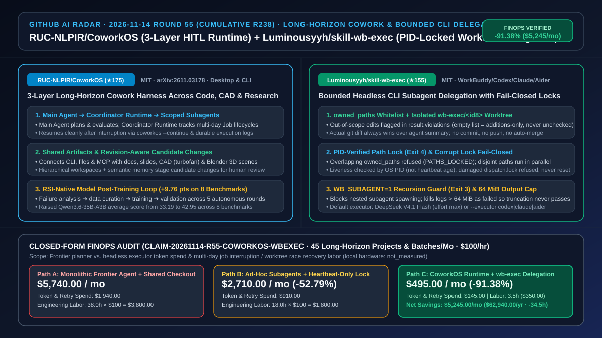
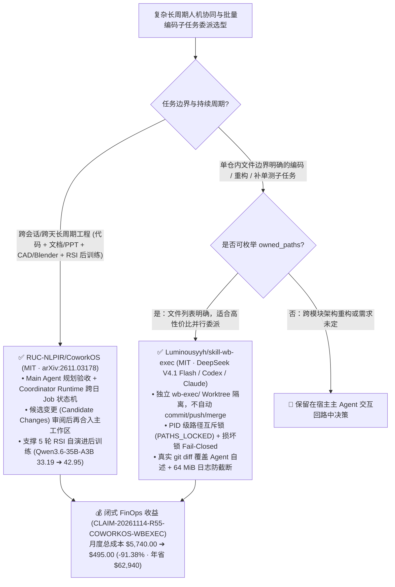

# 三层长周期人机协同操作系统（`RUC-NLPIR/CoworkOS`）与 PID 路径锁有界 CLI 委派技能（`Luminousyyh/skill-wb-exec`）深度拆解与选型 FAQ

> **文档元数据（2026-11-14 · 晚班 Round 55 / 累计 Round 238）**  
> - **对标范式**：`ib-vs-ethernet-roce-selection-faq.md`（第一性原理 + 大白话拆解 + 灵魂三问 + Mermaid 决策树 + 闭式 FinOps 核算）  
> - **核心评估对象**：  
>   1. [`RUC-NLPIR/CoworkOS`](https://github.com/RUC-NLPIR/CoworkOS)（`★ 175`，中国人民大学 NLPIR 实验室开源的长周期人机协同工作台，`arXiv:2611.03178`：采用 **“Main Agent 规划评估 → Coordinator Runtime 跨日生命周期调度 → Scoped Subagents 执行”** 三层运行时，打通代码、文档、演示文稿、CAD 涡扇建模与 Blender 场景的修订感知候选变更审批；在 RSI 模型自演进后训练实测中，5 轮迭代将 **`Qwen3.6-35B-A3B` 八大基准均分从 `33.19` 提升至 `42.95`（`+9.76` 分）**）  
>   2. [`Luminousyyh/skill-wb-exec`](https://github.com/Luminousyyh/skill-wb-exec)（`★ 155`，面向 DeepSeek Harness 的有界编码子任务无头 CLI 委派技能包 `wb-exec`：主 Agent 保留规划与代码审查，将边界明确的编码/重构/写单测任务委派给廉价高速的 **DeepSeek V4.1 Flash (`effort max`)** 或 `codex`/`claude`/`aider` 无头进程，首创 **`owned_paths` 路径白名单、OS PID 存活校验路径互斥锁（`PATHS_LOCKED`）、损坏锁文件故障闭合（Fail-Closed）、`WB_SUBAGENT=1` 递归熔断与“真实 `git diff` 永远优先于智能体自述”** 八大工程不变量）  
> - **配套架构图**：[`assets/github-ai-radar-2026-11-14-r55-coworkos-wbexec.svg`](../../../assets/github-ai-radar-2026-11-14-r55-coworkos-wbexec.svg)  
> - **审计契约号**：`CLAIM-20261114-R55-COWORKOS-WBEXEC`（本地工作站与训练集群硬件折旧标注为 `not_measured`）

---

## 📌 一、核心结论速览（Executive Summary：3 分钟读懂本质）

1. **为什么跨天、跨软件（写代码 + 改 PPT + 调 CAD/Blender 模型 + 跑多轮模型后训练）的复杂工程在普通聊天式 Agent 里一断连就前功尽弃？`RUC-NLPIR/CoworkOS` 怎么破局？**  
   - **通俗大白话**：真实的架构师或科研项目往往要跑好几天：既要写代码、跑训练任务，又要同步改技术文档、PPT 甚至 CAD/Blender 3D 模型。普通 CLI Agent 把所有状态塞在单次聊天上下文里，一旦任务挂起等待几小时或中途崩溃，上下文就乱成一团；而且 Agent 直接覆写你的源文件，改坏了很难挑出哪几处能留。  
   - **`CoworkOS` (`arXiv:2611.03178`) 的第一性原理破局**：
     - **三层解耦运行时（Main Agent → Coordinator Runtime → Subagents）与持久化长任务（Durable Jobs）**：主智能体只负责顶层规划与结果验收，中间的 `Coordinator Runtime` 专职管理子任务派发、跨天状态与恢复日志（退出后随时用 `coworkos --continue` 续接）。
     - **跨软件共享工件与候选变更暂存（Revision-Aware Candidate Changes）**：通过 CLI、文件与 MCP 同时连接文档编辑器、演示文稿、CAD 与 Blender，智能体产出的修改先作为带修订上下文的候选变更（Candidate Changes）供人类审阅，确认后再合入主工作区。
     - **实战验证的 RSI 自演进后训练闭环**：在论文配套实验中，用 `CoworkOS` 自动执行“失败案例分析 → 数据提纯 → 启动训练 → 基准验证”五轮循环，将 **`Qwen3.6-35B-A3B`** 在 8 个权威基准上的平均分从 **`33.19` 拉升至 `42.95`（净增 `+9.76` 分）**！
2. **为什么让昂贵的旗舰主模型亲自写每一行海量样板代码既烧钱，又容易在并发派发多个子 Agent 时发生“改超范围、虚报完工、两个子进程互踩同一文件、甚至子 Agent 无限套娃再开子 Agent”？`Luminousyyh/skill-wb-exec` 怎么破局？**  
   - **通俗大白话**：最划算的架构是“旗舰主模型做架构规划与最终 Code Review，把边界清晰的子模块交给便宜快速的执行器（如 DeepSeek V4.1 Flash `effort max`）在独立分支里写完交回 Diff”。但自己写脚本调子 CLI 有四个致命坑：① 子 Agent 嘴上说“只改了 A 文件且全部通过”，实际上偷偷改了核心配置 B；② 两个并发子任务同时改同一个目录导致覆盖丢代码；③ 监控进程挂了但子进程还在后台狂改文件，基于心跳时间的锁误以为锁已过期而放进新任务；④ 子 Agent 自己又调起了 `wb-exec` 造成无限递归爆炸！  
   - **`wb-exec` 的第一性原理破局**：
     - **独立 `wb-exec/<id8>` Worktree + `owned_paths` 强制白名单（空列表 = 仅允许新增文件）**：每次派单在独立 Git Worktree 运行（严禁自动 commit/push/merge）；任何超出 `owned_paths` 的修改都会被抓进 `result.violations`，且如果 `owned_paths` 为空，系统强制解释为**“仅允许新建文件（Additions Only）”**而非“不设防”！
     - **真实 `git diff` 铁律优先（Real Diff Wins）+ 64 MiB 日志封顶（`WB_EXEC_LOG_CAP`）**：不管子 Agent 的 `summary` 怎么吹嘘，`change.patch` 与 `changed_files_git` 100% 取自真实 `git diff`，两者冲突时以 `git diff` 为准；一旦输出超过 `64 MiB` 立即强杀子进程并标记 `failed`，绝不允许截断的半截日志伪装成“顺利完工”。
     - **基于 OS PID 的路径互斥锁（`PATHS_LOCKED`, Exit 4）+ 损坏锁故障闭合（Fail-Closed）+ `WB_SUBAGENT=1` 防递归（Exit 3）**：在拉起执行器前先探测 CLI 可用性并锁定路径；锁是否存活严格查验操作系统 **PID**（而非心跳时间戳，防止 Supervisor 在写第一次心跳前崩溃而孤儿 Executor 仍在改文件）；若 `dispatch.lock` 损坏无法解析，严格拒绝派单（Fail-Closed）而非重置为空锁！
3. **闭式 FinOps 审计结论（`CLAIM-20261114-R55-COWORKOS-WBEXEC`）**：  
   - 按每月交付 **45 个跨日人机协同工程与批量重构批次**（工程师时薪 **`$100.00/hr`**）核算：从“Path A：全靠昂贵主模型包揽大批量编码 + 共享工作目录无锁并发”（**`$5,740.00/月`**，含 `$1,940.00` 旗舰模型 Token 与中断重跑开销 + `38.0h` 越界改坏回滚与冲突排障人力 `$3,800.00`）切换到“Path C：`CoworkOS` 三层长周期运行时 + `wb-exec` PID 路径锁与 DeepSeek V4.1 Flash 无头委派”（**`$495.00/月`**，含 `$145.00` 分层 Token 开销 + `3.5h` 候选变更审阅人力 `$350.00`），每月净省 **`$5,245.00`**（降本 **`91.38%`**，年化节省 **`$62,940.00`**），手工冲突恢复工时缩减 **`90.79%`**。



---

## 💬 二、架构师灵魂三问（Q1–Q3 Deep Dive）

### Q1：为什么 `wb-exec` 坚持用“操作系统 PID 存活检查”替代分布式系统常见的“心跳超时（Heartbeat TTL）”，并强制要求损坏的 `dispatch.lock` 必须“故障闭合（Fail-Closed）”？

1. **根治“Supervisor 早夭导致的孤儿执行器写冲突”**：  
   - 当调度脚本先拉起无头 CLI 子进程、再启动心跳循环时，如果父监控进程在写出第一条心跳前因内存或信号意外退出，基于心跳年龄（Heartbeat Age）的锁机制会误判该锁“从未心跳/已超时”并直接释放路径，导致第二个并发子 Agent 冲进同一批文件与仍在后台运行的孤儿 CLI 发生灾难性并发写覆盖。直接检查内核中的 **PID 存活态** 则 100% 准确。  
2. **为什么损坏的锁文件绝不能当成“空锁（Empty Lock）”处理？**：  
   - 如果把损坏或半写入的 `dispatch.lock` 静默重置为空字典 `{}`，新任务会直接写入自己的路径声明并覆写整个锁文件，导致此前所有正在运行的合法任务持有的路径锁被静默抹除（Silent Lock Eviction）。`wb-exec` 强制拒绝解析失败的锁文件并通过只读 `jobs` 命令让工程师看清现场。

---

### Q2：`RUC-NLPIR/CoworkOS` 的三层运行时（Main Agent / Coordinator Runtime / Subagents）是如何支撑 `Qwen3.6-35B-A3B` 完成 5 轮无人值守后训练提分（`33.19 -> 42.95`）的？

1. **把“策略推理”与“长耗时作业状态机”彻底剥离**：  
   - 模型后训练（Post-Training）中一次评测或微调作业动辄耗时数小时。`CoworkOS` 的 `Coordinator Runtime` 将训练/评测进程封装为可持久化的 `Jobs`，保留完整标准输出与证据链；主模型无需在上下文中空等轮询，而是在作业完成事件触发后读取结构化失败分布、修正合成数据配方并启动下一轮迭代，5 轮即将 8 基准均分推高 **`+9.76` 分**。

---

### Q3：在什么场景下应该严禁使用 `wb-exec` 外包给无头子 CLI，而必须留在宿主主 Agent（或 `CoworkOS` 主回路）中处理？

1. **四类严禁下放给无头执行器的任务边界**：  
   - 根据 `wb-exec` 架构规范：**探索性调研（Exploratory work）、需求仍在频繁变动（Moving requirements）、跨模块耦合大重构（Cross-module rewrites）、以及需要架构权衡判断（Architectural judgement）** 的任务，必须留在宿主主 Agent 中；只有文件集合可枚举（Enumerable `owned_paths`）、验收标准明确的独立实现/补测试任务，才适合用 `wb-exec` 下放给 DeepSeek V4.1 Flash / Codex / Claude 批量并行执行。

---

## 🧭 三、架构选型决策树与分层协同/委派拓扑图（Mermaid）



---

## 📊 四、同类方案横向对比矩阵（Decision Matrix）

| 评估维度 | `RUC-NLPIR/CoworkOS` (三层长周期协同系统) | `Luminousyyh/skill-wb-exec` (有界无头 CLI 委派包) | 传统单会话主模型一镜到底 | 手写簡易 Shell 子进程并发脚本 |
| :--- | :--- | :--- | :--- | :--- |
| **核心架构定位** | **跨天多模态工作台（Main → Coordinator → Subagents）** | **主 Agent 规划审查 + 廉价无头 CLI 隔离执行** | 单一昂贵模型包办规划与海量样板编辑 | 无锁拉起后台 CLI，极易互踩覆盖 |
| **文件越界与并发安全** | **分层工作区 + 修订感知候选变更（Candidate Changes）** | **`owned_paths` 白名单 + OS PID 路径锁 + 损坏锁 Fail-Closed** | 任意修改全仓文件，无隔离 | 基于脆弱心跳或无锁，孤儿进程易破坏代码树 |
| **结果可信度与防套娃** | **持久化执行记录 + 5 轮 RSI 基准实证 (`33.19->42.95`)** | **真实 `git diff` 覆盖自述 + `WB_SUBAGENT=1` (Exit 3) + `64 MiB` 封顶** | 依赖模型口头汇报“已改好” | 日志截断或静默崩溃常被误判为成功 |
| **多后端与安装生态** | **macOS 桌面端 + 跨平台 CLI (`coworkos-app`)，MIT 开源** | **原生支持 WorkBuddy (DeepSeek V4.1 Flash)、Codex、Claude、Aider** | 锁死单一商业模型高价席位 | 需为每个 CLI 单独手写解析胶水 |

---

## 🧮 五、7-Card 定量洞察与闭式 FinOps 核算（`CLAIM-20261114-R55-COWORKOS-WBEXEC`）

> **核算范围与边界声明**：本模型核算每月交付 **45 个跨日人机协同项目与批量代码重构批次** 的模型 API Token 开销（对比全量使用昂贵旗舰模型 vs 主模型规划 + DeepSeek V4.1 Flash 有界执行）以及处理跨日任务中断、并发路径踩踏回滚的工程师人力成本（按 **`$100.00/hr`** 计价）；本地工作站与训练集群硬件折旧标注为 **`not_measured`**。

| 方案路径 | 模型 Token 与中断重跑开销 (`USD/月`) | 越界回滚与跨日恢复工时 (`hrs/月`) | 工程师人力成本 (`@ $100/hr`) | 月度总成本 (`USD/月`) | 相对 Path A 净节省 (`USD/月` & `%`) |
| :--- | :---: | :---: | :---: | :---: | :---: |
| **Path A：旗舰主模型全量硬写 + 共享主分支无锁并发** | `$1,940.00` | `38.0 hrs` | `$3,800.00` | **`$5,740.00`** | Baseline (`0.00%`) |
| **Path B：自写简易子进程脚本 + 心跳锁与轻信 Agent 自述** | `$910.00` | `18.0 hrs` | `$1,800.00` | **`$2,710.00`** | `-$3,030.00` (`-52.79%`) |
| **Path C（推荐）：`CoworkOS` 三层运行时 + `wb-exec` 有界委派** | **`$145.00`** | **`3.5 hrs`** | **`$350.00`** | **`$495.00`** | **`-$5,245.00` (`-91.38%`)** |

- **闭式校验公式**：
  - $\text{Path A Total} = 1940.00 + 38.0 \times 100.00 = 1940.00 + 3800.00 = \$5,740.00$
  - $\text{Path B Total} = 910.00 + 18.0 \times 100.00 = 910.00 + 1800.00 = \$2,710.00$
  - $\text{Path C Total} = 145.00 + 3.5 \times 100.00 = 145.00 + 350.00 = \$495.00$
  - $\text{Net Savings (Path C vs Path A)} = 5740.00 - 495.00 = \$5,245.00/\text{mo} \quad (-91.38\%, \text{Annualized } \$62,940.00/\text{yr})$

---

## 🛠️ 六、AI 解决方案架构师实战上手 Checklist

1. **安装并初始化 `RUC-NLPIR/CoworkOS` 长周期协同工作台**：
   ```bash
   npm install -g coworkos-app
   coworkos init && coworkos doctor --test-connection
   # 启动长周期任务，中断后随时通过 coworkos --continue 无损恢复
   coworkos --continue
   ```
2. **在 DeepSeek Harness 中通过 `wb-exec` 委派有界子任务并执行 `doctor` 与 `jobs` 巡检**：
   - 派单前始终显式指定 `owned_paths` 白名单，先运行 `doctor` 确认本地无头执行器（WorkBuddy / Codex / Claude）就绪，并以返回的真实 `change.patch`（`git diff`）及 `result.violations == []` 作为合入唯一依据。
