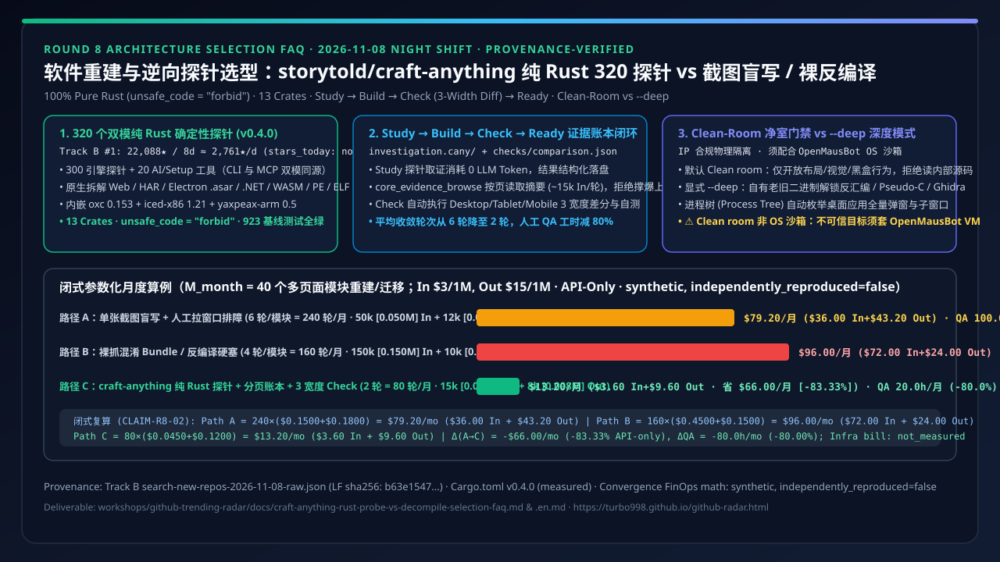
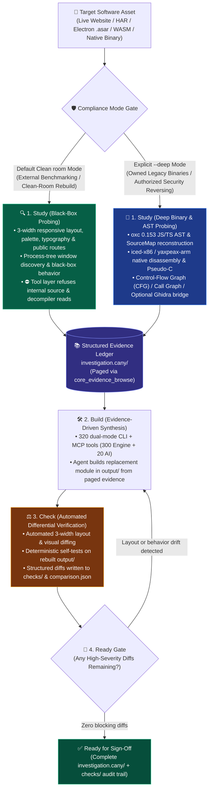
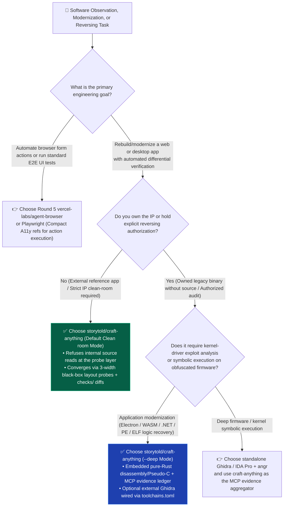

# Clean-Room Software Rebuild & Binary Probe Architecture: storytold/craft-anything Pure-Rust 320 Probes vs. Blind Screenshot Prompting & Raw Decompiler Dumps

> **Document Purpose**: Written for AI Solution Architects, Application Modernization leads, and Reverse/Security Engineering teams, this guide uses **first principles and plain language** to deconstruct the #1 Track B 10-day breakout repository from the 2026-11-08 GitHub AI Radar: **`storytold/craft-anything`** (`22,088` total Stars / **`~2,761 stars/day`** lifecycle velocity over 8 days; `22,299` total Stars in archived search snapshot `evidence/search-new-repos-2026-11-08-raw.json`, LF `sha256: b63e154759fa065063e70e5f237645e317a455a889598d7785b0245f872830cb`; single-day `stars_today: not_measured`). We explain why feeding a single screenshot to a multimodal LLM or dumping 150k tokens of obfuscated JS / raw Ghidra output into a prompt causes responsive layout collapse, token bloat, and IP contamination—and how **100% pure Rust (`unsafe_code = "forbid"`) with 320 dual-mode CLI+MCP probes, a paged `investigation.cany/` evidence ledger, automated 3-width `Study -> Build -> Check -> Ready` verification, and strict `Clean room` vs. `--deep` mode separation** solves clean-room rebuilds and legacy binary migration.
> **Style Benchmark**: Strictly aligned with `ib-vs-ethernet-roce-selection-faq.md` (Executive Summary, Q1/Q2/Q3 First-Principles Q&A, Mermaid Decision Tree & Architecture Diagrams, Comparison Matrix, Closed-Form Reproducible FinOps Worked Example, and Production Checklist).
> **中文版本**: [软件重建与逆向探针选型：storytold/craft-anything 纯 Rust 320 净室探针 vs 传统截图盲写 / Ghidra 裸反编译实战选型 FAQ (`craft-anything-rust-probe-vs-decompile-selection-faq.md`)](./craft-anything-rust-probe-vs-decompile-selection-faq.md)



---

## 📌 Executive Summary (30-Second Architect's Verdict)

1. **Plain-Language Essence (Zero Jargon)**:
   - **The Two Dead Ends of AI Software Rebuilds & Legacy Migration**:
     - **Dead End 1 (Blind Single-Screenshot Prompting)**: Dropping one desktop screenshot into Claude/GPT and asking it to "build this app." The LLM cannot see responsive breakpoints (desktop/tablet/mobile), computed typography/spacing, or multi-window state transitions—forcing 5–6 rounds of manual visual QA and rework.
     - **Dead End 2 (Raw Bundle / Unindexed Decompiler Dumps)**: Scraping obfuscated JS bundles or pasting raw Ghidra pseudo-C dumps directly into the LLM prompt. This burns `~150k` input tokens per turn, destroys prompt cache locality, and **violates IP clean-room compliance** when studying external commercial software.
   - **`storytold/craft-anything` (`v0.4.0`, 100% Pure Rust, `edition = "2024"`, `MIT OR Apache-2.0`)**: Turns software observation and differential verification into **320 zero-LLM-token deterministic Rust probes (`300` engine tools + `20` AI/setup tools, each exposed simultaneously as a CLI command and an MCP tool)**. It structures AI software modernization into a four-stage loop—**`Study` (deterministic probing) $\rightarrow$ `Build` (implementing from the paged `investigation.cany/` ledger) $\rightarrow$ `Check` (automated 3-width website layout & self-test comparison written to `checks/`) $\rightarrow$ `Ready` (blocking sign-off until high-severity diffs are zero)**—with a hard gate between default **`Clean room` mode (refuses internal source reads)** and explicit **`--deep` mode (unlocks x86/ARM64 disassembly, Pseudo-C, and Ghidra)**.
2. **Closed-Form Reproducible Convergence & FinOps Math (40 Multi-Page Application Modules Rebuilt/Migrated per Month, API-Only)**:
   - Under explicit synthetic parameters (`M_month = 40` modules/month, `$3.00/1M` input tokens, `$15.00/1M` output tokens):
     - **Path A (Blind Single-Screenshot Prompting + Manual Visual Rework, avg `6` rounds/module = `240` rounds/month)**: `50k` input (`$0.1500`) + `12k` output (`$0.1800`) = `$0.3300/round` $\Rightarrow$ **`$79.20/month`** API-only (`$36.00` input + `$43.20` output), plus **`100.0 hours/month`** (`2.5h/module`) of manual cross-width QA diffing;
     - **Path B (Raw Obfuscated Bundle / Decompiler Dump into Prompt, avg `4` rounds/module = `160` rounds/month)**: `150k` input (`$0.4500`) + `10k` output (`$0.1500`) = `$0.6000/round` $\Rightarrow$ **`$96.00/month`** API-only (`$72.00` input + `$24.00` output), **`60.0 hours/month`** manual QA, and **fails IP clean-room compliance** on external software;
     - **Path C (`storytold/craft-anything` Pure-Rust Probes + `core_evidence_browse` Paging + Automated 3-Width `Check`, avg `2` rounds/module = `80` rounds/month)**: Local Rust probes consume `0` LLM tokens and feed paged evidence summaries (`15k` input `$0.0450` + `8k` output `$0.1200` = `$0.1650/round`) $\Rightarrow$ **`$13.20/month`** API-only (`$3.60` input + `$9.60` output, saving **`$66.00/month` [`-83.33%` vs. Path A]** and **`$82.80/month` [`-86.25%` vs. Path B]** API-only; host/VM infra bills `not_measured`), while cutting manual QA review to **`20.0 hours/month`** (**saving `80.0 hours/month` [`-80.00%`]** vs. Path A).
3. **Critical Security Boundary (`Clean room` $\neq$ OS Sandbox)**:
   - As documented in the upstream `README.md`, **`Clean room` is a rule about what `craft-anything` offers and refuses—it is NOT an operating-system sandbox** (a coding agent still runs with your user permissions). When inspecting untrusted binaries or running autonomous agent loops, pair `craft-anything` with **Round 4's `milind-soni/OpenMausBot` isolated VM sandbox**.

---

## 1. First-Principles Problem Breakdown: Why Do AI Software Rebuilds & Legacy Migrations Fail in Practice?

### Q1: Why do coding agents struggle when asked to recreate a web/desktop product or modernize a legacy binary without source code?

From first principles, traditional agent workflows fail at both ends of the loop—**Observation (`Study`)** and **Verification (`Check`)**:

1. **Single-Viewport Blindness (No Multi-Width Layout Metrics)**:
   - Giving a vision model a single `1440px` screenshot forces it to guess flexbox/grid rules, responsive breakpoints, and computed typography. As soon as the rebuilt UI is resized to tablet (`768px`) or mobile (`375px`), navigation bars overlap and tables overflow.
2. **Context Window Flood (Dumping Raw HARs, ASTs, or Symbol Tables)**:
   - When inspecting an Electron app (`.asar`), a `.wasm` module, or a native PE/ELF/Mach-O executable, ad-hoc scripts dump tens of thousands of lines of symbols or decompiled pseudo-code into stdout—overflowing the agent's context window and triggering destructive compaction (which, as proven in Round 2, collapses prompt cache hit rates).
3. **Missing IP Clean-Room Guardrails**:
   - In clean-room engineering, engineers may observe externally visible layout, public routes, accessibility trees, and black-box behavior, but **must never read or copy proprietary internal source code**. Standard coding agents have no clean-room enforcement and will happily read bundled source maps or decompile internal code unless restricted at the tool layer.

---

## 2. Under the Hood: How Do `storytold/craft-anything`'s 13 Pure-Rust Crates Work Together?

### Q2: Why is `storytold/craft-anything` built in 100% pure Rust (`unsafe_code = "forbid"`), and how does `Study -> Build -> Check -> Ready` operate?

Primary-source verification of `Cargo.toml`, `docs/STATUS.md`, and `crates/*` confirms that `craft-anything` (`v0.4.0`, `923` baseline tests passing) is organized into **13 pure-Rust workspace crates** across four architectural layers:

| Architectural Layer | Verified Rust Crates & Embedded Engines (`measured` Primary Source) | Core Engineering Problem Solved (Plain Language) |
| :--- | :--- | :--- |
| **1. Structured Evidence Ledger & Paged Browsing** | `craft-anything-evidence` (`investigation.cany/` workspace + `core_evidence_browse`) | Every probe writes structured findings, screenshots, routes, and binary metadata into `investigation.cany/`. Coding agents query `core_evidence_browse` in **paged summaries** (`~15k` tokens/turn) instead of flooding context. |
| **2. Zero-Dependency Multi-Format Unpacking & Analysis** | `craft-anything-formats` (`object 0.36`, `wasmparser 0.261`, `zip`, `tar`, `sqlite`) + `craft-anything-js` (`oxc 0.153`) + `craft-anything-disasm` (`iced-x86 1.21`, `yaxpeax-arm 0.5`) | Single static binary natively inspects **live websites, HAR captures, Electron `.asar` archives, `.NET` single-file bundles, Source Maps, WASM, and PE/ELF/Mach-O binaries** using embedded `oxc` JS/TS AST parsing and pure-Rust x86/ARM64 disassembly. |
| **3. Process-Tree Window Discovery & 3-Width Differential Check** | `craft-anything-platform` + `craft-anything-analysis` (`checks/` & `comparison.json`) | Inspects websites across **3 viewport widths (Desktop / Tablet / Mobile)** and discovers all desktop app windows across the process tree; automatically diffs the rebuilt `output/` against the target during `Check`. |
| **4. 320 Dual-Mode CLI/MCP Probes & Clean-Room Gate** | `craft-anything-mcp` + `craft-anything-engine` + `craft-anything-ai` (`300` engine + `20` AI/setup = `320` dual-mode tools) | **Every tool is simultaneously a CLI subcommand and an MCP tool**. Default **`Clean room` mode** exposes only black-box layout, visual, route, and behavior probes and refuses internal source reads; explicit **`--deep` mode** unlocks disassembly, Pseudo-C, call graphs, and optional Ghidra integration. |

### 2.1 `Study -> Build -> Check -> Ready` Loop & Clean-Room Gate (Mermaid)



---

## 3. Architect's Decision Tree & Comparison Matrix

### Q3: When should I choose `storytold/craft-anything` (`Clean room` vs. `--deep`), and when should I stick with `agent-browser` / Playwright or standalone Ghidra?



### 3.1 Four-Way Software Rebuild & Binary Probe Comparison Matrix

| Evaluation Dimension | Path A: Blind Single-Screenshot Prompting (Screenshot-to-Code) | Path B: Raw Obfuscated Bundle / Unindexed Decompiler Dump in Prompt | Path C: `storytold/craft-anything` (Pure-Rust `320` Probes + `Study->Build->Check`) | Standalone Reversing Suite (Manual Ghidra / IDA Pro) |
| :--- | :--- | :--- | :--- | :--- |
| **Observation Fidelity** | ❌ Low (single static viewport; misses responsive breakpoints & child windows) | 🟡 Fragmented (minified symbols or raw pseudo-C without UI/layout mapping) | **✅ High (3-width website checks, process-tree window discovery + multi-format probes)** | ✅ High on native binaries, but zero web/UI 3-width differential checks |
| **LLM Token Efficiency** | 🔴 Poor (5–6 full regeneration rounds due to layout drift) | 🔴 Very Poor (`~150k` input tokens/turn of raw dumps) | **🟢 Excellent (`0` LLM tokens to run Rust probes; `~15k` In/turn via `core_evidence_browse`)** | 🟡 Depends on manual copy-paste chunk size |
| **IP Clean-Room Compliance** | 🟢 Safe but low quality | 🔴 **High Risk (injects proprietary implementation directly into generation context)** | **✅ Built-In Mode Gate (default `Clean room` refuses internal source; explicit `--deep` for owned binaries)** | ⚠️ No built-in AI clean-room gate |
| **Automated Differential Check** | ❌ None (manual browser resizing & visual QA) | ❌ None | **✅ Built-In `Check -> Ready` loop (`checks/` & `comparison.json`)** | ❌ No automated rebuild comparison |
| **Runtime Footprint & Safety** | 🟢 API-only | 🔴 Fragile mix of Python/Node scrapers & decompiler scripts | **✅ `100%` Pure Rust (`unsafe_code = "forbid"`), single binary for CLI + MCP + egui** | 🟡 Requires JVM (Ghidra) & manual scripting |
| **OS Sandbox Caveat** | No local execution | Direct host script execution | **⚠️ `Clean room` is a probe rule, not an OS sandbox—pair with `OpenMausBot` VM for untrusted targets** | Must be run inside an isolated VM |

---

## 4. Closed-Form Reproducible FinOps & Convergence Math (`CLAIM-R8-02`)

> **Provenance & Reproducibility Gate**:
> - **`measured` (Primary Source & Archived Snapshot Verification)**: `storytold/craft-anything` total stars (`22,088` / `22,299` in archived `evidence/search-new-repos-2026-11-08-raw.json`, LF `sha256: b63e154759fa065063e70e5f237645e317a455a889598d7785b0245f872830cb`), creation timestamp (`2026-10-31T14:50:00Z`, lifecycle velocity `~2,761 stars/day`, single-day `stars_today: not_measured`), workspace version `v0.4.0`, `13` pure-Rust crates, `unsafe_code = "forbid"`, `320` dual-mode tools (`300` engine + `20` AI/setup), and `923` passing baseline tests are verified directly from the repository source.
> - **`synthetic, independently_reproduced=false` (Explicit Parameterized Convergence Model)**: The monthly API token cost and manual QA hour comparison below is a **100% closed-form reproducible synthetic model (API-only)** parameterized for `M_month = 40` rebuilt/migrated multi-page modules per month (`$3.00/1M` input, `$15.00/1M` output). Host/VM infrastructure costs are `not_measured`.

### 4.1 Closed-Form Component Equations (`M_month = 40` Modules/Month, `CLAIM-R8-02`)

Let a modernization team rebuild or migrate $M_{\text{month}} = 40$ multi-page modules per month at $P_{\text{in}} = \$3.00/\text{1M}$ and $P_{\text{out}} = \$15.00/\text{1M}$. For each path $k \in \{A, B, C\}$, let $N_k$ be the average LLM convergence rounds per module (monthly rounds $R_k = M_{\text{month}} \times N_k$), $I_k$ and $O_k$ be billable input and output tokens (in millions) per round, and $H_k$ be manual cross-width QA hours per module:

$$\text{Cost}_{\text{in}, k} = R_k \times I_k \times P_{\text{in}}, \quad \text{Cost}_{\text{out}, k} = R_k \times O_k \times P_{\text{out}}, \quad \text{Cost}_{\text{API}, k} = \text{Cost}_{\text{in}, k} + \text{Cost}_{\text{out}, k}$$

$$\text{QA\_Hours}_{\text{month}, k} = M_{\text{month}} \times H_k$$

| Comparison Path (`M_month = 40` Modules/Month) | Convergence Rounds $N_k$ (Monthly Rounds $R_k$) | Per-Round Input $I_k$ / Output $O_k$ (Per-Round Cost) | Monthly Input Bill $\text{Cost}_{\text{in}}$ | Monthly Output Bill $\text{Cost}_{\text{out}}$ | **Monthly Total API Bill $\text{Cost}_{\text{API}}$ (API-Only)** | Monthly Manual Cross-Width QA $\text{QA\_Hours}$ |
| :--- | :--- | :--- | :--- | :--- | :--- | :--- |
| **Path A: Blind Single-Screenshot Prompting + Manual Visual Rework** | `6` rounds/mod (`240` rounds/mo) | `0.050M` In (`$0.1500`) + `0.012M` Out (`$0.1800`) = **`$0.3300/round`** | `240 × $0.1500` = **`$36.00/mo`** | `240 × $0.1800` = **`$43.20/mo`** | **`$79.20/mo`** (`$950.40/yr`) | `40 × 2.5h` = **`100.0 hours/mo`** |
| **Path B: Raw Obfuscated Bundle / Decompiler Dump into Prompt** | `4` rounds/mod (`160` rounds/mo) | `0.150M` In (`$0.4500`) + `0.010M` Out (`$0.1500`) = **`$0.6000/round`** | `160 × $0.4500` = **`$72.00/mo`** | `160 × $0.1500` = **`$24.00/mo`** | **`$96.00/mo`** (`$1,152.00/yr`; fails external clean-room IP) | `40 × 1.5h` = **`60.0 hours/mo`** |
| **Path C: `storytold/craft-anything` (Rust Probes + Paged Ledger + 3-Width Check)** | **`2` rounds/mod (`80` rounds/mo)** | `0.015M` In (`$0.0450`) + `0.008M` Out (`$0.1200`) = **`$0.1650/round`** | `80 × $0.0450` = **`$3.60/mo`** | `80 × $0.1200` = **`$9.60/mo`** | **`$13.20/mo`** (`$158.40/yr`) | `40 × 0.5h` = **`20.0 hours/mo`** |
| **Path C vs. Path A Net Savings (Closed-Form Delta)** | **`-4` rounds/mod (`-160` rounds/mo)** | **`-$0.1650/round` (`-50.00%`)** | **`-$32.40/mo`** | **`-$33.60/mo`** | **`-$66.00/mo` (`-$792.00/yr`, `-83.33%` API-only)** | **`-80.0 hours/mo` (`-80.00%`)** |
| **Path C vs. Path B Net Savings (Closed-Form Delta)** | **`-2` rounds/mod (`-80` rounds/mo)** | **`-$0.4350/round` (`-72.50%`)** | **`-$68.40/mo`** | **`-$14.40/mo`** | **`-$82.80/mo` (`-$993.60/yr`, `-86.25%` API-only)** | **`-40.0 hours/mo` (`-66.67%`) + Clean-Room Compliant** |

---

## 5. Architect's 30-Minute PoC Recipe & Production Governance Checklist

### 5.1 30-Minute Customer / Engineering PoC Script

```bash
# Step 1: Clone and build storytold/craft-anything (Rust 1.97+, workspace enforces unsafe_code = "forbid")
git clone https://github.com/storytold/craft-anything.git
cd craft-anything
cargo build --release

# Step 2: Run Study in default Clean-Room mode (refuses internal source reads; captures 3-width black-box evidence)
./target/release/craft-anything study --target https://example.com --workspace ./demo-cleanroom
# Emits ./demo-cleanroom/investigation.cany/ structured evidence ledger

# Step 3: Connect craft-anything MCP to Claude Code / Copilot / Cursor, build output/, and run 3-width differential Check
./target/release/craft-anything check --workspace ./demo-cleanroom
# Inspect ./demo-cleanroom/checks/comparison.json for Desktop/Tablet/Mobile layout diffs and Ready gate status
```

### 5.2 Production Clean-Room Rebuild & Legacy Modernization Checklist

- [ ] **Enforce Mode Separation (`Clean room` vs. `--deep`)**: Lock CI/CD and MCP server flags to default **`Clean room` mode** whenever benchmarking or rebuilding external reference applications; permit `--deep` (disassembly / Pseudo-C / Ghidra) only on owned legacy binaries or targets with written authorization.
- [ ] **Pair with OS-Level VM Sandboxing (`OpenMausBot`)**: Remember that `craft-anything`'s `Clean room` is a tool-level observation rule, not an OS sandbox; always execute untrusted binaries and autonomous coding agents inside an isolated VM sandbox (such as Round 4's `milind-soni/OpenMausBot`).
- [ ] **Page the Evidence Ledger (`core_evidence_browse`)**: Configure agent instructions to browse `investigation.cany/` via paged summaries (`~15k` tokens/turn) rather than dumping raw HARs or symbol tables into the main prompt context.
- [ ] **Gate Sign-Off on 3-Width `Check -> Ready`**: Require `craft-anything check` to report zero high-severity diffs across Desktop, Tablet, and Mobile viewports (`Ready` status in `checks/comparison.json`) before merging modernized UI modules.
- [ ] **Pin External Reversing Toolchains (`toolchains.toml`)**: When running `--deep` mode with external Ghidra or browser drivers, pin tool versions and hashes in `toolchains.toml` and archive `investigation.cany/` + `checks/comparison.json` as compliance evidence.
