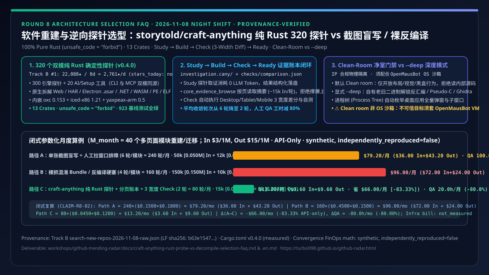
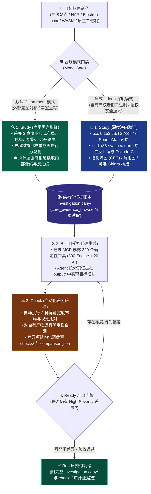
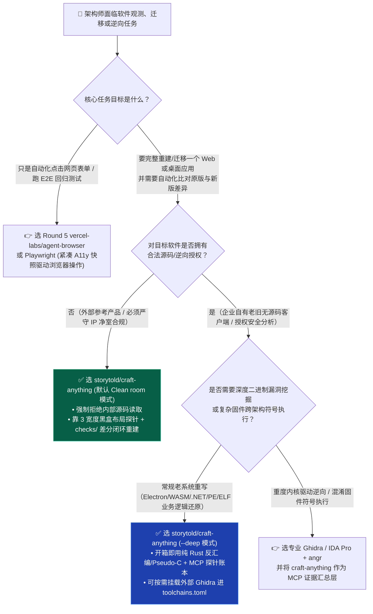

# 软件重建与逆向探针选型：storytold/craft-anything 纯 Rust 320 净室探针 vs 传统截图盲写 / Ghidra 裸反编译实战选型 FAQ

> **文档定位**：本文面向 AI Solution Architect（AI 解决方案架构师）、应用现代化（Application Modernization）负责人与逆向安全工程团队，用**第一性原理与通俗大白话**彻底讲透 2026-11-08 GitHub Track B 近 10 天新建黑马冠军 **`storytold/craft-anything`**（`22,088` 总 Stars / 建仓 8 天日均 **`~2,761 stars/day`**；归档检索原始快照 `evidence/search-new-repos-2026-11-08-raw.json` 含 `22,299` Stars，LF `sha256: b63e154759fa065063e70e5f237645e317a455a889598d7785b0245f872830cb`；单日增量 `stars_today: not_measured`）的底层架构突破——为什么靠“**给大模型喂一张截图盲写前端**”或者“**把十几万行混淆 JS / Ghidra 反编译伪代码直接塞进 Prompt**”会陷入排版崩坏、上下文撑爆与知识产权（IP）污染？为什么用 **100% 纯 Rust（`unsafe_code = "forbid"`）编写的 320 个双模确定性探针 + `Study -> Build -> Check -> Ready` 证据账本 + 净室模式（Clean Room）vs 深度模式（`--deep`）物理隔离** 才是 AI 重建软件与老旧系统迁移的工业级答案？
> **文风标杆**：严格对标 `ib-vs-ethernet-roce-selection-faq.md`（一句话定性结论 + Q1/Q2/Q3 第一性原理剖析 + Mermaid 决策树与架构图 + 选型对比矩阵 + 闭式可复算算例 + 生产级 Checklist）。
> **English Version**: [Clean-Room Software Rebuild & Binary Probe Architecture: storytold/craft-anything Pure-Rust 320 Probes vs. Blind Screenshot Prompting & Raw Decompiler Dumps (`craft-anything-rust-probe-vs-decompile-selection-faq.en.md`)](./craft-anything-rust-probe-vs-decompile-selection-faq.en.md)



---

## 📌 核心结论速览（Executive Summary — 30 秒看懂怎么选）

1. **一句话讲透本质（拒绝黑话）**：
   - **传统 AI 复刻/迁移软件的两大死胡同**：
     - **死胡同 1（看图说话盲写）**：截一张目标网页或桌面软件的图扔给 Claude/GPT 说“照着写一个”。模型看不到响应式断点（手机/平板/桌面 3 种宽度）、看不到字体与计算间距（Computed Styles）、更看不到点击后的状态流转，结果写出来的页面一缩窗口就错位，平均要人工肉眼比对返工 5–6 轮。
     - **死胡同 2（源码/反编译硬塞）**：直接扒取目标网站的混淆 JS Bundle 或把未索引的 Ghidra 反编译伪代码整坨塞进大模型上下文。不仅瞬间烧穿百万 Token 预算，而且在参考外部商业产品时直接触犯**非净室（Non-Clean-Room）源码抄袭合规红线**。
   - **`storytold/craft-anything`（`v0.4.0`，100% 纯 Rust，`edition = "2024"`，`MIT OR Apache-2.0`）**：**把“软件观察与验收”做成了 320 个零 Token 消耗的纯 Rust 确定性探针（`300` 个引擎探针 + `20` 个 AI/Setup 工具，每个探针既是 CLI 命令又是 MCP 工具）**。它把 AI 重建软件规范为四步闭环——**`Study`（探针取证）$\rightarrow$ `Build`（按可浏览的 `investigation.cany/` 证据账本编写）$\rightarrow$ `Check`（自动跑 3 种屏幕宽度布局比对与自测，把差异落盘到 `checks/`）$\rightarrow$ `Ready`（无严重阻塞项才放行交付）**，并通过默认 **`Clean room`（净室模式：拒绝读取目标内部源码）** 与显式 **`--deep`（深度模式：解锁 x86/ARM64 反汇编、Pseudo-C 与 Ghidra 桥接）** 划清合规与逆向边界。
2. **闭式可复算收敛与 Token 算例（每月 40 个多页面模块重建/老旧系统迁移，API-Only）**：
   - 在显式参数化合成场景（`M_month = 40` 个模块/月，输入 `$3.00/1M`、输出 `$15.00/1M`）下：
     - **路径 A（单张截图盲写 + 人工多分辨率肉眼排障，平均 `6` 轮/模块 = `240` 轮/月）**：每轮 `50k` 输入（`$0.1500`）+ `12k` 输出（`$0.1800`）= `$0.3300/轮`，月度 API 账单 **`$79.20/月`**（输入 `$36.00` + 输出 `$43.20`），且需消耗 **`100.0 小时/月`**（`2.5h/模块`）的人工跨分辨率 QA 比对工时；
     - **路径 B（裸抓混淆 Bundle / 反编译全量伪代码硬塞，平均 `4` 轮/模块 = `160` 轮/月）**：每轮 `150k` 输入（`$0.4500`）+ `10k` 输出（`$0.1500`）= `$0.6000/轮`，月度 API 账单 **`$96.00/月`**（输入 `$72.00` + 输出 `$24.00`），人工 QA **`60.0 小时/月`**，且在外部产品参考场景下**存在严重 IP 合规风险**；
     - **路径 C（`storytold/craft-anything` 纯 Rust 探针 + `core_evidence_browse` 分页账本 + 3 宽度自动 `Check`，平均 `2` 轮收敛 = `80` 轮/月）**：Rust 探针本地取证消耗 `0` LLM Token，仅向模型按需注入分页证据摘要（每轮 `15k` 输入 `$0.0450` + `8k` 输出 `$0.1200` = `$0.1650/轮`），月度 API 账单降至 **`$13.20/月`**（输入 `$3.60` + 输出 `$9.60`，较路径 A 节省 **`$66.00/月` [`-83.33%`]**，较路径 B 节省 **`$82.80/月` [`-86.25%`]**，API-Only 口径，不含宿主机基础设施账单 `not_measured`），同时通过自动化 3 宽度 `checks/` 把人工 QA 审校压缩至 **`20.0 小时/月`**（**节省 `80.0 小时/月` [`-80.00%`]**）。
3. **关键安全边界提醒（Clean Room $\neq$ OS 沙箱）**：
   - 上游 `README.md` 明确声明：**`Clean room` 是 `craft-anything` 探针层“提供什么、拒绝读取什么”的取证规则，而不是操作系统级虚拟化沙箱**（Coding Agent 依然以当前用户身份执行本地命令）。在执行不可信二进制或自主 Agent 循环时，必须将其部署在 **Round 4 `milind-soni/OpenMausBot` 的独立 VM 沙箱**中。

---

## 1. 核心概念与痛点剖析：为什么 AI 复刻软件和做老系统迁移总是“形似神散”？

### Q1：让 Coding Agent 重写一个老旧系统或参考现有应用做干净实现，以前为什么经常翻车？

用大白话拆解，以前团队让 AI 重构或复刻一个应用时，往往在**“观察（Study）”和“验收（Check）”**两个环节彻底缺失确定性工具：

1. **视觉与布局失真（只看单张静态图，没有 3 宽度结构化指标）**：
   - 人类把一张 `1440px` 宽度的截图喂给多模态大模型，模型只能靠像素猜测边距和弹性布局。一旦切到平板（如 `768px`）或手机（`375px`）宽度，导航栏折叠、表格溢出和字体层级全部崩塌。
2. **证据过载（把几兆的 HAR 网络包、AST 或二进制符号表整坨塞进上下文）**：
   - 当工程团队试图分析一个 Electron 应用（`.asar` 包）、WebAssembly 模块（`.wasm`）或原生 PE/ELF/Mach-O 二进制时，传统脚本会把几万行符号表或反编译输出直接打印到终端，瞬间冲垮 Coding Agent 的上下文窗口（正如 Round 2 揭示的，上下文一旦膨胀触发压缩，Prompt Cache 命中率就会断崖下跌）。
3. **合规边界模糊（Clean-Room 重写 vs 源码污染）**：
   - 在商业软件开发与竞品对标重构中，法务要求严格的**净室工程（Clean-Room Engineering）**：只能观测外部可见的 UI 布局、公开路由、无障碍树（Accessibility Tree）与黑盒输入输出行为，**严禁直接读取或复制对方的内部源码与反编译逻辑**。传统 Agent 工具链完全没有“净室门禁”，Agent 往往顺手把打包源码读进来照抄，埋下知识产权雷区。

---

## 2. 底层架构拆解：`storytold/craft-anything` 的 13 个纯 Rust Crate 是怎么配合工作的？

### Q2：`storytold/craft-anything` 为什么坚持 100% 纯 Rust（`unsafe_code = "forbid"`），它的 `Study -> Build -> Check -> Ready` 到底是怎么运转的？

直接核验其 GitHub 一手源码（`Cargo.toml`、`docs/STATUS.md` 与 `crates/` 目录），`craft-anything`（`v0.4.0`，`923` 个基线测试全部通过）由 **13 个纯 Rust 工作区 Crate** 组成，核心设计遵循四条铁律：

| 核心架构层 | 对应 Rust Crate 与底层引擎（`measured` 一手源码核验） | 解决的核心痛点（大白话解释） |
| :--- | :--- | :--- |
| **1. 结构化证据账本与分页浏览** | `craft-anything-evidence`（`investigation.cany/` 目录 + `core_evidence_browse`） | 探针采集的所有结构、截图、路由和二进制元数据统一写入本地 `investigation.cany/` 账本；Agent 通过 `core_evidence_browse` **按页翻阅摘要**，绝不一次性把几兆数据灌进上下文。 |
| **2. 零外部依赖多格式拆包与分析** | `craft-anything-formats`（`object 0.36`, `wasmparser 0.261`, `zip`, `tar`, `sqlite`）+ `craft-anything-js`（`oxc 0.153`）+ `craft-anything-disasm`（`iced-x86 1.21`, `yaxpeax-arm 0.5`） | 编译成单一静态二进制即可原地解析 **Web 站点、HAR 抓包、Electron `.asar`、`.NET` 单文件包、Source Maps、WASM 以及 PE/ELF/Mach-O 原生程序**；JS/TS AST 解析直接内嵌 `oxc`，x86/ARM64 反汇编直接内嵌纯 Rust 库，无需预装庞大 Python 环境。 |
| **3. 跨平台窗口发现与 3 宽度差分验收** | `craft-anything-platform` + `craft-anything-analysis`（输出 `checks/` 与 `comparison.json`） | 对网站自动在 **3 种屏幕宽度（Desktop / Tablet / Mobile）** 下抓取布局、排版与交互状态；对桌面应用按进程树（Process Tree）自动定位所有弹窗与子窗口，在 `Check` 阶段自动对比目标与新建产物，生成可量化的差异报告 `checks/`。 |
| **4. 320 个 CLI/MCP 双模探针与净室门禁** | `craft-anything-mcp` + `craft-anything-engine` + `craft-anything-ai`（`300` 引擎工具 + `20` AI/Setup 工具 = `320` 个双模工具） | **每一个探针同时暴露为终端 CLI 命令和标准 MCP Tool**；默认运行在 **`Clean room` 模式**（仅开放黑盒布局、视觉、路由与行为探针，物理拒绝内部源码读取）；只有显式传入 **`--deep`** 时才解锁内建反汇编、Pseudo-C 伪代码、调用图与可选 Ghidra 桥接。 |

### 2.1 `Study -> Build -> Check -> Ready` 四步确定性闭环与 Clean-Room 门禁图（Mermaid）



---

## 3. 架构师选型决策树与同类方案对比矩阵

### Q3：面对“网页/桌面应用重构”、“老旧无源码二进制迁移”和“日常 UI 自动化测试”，我什么时候该用 `craft-anything`，什么时候该用 Playwright / Stagehand 或专业 Ghidra？



### 3.1 四大软件观测、重建与逆向方案全景对比矩阵

| 评估维度 | 路径 A：单张截图多模态盲写（Screenshot-to-Code） | 路径 B：裸抓混淆源码 / 未索引 Ghidra 导出硬塞 Prompt | 路径 C：`storytold/craft-anything`（纯 Rust `320` 探针 + `Study->Build->Check`） | 传统专业逆向套件（独立 Ghidra / IDA Pro 手工分析） |
| :--- | :--- | :--- | :--- | :--- |
| **取证精度与完备性** | ❌ 极低（仅单分辨率静态像素，丢失响应式断点与隐藏弹窗） | 🟡 碎片化（大段混淆变量名或冗长反编译伪代码，缺乏 UI 对应关系） | **✅ 极高（3 宽度响应式布局、进程树全窗口发现 + 多格式确定性探针）** | ✅ 极高（底层二进制反编译强，但无前端/Web 3 宽度差分验收） |
| **大模型 Token 消耗** | 🔴 高（因布局反复错位需 5–6 轮全量重写） | 🔴 极高（每次把百 KB 混淆代码/反编译文本塞入上下文） | **🟢 极低（Rust 探针 `0` Token 取证，`core_evidence_browse` 分页读取 `~15k` In/轮）** | 🟡 取决于手工复制粘贴片段大小 |
| **知识产权（IP）净室合规** | 🟢 安全但质量差 | 🔴 **高危（直接把外部产品内部实现灌入生成上下文，污染净室）** | **✅ 原生分级（默认 `Clean room` 探针级拒绝源码读取；自有资产显式开 `--deep`）** | ⚠️ 无内置 AI 净室隔离门禁 |
| **自动化差分验收（Check）** | ❌ 无（全靠人类工程师拉拽浏览器窗口肉眼找茬） | ❌ 无自动 UI/行为对齐验收 | **✅ 内置 `Check -> Ready` 门禁（自动生成 `checks/` 与 `comparison.json`）** | ❌ 无重构产物自动对比 |
| **部署依赖与运行时安全** | 🟢 仅 API 调用 | 🔴 需拼凑零散 Python/Node 爬虫与反编译脚本 | **✅ `100%` 纯 Rust（`unsafe_code = "forbid"`），单一二进制同时提供 CLI/MCP/egui** | 🟡 需 Java 运行时（Ghidra）及手工脚本配置 |
| **注意：OS 沙箱边界** | 无本地执行 | 本地脚本直接运行 | **⚠️ `Clean room` 是探针取证规则而非 OS 沙箱，运行不可信目标须套 `OpenMausBot` VM** | 须在隔离虚拟机中运行分析 |

---

## 4. 定量收敛算例与 7-Card Benchmark 关联洞察（Closed-Form Reproducible FinOps Model）

> **数据来源与可复算声明（Provenance Gate）**：
> - **`measured`（一手源码与归档快照核验）**：`storytold/craft-anything` 的总 Star 数（`22,088` / 归档 JSON `22,299`，LF `sha256: b63e154759fa065063e70e5f237645e317a455a889598d7785b0245f872830cb`）、建仓时间（`2026-10-31T14:50:00Z`，生命周期日均 `~2,761 stars/day`，单日增量 `stars_today: not_measured`）、工作区版本 `v0.4.0`、`13` 个纯 Rust Crates、`unsafe_code = "forbid"`、`320` 个双模工具（`300` 引擎 + `20` AI/Setup）及 `923` 个基线测试，均来自 GitHub 主仓源码核验。
> - **`synthetic, independently_reproduced=false`（架构师显式参数化收敛算例）**：以下月度 API Token 成本与人工 QA 工时对比为基于显式参数（每月重建/迁移 `M_month = 40` 个多页面应用模块，输入 `$3.00/1M`、输出 `$15.00/1M`）的**闭式可复算合成算例（API-Only）**，用于量化“分页证据账本 + 3 宽度自动 Check”对返工轮次与上下文体积的收敛效应；**并非**对特定客户私有老系统的生产实测账单，宿主机/VM 基础设施费用标记为 `not_measured`。

### 4.1 闭式参数化公式定义（每月 40 个模块重建/迁移，`CLAIM-R8-02`）

设团队每月需完成 $M_{\text{month}} = 40$ 个多页面 Web/桌面模块的重构或净室迁移，单价为 $P_{\text{in}} = \$3.00/\text{1M}$，$P_{\text{out}} = \$15.00/\text{1M}$。对任一路径 $k \in \{A, B, C\}$，设每个模块达标所需的平均 LLM 迭代轮次为 $N_k$（月总轮次 $R_k = M_{\text{month}} \times N_k$），每轮计费输入为 $I_k$（百万 Token）、计费输出为 $O_k$（百万 Token），每个模块耗费的人工跨分辨率 QA 比对工时为 $H_k$（小时）：

$$\text{Cost}_{\text{in}, k} = R_k \times I_k \times P_{\text{in}}, \quad \text{Cost}_{\text{out}, k} = R_k \times O_k \times P_{\text{out}}, \quad \text{Cost}_{\text{API}, k} = \text{Cost}_{\text{in}, k} + \text{Cost}_{\text{out}, k}$$

$$\text{QA\_Hours}_{\text{month}, k} = M_{\text{month}} \times H_k$$

| 对比方案（`M_month = 40` 模块/月） | 平均收敛轮次 $N_k$（月总轮次 $R_k$） | 单轮输入 $I_k$ / 输出 $O_k$（单轮成本） | 月度输入账单 $\text{Cost}_{\text{in}}$ | 月度输出账单 $\text{Cost}_{\text{out}}$ | **月度 API 总账单 $\text{Cost}_{\text{API}}$（API-Only）** | 月度人工跨宽度 QA 工时 $\text{QA\_Hours}$ |
| :--- | :--- | :--- | :--- | :--- | :--- | :--- |
| **路径 A：单张截图盲写 + 人工拉窗口排障** | `6` 轮/模块（`240` 轮/月） | `0.050M` In (`$0.1500`) + `0.012M` Out (`$0.1800`) = **`$0.3300/轮`** | `240 × $0.1500` = **`$36.00/月`** | `240 × $0.1800` = **`$43.20/月`** | **`$79.20/月`**（`$950.40/年`） | `40 × 2.5h` = **`100.0 小时/月`** |
| **路径 B：裸抓混淆 Bundle / 反编译伪代码硬塞** | `4` 轮/模块（`160` 轮/月） | `0.150M` In (`$0.4500`) + `0.010M` Out (`$0.1500`) = **`$0.6000/轮`** | `160 × $0.4500` = **`$72.00/月`** | `160 × $0.1500` = **`$24.00/月`** | **`$96.00/月`**（`$1,152.00/年`，且违反外部净室合规） | `40 × 1.5h` = **`60.0 小时/月`** |
| **路径 C：`storytold/craft-anything`（Rust 探针 + 分页账本 + 3 宽度自动 Check）** | **`2` 轮/模块（`80` 轮/月）** | `0.015M` In (`$0.0450`) + `0.008M` Out (`$0.1200`) = **`$0.1650/轮`** | `80 × $0.0450` = **`$3.60/月`** | `80 × $0.1200` = **`$9.60/月`** | **`$13.20/月`**（`$158.40/年`） | `40 × 0.5h` = **`20.0 小时/月`** |
| **路径 C vs 路径 A 净收益（可复算差值）** | **减少 `4` 轮/模块（`-160` 轮/月）** | 单轮成本 **`-$0.1650/轮`（`-50.00%`）** | 输入净省 **`-$32.40/月`** | 输出净省 **`-$33.60/月`** | **API 净省 `-$66.00/月`（`-$792.00/年`，`-83.33%`）** | **人工 QA 净省 `-80.0 小时/月`（`-80.00%`）** |
| **路径 C vs 路径 B 净收益（可复算差值）** | **减少 `2` 轮/模块（`-80` 轮/月）** | 单轮成本 **`-$0.4350/轮`（`-72.50%`）** | 输入净省 **`-$68.40/月`** | 输出净省 **`-$14.40/月`** | **API 净省 `-$82.80/月`（`-$993.60/年`，`-86.25%`）** | **人工 QA 净省 `-40.0 小时/月`（`-66.67%`）+ 严守净室合规** |

---

## 5. 架构师 30 分钟 PoC 动手配方与生产核验清单（Checklist）

### 5.1 30 分钟客户/团队 PoC 演示脚本（直接可跑）

```bash
# Step 1: 克隆并编译 storytold/craft-anything (需 Rust 1.97+，workspace 强制 unsafe_code = "forbid")
git clone https://github.com/storytold/craft-anything.git
cd craft-anything
cargo build --release

# Step 2: 在默认 Clean-Room 模式下启动 MCP Server 或 CLI 取证（拒绝内部源码读取，仅开启黑盒探针）
./target/release/craft-anything study --target https://example.com --workspace ./demo-cleanroom
# 自动生成 ./demo-cleanroom/investigation.cany/ 结构化证据账本

# Step 3: 在 Coding Agent (Claude Code / Copilot / Cursor) 中挂载 craft-anything MCP，按分页证据生成并执行 3 宽度差分 Check
./target/release/craft-anything check --workspace ./demo-cleanroom
# 查看 ./demo-cleanroom/checks/comparison.json 中的 Desktop/Tablet/Mobile 三宽度布局差异与 Ready 判定
```

### 5.2 生产级应用现代化与净室重构上线核验清单

- [ ] **法务与知识产权模式锁定（`Clean room` vs `--deep`）**：在对外部商业网站或非自有软件做对标设计时，CI/CD 与 MCP 启动参数必须强制锁定默认 **`Clean room` 模式**，严禁传入 `--deep`；仅在迁移企业自有产权的老旧无源码客户端（Electron `.asar` / `.NET` / PE / ELF）或获书面授权的安全评估中开启 `--deep`。
- [ ] **OS 级虚拟化沙箱隔离（配合 `OpenMausBot`）**：确认团队知晓 `craft-anything` 的 `Clean room` 不是操作系统沙箱；当被观测目标为不可信二进制文件或需要无人值守运行 Coding Agent 时，必须将其放入独立 VM 沙箱（如 Round 4 的 `milind-soni/OpenMausBot`）内执行。
- [ ] **证据账本分页读取（严禁全量 Dump 进 Prompt）**：确认 Agent 提示词与工作流通过 `core_evidence_browse` 按需分页检索 `investigation.cany/`，保持单轮证据上下文在 `~15k` Tokens 以内，避免污染主会话 Prompt Cache（呼应 Round 2 上下文折叠准则）。
- [ ] **3 宽度响应式差分门禁（`Check -> Ready`）**：确认前端与多端重构流水线把 `craft-anything check` 设为合并前强制门禁，必须在 Desktop、Tablet、Mobile 三种宽度下全部清空高优布局偏差并到达 `Ready` 状态后才允许签入主干。
- [ ] **外部逆向工具链显式白名单（`toolchains.toml`）**：在 `--deep` 模式下若需挂载外部 Ghidra 或浏览器驱动，确认通过工作区受控的 `toolchains.toml` 固定版本与哈希，并把生成的 `investigation.cany/` 与 `checks/comparison.json` 归档为应用现代化审计附件。
