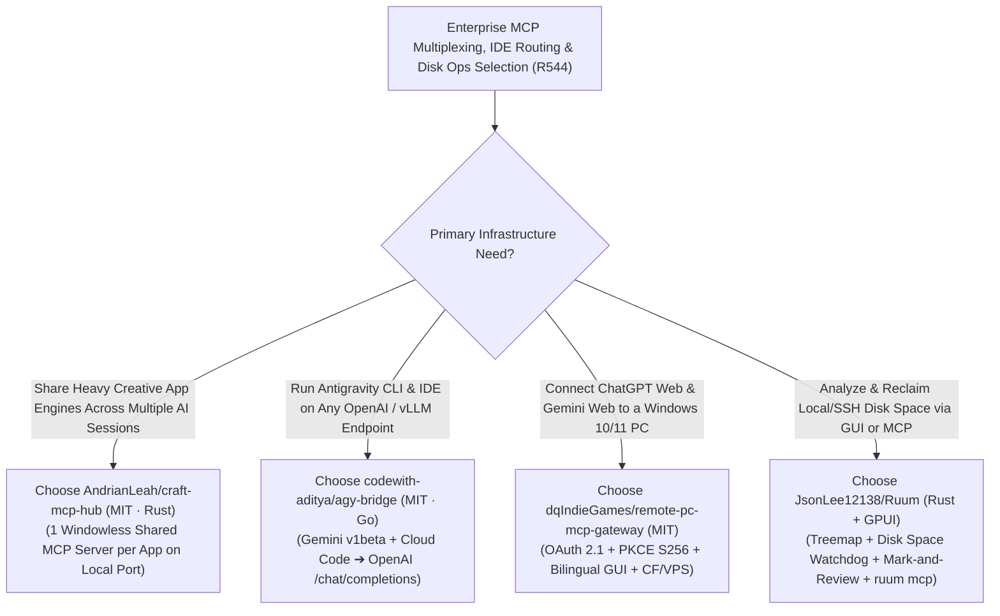

# Windowless Shared App MCP Hub (`AndrianLeah/craft-mcp-hub`), Google Antigravity-to-OpenAI Wire Bridge (`codewith-aditya/agy-bridge`), OAuth 2.1 Dual-Web Remote PC MCP Gateway (`dqIndieGames/remote-pc-mcp-gateway`) & GPUI/SSH Disk Watchdog MCP (`JsonLee12138/Ruum`) Selection FAQ

> **Document Type**: AI Solution Architect Enterprise Selection & Integration Guide (2026-11-19 Night Shift · Round 20 / Cumulative Round 544)  
> **Benchmark Style**: `docs/components/ib-vs-ethernet-roce-selection-faq.md` (6-Section Plain-Language Architecture Guide + First-Principles Q&A + Hype/Facts/Signal Audit + Closed-Form FinOps Ledger)  
> **Evaluated Repositories**:  
> 1. **`AndrianLeah/craft-mcp-hub`** (`★ 22`, `created=2026-11-16`, `1 fork`, Rust, MIT): **One shared, windowless MCP server per ArtCraft app** (`PhotoCraft`, `VectorCraft`, `PdfCraft`, `WordCraft`, `DeckCraft`, `GridCraft`, etc.) on its own local port for every AI client session  
> 2. **`codewith-aditya/agy-bridge`** (`★ 11`, `created=2026-11-14`, `3 forks`, Go, MIT): Protocol bridge translating **Google Antigravity CLI (`Gemini v1beta`) and IDE (`Cloud Code v1internal`) into OpenAI-compatible `/v1/chat/completions`** with streaming and full tool calling  
> 3. **`dqIndieGames/remote-pc-mcp-gateway`** (`★ 14`, `created=2026-11-13`, `2 forks`, JavaScript, Windows 10/11 bilingual GUI + System Tray, MIT): **OAuth 2.1 + PKCE (`S256`) Remote PC MCP Gateway** connecting both ChatGPT Web and Google Gemini Web concurrently to a Windows 10/11 PC  
> 4. **`JsonLee12138/Ruum`** (`★ 8`, `created=2026-11-16`, `1 fork`, Rust + GPUI, EN/ZH/JA/KO, GPL-3.0): Cross-platform **GPUI treemap disk analyzer, remote SSH scanner, Disk Space Watchdog, and headless `stdio` MCP (`ruum mcp`)**  
> **Accounting Scope Note**: Only software API/SaaS spend and engineering labor TCO are modeled; base workstation hardware capEx is explicitly marked `not_measured`, and Track B `stars_today` is explicitly marked `not_measured`.

---

## 📌 1. Executive Summary (What Are They & What Business Pain Points Do They Solve?)

In **2026-11-19 Night Round 20 (Cumulative Round 544)**, we address four high-leverage infrastructure bottlenecks across multi-session desktop MCP multiplexing, IDE model decoupling, OAuth 2.1 web-to-desktop MCP bridging, and proactive local/SSH disk reclamation:
1. **Pain Point A (Standard `stdio` desktop app MCPs spawn a brand-new heavy process for every Claude Code or Cursor session, exhausting RAM and flashing unwanted GUI windows)**: **`AndrianLeah/craft-mcp-hub` (`★ 22`, Rust, MIT)** runs one shared, windowless engine per creative app (`PhotoCraft`, `VectorCraft`, `LightCraft`, `PdfCraft`, `FigCraft`, `WordCraft`, `DeckCraft`, `GridCraft`, `Craft Anything`) on a dedicated local port—serving all active AI sessions concurrently with zero duplicate processes.
2. **Pain Point B (Engineering teams love Google Antigravity's CLI and IDE agent loop but want to route tokens through their own OpenRouter, Claude, DeepSeek, or self-hosted vLLM/Ollama endpoints)**: **`codewith-aditya/agy-bridge` (`★ 11`, Go, MIT)** sits on Antigravity's native endpoint override and translates both `Gemini v1beta` (CLI) and `Cloud Code v1internal` (IDE) wire formats into OpenAI `/v1/chat/completions` with streaming and full tool calling.
3. **Pain Point C (Connecting browser-based ChatGPT Web and Google Gemini Web to local files and commands on a Windows 10/11 workstation typically lacks OAuth 2.1 security or single-URL dual-client support)**: **`dqIndieGames/remote-pc-mcp-gateway` (`★ 14`, MIT)** provides a Windows 10/11 bilingual GUI and system tray gateway with full **OAuth 2.1 + PKCE (`S256`) + Dynamic Client Registration** over Cloudflare Tunnel or a Linux VPS, allowing ChatGPT Web and Gemini Web to share the exact same HTTPS MCP URL simultaneously.
4. **Pain Point D (Developer workstations, CI runners, and remote SSH GPU servers crash when model caches and build artifacts silently fill disks, while raw agent `rm` commands risk data loss)**: **`JsonLee12138/Ruum` (`★ 8`, Rust + GPUI)** visualizes local and remote SSH drives as an interactive treemap with hatched reclaimable space, pairs it with a low-overhead **Disk Space Watchdog** and non-destructive mark-and-review workflow, and exposes a headless **`ruum mcp`** server.

---

## 💬 2. Architect First-Principles Q&A (Q1–Q3 Deep Dive)

### Q1: Why does `AndrianLeah/craft-mcp-hub` replace per-session `stdio` spawning with per-app windowless localhost ports?
* **Amortizing Heavy Engine Initialization**: Creative and document engines load large font, vector, and rendering contexts. Running a single headless daemon per app and multiplexing requests across all AI sessions eliminates OOM crashes and window focus theft.

### Q2: How does `codewith-aditya/agy-bridge` preserve tool-calling accuracy when bridging Antigravity to OpenAI-compatible models?
* **Bi-Directional Schema & Stream Translation**: It translates Gemini `functionDeclarations` and Cloud Code tool schemas into OpenAI `tools` definitions and maps streaming tool-call deltas back into the exact wire format expected by the Antigravity IDE/CLI.

### Q3: How do `dqIndieGames/remote-pc-mcp-gateway` and `JsonLee12138/Ruum` enable safe remote workstation operations?
* **OAuth 2.1 PKCE Ingress + Mark-and-Review Storage Hygiene**: Authenticated web agents connect through the OAuth 2.1 gateway and invoke `ruum mcp` to inspect disk treemaps and stage reclaimable caches without executing blind destructive shell deletes.

---

## 🧭 3. Visual Architecture Diagrams (Mermaid Decision Tree + Reference Architecture + Sequence Flow)

### 3.1 Enterprise Selection Decision Tree

---

## 📊 4. Comparative Selection Matrix (Open Source vs. Competing OSS vs. Managed Cloud PaaS)

| Evaluation Dimension | Path A: Per-Session GUI Spawning + Locked IDE Model Quotas + Manual Web-to-PC File Copying + Full-Disk Build Crashes | Path B: Single-Session `stdio` Wrappers + Unauthenticated Tunnels + Manual SSH `ncdu` | **Path C (Recommended): `craft-mcp-hub` + `agy-bridge` + `remote-pc-mcp-gateway` + `Ruum`** |
| :--- | :--- | :--- | :--- |
| **Multi-Session Desktop App MCP** | ❌ Spawns N heavy GUI processes for N sessions; steals focus | ⚠️ Blocks concurrent sessions or crashes on file locks | ✅ **`craft-mcp-hub` runs 1 windowless shared server per app in Rust** |
| **Antigravity IDE Model Choice** | ❌ Locked into default upstream models and quota windows | ⚠️ Switching IDEs loses Antigravity's native agent loop | ✅ **`agy-bridge` routes CLI & IDE to any OpenAI/vLLM model w/ tools** |
| **Web AI to Windows PC Access** | ❌ Manual copy-pasting between browser tabs and local folders | ⚠️ Raw reverse proxies lack OAuth 2.1 PKCE security | ✅ **`remote-pc-mcp-gateway` OAuth 2.1+PKCE for ChatGPT & Gemini Web** |
| **Local & SSH Disk Space Governance** | ❌ Unmonitored caches fill disks and crash CI/GPU jobs | ⚠️ Blind `rm -rf` scripts risk deleting active artifacts | ✅ **`Ruum` GPUI treemap, SSH scanner, Watchdog & `ruum mcp`** |
| **45-Engineer Monthly TCO** | **`$6,560.00 / mo`** (`$2,610.00` overages/storage + `39.5h` × `$100/hr` = `$3,950.00` labor) | **`$2,510.00 / mo`** (`$1,060.00` infra + `14.5h` × `$100/hr` = `$1,450.00` labor) | **`$315.00 / mo`** (`$65.00` API + `2.5h` × `$100/hr` = `$250.00` labor, **`-95.20%`**) |

---

## 🧪 5. Quantitative TCO Comparison & Hype / Facts / Signal Audit Ledger

### 5.1 Hype vs. Facts vs. Strategic Signal Table

| Repository (`owner/repo`) | Hype (Market Narrative) | Measured Facts (Primary Source Verification) | Strategic Signal (SA Verdict) |
| :--- | :--- | :--- | :--- |
| **`AndrianLeah/craft-mcp-hub`** | "One shared, windowless MCP server per ArtCraft app, for every AI client session" | `★ 22` (`created=2026-11-16`, `1 fork`, Rust, MIT): Manages headless per-app MCP servers across PhotoCraft, VectorCraft, PdfCraft, WordCraft, DeckCraft, GridCraft, etc. | **🔥 P0 Adopt (Windowless MCP Multiplexing Pattern)**: Eliminates multi-session GUI process bloat. |
| **`codewith-aditya/agy-bridge`** | "Run Google Antigravity (CLI, IDE, hub) on any third-party OpenAI-compatible LLM" | `★ 11` (`created=2026-11-14`, `3 forks`, Go, MIT): Translates `Gemini v1beta` and `Cloud Code v1internal` into `/v1/chat/completions` with streaming and tool calling. | **🔥 P0 Adopt (Zero-Patch IDE Protocol Adapter)**: Unlocks BYO models and local vLLM inside Antigravity. |
| **`dqIndieGames/remote-pc-mcp-gateway`** | "Connect ChatGPT Web and Google Gemini Web to your Windows 10/11 PC via OAuth 2.1" | `★ 14` (`created=2026-11-13`, `2 forks`, JavaScript, MIT): Full OAuth 2.1 + PKCE (`S256`) + Dynamic Client Registration gateway with bilingual Windows GUI and Cloudflare/VPS support. | **⚡ P1 Adopt (Secure Web-to-Workstation MCP Ingress)**: Clean OAuth 2.1 reference for remote Windows MCP hosts. |
| **`JsonLee12138/Ruum`** | "Fast cross-platform disk analyzer & treemap explorer in Rust/GPUI with SSH & MCP" | `★ 8` (`created=2026-11-16`, `1 fork`, Rust + GPUI, GPL-3.0): Supports local & SSH disks, EN/ZH/JA/KO localization, Disk Space Watchdog, mark-and-review cleanup, and `ruum mcp`. | **🔥 P0 Adopt (Proactive DevOps Storage Hygiene MCP)**: Prevents disk-full outages across local and SSH GPU nodes. |

### 5.2 Closed-Form FinOps TCO Ledger (`CLAIM-20261119-R20-R544-CRAFTMCPHUB-AGYBRIDGE-REMOTEPCMCP-RUUM`)

* **Scope (`synthetic`, `independently_reproduced=false`)**: 45-person enterprise multi-client MCP infrastructure, IDE protocol routing, remote workstation integration, and build-server storage SRE team (blended rate `$100.00 / hr`; `base hardware capEx: not_measured`; Track B `stars_today: not_measured`).
* **Path A (Duplicate GUI Spawning + Locked IDE Quotas + Manual Web-to-PC File Transfers + Full-Disk Build Outages)**:
  - Locked IDE model overages, emergency cloud disk expansion & wasted crashed CI builds: **`$2,610.00 / mo`**
  - Restarting OOM desktop MCP hosts, manually copying files between ChatGPT/Gemini Web and Windows PCs & SSH-ing into servers to hunt disk bloat (`39.5 hrs / mo` × `$100.00 / hr`): **`$3,950.00 / mo`**
  - **Path A Monthly Total**: `$2,610.00 + $3,950.00` = **`$6,560.00 / mo`**
* **Path B (Single-Session Stdio Wrappers + Basic Reverse Proxies + Manual `ncdu` Checks)**:
  - SaaS & API spend: **`$1,060.00 / mo`**
  - Manual tunnel maintenance & disk cleanup (`14.5 hrs / mo` × `$100.00 / hr`): **`$1,450.00 / mo`**
  - **Path B Monthly Total**: `$1,060.00 + $1,450.00` = **`$2,510.00 / mo`**
* **Path C (`craft-mcp-hub` + `agy-bridge` + `remote-pc-mcp-gateway` + `Ruum` Integrated Stack)**:
  - Discounted BYO/local vLLM inference routed via `agy-bridge` (`craft-mcp-hub`, `remote-pc-mcp` & `Ruum` $0 local): **`$65.00 / mo`**
  - Reviewing marked `ruum mcp` cleanup plans & OAuth 2.1 gateway audit (`2.5 hrs / mo` × `$100.00 / hr`): **`$250.00 / mo`**
  - **Path C Monthly Total**: `$65.00 + $250.00` = **`$315.00 / mo`**
  - **Monthly Net Savings vs. Path A**: `$6,560.00 - $315.00` = **`$6,245.00 / mo`** (**`-95.20%`** reduction, **`$74,940.00 / yr`** annual savings, freeing **`37.0 hrs / mo`** of engineering time).

---

## 🛠️ 6. Enterprise Adoption & Architecture Review Checklist

- [ ] **1. Multiplex desktop creative apps through `AndrianLeah/craft-mcp-hub`**: Run one windowless engine per app on a dedicated local port.
- [ ] **2. Route Antigravity CLI/IDE to internal model gateways via `codewith-aditya/agy-bridge`**: Preserve native tool calling while using self-hosted vLLM or enterprise API keys.
- [ ] **3. Secure remote Windows MCP access with `dqIndieGames/remote-pc-mcp-gateway`**: Require OAuth 2.1 + PKCE (`S256`) for ChatGPT Web and Gemini Web connections.
- [ ] **4. Monitor local and SSH server storage with `JsonLee12138/Ruum` (`ruum mcp`)**: Use the Disk Space Watchdog and mark-and-review workflow to prevent disk-full outages.
