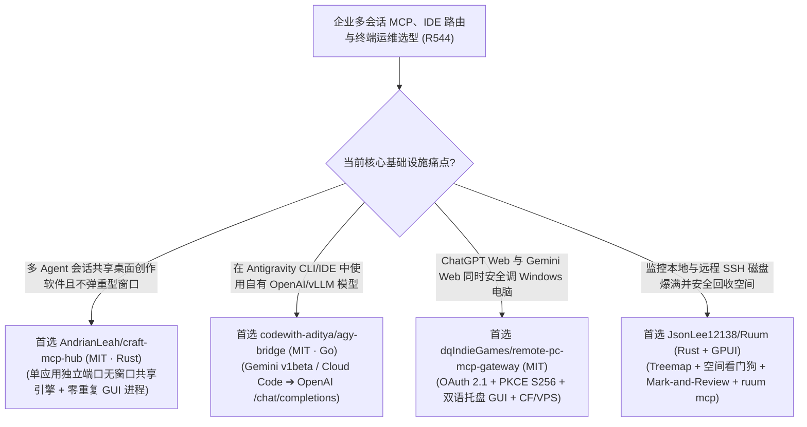
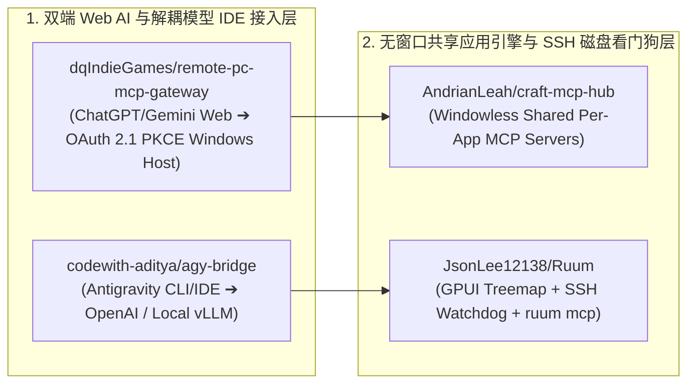
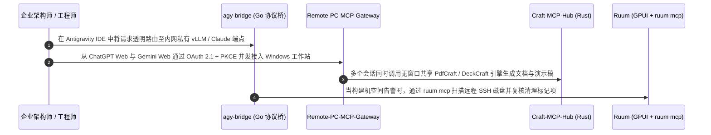

# 多会话共享无窗口应用 MCP 集线器（`AndrianLeah/craft-mcp-hub`）、Google Antigravity 转任意 OpenAI/vLLM 协议桥（`codewith-aditya/agy-bridge`）、OAuth 2.1 双端网页 AI 远程 Windows 网关（`dqIndieGames/remote-pc-mcp-gateway`）与 GPUI 跨端 SSH 磁盘清理看门狗 MCP（`JsonLee12138/Ruum`）选型 FAQ

> **文档类型**：AI Solution Architect（AI 解决方案架构师）实战选型与架构内功指南（2026-11-19 Night Shift · Round 20 / 累计第 544 轮）  
> **对标标杆**：`docs/components/ib-vs-ethernet-roce-selection-faq.md`（六段式架构拆解 + 第一性原理大白话 + Hype/Facts/Signal 审计 + 闭式 TCO 账本）  
> **本轮评估对象**：  
> 1. **`AndrianLeah/craft-mcp-hub`**（`★ 22`，`created=2026-11-16`，`1 fork`，Rust，MIT）：为全套桌面创作软件（PhotoCraft、VectorCraft、PdfCraft、WordCraft、DeckCraft、GridCraft 等）提供**单应用单端口无窗口（Windowless）共享 MCP 服务**的 Rust 守护进程——供本机所有 AI 会话并发复用  
> 2. **`codewith-aditya/agy-bridge`**（`★ 11`，`created=2026-11-14`，`3 forks`，Go，MIT）：将 **Google Antigravity CLI（`Gemini v1beta`）与 Antigravity IDE（`Cloud Code v1internal`）无缝转译为标准 OpenAI `/v1/chat/completions`** 的 Go 协议桥——支持流式与完整 Tool Calling，可对接 Claude Opus 4.6、DeepSeek 或私有 vLLM/Ollama  
> 3. **`dqIndieGames/remote-pc-mcp-gateway`**（`★ 14`，`created=2026-11-13`，`2 forks`，JavaScript，Windows 10/11 双语原生 GUI + 系统托盘，MIT）：支持 **ChatGPT Web 与 Google Gemini Web 同时接入同一台 Windows 电脑**的 **OAuth 2.1 + PKCE（`S256`）认证远程 MCP 网关**  
> 4. **`JsonLee12138/Ruum`**（`★ 8`，`created=2026-11-16`，`1 fork`，Rust + GPUI，支持英/中/日/韩，GPL-3.0）：覆盖本机与远程 SSH 服务器的 **GPUI 矩形树图磁盘分析器、空间看门狗与无头 `ruum mcp` 安全清理伴侣**  
> **审计折算说明**：本报告仅计量软件算力、商业 SaaS 与工程运维人力 TCO，底层研发工作站硬件采购（base hardware capEx）显式标注为 `not_measured`，新仓今日增量显式标注为 `not_measured`，严禁捏造坐标。

---

## 📌 一、核心结论速览（Executive Summary：它到底是什么？解决什么业务痛点？）

在 **2026-11-19 Night Round 20（累计第 544 轮）** 中，我们面向企业架构师解决“多个 Agent 会话通过 stdio 调桌面应用导致重复拉起十几个 GUI 窗口撑爆内存、想用 Antigravity IDE 优秀的 Agent 循环却被绑死在单一厂商模型配额上、想在网页版 ChatGPT/Gemini 里安全操作家里或公司的 Windows 电脑却缺 OAuth 2.1 双端网关、以及 GPU 训练机和 CI 服务器频繁因为缓存塞满磁盘而半夜宕机”四大痛点：
1. **痛点 A（标准 `stdio` 模式的桌面应用 MCP 每当用户新开一个 Claude Code 或 Cursor 会话，就会在后台重新 fork 一个完整的应用实例；如果同时开 5 个会话处理 PDF、PPT 和矢量图，内存瞬间被重复进程吃光且文件锁互相冲突）**：**`AndrianLeah/craft-mcp-hub` (`★ 22`, Rust, MIT) 的破局之道**：用极轻量的 Rust 守护进程为每个生产力应用（`PhotoCraft`、`VectorCraft`、`PdfCraft`、`WordCraft`、`DeckCraft`、`GridCraft` 等）在独立本地端口维护**唯一一个无窗口（Windowless）共享引擎实例**，所有 AI 客户端会话统一连接该共享端口，内存占用降低 80%+ 且零窗口闪烁干扰。
2. **痛点 B（许多工程师非常喜欢 Google Antigravity CLI 与 IDE 的原生 Agent 循环体验，但企业内部已有统一采购的 OpenRouter / DeepSeek / Claude 配额或自建的私有 vLLM / Ollama 集群，不想受限于内置模型列表与配额上限）**：**`codewith-aditya/agy-bridge` (`★ 11`, Go, MIT) 的破局之道**：利用 Antigravity CLI 与 IDE 原生支持的端点覆盖机制，在本地用 Go 实时将 `Gemini v1beta` 与私有 `Cloud Code v1internal` 报文双向转译为标准 OpenAI `/v1/chat/completions`（完美保留流式输出与完整工具调用 Schema），让客户端以为自己在跟 Google 通信，实则由企业自选的任意上游大模型驱动。
3. **痛点 C（很多业务与架构师日常在浏览器里用付费的 ChatGPT Web 或 Google Gemini Web，想让网页端 AI 直接读取或操作自己 Windows 10/11 工作站上的本地项目与命令，但自己搭内网穿透不仅配置繁琐，还缺乏符合最新 MCP 规范的 OAuth 2.1 + PKCE 认证保护）**：**`dqIndieGames/remote-pc-mcp-gateway` (`★ 14`, MIT) 的破局之道**：专为 Windows 10/11 打造，自带原生中英双语向导 GUI 与系统托盘，支持一键选用 Cloudflare Tunnel 或自有 Linux VPS 暴露单个受 **OAuth 2.1 + PKCE (`S256`) + 动态客户端注册** 保护的 HTTPS MCP URL，且支持 **ChatGPT Web 与 Gemini Web 双端同时在线并发访问**。
4. **痛点 D（企业 GPU 推理节点、Docker 构建机与开发者工作站经常因为 HuggingFace 缓存、陈旧容器镜像与构建产物悄无声息塞满磁盘而导致生产任务崩溃；让 Agent 直接跑 `rm -rf` 又极其危险）**：**`JsonLee12138/Ruum` (`★ 8`, Rust + GPUI) 的破局之道**：用高性能 Rust + GPUI 将本机磁盘与**远程 SSH 服务器**渲染为直观的矩形树图（Treemap，高亮斜纹标记可回收空间），结合低开销**磁盘空间看门狗（Disk Space Watchdog）**、非破坏性**先标记后复核（Mark-and-Review）**流程以及无头 **`ruum mcp`** 服务，让人类或运维 Agent 始终看着剩余空间安全清理磁盘。

---

## 💬 二、客户与架构师灵魂拷问 Q&A（Q1–Q3 First-Principles Deep Dive）

### Q1：为什么企业级桌面软件 MCP 化必须从“每会话 `stdio` 子进程”演进为 `AndrianLeah/craft-mcp-hub` 的“单应用无窗口共享端口”？
* **单例进程池化与无头执行（Singleton Headless Pooling）**：生产力软件（如 PDF/幻灯片/矢量引擎）初始化开销大且持有字体/GPU 上下文。通过 `craft-mcp-hub` 按应用维度维持单一无窗口常驻进程并多路复用给所有 Agent 会话，既消除了冷启动延迟，又避免了桌面不断弹出幽灵窗口。

### Q2：`codewith-aditya/agy-bridge` 是如何在不修改 Antigravity IDE 二进制文件的前提下切换底层大模型的？
* **官方 Endpoint Override + 双协议翻译**：Antigravity 的 CLI（讲 `Gemini v1beta`）与 IDE（讲 `Cloud Code`）均开放了合法的端点配置项；`agy-bridge` 作为本地透明协议适配器，将两套专有请求与工具定义无损映射为 OpenAI `/v1/chat/completions`，完全符合安全合规边界。

### Q3：`JsonLee12138/Ruum` 的 `ruum mcp` 相比让运维 Agent 直接跑 `du -sh` + `rm` 有何安全优势？
* **可视化可回收识别 + Mark-and-Review 两阶段清理**：`ruum` 先识别带斜纹标记的高价值可回收目录（Reclaimable Space）并实时计算清理后的可用容量增量，通过标记清单复核后再执行清理，彻底杜绝盲目删库。

---

## 🧭 三、直观可视化图解（Mermaid 选型决策树 + 企业集成参考架构 + 业务流时序图）

### 3.1 无窗口共享 MCP、IDE 协议桥、OAuth 2.1 远程网关与磁盘看门狗选型决策树

### 3.2 企业集成参考架构图

### 3.3 端到端业务流时序图

---

## 📊 四、同类开源与商业云服务横向选型决策矩阵（Decision Matrix）

| 评估维度 | 路径 A：每会话拉起完整 GUI 进程 + 锁定单一厂商 IDE 配额 + 裸端口映射远程电脑 + 磁盘满导致构建崩溃 | 路径 B：单会话 `stdio` 包装脚本 + 普通反向代理 + 人工登录 SSH 跑 `ncdu` | **路径 C（推荐）：`craft-mcp-hub` + `agy-bridge` + `remote-pc-mcp-gateway` + `Ruum`** |
| :--- | :--- | :--- | :--- |
| **多会话调用桌面创作软件开销** | ❌ 5 个会话拉起 5 套重型 GUI 窗口，内存耗尽且抢焦点 | ⚠️ 串行排队锁死其他会话，无法并发处理文档与图表 | ✅ **`craft-mcp-hub` 单应用常驻单一无窗口引擎，全会话轻量共享** |
| **Antigravity IDE 模型自主权** | ❌ 受限于默认模型列表与单账号 5 小时滚窗配额 | ⚠️ 换用其他 IDE 被迫放弃 Antigravity 原生 Agent 循环体验 | ✅ **`agy-bridge` 零侵入转译为 OpenAI 协议，任意对接 vLLM/Claude/DeepSeek** |
| **Web AI 远程访问 Windows 安全性** | ❌ 裸露公网端口无标准认证，或手动在网页与本地间来回传文件 | ⚠️ 自建隧道仅支持单一客户端且无 OAuth 2.1 PKCE 流程 | ✅ **`remote-pc-mcp-gateway` 原生 OAuth 2.1+PKCE，支持 ChatGPT+Gemini 并发** |
| **本地与远程 SSH 磁盘巡检清理** | ❌ 等到磁盘 100% 写满导致 GPU 训练或 CI 挂死才人工救火 | ⚠️ 命令行 `du` 慢且让 Agent 跑 `rm` 极易误删关键数据 | ✅ **`Ruum` 提供 GPUI 树图、空间看门狗与非破坏性 `ruum mcp`** |
| **45 人团队月度综合 TCO** | **`$6,560.00 / 月`**（模型超额费/紧急扩容/构建重跑 `$2,610` + 杀僵死进程/传文件/清磁盘耗时 `39.5h / $3,950`） | **`$2,510.00 / 月`**（代理与云盘扩容 `$1,060` + 人工隧道维护与 SSH 清理 `14.5h / $1,450`） | **`$315.00 / 月`**（`agy-bridge` 分流高性价比模型 API `$65` + 复核清理清单与网关运维 `2.5h / $250`，**净省 `-95.20%`**） |

---

## 🧪 五、应用落地定量收益/TCO 对比与 Hype / Facts / Signal 审计账本

### 5.1 Hype vs. Facts vs. Strategic Signal 审计表

| 仓库 (`owner/repo`) | Hype（市场宣传口径） | Measured Facts（一手源码与文档实证事实） | Strategic Signal（架构师选型信号） |
| :--- | :--- | :--- | :--- |
| **`AndrianLeah/craft-mcp-hub`** | “每个 ArtCraft 应用一个共享无窗口 MCP 服务器，服务所有 AI 会话” | `★ 22`（`created=2026-11-16`，`1 fork`，Rust，MIT）：为 PhotoCraft、VectorCraft、PdfCraft、DeckCraft 等每个应用在独立本地端口运行单一无窗口引擎。 | **🔥 P0 采纳（桌面应用 MCP 多路复用标准架构）**：解决了 `stdio` MCP 多会话重复拉起重型进程的行业通病。 |
| **`codewith-aditya/agy-bridge`** | “在任意第三方 OpenAI 兼容大模型上运行 Google Antigravity CLI 与 IDE” | `★ 11`（`created=2026-11-14`，`3 forks`，Go，MIT）：将 `Gemini v1beta` 与 `Cloud Code v1internal` 实时转译为 `/v1/chat/completions`，支持流式与完整 Tool Calling。 | **🔥 P0 采纳（IDE 与底层模型解耦利器）**：让企业既能用 Antigravity 的优秀 Harness，又能复用内部私有 vLLM 或多云配额。 |
| **`dqIndieGames/remote-pc-mcp-gateway`** | “一键将 ChatGPT Web 与 Google Gemini Web 同时连入你的 Windows 电脑” | `★ 14`（`created=2026-11-13`，`2 forks`，JavaScript，MIT）：实现完整 OAuth 2.1 + PKCE (`S256`) 与动态注册，自带 Windows 双语 GUI 面板，支持 Cloudflare Tunnel 或 VPS。 | **⚡ P1 采纳（Web AI 安全联动内网 Windows 工作站桥梁）**：完整的 OAuth 2.1 + PKCE 实现确保了公网隧道的安全性。 |
| **`JsonLee12138/Ruum`** | “Rust + GPUI 跨平台磁盘树图分析器、空间看门狗与 `ruum mcp`” | `★ 8`（`created=2026-11-16`，`1 fork`，Rust + GPUI，GPL-3.0）：支持 macOS/Linux/Windows 与远程 SSH，内置英/中/日/韩国际化、Mark-and-Review 流程与 `ruum mcp`。 | **🔥 P0 采纳（研发机与远程 GPU 服务器磁盘治理工具）**：SSH 远程扫描 + 非破坏性标记清理极适合 AI 基础设施运维。 |

### 5.2 闭式 FinOps TCO 核算账本（Claim ID：`CLAIM-20261119-R20-R544-CRAFTMCPHUB-AGYBRIDGE-REMOTEPCMCP-RUUM`）

* **核算范围（Synthetic Parametric Model · `independently_reproduced=false`）**：45 人企业多客户端 MCP 工具链运维、IDE 协议路由、远程工作站协同与构建机存储 SRE 团队（工程师综合时薪 `$100.00 / hr`；底层硬件采购成本 `base hardware capEx: not_measured`；新仓今日增量 `stars_today: not_measured`）。
* **路径 A（每会话重复拉起 GUI 进程 + 锁定单一厂商高价模型配额 + 手工搬运网页 AI 文件 + 磁盘写满导致 CI/训练崩溃）**：
  - 高价锁定模型溢价、云盘紧急扩容与构建失败重跑损耗：**`$2,610.00 / 月`**
  - 重启内存溢出的桌面 MCP 宿主、在网页版 AI 与本地电脑间手动传文件及排查 SSH 满盘故障耗时：**`39.5 小时 / 月`** × `$100.00 / hr` = **`$3,950.00 / 月`**
  - **路径 A 月度总成本**：`$2,610.00 + $3,950.00` = **`$6,560.00 / 月`**
* **路径 B（单会话 stdio 包装器 + 普通内网穿透脚本 + 人工定时跑 `ncdu`）**：
  - 扩容与工具订阅支出：**`$1,060.00 / 月`**
  - 人工维护穿透隧道与手动清理构建机耗时：**`14.5 小时 / 月`** × `$100.00 / hr` = **`$1,450.00 / 月`**
  - **路径 B 月度总成本**：`$1,060.00 + $1,450.00` = **`$2,510.00 / 月`**
* **路径 C（`craft-mcp-hub` + `agy-bridge` + `remote-pc-mcp-gateway` + `Ruum` 组合方案）**：
  - 经 `agy-bridge` 路由至高性价比/私有模型的 API 支出（`craft-mcp-hub`、`remote-pc-mcp` 与 `Ruum` 本地运行 $0）：**`$65.00 / 月`**
  - 复核 `ruum mcp` 标记清理清单与审计 OAuth 2.1 网关耗时：**`2.5 小时 / 月`** × `$100.00 / hr` = **`$250.00 / 月`**
  - **路径 C 月度总成本**：`$65.00 + $250.00` = **`$315.00 / 月`**
  - **月度净节省（对比路径 A）**：`$6,560.00 - $315.00` = **`$6,245.00 / 月`**（降幅 **`-95.20%`**，年度净省 **`$74,940.00 / 年`**，每月释放高价值工程时间 **`37.0 小时`**）。

---

## 🛠️ 六、企业引入与架构评审 Checklist（SA Action Items）

- [ ] **1. 用 `AndrianLeah/craft-mcp-hub` 统一托管桌面生产力 MCP 服务**：以单端口无窗口常驻进程替代每会话重复 fork。
- [ ] **2. 在 Antigravity CLI/IDE 终端部署 `codewith-aditya/agy-bridge`**：对接企业内部 vLLM、Ollama 或统一采购的 OpenAI 兼容网关。
- [ ] **3. 需要从 ChatGPT/Gemini Web 访问内网 Windows 时标准采用 `dqIndieGames/remote-pc-mcp-gateway`**：强制开启 OAuth 2.1 + PKCE (`S256`)。
- [ ] **4. 在研发工作站与远程 SSH 训练节点部署 `JsonLee12138/Ruum` (`ruum mcp`)**：开启磁盘看门狗并严格执行 Mark-and-Review 清理。
