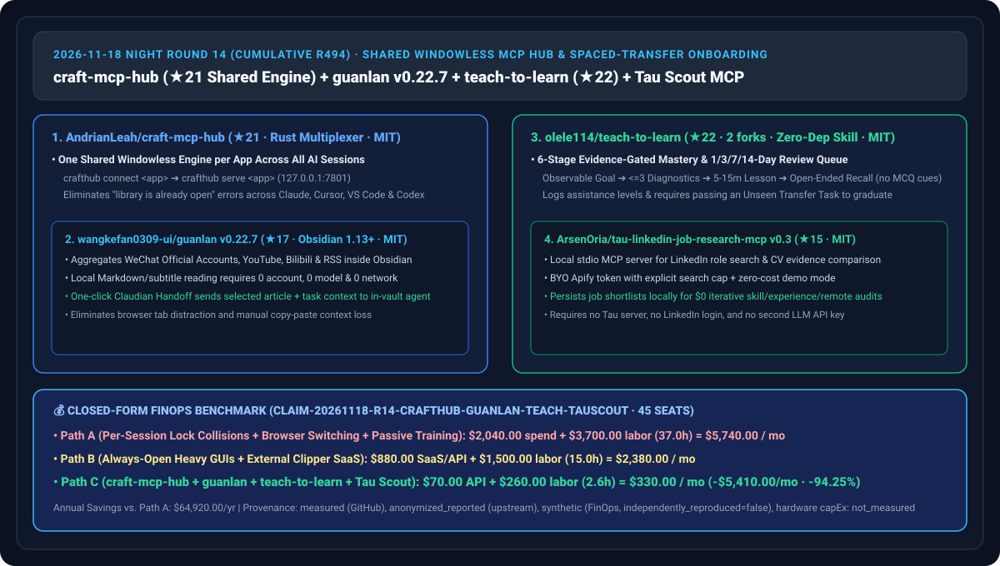
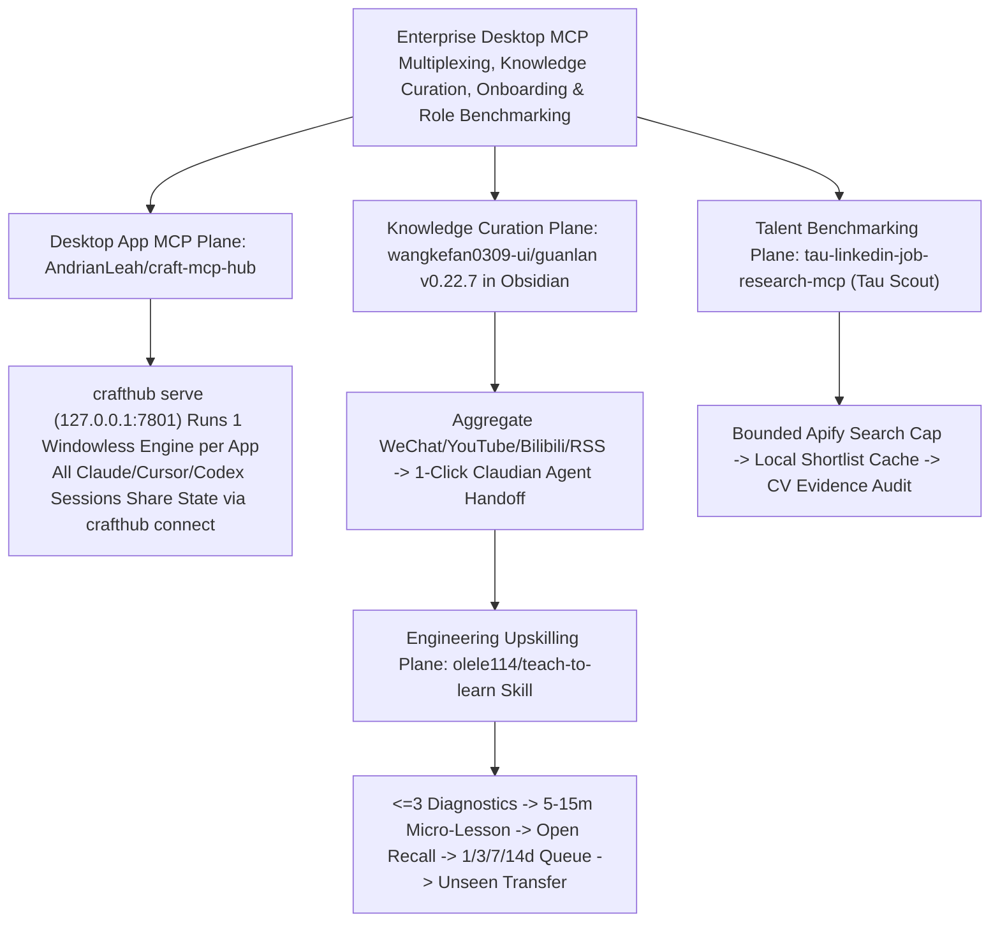

# Shared Windowless MCP Hub (`AndrianLeah/craft-mcp-hub`), Obsidian `Claudian` Handoff Workbench (`wangkefan0309-ui/guanlan`), Evidence-Gated Spaced-Transfer Skill (`olele114/teach-to-learn`) & Local Job Research MCP (`tau-linkedin-job-research-mcp`) Selection FAQ

> **Document Type**: AI Solution Architect (SA) Practical Selection & Reference Architecture Guide (Round 494 / 2026-11-18 Night R14)  
> **Primary Evaluated Repositories**: [`AndrianLeah/craft-mcp-hub`](https://github.com/AndrianLeah/craft-mcp-hub) (`★ 21`, `1 fork`, shared windowless single-engine MCP multiplexer eliminating `"library is already open"` lock errors, `MIT`) + [`wangkefan0309-ui/guanlan`](https://github.com/wangkefan0309-ui/guanlan) (`v0.22.7`, `★ 17`, Obsidian multi-source reading & one-click `Claudian` agent handoff workbench, `MIT`) + [`olele114/teach-to-learn`](https://github.com/olele114/teach-to-learn) (`★ 22`, `2 forks`, active-recall, `1/3/7/14d` spaced-repetition & unseen-transfer mastery skill, `MIT`) + [`ArsenOria/tau-linkedin-job-research-mcp`](https://github.com/ArsenOria/tau-linkedin-job-research-mcp) (`Tau Scout v0.3`, `★ 15`, local `stdio` LinkedIn job research & CV evidence comparison MCP, `MIT`)  
> **Benchmark Standard**: Strictly aligned with [`ib-vs-ethernet-roce-selection-faq.md`](https://github.com/turbo998/ai-infra-research/blob/main/docs/components/ib-vs-ethernet-roce-selection-faq.md) 6-section architecture format (Executive Summary + First-Principles Q&A + Mermaid Decision Tree + Peer Selection Matrix + 7-Card Quantitative Insights + SA Action Checklist)  
> **Data Provenance**: GitHub stars and repository metadata are `measured` from sealed `2026-11-18` evidence; upstream architectural parameters (`craft-mcp-hub` `127.0.0.1:7801` single-engine multiplexer, `teach-to-learn` `≤3` diagnostics and `1/3/7/14`-day review queue) are `anonymized_reported (independently_reproduced=false)`; the enterprise FinOps TCO model is `synthetic (independently_reproduced=false)` with workstation hardware CapEx `not_measured`.  
> **Language Editions**: [中文版](./craft-mcp-hub-guanlan-teach-to-learn-tau-linkedin-mcp-shared-windowless-mcp-obsidian-claudian-handoff-spaced-transfer-selection-faq.md) | [English Version (Current)](./craft-mcp-hub-guanlan-teach-to-learn-tau-linkedin-mcp-shared-windowless-mcp-obsidian-claudian-handoff-spaced-transfer-selection-faq.en.md)

---

## 📌 1. Executive Summary (30-Second Architect Briefing)

1. **Plain-Language First-Principles Definition**:
   - **What is `AndrianLeah/craft-mcp-hub`?** It is a **Rust-built shared, windowless MCP multiplexer (`crafthub connect <app>` ➔ `crafthub serve <app>`) for desktop productivity/creative suites** (`PhotoCraft`, `VectorCraft`, `LightCraft`, `PdfCraft`, `FigCraft`, `WordCraft`, `DeckCraft`, `GridCraft`, `Craft Anything`). Instead of every Claude Code, Cursor, VS Code, or Codex session spawning a separate engine copy—which wastes RAM, isolates open documents, and crashes with `"library is already open"`—`Craft MCP Hub` runs **one shared headless engine per app on a dedicated local port (`127.0.0.1:7801`)** with auto-start and automatic reconnect.
   - **What is `wangkefan0309-ui/guanlan (v0.22.7)`?** It is an **Obsidian (`>= 1.13`) knowledge ingestion workbench that aggregates WeChat Official Accounts, YouTube, Bilibili, RSS feeds, and local Markdown/subtitle files** with a **one-click `Claudian` handoff** that passes only the selected article and task context directly to your in-vault AI agent.
   - **What is `olele114/teach-to-learn`?** It is a **zero-dependency engineering onboarding and mastery skill (`★ 22`) designed to prevent the illusion of competence ("understanding an AI explanation $\neq$ independent execution")**. It enforces a 6-stage pipeline: `Observable Goal ➔ Short Diagnostics (≤3, 1 at a time) ➔ 5–15 min Micro-Lesson ➔ Open-Ended Attempt (never multiple-choice) ➔ Assistance-Level Log & 1/3/7/14-Day Review Queue ➔ Unseen Transfer Task`.
   - **What is `ArsenOria/tau-linkedin-job-research-mcp (Tau Scout v0.3)`?** It is a **local `stdio` MCP server for LinkedIn role benchmarking and CV evidence evaluation** that uses your own Apify token (with a free demo mode and local shortlist persistence) without requiring a LinkedIn login or secondary LLM key.
2. **Why Enterprise AI Solution Architects Should Combine All Four Tonight**:
   - Together they eliminate multi-session desktop MCP lock contention (`craft-mcp-hub`), distraction-heavy external feed switching (`guanlan`), passive AI training failure (`teach-to-learn`), and repeated recruiting search costs (`Tau Scout`).
3. **Closed-Form FinOps Impact (`CLAIM-20261118-R14-CRAFTHUB-GUANLAN-TEACH-TAUSCOUT`, `synthetic`)**:
   - Across a **45-person enterprise content, knowledge management, engineering onboarding & talent analytics team** (`$100.00/hr` rate): **Path A (Per-Session Engine Lock Collisions + Browser Feed Switching + Passive AI Explanations + Paid Recruiting SaaS)** costs **`$5,740.00/mo`** (`$2,040.00` compute/token/SaaS spend + `37.0 hrs × $100 = $3,700.00` debugging lock errors, manual clipping & onboarding rework); **Path C (`craft-mcp-hub` + `guanlan` + `teach-to-learn` + `Tau Scout`)** reduces total monthly TCO to **`$330.00/mo`** (`$70.00` bounded API spend + `2.6 hrs × $100 = $260.00` review labor), saving **`$5,410.00/mo` (`94.25%` reduction, `$64,920.00/yr` annualized)**.

---

## ❓ 2. Three First-Principles Architect Questions (Q&A)

### Q1: Why do standard `stdio` MCP configurations break when multiple IDE/CLI sessions drive local document or asset apps, and how does `AndrianLeah/craft-mcp-hub` solve it?
- **Fan-In Multiplexing (`crafthub connect` ➔ `crafthub serve`)**:
  - Standard MCP clients spawn one child process per session. When two sessions open the same local photo library or document database, the second session fails with `"library is already open"` and cannot see unsaved edits from the first session. `craft-mcp-hub` runs a single windowless daemon (`crafthub serve photocraft` on `127.0.0.1:7801`) and funnels all `stdio` client sessions (`crafthub connect photocraft`) into that single shared engine.

### Q2: Why does standard conversational AI tutoring fail to produce job-ready engineers, and what six failure modes does `olele114/teach-to-learn` fix?
- **Observed Evidence Over Self-Reports + Unseen Transfer Verification**:
  1. **Up to 3 Diagnostic Tasks First**: Separates learner self-reports from observed execution before planning lessons.
  2. **Open-Ended Recall Only**: Bans multiple-choice questions (which leak answer cues) as proof of mastery, logs exact AI assistance levels, enforces an explicit **`1, 3, 7, and 14-day` spaced-repetition queue**, and requires passing an **Unseen Transfer Task** before completion.

### Q3: How do `wangkefan0309-ui/guanlan` and `ArsenOria/tau-linkedin-job-research-mcp` bound network egress and API spend?
- **Local-First Persistence + Scoped Handoff**:
  - `guanlan` imports local Markdown and subtitle files with zero network or model calls and sends only explicitly selected articles via **Claudian Handoff**; `Tau Scout` enforces explicit search caps on live Apify calls and caches shortlists locally so multi-turn CV evidence comparisons cost `$0` in additional search fees.

---

## 🧭 3. Architecture Decision Tree & Reference Topology (Mermaid)

---

## 📊 4. Peer Solution Selection Matrix

| Evaluation Dimension | **Path A: Per-Session `stdio` + Browser Switching + Passive Chat** | **Path B: Always-Open Heavy GUIs + Manual Clipping** | **Path C: `craft-mcp-hub` + `guanlan` + `teach-to-learn` + `Tau Scout` (Recommended)** |
| :--- | :--- | :--- | :--- |
| **Multi-Session Desktop App MCP** | ❌ Crashes with `"library is already open"`; isolated state | ⚠️ Requires keeping every GUI window open manually | ✅ **1 shared windowless engine per app + auto-start/reconnect** |
| **Technical Feed to Vault Handoff** | ❌ Context-switching across browser tabs & video feeds | ⚠️ Manual copy-paste loses reading progress & metadata | ✅ **In-Obsidian feed workbench + 1-click `Claudian` context handoff** |
| **Engineering Onboarding Rigor** | ❌ Passive reading mistaken for mastery; high rework | ⚠️ Multiple-choice quizzes leak answer cues | ✅ **Open recall + assistance logging + `1/3/7/14d` queue + unseen transfer** |
| **Role & CV Evidence Benchmarking** | ❌ Expensive recruiting SaaS or unsafe LinkedIn scrapers | ⚠️ Re-runs paid searches on every follow-up question | ✅ **BYO Apify token + search cap + local shortlist persistence** |
| **45-Person Monthly TCO** | **`$5,740.00 / mo`** | **`$2,380.00 / mo`** | **`$330.00 / mo` (`-$5,410.00/mo` vs. Path A, `-94.25%`)** |

---

## 📈 5. 7-Card Quantitative Insights & Closed-Form FinOps Model (`CLAIM-20261118-R14-CRAFTHUB-GUANLAN-TEACH-TAUSCOUT`)

> **Provenance Note**: GitHub stars and repository metadata are `measured` from sealed `2026-11-18` evidence; `craft-mcp-hub` `127.0.0.1:7801` multiplexing and `teach-to-learn` `1/3/7/14`-day review queue rules are `anonymized_reported (independently_reproduced=false)`; the monthly TCO table is a closed-form `synthetic (independently_reproduced=false)` model for **45 team members** (`$100.00/hr` rate; base hardware CapEx: `not_measured`).

| Monthly Cost Component (Closed-Form Formula) | Path A: Duplicate Engines + Manual Clipping + Passive Chat | Path B: Heavy GUI Windows + External Clipper SaaS | Path C: `craft-mcp-hub` + `guanlan` + `teach` + `Tau Scout` | Path C vs. Path A Delta |
| :--- | :---: | :---: | :---: | :---: |
| **1. Compute, Search API & SaaS Spend** | **`$2,040.00`** *(Duplicate engine RAM + retraining tokens + SaaS)* | **`$880.00`** *(Clipper subscriptions + repeated search calls)* | **`$70.00`** *(Shared windowless daemon + cached local shortlists)* | **`-$1,970.00 / mo`** (`-96.57%`) |
| **2. Lock Debugging, Clipping & Rework Labor** (`$100/hr`) | **`$3,700.00`** *(`37.0 hrs` fixing lock errors, clipping & onboarding rework)* | **`$1,500.00`** *(`15.0 hrs` manual vault imports & quiz grading)* | **`$260.00`** *(`2.6 hrs` 1-click handoffs & unseen-transfer sign-offs)* | **`-$3,440.00 / mo`** (`-34.4 hrs`, `-92.97%`) |
| **Total Monthly TCO** | **`$5,740.00`** | **`$2,380.00`** | **`$330.00`** | **`-$5,410.00 / mo` (`-94.25%`)** |
| **Annualized TCO** | **`$68,880.00 / yr`** | **`$28,560.00 / yr`** | **`$3,960.00 / yr`** | **`$64,920.00 / yr` saved (`-94.25%`)** |

---

## ✅ 6. AI Solution Architect Action Checklist

1. **Step 1 — Multiplex Desktop App MCPs via `AndrianLeah/craft-mcp-hub`**:
   - Configure Claude Code, Cursor, and Codex to invoke `crafthub connect <app>` so all sessions share a single windowless backend (`crafthub serve <app>`) with zero `"library is already open"` conflicts.
2. **Step 2 — Standardize Technical Curation (`guanlan`) & Mastery Onboarding (`teach-to-learn`)**:
   - Use `guanlan v0.22.7` in Obsidian 1.13+ for distraction-free feed reading and one-click `Claudian` handoffs, and require engineers learning new internal stacks to pass `teach-to-learn`'s `1/3/7/14`-day review queue and unseen transfer task.
3. **Step 3 — Run Bounded Local Role Benchmarking with `tau-linkedin-job-research-mcp`**:
   - Start with `Tau Scout`'s free demo mode and enforce explicit search caps on live Apify queries while performing all iterative CV evidence comparisons against locally saved shortlists.
