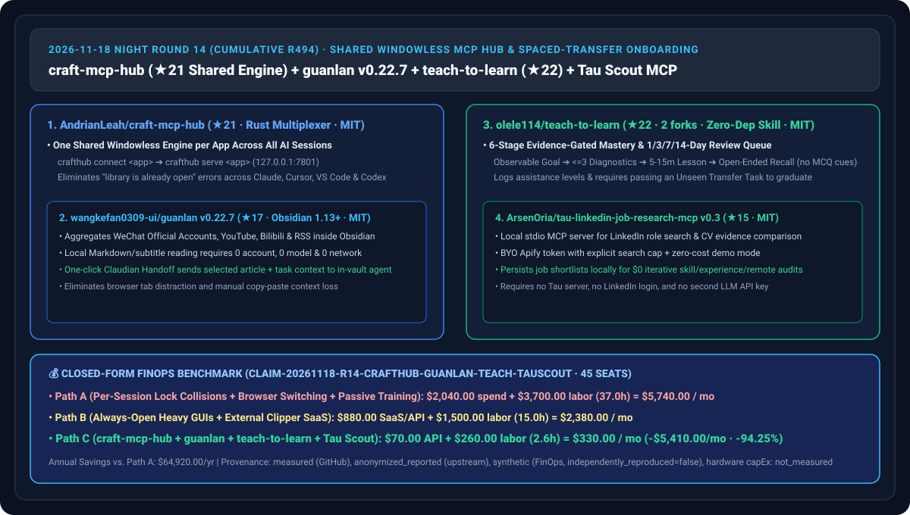
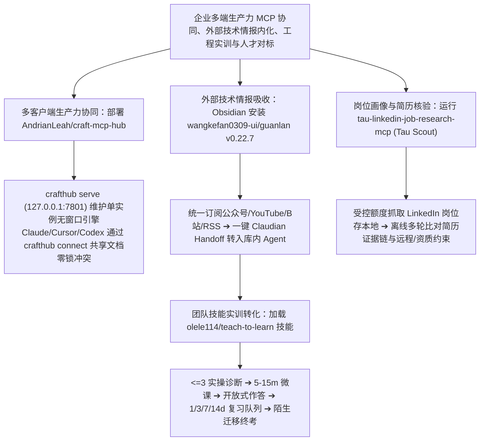

# 无窗口单实例共享 MCP 集线器（`AndrianLeah/craft-mcp-hub`）、Obsidian 多源阅读与 Claudian 一键移交台（`wangkefan0309-ui/guanlan`）、1/3/7/14 天迁移实证培训技能（`olele114/teach-to-learn`）与本地岗位对标 MCP（`tau-linkedin-job-research-mcp`）选型 FAQ

> **文档类型**：AI Solution Architect (SA) 实战选型与参考架构指南（Round 494 / 2026-11-18 Night R14）  
> **核心评估对象**：[`AndrianLeah/craft-mcp-hub`](https://github.com/AndrianLeah/craft-mcp-hub)（`★ 21`，`1 fork`，消除多会话 `"library is already open"` 锁冲突的无窗口单引擎 MCP 集线器，`MIT`） + [`wangkefan0309-ui/guanlan`](https://github.com/wangkefan0309-ui/guanlan)（`v0.22.7`，`★ 17`，聚合公众号/YouTube/B站并一键移交 Obsidian 内置 Claudian Agent 的知识工作台，`MIT`） + [`olele114/teach-to-learn`](https://github.com/olele114/teach-to-learn)（`★ 22`，`2 forks`，拒绝选择题泄题、强制 `1/3/7/14` 天复习队列与陌生迁移任务验收的工程实训技能，`MIT`） + [`ArsenOria/tau-linkedin-job-research-mcp`](https://github.com/ArsenOria/tau-linkedin-job-research-mcp)（`Tau Scout v0.3`，`★ 15`，基于自有 Apify Token 与证据链比对的本地岗位调研 MCP，`MIT`）  
> **对标范式**：严格遵循 [`ib-vs-ethernet-roce-selection-faq.md`](https://github.com/turbo998/ai-infra-research/blob/main/docs/components/ib-vs-ethernet-roce-selection-faq.md) 六段式结构（核心结论速览 + 三大灵魂拷问 + Mermaid 决策树 + 选型对比矩阵 + 7-Card 定量洞察 + SA 落地 Checklist）  
> **数据溯源分级（Provenance）**：GitHub 星标与目录元数据为 `measured`；上游特性参数（如 `craft-mcp-hub` `127.0.0.1:7801` 单引擎复用、`teach-to-learn` `≤3` 诊断题与 `1/3/7/14` 天队列）标注为 `anonymized_reported (independently_reproduced=false)`；企业 FinOps 成本算例为 `synthetic (independently_reproduced=false)`，硬件折旧 `not_measured`。  
> **语言版本**：[中文版 (当前)](./craft-mcp-hub-guanlan-teach-to-learn-tau-linkedin-mcp-shared-windowless-mcp-obsidian-claudian-handoff-spaced-transfer-selection-faq.md) | [English Version](./craft-mcp-hub-guanlan-teach-to-learn-tau-linkedin-mcp-shared-windowless-mcp-obsidian-claudian-handoff-spaced-transfer-selection-faq.en.md)

---

## 📌 一、核心结论速览（Executive Summary — 30 秒看懂）

1. **大白话本质定义**：
   - **`AndrianLeah/craft-mcp-hub` 是什么？** 它是 **解决桌面生产力套件（PhotoCraft、VectorCraft、PdfCraft、WordCraft、DeckCraft、GridCraft 等）在多 AI 会话并发调用时报错 `"library is already open"` 或文档状态互不可见的“无窗口单实例共享 MCP 集线器”**。它通过 `crafthub serve <app>` 在固定本地端口（如 `127.0.0.1:7801`）后台维护唯一一份无界面引擎，所有 Claude Code、Cursor、VS Code 与 Codex 会话通过 `crafthub connect <app>` 共享同一个文档上下文，且支持按需自启与断线自动重连。
   - **`wangkefan0309-ui/guanlan (观澜 v0.22.7)` 是什么？** 它是 **生在 Obsidian (`>= 1.13`) 内部的“公众号 / YouTube / Bilibili / RSS 聚合阅读 + 一键移交（Claudian Handoff）”情报工作台**。本地导入阅读完全免账号免模型，读完高价值技术文章后点一下按钮，只把当前选定材料与任务上下文精准投喂给库内的 `Claudian` AI Agent 沉淀为结构化笔记。
   - **`olele114/teach-to-learn` 是什么？** 它是 **根治企业员工用 AI 学习时“看懂了 AI 解释 $\neq$ 自己真会动手做”假性掌握幻觉的六步工程实训技能**。它在 Matt Pocock `teach` 基础上做了六大硬核改造：先定可观测完成标准 ➔ 最多 3 道单步实测诊断题（区分自评与实证）➔ 5–15 分钟微课 ➔ **强制开放式作答/排障（严禁把做对选择题当成掌握，防选项暗示泄题）** ➔ 记录提示辅助等级并写入 **`1 / 3 / 7 / 14` 天间隔重复队列** ➔ 通过一道从未见过的**陌生迁移任务（Unseen Transfer Task）**才算结业。
   - **`ArsenOria/tau-linkedin-job-research-mcp (Tau Scout v0.3)` 是什么？** 它是 **零服务端、免 LinkedIn 账号登录（自带免费 Demo 与本地缓存）的岗位能力画像与简历证据链比对 MCP 服务器**，支持 HR 与技术主管按上限额度调用自有 Apify Token 抓取实时 JD 并逐条核对候选人证据。
2. **为什么企业 AI 解决方案架构师（SA）今晚要把这四款工具组合进“企业办公协同与人才赋能底座”？**
   - **`craft-mcp-hub` 解决多 Agent 抢占桌面文档/图库锁冲突 ➔ `观澜 (guanlan)` 解决跨平台技术情报入库 Obsidian 断层 ➔ `teach-to-learn` 解决工程师新框架实训“一看就会、一写就废” ➔ `Tau Scout` 解决岗位技能对标与人才筛选证据化**！
3. **闭式 FinOps 量化收益（`CLAIM-20261118-R14-CRAFTHUB-GUANLAN-TEACH-TAUSCOUT`，`synthetic`）**：
   - 以 **45 人企业内容生产、知识工程、研发实训与技术招聘团队**（时薪 `$100.00/hr`）计：**Path A（每会话独立拉起桌面引擎冲突重跑 + 跨浏览器手工搬运文章 + 被动阅读式 AI 培训 + 高价商业招聘 SaaS）** 月均总成本 **`$5,740.00`**（重复进程算力、重训 Token 与 SaaS 费 `$2,040.00` + 排查锁冲突、手动贴笔记与新员工返工 `37.0h × $100 = $3,700.00`）；**Path C（`craft-mcp-hub` + `guanlan` + `teach-to-learn` + `Tau Scout`）** 月均总成本降至 **`$330.00`**（受上限控制的检索与模型开销 `$70.00` + 复核人工 `2.6h × $100 = $260.00`），**净省 `$5,410.00/月`（降幅 `94.25%`，年化节省 `$64,920.00`）**。

---

## ❓ 二、三大灵魂拷问（First-Principles Q&A）

### Q1：为什么在 Claude Code 和 Cursor 里同时配置本地生产力工具 MCP，第二个会话一调工具就会报错 `"library is already open"`？`AndrianLeah/craft-mcp-hub` 是怎么根治的？
- **第一性原理：`stdio` 子进程一会话一实例 vs 有状态文档库的排他文件锁**：
  1. **原生 `stdio` 模式的致命缺陷**：MCP 客户端默认每开一个聊天窗口就 `spawn` 一个全新的 CLI 进程。当两个会话同时操作同一个本地图库、PDF 或 PPT/表格工程时，不仅内存翻倍、两边看不到对方刚改的页面，第二个进程更会直接被底层 SQLite/文件排他锁拒之门外。
  2. **`crafthub connect` ➔ `crafthub serve` 扇入复用架构**：`craft-mcp-hub` 为每款应用在固定本地端口（如 `127.0.0.1:7801`）仅运行**唯一一个无窗口后台引擎（Windowless Shared Engine）**；各个 IDE/CLI 会话启动轻量级 `crafthub connect <app>` 桥接器汇聚到同一个引擎实例，既实现了跨会话实时共享同一份打开的文档，又彻底消除了文件锁报错。

### Q2：为什么企业用大模型给工程师做技术培训，员工聊完觉得“全懂了”，一上生产写代码还是照样踩坑？`olele114/teach-to-learn` 改了哪六条规则？
- **消灭“被动阅读幻觉”与“选择题提示泄露”**：
  1. **拒绝首轮盲信自评**：不听信学员自我汇报“我已经熟悉 K8s”，而是先出一道小诊断题（最多 3 题，每次 1 题），用观察到的实操表现定级。
  2. **禁用选择题作为掌握证明**：四选一题目会泄露答案线索；`teach-to-learn` 强制要求开放式回忆、结果预测、动手修 Bug，并精确记录本次通关借用了多少级 AI 提示（区分“靠提示勉强写出”与“独立默写”）。
  3. **`1 / 3 / 7 / 14` 天显式复习队列 + 陌生迁移终考（Unseen Transfer Task）**：只有在不靠提示独立跑通一道**全新场景迁移任务**后，才允许结业签出。

### Q3：`wangkefan0309-ui/guanlan` 与 `ArsenOria/tau-linkedin-job-research-mcp` 如何保护企业知识流转与人才调研的成本边界？
- **按需外联 + 本地持久化复盘**：
  - `观澜 (guanlan)` 将公众号、B站、YouTube 更新收敛进 Obsidian 面板，本地阅读与字幕导入 0 联网 0 成本，仅在用户主动点击 **Claudian Handoff** 时才把选定文章与任务上下文移交给 Agent；`Tau Scout` 则将每次付费 Apify 检索设置硬上限（Search Cap）并把岗位短名单保存在本地，后续多轮简历匹配度比对完全在本地离线数据上完成，无需重复付费检索。

---

## 🧭 三、架构师选型决策树与端到端参考架构（Mermaid）

---

## 📊 四、同类方案横向选型对比矩阵（Peer Selection Matrix）

| 评估维度 | **Path A：多会话直连 CLI + 浏览器刷视频 + 被动问答培训** | **Path B：常驻打开全套桌面 GUI + 手工剪藏笔记** | **Path C：`craft-mcp-hub` + `guanlan` + `teach-to-learn` + `Tau Scout`（推荐）** |
| :--- | :--- | :--- | :--- |
| **多 Agent 并发操作本地文档/图库** | ❌ 报错 `"library is already open"`，各会话状态隔离 | ⚠️ 必须常驻打开多个重型 GUI 窗口占内存 | ✅ **无窗口单引擎本地端口复用，跨 Claude/Cursor/Codex 状态实时同步** |
| **公众号/视频平台情报入库效率** | ❌ 频繁切 App 容易刷短视频分心，手工复制格式乱 | ⚠️ 第三方剪藏插件难以直接带上下文唤醒库内 Agent | ✅ **Obsidian 内一站式阅读 + 一键 Claudian Handoff 精准投喂** |
| **工程师新技能掌握真实度** | ❌ 看懂解释即以为学会，上线实战频频返工 | ⚠️ 传统选择题考试可靠猜题蒙混过关 | ✅ **开放式作答 + 辅助等级日志 + `1/3/7/14d` 队列 + 陌生迁移任务终考** |
| **岗位市场调研与简历证据核验** | ❌ 购买昂贵招聘 SaaS 或把 LinkedIn 账密交给爬虫 | ⚠️ 每次追问都重新触发外部搜索扣费 | ✅ **免 LinkedIn 登录 + 本地持久化短名单支持无限次离线证据比对** |
| **45 人团队月均总拥有成本 (TCO)** | **`$5,740.00 / 月`** | **`$2,380.00 / 月`** | **`$330.00 / 月`（较 Path A 净省 `$5,410.00/月`，`-94.25%`）** |

---

## 📈 五、7-Card 定量洞察与闭式 FinOps 算例（`CLAIM-20261118-R14-CRAFTHUB-GUANLAN-TEACH-TAUSCOUT`）

> **Provenance 声明**：GitHub 星标与目录元数据源自 `2026-11-18` 封存证据（`measured`）；`craft-mcp-hub` `127.0.0.1:7801` 扇入架构与 `teach-to-learn` `1/3/7/14` 天复习队列参数源自上游文档（`anonymized_reported`, `independently_reproduced=false`）；月度 TCO 为面向 **45 人内容、知识、实训与招聘团队** 的闭式合成模型（`synthetic`, `independently_reproduced=false`；宿主机硬件折旧 CapEx：`not_measured`）。

| 成本构成项（月度闭式公式） | Path A：多进程冲突 + 手工剪藏 + 被动培训 | Path B：常驻重型 GUI + 外部剪藏订阅 | Path C：`craft-mcp-hub` + `guanlan` + `teach` + `Tau Scout` | Path C 对比 Path A 净变化 |
| :--- | :---: | :---: | :---: | :---: |
| **1. 算力内存、重复检索与 SaaS 订阅支出** | **`$2,040.00`** *(重复引擎消耗 + 实训返工 Token + 招聘 SaaS)* | **`$880.00`** *(剪藏工具订阅 + 外部搜索 API)* | **`$70.00`** *(单引擎复用 + 本地缓存离线比对)* | **`-$1,970.00 / 月`** (`-96.57%`) |
| **2. 锁冲突排障、情报搬运与培训返工人工** (`$100/hr`) | **`$3,700.00`** *(`37.0 hrs`：处理锁报错、手动贴文章与新员工返工)* | **`$1,500.00`** *(`15.0 hrs`：手工整理笔记与出题考核)* | **`$260.00`** *(`2.6 hrs`：一键移交与审阅迁移终考结果)* | **`-$3,440.00 / 月`** (`-34.4 hrs`, `-92.97%`) |
| **月度总拥有成本 (Monthly Total TCO)** | **`$5,740.00`** | **`$2,380.00`** | **`$330.00`** | **`-$5,410.00 / 月` (`-94.25%`)** |
| **年化总拥有成本 (Annualized TCO)** | **`$68,880.00 / 年`** | **`$28,560.00 / 年`** | **`$3,960.00 / 年`** | **年省 `$64,920.00` (`-94.25%`)** |

---

## ✅ 六、AI 解决方案架构师（SA）实战落地 Checklist

1. **Step 1 — 用 `AndrianLeah/craft-mcp-hub` 统一管理本地生产力套件 MCP**：
   - 将各 IDE/CLI 中的直连应用命令替换为 `crafthub connect <app>`，通过控制面板统一监控本地端口（`127.0.0.1:7801` 等）状态，消除多会话数据库锁死。
2. **Step 2 — 在团队知识库部署 `guanlan v0.22.7` 与 `olele114/teach-to-learn`**：
   - 在 Obsidian 1.13+ 启用 `观澜` 聚合核心技术信源并通过 Claudian Handoff 沉淀知识；将内部技术栈培训切换至 `teach-to-learn`，强制通过 `1/3/7/14` 天复习队列与陌生迁移任务验收。
3. **Step 3 — 挂载 `tau-linkedin-job-research-mcp` 开展证据化岗位对标**：
   - 先使用免费 Demo 模式验证工具链，生产检索时设定明确 `search cap` 并将岗位短名单落盘本地供多轮比对。
