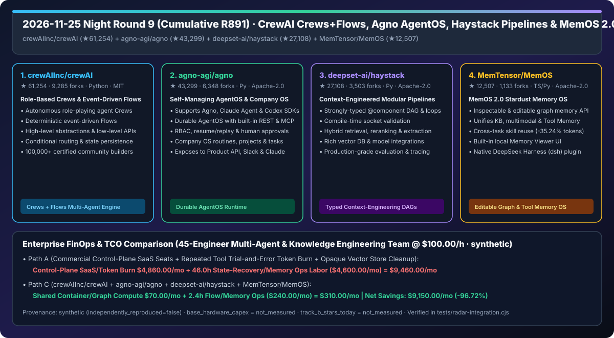
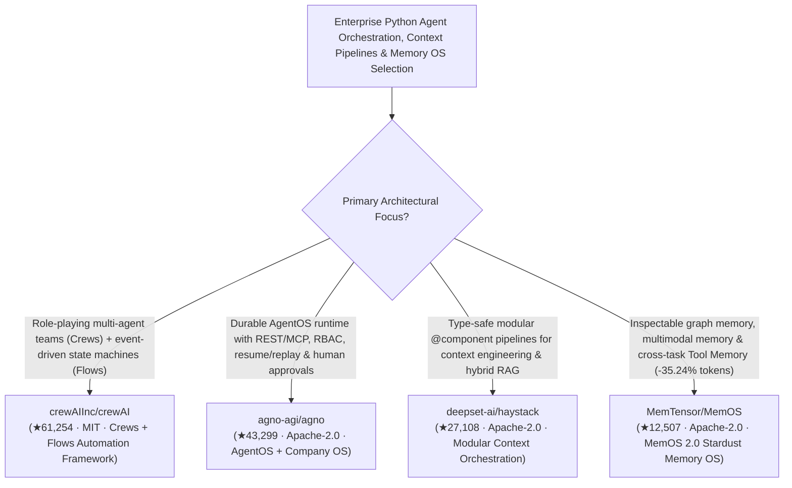
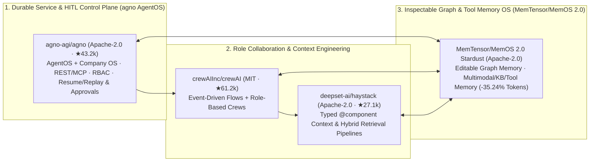

# Role-Based Crews + Event Flows (`crewAIInc/crewAI`), Self-Managing AgentOS Platform (`agno-agi/agno`), Context-Engineered Modular Pipelines (`deepset-ai/haystack`) & Stardust 2.0 Graph/Tool Memory OS (`MemTensor/MemOS`) Selection & Integration Architecture FAQ

> **Document Type**: Enterprise AI Solution Architect Selection Decision Guide (GitHub Trending AI Radar — 2026-11-25 Night Round 9 / Cumulative Round 891)
> **Covered Repositories**: [`crewAIInc/crewAI`](https://github.com/crewAIInc/crewAI) (`★ 61,254`, `9,285 forks`, `MIT`: Python multi-agent automation framework uniting autonomous role-playing **Crews** with deterministic, event-driven **Flows**) · [`agno-agi/agno`](https://github.com/agno-agi/agno) (`★ 43,299`, `6,348 forks`, `Apache-2.0`: self-managing agent platform with **AgentOS** and **Company OS**, supporting Agno, Claude Agent, and Codex SDKs with built-in REST API, MCP server, RBAC, resume/replay, human approvals, and scheduled routines) · [`deepset-ai/haystack`](https://github.com/deepset-ai/haystack) (`★ 27,108`, `3,503 forks`, `Apache-2.0`: production AI orchestration framework for building context-engineered LLM applications and type-safe modular pipelines) · [`MemTensor/MemOS`](https://github.com/MemTensor/MemOS) (`★ 12,507`, `1,133 forks`, `Apache-2.0`: `MemOS 2.0 Stardust` Memory Operating System unifying inspectable graph memory, multimodal memory, knowledge bases, and cross-task **Tool Memory** with **`35.24%` token savings** [`anonymized_reported`] and native DeepSeek Harness `dsh` integration)
> **Core Enterprise Scenario**: Selecting the right **Python agent orchestration paradigm (role-based Crews/Flows vs. durable AgentOS services vs. typed context-engineering pipelines) paired with an inspectable, editable Memory Operating System**.

---

## 1. 📌 Executive Summary (One-Line Selection Verdict)

1. **Need to combine autonomous role-based agent teams (`Crews`) with deterministic, event-driven workflow control (`Flows`)** ➔ Choose **[`crewAIInc/crewAI`](https://github.com/crewAIInc/crewAI) (`★ 61,254`, `9,285 forks`, `MIT`)**.
   - **Plain-English Mechanism**: Uses `CrewAI Flows` for deterministic state management, conditional routing, and single-LLM calls while delegating complex collaborative reasoning subtasks to role-specialized `CrewAI Crews`.
2. **Need a turnkey runtime (`AgentOS` + `Company OS`) that turns Agno, Claude Agent, or Codex SDK agents into durable REST/MCP services with RBAC, resume/replay, human approvals, and recurring routines** ➔ Choose **[`agno-agi/agno`](https://github.com/agno-agi/agno) (`★ 43,299`, `6,348 forks`, `Apache-2.0`)**.
   - **Plain-English Mechanism**: Eliminates months of custom FastAPI/Celery/auth plumbing by providing a self-managing service layer (`AgentOS`) that exposes agents simultaneously to product REST APIs, Slack/chat apps, and Claude/ChatGPT MCP clients.
3. **Need strongly typed, modular DAG/cyclic pipelines (`@component`) for enterprise search, hybrid retrieval, reranking, and context engineering** ➔ Choose **[`deepset-ai/haystack`](https://github.com/deepset-ai/haystack) (`★ 27,108`, `3,503 forks`, `Apache-2.0`)**.
   - **Plain-English Mechanism**: Validates input/output sockets across every retrieval, extraction, and reasoning component before execution, making complex context-engineering pipelines unit-testable and maintainable.
4. **Need an inspectable, editable graph-structured Memory Operating System (`MemOS 2.0 Stardust`) that captures text, multimodal assets, and reusable Tool Memory (`-35.24%` tokens)** ➔ Choose **[`MemTensor/MemOS`](https://github.com/MemTensor/MemOS) (`★ 12,507`, `1,133 forks`, `Apache-2.0`)**.
   - **Plain-English Mechanism**: Replaces opaque vector-only stores with a unified `add / retrieve / edit / delete` graph memory API and local Memory Viewer, storing successful tool-use trajectories (**Tool Memory**) for cross-task reuse.

---

## 2. 🎯 Architect & Customer Deep-Dive Q&A

### Q1: How do `CrewAI`, `Agno`, `Haystack`, and `MemOS` compare against managed cloud frameworks (e.g., Azure AI Foundry Agent Service + Semantic Kernel)?

- **Four-Layer Open-Source Synergy (Path C)**:
  1. **Durable Runtime & Governance Plane ➔ `agno-agi/agno`**: `AgentOS` + `Company OS` handling RBAC, human approvals, resume/replay, and REST/MCP exposure.
  2. **Role-Based & Event-Driven Collaboration ➔ `crewAIInc/crewAI`**: `Flows` + `Crews` orchestrating multi-persona business workflows.
  3. **Typed Context-Engineering Pipelines ➔ `deepset-ai/haystack`**: Modular `@component` retrieval, reranking, and extraction graphs.
  4. **Inspectable Graph & Tool Memory OS ➔ `MemTensor/MemOS`**: Shared long-term, multimodal, and tool memory cutting redundant token exploration by `35.24%`.
- **When to choose Managed Cloud PaaS vs. Path C?**
  - Choose **Semantic Kernel / Microsoft Agent Framework + Azure AI Foundry** when building .NET/C#-first enterprise systems tightly bound to Azure AI Search and Entra ID Managed Identities.
  - Choose **Path C** when Python-first engineering teams need self-hosted `Apache-2.0`/`MIT` control over durable agent execution, role-based collaboration, and inspectable graph/tool memory.

### Q2: How do these four frameworks integrate in production?

1. **Service Ingress & HITL Approval Layer (`agno-agi/agno`)**:
   - `AgentOS` exposes unified REST and MCP endpoints, authenticates users via RBAC, schedules recurring routines, and pauses high-risk actions for human approval.
2. **Collaborative Execution & Context Retrieval (`crewAI` + `haystack`)**:
   - `CrewAI Flows` coordinate multi-agent `Crews`, which invoke `Haystack` pipelines for high-precision hybrid search and document grounding.
3. **Persistent Graph & Tool Memory (`MemTensor/MemOS 2.0`)**:
   - All agents read and write to `MemOS`, reusing verified **Tool Memory** patterns and allowing operators to edit or prune stale memories via the Memory Viewer.

### Q3: What are the critical production guardrails?

- **Architect Redlines**:
  1. **Bound `CrewAI` autonomous loops inside deterministic `Flows`**: Always set explicit `max_iter` limits on `Crews` and govern state transitions via `CrewAI Flows`.
  2. **Sanitize credentials from `MemOS` Tool Memory**: Strip transient session tokens and customer PII before persisting successful tool-call trajectories into shared `MemOS` Tool Memory.

---

## 3. 🧭 Visual Architecture Diagrams (Mermaid Decision Tree + Architecture + Sequence)



### 3.1 Architect Selection Decision Tree



### 3.2 End-to-End Enterprise Production Architecture



### 3.3 End-to-End Execution Sequence

```mermaid
sequenceDiagram
    participant User as Enterprise User / Slack / MCP Client
    participant Agno as agno (AgentOS / Company OS)
    participant MemOS as MemTensor/MemOS 2.0 (Stardust)
    participant Crew as crewAI (Flows + Crews)
    participant Hay as deepset-ai/haystack (Context Pipeline)

    User->>Agno: 1. Trigger operational routine or API request (RBAC & durable checkpoint)
    Agno->>MemOS: 2. Recall graph context & verified cross-task Tool Memory trajectories
    MemOS-->>Agno: 3. Return structured memory & tool patterns (-35.24% token savings)
    Agno->>Crew: 4. Execute CrewAI Flow & delegate multi-role Crew collaboration
    Crew->>Hay: 5. Run typed Haystack hybrid retrieval & reranking pipeline
    Hay-->>Crew: 6. Return grounded evidence; Crew synthesizes deliverable for Agno approval gate
    Agno->>MemOS: 7. Persist approved outcome & updated Tool Memory graph nodes
```

---

## 4. 📊 Horizontal Selection Matrix

| Dimension | `crewAIInc/crewAI` (`★ 61,254`) | `agno-agi/agno` (`★ 43,299`) | `deepset-ai/haystack` (`★ 27,108`) | `MemTensor/MemOS` (`★ 12,507`) | Commercial Managed Agent Control Plane SaaS (Path A) | Custom `while` Loops + Opaque Vector Stores (Path B) |
| :--- | :--- | :--- | :--- | :--- | :--- | :--- |
| **Primary Role** | Role-based Crews + event-driven Flows | Durable `AgentOS` & `Company OS` | Typed modular context/RAG pipelines | Inspectable graph & tool Memory OS | Metered commercial control-plane SaaS | Ad-hoc prompt loops & read-only embeddings |
| **Key Differentiator** | **Unites autonomous Crews with deterministic Flows** | **Built-in REST/MCP, RBAC, resume/replay & approvals** | **Compile-time typed `@component` DAG/cyclic graphs** | **Editable graph memory + cross-task Tool Memory (`-35.24%` tokens)** | Hosted convenience, but high per-seat/per-execution fees | Fragile state recovery; cannot edit/delete poisoned vector memories |
| **License** | `MIT` | `Apache-2.0` | `Apache-2.0` | `Apache-2.0` | Proprietary SaaS | Internal scripts |
| **Monthly TCO (45-Eng Team)** | **`$310.00/mo` combined** (`$70.00` compute + `2.4h` ops) | Included in `$310.00/mo` stack | Included in `$310.00/mo` stack | Included in `$310.00/mo` stack | **`$9,460.00/mo`** (`$4,860.00` commercial seats & trial-and-error token burn + `46.0h` ops) | `~$3,210.00/mo` (manual checkpoint/approval plumbing & memory debugging) |

---

## 5. 🧪 Quantitative FinOps & TCO Comparison (45-Person Enterprise Team)

> **📊 Provenance & Closed-Form Schema**:
> - **provenance**: `synthetic` (`independently_reproduced = false`; `base_hardware_capex = not_measured`; `track_b_stars_today = not_measured`; upstream `MemOS` `35.24%` token savings claim is `anonymized_reported`).
> - **Closed-Form Formula**:
>   - **Path A (Commercial Multi-Agent Control-Plane Seats + Repeated Tool Trial-and-Error Token Burn + Manual Recovery of Interrupted Runs & Opaque Vector Store Cleanup)**: **`$4,860.00`** monthly SaaS/token bills + **`46.0h × $100.00/h = $4,600.00`** engineering labor = **`$9,460.00/mo`**.
>   - **Path C (`crewAIInc/crewAI` + `agno-agi/agno` + `deepset-ai/haystack` + `MemTensor/MemOS` Stack)**: **`$70.00`** shared container/graph compute + **`2.4h × $100.00/h = $240.00`** workflow/memory maintenance = **`$310.00/mo`**.
>   - **Net Savings vs. Path A**: **`-$9,150.00/mo`** (**`96.72%`** TCO reduction).

| Evaluation Path | Control-Plane SaaS / Token & Compute Cost | State Recovery, Memory Cleanup & Ops (`$100/h`) | Monthly Total TCO | Net Savings vs. Path A | Key Architectural Outcome |
| :--- | :---: | :---: | :---: | :---: | :--- |
| **Path A: Commercial Control-Plane SaaS + No Tool Memory + Opaque Vectors** | `$4,860.00` | `46.0h` (`$4,600.00`) | **`$9,460.00`** | Baseline | Repeated tool-calling trial-and-error; uneditable black-box memory |
| **Path B: Custom FastAPI State Plumbing + Untyped Scripts** | `$1,410.00` | `18.0h` (`$1,800.00`) | **`$3,210.00`** | `-$6,250.00` (`-66.07%`) | High maintenance burden for resume/replay and HITL approval gates |
| **Path C: `crewAI` + `agno` + `haystack` + `MemOS 2.0`** | **`$70.00`** | **`2.4h` (`$240.00`)** | **`$310.00`** | **`-$9,150.00` (`-96.72%`)** | **Crews+Flows + AgentOS durability + typed Haystack + `-35.24%` MemOS** |

- 🔗 **7-Card 4:5 Visual Benchmark Deck**: [`workshops/github-trending-radar/cards.en.html`](../cards.en.html) · [`cards.html`](../cards.html)

---

## 6. 🛠️ Enterprise Adoption & Architecture Review Checklist

- [ ] **Wrap `CrewAI Crews` Inside Deterministic `Flows`**: Enforce explicit iteration caps and state-machine transitions for all multi-role agent teams.
- [ ] **Enable `Agno AgentOS` Resume/Replay & HITL Approvals**: Gate external state-mutating tools behind `AgentOS` human approvals with durable checkpointing.
- [ ] **Validate `Haystack` Component Sockets in CI**: Run pipeline connection and type checks on every PR modifying retrieval or extraction graphs.
- [ ] **Audit Shared `MemOS` Graph & Tool Memories**: Use the `MemOS` Memory Viewer to inspect, edit, or prune outdated organizational rules and sanitize PII from shared Tool Memory.
