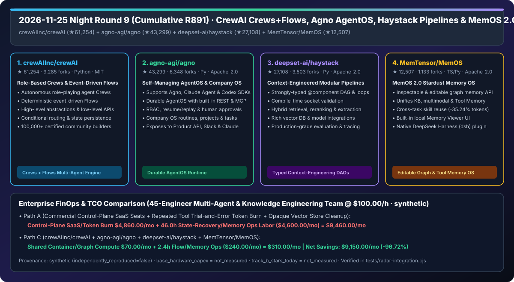
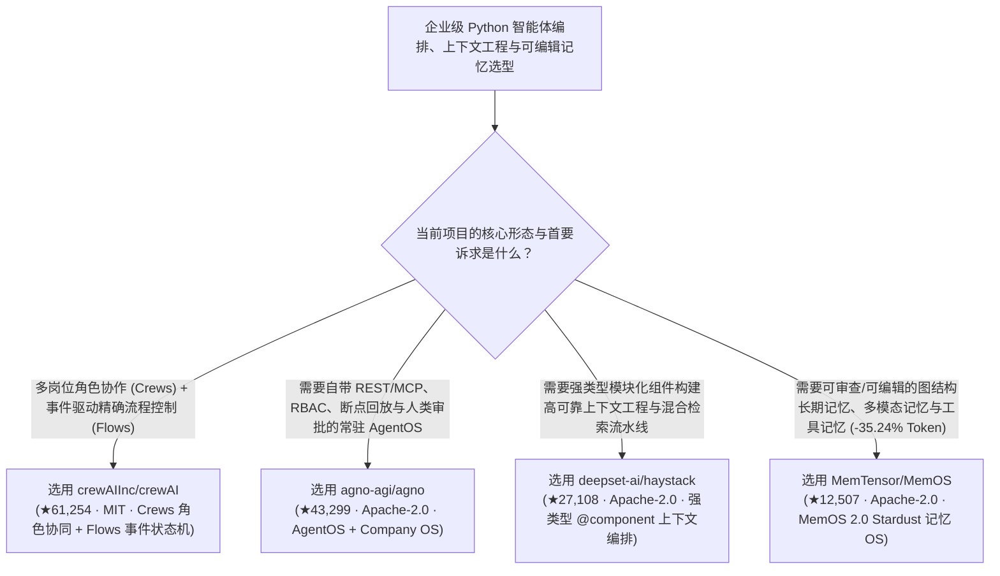
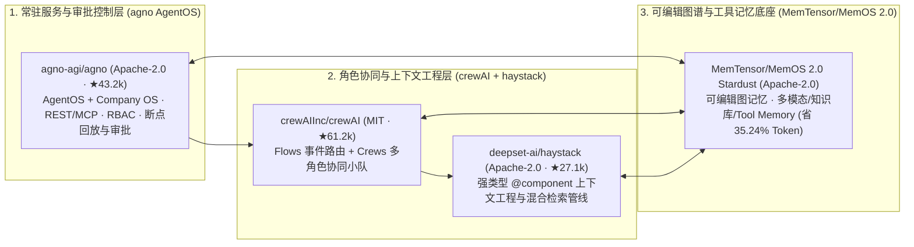
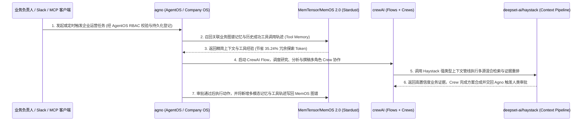

# 角色协同 Crews + 事件流 Flows 多智能体框架（`crewAIInc/crewAI`）、自带 AgentOS 持久化运行时的自管理智能体平台（`agno-agi/agno`）、模块化上下文工程编排框架（`deepset-ai/haystack`）与星尘 2.0 可视化图谱记忆操作系统（`MemTensor/MemOS`）选型与集成架构 FAQ

> **文档类型**：企业 AI 解决方案架构师（AI Solution Architect）选型决策指南（GitHub Trending AI 雷达 2026-11-25 Night Round 9 / 累计第 891 轮）
> **覆盖项目**：[`crewAIInc/crewAI`](https://github.com/crewAIInc/crewAI)（`★ 61,254`、`9,285 forks`、`MIT`：融合自主角色协同 **Crews** 与精确事件驱动控制 **Flows** 的旗舰 Python 多智能体自动化框架）· [`agno-agi/agno`](https://github.com/agno-agi/agno)（`★ 43,299`、`6,348 forks`、`Apache-2.0`：自带 **AgentOS** 与 **Company OS** 的自管理智能体平台，兼容 Agno、Claude Agent 与 Codex SDK，开箱提供 REST API、MCP Server、RBAC、断点恢复回放（Resume/Replay）、人工审批与定时例程）· [`deepset-ai/haystack`](https://github.com/deepset-ai/haystack)（`★ 27,108`、`3,503 forks`、`Apache-2.0`：面向上下文工程（Context-Engineered）生产级 LLM 应用的老牌模块化编排框架，通过强类型 `@component` 输入输出插槽构建可测试、可组合的检索与智能体流水线）· [`MemTensor/MemOS`](https://github.com/MemTensor/MemOS)（`★ 12,507`、`1,133 forks`、`Apache-2.0`：面向 LLM 与 AI Agent 的记忆操作系统 `MemOS 2.0 Stardust（星尘）`，将文本、多模态与工具调用经验（Tool Memory）统一组织为可审查、可编辑的图结构记忆，实测带来 **`35.24%`** 的 Token 节省 [`anonymized_reported`] 并原生支持 DeepSeek Harness `dsh` 插件）
> **核心场景**：当企业架构师为业务研发团队挑选 Python 主力智能体编排框架与记忆底座时，最常面临四个选型困惑：**“什么时候用 CrewAI 的角色分工（Crews + Flows），什么时候用 Agno 的 AgentOS 常驻服务，什么时候用 Haystack 的模块化数据/RAG 管线？以及多智能体在长周期运行中如何共享一套既支持多模态又记住‘哪个工具怎么调最稳’（Tool Memory）的可编辑记忆系统？”** 本文给出清晰选型边界与与 Microsoft Agent Framework / Semantic Kernel / LangGraph 的横向对比。

---

## 一、📌 核心结论速览（选型一句话结论）

1. **业务场景天然适合按“岗位角色分工”（如：市场研究员 + 数据分析师 + 报告撰稿人 + 质量审核员），且外层需要用确定性事件状态机（Flows）把多个智能体小组串起来** ➔ 选 **[`crewAIInc/crewAI`](https://github.com/crewAIInc/crewAI)（`★ 61,254`，`9,285 forks`，`MIT`）**。
   - **通俗原理**：把宏观流程拆成两层——外层用 **`CrewAI Flows`** 写确定性的 Python 事件路由（何时调普通 API、何时分支判断），内层在需要创造性多角色脑暴或复杂信息综合的节点唤醒 **`CrewAI Crews`**，兼顾了业务流程的可控性与多角色协同的自主性。
2. **不仅要写 Agent 逻辑，更需要直接把 Agent 变成一套带身份鉴权、RBAC 权限、断点续跑（Resume/Replay）、人工审批、定时任务与内置 MCP Server 的常驻后端服务（AgentOS）** ➔ 选 **[`agno-agi/agno`](https://github.com/agno-agi/agno)（`★ 43,299`，`6,348 forks`，`Apache-2.0`）**。
   - **通俗原理**：很多框架只给你一个 Python 库，上线时你还得自己套 FastAPI、写数据库会话持久化、写审批挂起与 Cron 调度。`Agno` 直接提供 **`AgentOS`** 与 **`Company OS`**，不仅支持原生 Agno Agent，还能把 Claude Agent SDK 与 Codex SDK 统管起来，一键暴露为产品 REST API、Slack 机器人与标准 MCP Server。
3. **核心痛点在“复杂上下文工程（Context Engineering）与企业级搜索/RAG 管线编排”，要求每个处理节点（解析、切块、混合检索、重排、路由、工具调用）具备严格的类型校验与工业级单元测试** ➔ 选 **[`deepset-ai/haystack`](https://github.com/deepset-ai/haystack)（`★ 27,108`，`3,503 forks`，`Apache-2.0`）**。
   - **通俗原理**：`Haystack` 将整个上下文工程流水线建模为强类型有向图（支持分支与循环），每个组件（`@component`）显式声明输入输出类型，在流水线连接阶段就能抓出接口不匹配错误，非常适合构建高可靠的企业搜索、合规问答与结构化信息抽取系统。
4. **想给上述所有智能体装上一套“拒绝黑盒向量库、人类可在本地界面直接查看和修改、且能同时记住知识库、多模态素材与工具调用经验（Tool Memory）”的统一记忆操作系统** ➔ 选 **[`MemTensor/MemOS`](https://github.com/MemTensor/MemOS)（`★ 12,507`，`1,133 forks`，`Apache-2.0`）**。
   - **通俗原理**：`MemOS 2.0 Stardust（星尘）` 提供统一的 `add / retrieve / edit / delete` 图结构记忆 API 与本地 Memory Viewer，不仅记对话事实，还专门沉淀 **跨任务工具记忆（Tool Memory，复用过往成功的工具调用轨迹，节省 `35.24%` Token，`anonymized_reported`）**，并支持一键挂载至 DeepSeek Harness (`dsh`) 与各类多 Agent 框架。

---

## 二、🎯 客户与架构师灵魂拷问 Q&A（深度架构拆解）

### Q1：`CrewAI` vs `Agno` vs `Haystack` vs 云厂商原生框架（如 Azure AI Foundry Agent Service / Semantic Kernel）到底怎么选？

- **四大方案精准对号入座**：
  1. **选 `agno-agi/agno`**：当你希望最快交付一个带 REST API、MCP Server、RBAC、断点回放与人类审批门禁的**自托管常驻数字员工服务（AgentOS）**。
  2. **选 `crewAIInc/crewAI`**：当你的业务流程是典型的**多岗位角色协作 SOP**（如投研报告生成、营销活动策划、多角色标书评审），需要 `Flows` 管流程、`Crews` 管协作。
  3. **选 `deepset-ai/haystack`**：当你的核心竞争力在于**深度上下文工程、复杂多步检索重排与文档信息抽取流水线**。
  4. **选 `MemTensor/MemOS`**：作为上述三大编排框架底层的**统一可审查图谱记忆与跨任务技能/工具记忆底座**。
- **何时直接选 Azure AI Foundry Agent Service + Semantic Kernel？**
  - 若企业主力研发语言是 **C# / .NET**，或者希望直接使用微软托管的线程状态存储、Azure AI Search 原生绑定与 Entra ID 零信任身份，**Semantic Kernel / Microsoft Agent Framework + Azure AI Foundry** 是最顺滑的企业标准路线。

### Q2：如何把这四个开源项目组合为企业级“常驻运营 OS (`Agno`) + 多角色协作 (`CrewAI`) + 强类型上下文管线 (`Haystack`) + 星尘记忆 (`MemOS`)”生产架构？

1. **顶层服务化与人机协同网关层（`agno-agi/agno` AgentOS）**：
   - 使用 `Agno AgentOS` 承接来自产品前端 REST API、Slack/Teams 及 Claude/ChatGPT MCP 客户端的请求，统一处理 RBAC 鉴权、定时任务触发、高危动作挂起审批与断点重放。
2. **中层业务编排与上下文工程层（`crewAI` + `haystack`）**：
   - 涉及多岗位分工协作的复杂任务由 `CrewAI Flows & Crews` 编排执行；每个角色需要查询企业私域知识时，调用由 `deepset-ai/haystack` 构建的强类型混合检索与重排上下文流水线。
3. **底层统一可审查记忆底座（`MemTensor/MemOS 2.0 Stardust`）**：
   - 所有智能体共享 `MemOS` 的统一图记忆接口，自动召回多模态上下文与历史工具调用经验（Tool Memory），管理员通过 Memory Viewer 实时审查与修正错误记忆节点。

### Q3：生产落地的关键架构红线是什么？

- **架构师避坑红线**：
  1. **严禁无边界的纯自主多角色死循环**：在使用 `CrewAI Crews` 时，必须在外层套上 `CrewAI Flows` 状态机并显式设置每个 Agent 的 `max_iter` 与超时上限，防止两个角色互相反驳导致 Token 无限空转。
  2. **工具记忆（Tool Memory）的参数脱敏**：在将历史成功工具调用轨迹写入 `MemTensor/MemOS` 供跨任务复用时，必须剥离调用参数中的一次性会话 Token 与客户明文隐私数据，仅保留参数结构与调用模式。

---

## 三、🧭 直观可视化图解（Mermaid 决策树 + 集成架构 + 时序图）

### 3.1 架构师选型决策树

### 3.2 企业端到端生产集成参考架构图

### 3.3 端到端业务例程触发、多角色协同、上下文检索与工具记忆沉淀时序图

---

## 四、📊 同类开源与商业云服务横向选型决策矩阵

| 对比维度 | `crewAIInc/crewAI` (`★ 61,254`) | `agno-agi/agno` (`★ 43,299`) | `deepset-ai/haystack` (`★ 27,108`) | `MemTensor/MemOS` (`★ 12,507`) | 商业托管多 Agent 控制面 SaaS (Path A) | 手写脆弱 Prompt 循环与不可查黑盒向量库 (Path B) |
| :--- | :--- | :--- | :--- | :--- | :--- | :--- |
| **核心能力定位** | Crews 角色协作 + Flows 事件驱动框架 | 自带 AgentOS/Company OS 的自管理平台 | 强类型上下文工程与检索编排框架 | 可审查图谱、多模态与工具记忆操作系统 | 按运行分钟/席位计费的商业托管平台 | 手写 `while` 循环调模型 + 只读向量库 |
| **差异化杀手锏** | **自主角色小队与精确事件流无缝结合** | **内置 REST/MCP、RBAC、断点回放与人工审批** | **编译期类型校验 `@component` 上下文管线** | **可可视化编辑图记忆 + 跨任务 Tool Memory** | 免基础设施搭建，但按执行次数收费高昂 | 角色职责混乱易死循环；错误记忆进了黑盒向量库无法手动修正 |
| **开源协议** | `MIT` | `Apache-2.0` | `Apache-2.0` | `Apache-2.0` | 闭源商业 SaaS | 内部脚本 |
| **月度 TCO（45 人团队）** | **四件套合建仅 `$310.00/月`**（`$70.00` 容器算力 + `2.4h` 维护） | 同左（`Apache-2.0` 免商业控制面席位费） | 同左（高复用模块化上下文组件） | 同左（Tool Memory 节省 `35.24%` Token） | **`$9,460.00/月`**（`$4,860.00` 商业控制面席位与重复探索 Token + `46.0h` 排障） | 约 `$3,210.00/月`（手写断点恢复、审批状态机与修补幻觉工时） |

---

## 五、🧪 应用落地定量收益/TCO 对比与 7-Card 报告

> **📊 数据来源与闭式核算声明（Provenance & Closed-Form Schema）**：
> - **provenance**: `synthetic`（基于 45 人企业 AI 业务自动化、知识检索与多智能体研发团队月度工作负载模型：`independently_reproduced = false`；硬件采购基线 `base_hardware_capex = not_measured`；Track B 单日增量 `track_b_stars_today = not_measured`；`MemOS` `35.24%` Token 节省率为上游作者报告 `anonymized_reported`）。
> - **核算公式**：
>   - **Path A（采购按席位/按任务计费的商业多 Agent 托管控制面 + 缺乏 Tool Memory 导致每次任务重复试错烧 Token + 工程师手工修补黑盒向量库脏数据与中断任务）**：月度商业平台订阅与冗余试错 Token 账单 **`$4,860.00`** + 流程中断恢复、黑盒记忆排障与管线重构人工 **`46.0h × $100.00/h = $4,600.00`** = **`$9,460.00/月`**。
>   - **Path C（自建 `crewAIInc/crewAI` + `agno-agi/agno` + `deepset-ai/haystack` + `MemTensor/MemOS` 四层开源智能体与记忆底座）**：共享容器与图存储算力分摊 **`$70.00`** + 流程模板与记忆审查日常维护人工 **`2.4h × $100.00/h = $240.00`** = **`$310.00/月`**。
>   - **净节省（Net Savings vs Path A）**：**`-$9,150.00/月`**（成本降低 **`96.72%`**）。

| 评估方案 | 商业平台订阅 / 重复探索 Token 与算力 | 中断恢复、记忆清洗与排障人工（`$100/h`） | 月度总 TCO | 相对 Path A 净节省 | 核心业务交付收益 |
| :--- | :---: | :---: | :---: | :---: | :--- |
| **Path A：商业多 Agent 托管席位 + 无工具记忆重复试错 + 黑盒向量库** | `$4,860.00` | `46.0h` (`$4,600.00`) | **`$9,460.00`** | Baseline | 每次任务重复试探工具参数；错误记忆无法在 UI 中直观编辑删除 |
| **Path B：手写状态机与 FastAPI 包装 + 散装向量检索脚本** | `$1,410.00` | `18.0h` (`$1,800.00`) | **`$3,210.00`** | `-$6,250.00` (`-66.07%`) | 自行维护断点续跑与审批门禁极易出 Bug；组件缺乏强类型校验 |
| **Path C：`crewAI` + `agno` + `haystack` + `MemOS 2.0`** | **`$70.00`** | **`2.4h` (`$240.00`)** | **`$310.00`** | **`-$9,150.00` (`-96.72%`)** | **Crews+Flows 双擎 + AgentOS 断点审批 + 强类型上下文 + `-35.24%` 星尘记忆** |

- 🔗 **关联 7-Card 4:5 视觉评测报告**：[`workshops/github-trending-radar/cards.html`](../cards.html) · [`cards.en.html`](../cards.en.html)

---

## 六、🛠️ 企业引入与架构评审 Checklist

- [ ] **外层 `Flows` 确定性包裹内层 `Crews`**：在使用 `crewAIInc/crewAI` 编写生产业务流时，强制以 `Flow` 管理状态流转与异常分支，并为每个 `Crew` 设置明确的迭代上限。
- [ ] **启用 `agno AgentOS` 断点回放与高危动作审批**：将涉及外部写操作（发邮件、改库、调 ERP）的工具挂载在 `Agno` 的 Human Approval 门禁后，并开启会话持久化以支持故障一键 Resume。
- [ ] **上下文管线编译期类型检查**：在 `deepset-ai/haystack` 流水线构建加入 CI 静态与连接校验测试，确保所有自定义 `@component` 插槽类型严格对齐。
- [ ] **开放 `MemOS` Memory Viewer 人工纠偏机制**：为业务运营管理员开放 `MemTensor/MemOS` 图谱记忆审查界面，定期清理过期的业务规则节点并复用高分 Tool Memory。
