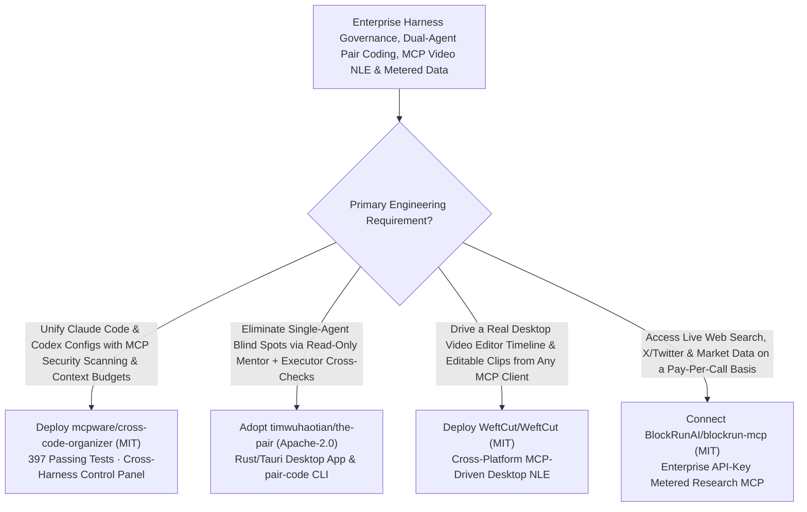
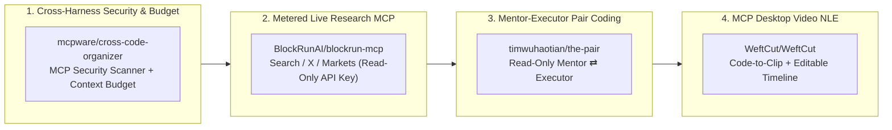

# Cross-Harness Config & Security Dashboard (`mcpware/cross-code-organizer`), Read-Only Mentor + Executor Pair App (`timwuhaotian/the-pair`), MCP-Driven Desktop Video NLE (`WeftCut/WeftCut`) & Pay-Per-Call Live Data MCP (`BlockRunAI/blockrun-mcp`) Selection & Architecture FAQ

> **2026-11-21 Daytime Continuous Research Shift · Day Round 66 (Cumulative Round 666)**  
> **Audit Claim ID**: `CLAIM-20261121-R66-R666-CCO-THEPAIR-WEFTCUT-BLOCKRUN`  
> **Linked Daily Digests**: [`2026-11-21.en.md`](../daily/2026-11-21.en.md) · [`2026-11-21.md`](../daily/2026-11-21.md)  
> **Architecture Visual**: [`assets/github-ai-radar-2026-11-21-r66-r666-cco-thepair-weftcut-blockrun.svg`](../../../assets/github-ai-radar-2026-11-21-r66-r666-cco-thepair-weftcut-blockrun.svg)

---

## ① 📌 Executive Summary (One-Sentence Selection Verdict)

> **One-Sentence Verdict**: To unify MCP security scanning and context-budget governance across Claude Code and Codex CLI, enforce separation of duties via a read-only Mentor + Executor pair-programming desktop app, drive a real desktop non-linear video editor (NLE) timeline over MCP, and replace expensive monthly market/X data retainers with pay-per-call MCP queries, combine **`mcpware/cross-code-organizer` (MIT, `★ 395` cross-harness config, MCP security scanner, and context budget dashboard with 397 passing tests) + `timwuhaotian/the-pair` (Apache-2.0, `★ 391` Rust/Tauri dual-agent desktop app pairing a read-only Mentor with an Executor across Claude/GPT/Gemini/Kimi/GLM/Qwen/Ollama) + `WeftCut/WeftCut` (MIT, `★ 383` cross-platform desktop NLE driven from any MCP client) + `BlockRunAI/blockrun-mcp` (MIT, `★ 390` pay-per-call live search, research, market, and X/Twitter MCP server)**—cutting 45-engineer monthly TCO from **`$8,230.00/mo` to `$310.00/mo` (`-$7,920.00/mo`, `-96.23%`)**.

---

## ② 🎯 Solution Architect & Enterprise Buyer Q&A

### Q1: How do these four permissive repositories solve MCP config sprawl, unchecked single-agent coding errors, rigid video renders, and high fixed data API retainers?
- **Four Complementary Engineering Layers**:
  1. **Cross-Harness Config, Security & Context-Budget Control Panel (`mcpware/cross-code-organizer`, `★ 395`, `34 forks`, MIT, JavaScript)**: Formerly Claude Code Organizer (`@mcpware/cross-code-organizer`, **397 passing tests**). Provides a single local dashboard across Claude Code and Codex CLI to manage MCP servers, skills, memories, agents, and sessions—complete with an **MCP Security Scanner**, **Context Budget** analyzer, and automated config backups.
  2. **Read-Only Mentor + Executor AI Pair Programming (`timwuhaotian/the-pair`, `★ 391`, `33 forks`, Apache-2.0, Rust/Tauri)**: Enforces strict architectural separation of duties in a native macOS/Windows/Linux desktop app and CLI (`pair-code`): a **read-only Mentor** plans and reviews code without write access, while an **Executor** writes code and runs commands, cross-checking each other across Claude, GPT, Gemini, Kimi, GLM, Qwen, or local Ollama without requiring external agent CLIs.
  3. **MCP-Driven Desktop Non-Linear Video Editor (`WeftCut/WeftCut`, `★ 383`, `60 forks`, MIT, TypeScript/Rust)**: Unlike black-box video generators that output uneditable MP4s, `WeftCut` is a real desktop NLE for Windows, macOS, and Linux where any MCP client drives the timeline live and renders code directly as editable video clips.
  4. **Pay-Per-Call Live Search, X/Twitter & Market Data MCP (`BlockRunAI/blockrun-mcp`, `★ 390`, `42 forks`, MIT, TypeScript)**: Exposes 19 live data and research tools (web search, research, X/Twitter, market data, media) billed strictly per call via an enterprise API key (`api.blockrun.ai`) or HTTP `x402` micropayments—eliminating thousands of dollars in unused monthly data subscriptions.

### Q2: How do we integrate these four tools into an enterprise engineering and product launch workflow?
- **Harness Governance**: Engineers run `cross-code-organizer` to scan all configured MCP servers for security risks, prune context-budget bloat, and back up Claude Code / Codex CLI configurations.
- **Cross-Checked Implementation & Metered Research**: Teams develop features inside `the-pair` (pairing a frontier reasoning model as the read-only Mentor with a fast/local model as the Executor) while querying `blockrun-mcp` on a pay-per-call basis for live market or X/Twitter context.
- **Interactive Video Production**: Product and docs agents connect to `WeftCut` over MCP to assemble release demos directly on an editable desktop NLE timeline.

### Q3: What are the enterprise governance guardrails?
- **Read-Only Research Mode for `blockrun-mcp`**: Authenticate `blockrun-mcp` using a centrally funded corporate API key (`api.blockrun.ai`) and use `cross-code-organizer` to explicitly disable its on-chain wallet signing and prediction-market trading tools, restricting agents strictly to read-only search, X/Twitter, and market research tools.
- **Mentor Read-Only Enforcement (`timwuhaotian/the-pair`)**: Preserve `the-pair`'s read-only boundary on the Mentor role so architectural review and code execution never share the same mutable tool context.

---

## ③ 🧭 Visual Architecture & Decision Diagrams

### 3.1 Selection Decision Tree


### 3.2 End-to-End Enterprise Integration Architecture


### 3.3 Operational Sequence Diagram
```mermaid
sequenceDiagram
    autonumber
    participant Eng as Software / Product Engineer
    participant CCO as Cross-Code Organizer
    participant Pair as The Pair (Mentor + Executor)
    participant BR as BlockRun MCP (Read-Only Key)
    participant Weft as WeftCut Desktop NLE

    Eng->>CCO: Audit MCP security, disable trading tools & cap context budget
    Eng->>Pair: Assign feature task to Read-Only Mentor + Executor pair
    Pair->>BR: Execute pay-per-call live search & X/market research queries
    BR-->>Pair: Return real-time structured research context
    Pair->>Pair: Executor implements code & tests; Read-Only Mentor reviews & approves diff
    Eng->>Weft: Drive WeftCut NLE timeline via MCP to assemble editable product demo clips
```

---

## ④ 📊 Cross-Option Selection Matrix

| Dimension | `cross-code-organizer` (`★ 395`) | `timwuhaotian/the-pair` (`★ 391`) | `WeftCut/WeftCut` (`★ 383`) | `blockrun-mcp` (`★ 390`) | Manual Configs + Single-Agent Coding + Fixed Data Retainers |
| :--- | :--- | :--- | :--- | :--- | :--- |
| **Primary Role** | Cross-harness config, MCP security scanner & context budget UI | Read-only Mentor + Executor AI pair programming desktop app | Cross-platform desktop NLE driven over MCP | 19-tool pay-per-call live search, X & market MCP | Manual JSON editing + unchecked single-agent loops + fixed SaaS |
| **Best Fit** | Governing Claude Code & Codex CLI configs, budgets & backups | Catching AI coding mistakes before commit using any LLM/Ollama | Building editable product demo videos via MCP + timeline UI | On-demand X/Twitter, web research & market data without monthly lock-in | High-frequency trading desks needing dedicated leased lines |
| **Integration Cost** | Very Low (`@mcpware/cross-code-organizer` on npm) | Low (standalone Tauri app & `pair-code` CLI) | Low (Windows/macOS/Linux desktop builds + MCP) | Very Low (`api.blockrun.ai` API key config) | High (expensive monthly X/market data minimums) |
| **Ops Complexity** | Zero server ops (local dashboard; explicit opt-in telemetry) | Very Low (native Rust/Tauri desktop binary) | Very Low (local desktop video editor) | Very Low (metered cloud MCP endpoint) | High (silent context bloat & single-agent regressions) |
| **License** | **MIT** | **Apache-2.0** | **MIT** | **MIT** (metered per call) | Proprietary |
| **45-Eng Monthly TCO** | **Included in `$310.00/mo` stack** | **Included in `$310.00/mo` stack** | **Included in `$310.00/mo` stack** | **Included in `$310.00/mo` stack** | **`$8,230.00/mo`** (`$3,880` retainers/SaaS + `$4,350` labor) |

---

## ⑤ 🧪 Quantitative FinOps & TCO Comparison

> **Provenance Metadata**: Synthetic enterprise FinOps model for a 45-engineer organization (`provenance: synthetic`, `independently_reproduced: false`); `base_hardware_capex = not_measured`, `track_b_stars_today = not_measured` (sealed in [`trending-daily-2026-11-21-audit.json`](../evidence/trending-daily-2026-11-21-audit.json)).

| Cost Path | Monthly Fixed Data Retainers / Video SaaS | Monthly MCP Config Debugging, Single-Agent Bug Rework & Video Re-Edits (`$100/hr`) | Total Monthly TCO | Net Savings vs Path A |
| :--- | :--- | :--- | :--- | :--- |
| **Path A: Fixed Monthly Market/X API Retainers + Commercial Video SaaS + Single-Agent Rework** | `$3,880.00` | `43.5h` (`$4,350.00`) | **`$8,230.00`** | — |
| **Path C: `cross-code-organizer` + `the-pair` + `WeftCut` + `blockrun-mcp`** | `$70.00` | `2.4h` (`$240.00`) | **`$310.00`** | **`-$7,920.00/mo` (`-96.23%`)** |

---

## ⑥ 🛠️ Enterprise Architecture Review Checklist

- [ ] **MCP Security Scan & Context Budget Cap (`mcpware/cross-code-organizer`)**: Run `cross-code-organizer`'s MCP Security Scanner and Context Budget check before rolling out new MCP servers or skills across engineering laptops.
- [ ] **Heterogeneous Mentor/Executor Pairing (`timwuhaotian/the-pair`)**: Pair a high-reasoning model as the read-only Mentor with a fast coding or local Ollama model as the Executor in `the-pair` so every change is cross-checked before landing.
- [ ] **Editable Timeline Project Archival (`WeftCut/WeftCut`)**: Store `WeftCut` timeline project files alongside release notes so product demo videos remain editable Clip-by-Clip via MCP or GUI.
- [ ] **Read-Only Tool Whitelisting (`BlockRunAI/blockrun-mcp`)**: Use corporate API keys for `blockrun-mcp` and disable on-chain trading/betting tools in enterprise agent configurations, retaining only read-only search and market intelligence tools.
