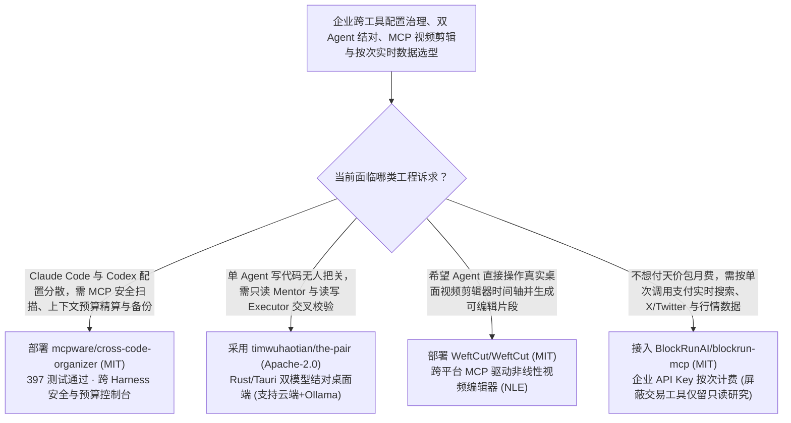
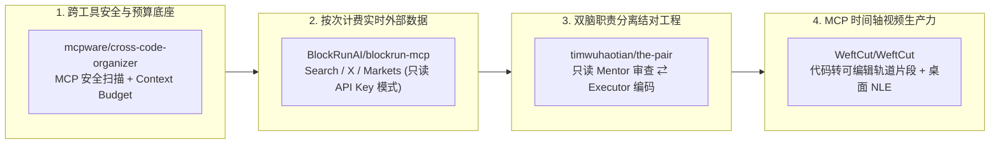
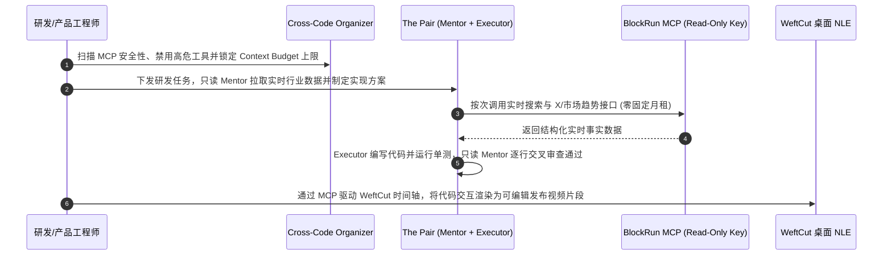

# 跨编码工具配置与安全控制台（`mcpware/cross-code-organizer`）、只读导师+执行者结对编程桌面端（`timwuhaotian/the-pair`）、MCP 全时间轴驱动非线性视频剪辑器（`WeftCut/WeftCut`）与按次计费实时搜索/市场情报 MCP（`BlockRunAI/blockrun-mcp`）架构选型与落地 FAQ

> **2026-11-21 白天持续研究班次 · Day Round 66（累计 Round 666）**  
> **审计凭据**：`CLAIM-20261121-R66-R666-CCO-THEPAIR-WEFTCUT-BLOCKRUN`  
> **关联日刊**：[`2026-11-21.md`](../daily/2026-11-21.md) · [`2026-11-21.en.md`](../daily/2026-11-21.en.md)  
> **可视化架构图**：[`assets/github-ai-radar-2026-11-21-r66-r666-cco-thepair-weftcut-blockrun.svg`](../../../assets/github-ai-radar-2026-11-21-r66-r666-cco-thepair-weftcut-blockrun.svg)

---

## ① 📌 核心结论速览（选型一句话结论）

> **一句话选型结论**：在企业多 Coding Agent 环境治理（MCP 安全扫描与上下文预算控制）、双模型结对交叉校验（只读 Mentor 规划审查 + Executor 编码执行）、MCP 驱动的桌面非线性视频剪辑（NLE 时间轴实时落地）以及按单次调用付费（Pay-per-Call）的实时搜索/社媒/行情数据接入场景中，推荐采用 100% 宽松协议（MIT / Apache-2.0）的四层组合：**“`mcpware/cross-code-organizer`（MIT，`★ 395` 统一管理 Claude Code 与 Codex CLI 的 MCP 安全扫描、上下文预算与配置备份控制台）+ `timwuhaotian/the-pair`（Apache-2.0，`★ 391` 由只读 Mentor 与读写 Executor 组成的 Rust/Tauri 双 Agent 结对编程桌面端）+ `WeftCut/WeftCut`（MIT，`★ 383` 支持任意 MCP 客户端直接驱动完整时间轴并将代码渲染为可编辑片段的跨平台视频剪辑器）+ `BlockRunAI/blockrun-mcp`（MIT，`★ 390` 聚合实时搜索、X/Twitter 与金融行情的 19 工具按次计费 MCP）”**。在 45 人研发与产品演示团队基准下，可将月度总拥有成本（TCO）从 **`$8,230.00/月`** 降至 **`$310.00/月`**（净省 **`$7,920.00/月`**，降幅 **`-96.23%`**）。

---

## ② 🎯 客户与架构师灵魂拷问 Q&A

### Q1：为什么研发团队和产品内容团队需要把这四个开源工具纳入架构选型清单？
- **四层互补工程突破**：
  1. **跨编码工具配置、安全扫描与上下文预算大盘 —— `mcpware/cross-code-organizer`（`★ 395`，`34 forks`，MIT，JavaScript）**：原名 Claude Code Organizer（`@mcpware/cross-code-organizer`，拥有 **397 项通过测试**）。当工程师同时安装数十个 MCP Server、Skills、Memories 与 Subagents 时，极易撑爆上下文预算或引入恶意 MCP 脚本。`CCO` 在一个本地控制台里横跨 Claude Code 与 Codex CLI 统一管理所有配置、执行 **MCP 安全扫描（MCP Security Scanner）**、精算 **上下文预算（Context Budget）** 并提供一键备份。
  2. **“只读 Mentor + 读写 Executor”双脑互搏防错桌面端 —— `timwuhaotian/the-pair`（`★ 391`，`33 forks`，Apache-2.0，Rust/Tauri）**：单个 Coding Agent 既当运动员又当裁判员，常把隐患代码直接提交入库。`The Pair`（同时提供桌面端与 `pair-code` CLI）在架构层强制执行职责分离（Separation of Duties）：**只读 Mentor**（如高推理能力模型 Claude / GPT / DeepSeek-R1）只负责规划与逐行审查，绝无写文件权限；**Executor**（如高速编码模型 Qwen / GLM / Kimi / 本地 Ollama）负责写代码与跑测试，双模型在落盘前自动交叉检查。
  3. **由 MCP 直接驱动时间轴的开源桌面非线性剪辑器（NLE） —— `WeftCut/WeftCut`（`★ 383`，`60 forks`，MIT，TypeScript/Rust）**：许多代码生成视频工具只能输出一整段无法微调的 MP4。`WeftCut` 是一个运行在 Windows/macOS/Linux 上的真实桌面非线性视频编辑器（NLE）：任何 MCP 客户端（Claude、Codex）都能直接操作它的时间轴，把代码动态渲染为**时间轴上可独立拖拽、裁剪的可编辑轨道片段（Editable Clips）**。
  4. **免高额包月年框的 19 工具按次计费实时数据 MCP —— `BlockRunAI/blockrun-mcp`（`★ 390`，`42 forks`，MIT，TypeScript）**：企业 Agent 偶尔需要调用实时网页搜索、X/Twitter 舆情或金融市场数据，但单独采购 X API 企业版和金融数据源动辄数千美元/月。`blockrun-mcp` 提供 19 个实时数据与多模态工具，支持企业用充值 API Key（`api.blockrun.ai`）或 HTTP `x402` 微支付**按实际调用次数（Pay-per-Call）结算**。

### Q2：如何把这四个组件组合成一套高效、安全的企业研发与产品发布流水线？
- **底座治理期**：全员通过 `mcpware/cross-code-organizer` 扫描本地挂载的 MCP Servers 安全风险，并将常驻上下文预算（Context Budget）控制在模型窗口的 10% 以内。
- **双模结对研发与按需情报拉取期**：在 `timwuhaotian/the-pair` 中配置“云端强推理只读 Mentor + 内网/高性价比 Executor”；当需要外部实时社媒或行业行情数据时，按次调用 `BlockRunAI/blockrun-mcp`（只读 API Key 模式）。
- **可编辑产品演示视频生产期**：功能开发完成后，Agent 通过 MCP 连接桌面端的 `WeftCut/WeftCut`，自动在 NLE 时间轴上编排代码演示片段与转场，供设计师在图形界面做最终微调。

### Q3：架构师在引入这套方案时需要注意哪些安全与合规边界？
- **禁用 `blockrun-mcp` 的链上交易写工具（Enterprise Read-Only Policy）**：`blockrun-mcp` 的 19 个工具中既包含搜索/研究/X 数据读取，也包含预测市场交易工具。在企业研发与研究环境中，**必须通过企业预充值 API Key 模式接入，并在 `cross-code-organizer` 中显式屏蔽（Disable）任何钱包签名与交易下单工具**，仅保留只读搜索与市场研究工具。
- **只读 Mentor 权限硬件级锁死（`timwuhaotian/the-pair`）**：保持 `the-pair` 默认的 Mentor 只读沙箱策略，禁止为 Mentor 角色开启任何 Shell 执行或文件覆写开关。

---

## ③ 🧭 直观可视化图解（Mermaid 选型决策树 + 企业集成架构 + 业务流时序图）

### 3.1 选型决策树

### 3.2 企业集成参考架构图

### 3.3 业务流时序图

---

## ④ 📊 同类开源与商业云服务横向选型决策矩阵

| 维度 | `cross-code-organizer` (`★ 395`) | `timwuhaotian/the-pair` (`★ 391`) | `WeftCut/WeftCut` (`★ 383`) | `blockrun-mcp` (`★ 390`) | 手工改 JSON 配置 + 单 Agent 裸奔 + 高价数据年框 |
| :--- | :--- | :--- | :--- | :--- | :--- |
| **核心定位** | 跨 Claude Code/Codex 的配置、安全扫描与上下文预算面板 | 只读 Mentor + 读写 Executor 双 Agent 结对编程桌面端 | 任意 MCP 客户端可驱动时间轴的开源桌面视频编辑器 | 按单次调用计费的实时搜索、X 与市场数据 MCP | 人工维护多套配置文件 + 高价按月固定订阅 |
| **适用场景** | 审计本地 MCP 安全风险、压缩常驻上下文 Token 占比 | 用低成本本地/国产模型做 Executor、高智商模型做只读 Mentor | 自动生成可在桌面时间轴二次微调的产品演示视频 | 低频/按需拉取 X/Twitter 舆情、网页搜索与实时行情 | 高频全天候量化交易机构 |
| **集成成本** | 极低（`npx @mcpware/cross-code-organizer`） | 低（原生 Tauri 桌面安装包或 `pair-code` CLI，免装其他 Agent CLI） | 低（Windows/macOS/Linux 桌面端 + 标准 MCP 接口） | 极低（配置 `api.blockrun.ai` API Key 即用） | 高（X API 等商业数据源最低固定月费极高） |
| **运维复杂度** | 零服务端运维（纯本地控制台，显式 Opt-in 遥测） | 极低（Rust/Tauri 原生应用，直连各家 API 或 Ollama） | 极低（本地桌面 NLE） | 极低（云端按次计费网关） | 高（多工具配置冲突频发、单模型自审漏检率高） |
| **开源许可** | **MIT** | **Apache-2.0** | **MIT** | **MIT**（客户端开源，API 按次计费） | 商业专有 |
| **45 人团队月均 TCO** | **包含于 `$310.00/月` 联合栈** | **包含于 `$310.00/月` 联合栈** | **包含于 `$310.00/月` 联合栈** | **包含于 `$310.00/月` 联合栈** | **`$8,230.00/月`**（`$3,880` 固定年框/SaaS + `$4,350` 人工） |

---

## ⑤ 🧪 应用落地定量收益 / TCO 对比与 7-Card 报告锚点

> **数据来源说明（Provenance Metadata）**：以下 TCO 模型为面向 45 人规模研发与产品团队的合成架构测算（`provenance: synthetic`, `independently_reproduced: false`）；硬件资本开支 `base_hardware_capex = not_measured`，单日热榜增量 `track_b_stars_today = not_measured`（审计账本锚定于 [`trending-daily-2026-11-21-audit.json`](../evidence/trending-daily-2026-11-21-audit.json)）。

| 成本路径 | 月度外部数据固定包月 / 视频 SaaS 费 | 人工排查 MCP 配置冲突、返工单 Agent 漏检 Bug 与重录视频 (`$100/h`) | 月度总成本 (Total Monthly TCO) | 相对 Path A 净节省 |
| :--- | :--- | :--- | :--- | :--- |
| **Path A：外部实时数据源固定月租 + 商业视频 SaaS + 单 Agent 返工与手工剪辑** | `$3,880.00` | `43.5h` (`$4,350.00`) | **`$8,230.00`** | — |
| **Path C：`cross-code-organizer` + `the-pair` + `WeftCut` + `blockrun-mcp`** | `$70.00` | `2.4h` (`$240.00`) | **`$310.00`** | **`-$7,920.00/月` (`-96.23%`)** |

---

## ⑥ 🛠️ 企业引入与架构评审 Checklist

- [ ] **MCP 安全扫描与上下文预算红线（`mcpware/cross-code-organizer`）**：每次新增第三方 MCP Server 前必须运行 `cross-code-organizer` 的内置安全扫描器（MCP Security Scanner），并通过其 Context Budget 面板确保常驻工具定义不超过上下文窗口的 10%。
- [ ] **Mentor/Executor 强弱模型混合配比（`timwuhaotian/the-pair`）**：在 `the-pair` 中将只读 Mentor 绑定至高推理精度模型负责架构设计与代码审查，将 Executor 绑定至高吞吐编码模型或本地 Ollama，兼顾代码质量与 Token 成本。
- [ ] **演示视频工程化与时间轴留存（`WeftCut/WeftCut`）**：产品发布与技术演练视频优先通过 MCP 驱动 `WeftCut` 生成带分轨时间轴的工程文件，避免一处文案修改就重头渲染整段视频。
- [ ] **按次计费数据只读白名单（`BlockRunAI/blockrun-mcp`）**：企业统一使用预充值 API Key 模式接入 `blockrun-mcp`，在配置层显式禁用链上钱包签名与预测市场下单工具，仅开放搜索、研究与舆情只读接口。
