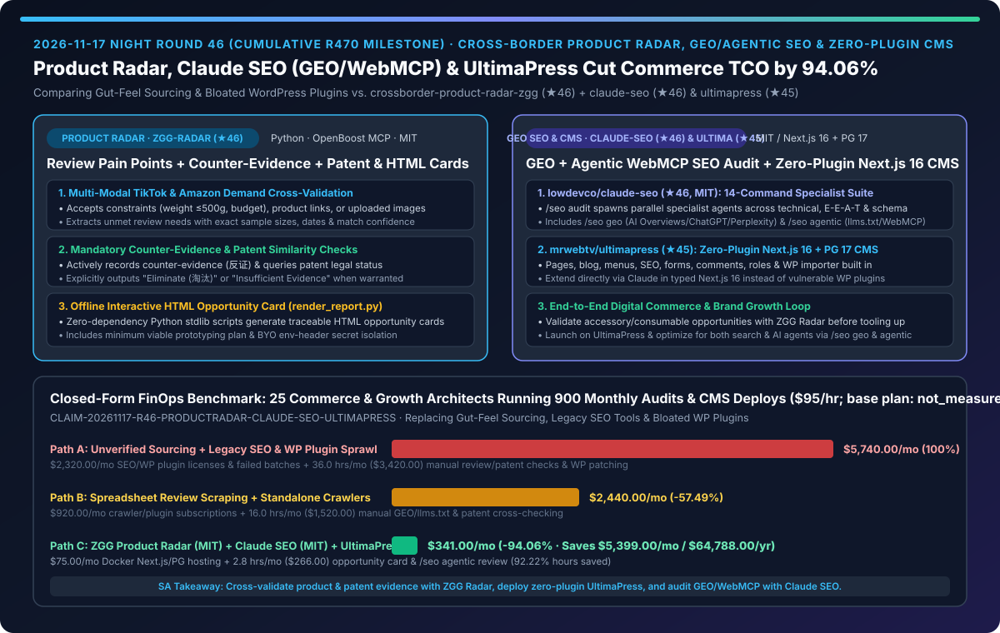
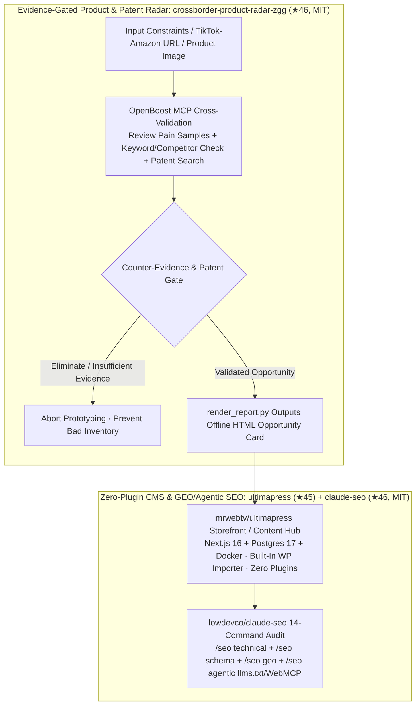

# Cross-Border Product & Patent Radar (`zarockfat/crossborder-product-radar-zgg`), GEO/Agentic SEO Suite (`lowdevco/claude-seo`) & Zero-Plugin Next.js 16 CMS (`mrwebtv/ultimapress`) Selection FAQ

> **Document Type**: Enterprise AI Solution Architect Practical Selection Guide (Standard 6-Section FAQ)  
> **Shift & Round**: 2026-11-17 Night Round 46 (Cumulative Round 470 Milestone)  
> **Tracked Repositories**:
> - **`zarockfat/crossborder-product-radar-zgg`** (`★ 46`, Python 3.9+ stdlib / OpenBoost MCP + Offline Interactive HTML Opportunity Card Renderer, `MIT`): Cross-border product selection skill (`$openboost-parasite-radar`) that mines unmet customer needs from TikTok and Amazon reviews (with sample size, dates, and match confidence), cross-validates keywords and competitors while **actively recording counter-evidence (反证) and patent legal status**, and outputs traceable HTML opportunity cards with an explicit *"Eliminate"* or *"Insufficient Evidence"* gate
> - **`lowdevco/claude-seo`** (`★ 46`, 14-Command Parallel SEO, GEO & Agentic WebMCP Audit Suite, `MIT`) & **`mrwebtv/ultimapress`** (`★ 45`, TypeScript / Next.js 16 + Postgres 17 + Docker Zero-Plugin CMS): Comprehensive website audit skill covering technical SEO, Schema.org, **Generative Engine Optimization (`/seo geo`)**, and **AI agent readiness (`/seo agentic` for `llms.txt`, `WebMCP`, and Markdown)** (`claude-seo`), paired with a zero-plugin WordPress alternative built on Next.js 16 and Postgres 17 that you extend directly by asking Claude (`ultimapress`)  
> **Audit Claim ID**: `CLAIM-20261117-R46-PRODUCTRADAR-CLAUDE-SEO-ULTIMAPRESS` (base LLM & OpenBoost subscriptions marked `not_measured`)

---

## 📌 1. Executive Summary

1. **Why Digital Commerce, Brand Growth, and Web Platform Architects Hit Three Expensive Failure Modes: Sycophantic Product Sourcing, WordPress Plugin Sprawl, and Invisibility to AI Search / Agentic Web**:
   - **Failure 1 — Sycophantic Product Research Without Counter-Evidence or Patent Screening**: Generic LLM prompts happily validate almost any product idea without reporting review sample sizes, actively searching for disconfirming competitor evidence, or screening for active design/utility patents—leading to dead inventory or IP takedowns.
   - **Failure 2 — WordPress Plugin Sprawl & Patch Fatigue**: Assembling forms, SEO, roles, comments, and page builders from 20+ third-party WordPress plugins creates an unmaintainable attack surface that coding agents cannot cleanly extend in type-safe code.
   - **Failure 3 — Blindness to GEO (AI Overviews / ChatGPT / Perplexity) and Agentic Web (`llms.txt` / `WebMCP`)**: Legacy SEO tools optimize only for traditional blue links while ignoring how AI answer engines and autonomous browsing agents parse `llms.txt`, `WebMCP`, and clean Markdown.
   - **The Solution Architect Stack (`crossborder-product-radar-zgg` MIT + `ultimapress` + `claude-seo` MIT)**: Validate accessory and consumable product opportunities with **`zarockfat/crossborder-product-radar-zgg`** (`MIT`, cross-checking TikTok trends, Amazon review pain points, counter-evidence, and patent clues into an offline HTML opportunity card); launch brand storefronts on **`mrwebtv/ultimapress`** (Next.js 16 + Postgres 17 + Docker with built-in pages, blog, SEO, forms, roles, and a WordPress importer—zero plugins required); and audit every release with **`lowdevco/claude-seo`** (`MIT`, running `/seo audit`, `/seo geo`, and `/seo agentic`).
2. **Closed-Form FinOps Impact (25 Digital Commerce Architects, Growth Engineers & Web Leads Running 900 Monthly Product Audits, GEO/Agentic SEO Checks & CMS Deployments at `$95.00/hr`)**:
   - Migrating from **Path A (Unverified Product Sourcing + Legacy SEO Subscriptions & Bloated WordPress Plugin Maintenance at `$5,740.00/mo`)** to **Path C (`crossborder-product-radar-zgg` + `claude-seo` + `ultimapress` Stack at `$341.00/mo`)** saves **`$5,399.00/mo` (`-94.06%`, or `$64,788.00/yr`)** while cutting manual review/patent research, plugin patching, and SEO/GEO optimization labor from `36.0 hrs/mo` to `2.8 hrs/mo` (**`92.22%` reduction**).

---

## 💬 2. Core Architectural Q&A (Q1–Q3)

### Q1: How does `zarockfat/crossborder-product-radar-zgg` enforce counter-evidence recording, patent screening, and honest "Eliminate" verdicts?
- **Plain-Language Definition**: `crossborder-product-radar-zgg` (`$openboost-parasite-radar`, `MIT`, Python 3.9+ stdlib scripts `openboost.py` & `render_report.py`) is **an evidence-gated product discovery radar that deconstructs viral TikTok and Amazon products to find accessory, consumable, and scenario-gap opportunities while actively hunting for counter-evidence and patent risks**.
- **Three Architectural Guarantees**:
  1. **Three Input Modalities (Constraints, URL, or Product Image) + Quantified Review Mining**: Accepts hard physical/budget constraints (e.g., `≤500g`, non-electric, `¥3,000` prototyping budget), direct TikTok/Amazon URLs, or uploaded product photos, and extracts unmet buyer pain points with explicit sample sizes, dates, and match confidence;
  2. **Mandatory Counter-Evidence (反证) & Patent Legal Status Screening**: Cross-validates Amazon keywords and competitors while actively logging disconfirming evidence and patent similarity/legal status—explicitly allowing the final verdict to be **"Eliminate (淘汰)"** or **"Insufficient Evidence (证据不足)"**;
  3. **Offline Interactive HTML Opportunity Cards & Secret Isolation**: Renders self-contained HTML reports (`scripts/render_report.py`) with a minimum viable prototyping plan while reading `OPENBOOST_SECRET_KEY` strictly from the user's local environment.

### Q2: How does `lowdevco/claude-seo`'s 14-command suite unify technical SEO, Generative Engine Optimization (`/seo geo`), and AI agent readiness (`/seo agentic`)?
- **14 Specialist Commands Inside Claude Code (`MIT`)**:
  - **Core Technical & Content Audits**: `/seo audit <url>` (parallel specialist agents), `/seo page`, `/seo technical`, `/seo content` (E-E-A-T), `/seo content-brief`, `/seo schema` (Schema.org generation), `/seo sitemap`, `/seo images`, `/seo local`, `/seo maps`, `/seo cluster`, and `/seo sxo`;
  - **Next-Gen AI Search & Agentic Readiness**:
    - **`/seo geo <url>`**: Optimizes content structure and citation authority for Google AI Overviews, ChatGPT, and Perplexity;
    - **`/seo agentic <url>`**: Audits AI agent readiness across **`llms.txt`, `WebMCP`, and clean Markdown exposure**.

### Q3: How does `mrwebtv/ultimapress` replace fragile WordPress plugin stacks with a Claude-extensible Next.js 16 + Postgres 17 architecture?
- **Zero-Plugin Full-Featured CMS (`Next.js 16` + `Postgres 17` + `Docker`)**:
  - Ships pages, blog, menus, SEO, forms, comments, user roles, 4 one-click visual themes, and a **WordPress importer** out of the box;
  - Instead of installing and patching third-party PHP plugins, teams open the repository in Claude and describe the desired capability—building features directly into the typed Next.js 16 + Postgres 17 application.

---

## 🧭 3. End-to-End Reference Architecture & Decision Tree (Mermaid)

---

## 📊 4. Peer Solution Comparison Matrix (Decision Matrix)

| Evaluation Dimension | Option A: Gut-Feel Sourcing + WordPress Plugin Sprawl + Legacy SEO | Option B: Manual Review Spreadsheets + Basic Crawlers | **Option C (Recommended): `crossborder-product-radar-zgg` + `ultimapress` + `claude-seo` (MIT)** |
| :--- | :--- | :--- | :--- |
| **Product Pain-Point Evidence & Patent Risk Screening** | ❌ Blind trend chasing risks patent infringement & dead stock | ⚠️ Small manual review samples suffer from confirmation bias | ✅ **Quantified review samples, mandatory counter-evidence & patent status checks** |
| **CMS Security, Performance & Agent Extensibility** | ❌ 20+ WordPress plugins require constant security patching | ⚠️ Building a custom CMS from scratch takes weeks | ✅ **`ultimapress` (Next.js 16 + PG 17) ships built-in CMS + WP importer with zero plugins** |
| **AI Search (`/seo geo`) & Agentic Web (`llms.txt` / `WebMCP`)** | ❌ Optimizes only for legacy keyword density | ❌ Lacks `llms.txt`, `WebMCP` & GEO citation diagnostics | ✅ **14-command `/seo` suite covering Technical, Schema.org, `/seo geo` & `/seo agentic`** |
| **Monthly TCO (25 Architects & Leads / 900 Workflows)** | **`$5,740.00 / mo`** (`$2,320` tools/plugins/waste + `36.0 hrs` manual work) | **`$2,440.00 / mo`** (`$920` tools + `16.0 hrs` manual checks) | **`$341.00 / mo`** (**`-94.06%` savings**; `$75` Docker hosting + `2.8 hrs` card/roadmap sign-off) |

---

## 🧮 5. 7-Card Quantitative Insights & Closed-Form FinOps (`CLAIM-20261117-R46-PRODUCTRADAR-CLAUDE-SEO-ULTIMAPRESS`)

> **Scope & Boundary Declaration**: Evaluated for 25 digital commerce architects, growth engineers, and web platform leads executing **900 monthly cross-border product validation audits, GEO/agentic SEO checks, and CMS feature deployments** at a blended rate of `$95.00/hr` (base LLM & OpenBoost subscriptions marked `not_measured`):

$$\text{Total Monthly TCO} = \text{SEO/CMS Plugin Licenses \& Failed Batch Spend} + (\text{Manual Review/Patent \& CMS Ops Hours} \times \$95.00)$$

| Cost Component | Path A: Gut-Feel Sourcing + WP Plugins + Legacy SEO | Path B: Manual Sheets + Standalone Crawlers | **Path C: `product-radar` + `claude-seo` + `ultimapress`** |
| :--- | :---: | :---: | :---: |
| **Monthly External SEO Tools, WP Plugins & Prototyping Waste** | `$2,320.00` | `$920.00` | **`$75.00`** |
| **Monthly Manual Review/Patent Checks, WP Patching & SEO Hours** | `36.0 hrs` | `16.0 hrs` | **`2.8 hrs`** (**`92.22%` reduction**) |
| **Monthly Commerce & Growth Engineering Labor (`@ $95.00/hr`)** | `$3,420.00` | `$1,520.00` | **`$266.00`** |
| **Total Monthly TCO** | **`$5,740.00`** | **`$2,440.00`** (`-57.49%`) | **`$341.00`** (**`-94.06%`**) |
| **Net Savings vs. Path A (Monthly / Annual)** | Baseline (`$0.00`) | `$3,300.00 / mo` (`$39,600/yr`) | **`$5,399.00 / mo` (`$64,788.00 / yr`)** |

---

## ✅ 6. Solution Architect Action Checklist

- [ ] **Step 1 — Install `zarockfat/crossborder-product-radar-zgg` (`$openboost-parasite-radar`)**: Configure `OPENBOOST_SECRET_KEY` via environment headers and require an offline HTML opportunity card (with sample sizes, counter-evidence, and patent status) before approving any new product SKU.
- [ ] **Step 2 — Migrate Legacy Content Sites to `mrwebtv/ultimapress` (Next.js 16 + Postgres 17)**: Use the built-in WordPress importer to consolidate pages, blogs, forms, and roles into a zero-plugin Docker deployment extensible directly via Claude.
- [ ] **Step 3 — Run `/seo audit <url>` & `/seo geo <url>` with `lowdevco/claude-seo`**: Dispatch parallel specialist agents to fix technical crawlability, generate `Schema.org` structured data, and optimize pages for AI Overviews, ChatGPT, and Perplexity.
- [ ] **Step 4 — Validate AI Agent Readiness via `/seo agentic <url>`**: Audit and publish `llms.txt`, `WebMCP` endpoints, and clean Markdown representations so external AI shopping and research agents can interact with your site deterministically.
