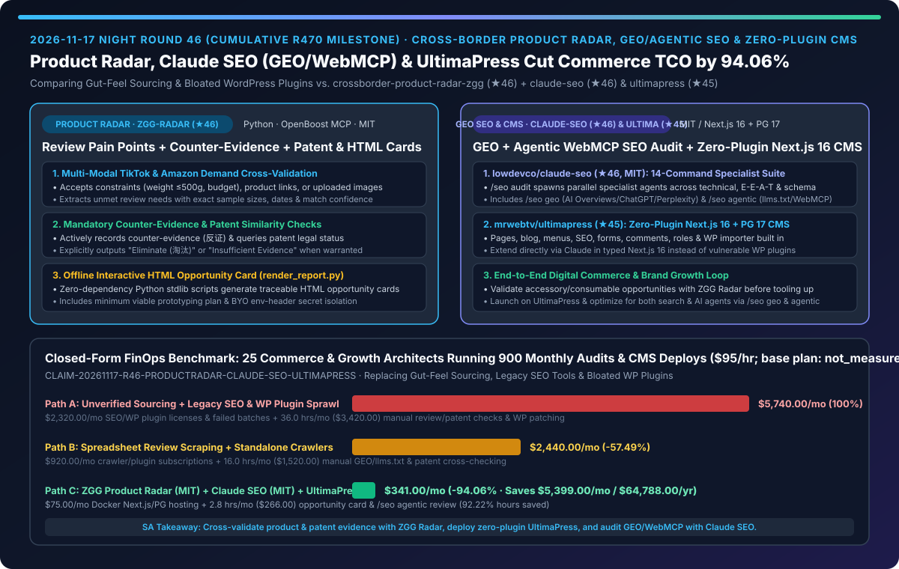
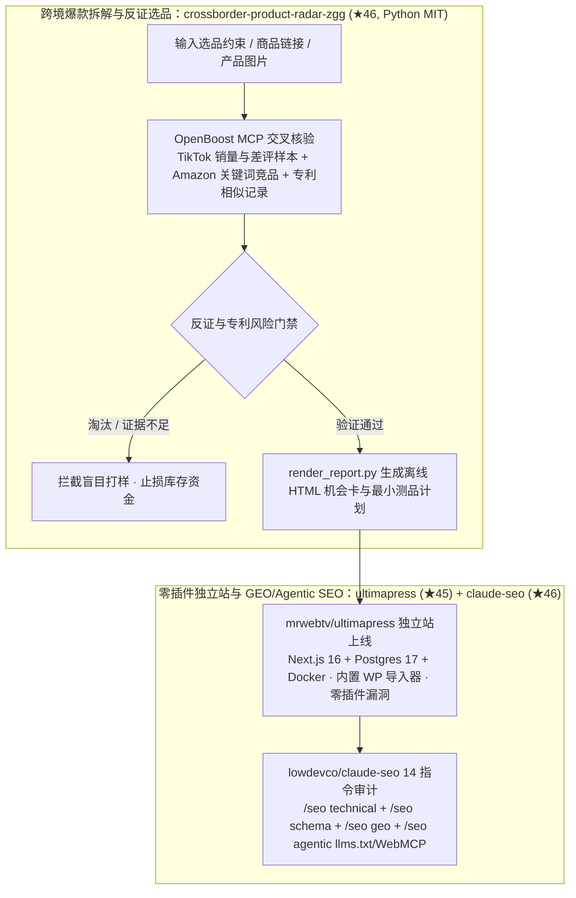

# 跨境选品反证与专利核查雷达（`crossborder-product-radar-zgg`）与 GEO/WebMCP 智能体搜索优化套件及零插件 Next.js 16 建站底座（`claude-seo` & `ultimapress`）架构选型 FAQ

> **文档类型**：AI Solution Architect（AI 解决方案架构师）实战选型指南（六段式标准 FAQ）  
> **所属轮次**：2026-11-17 Night Round 46（Cumulative Round 470 Milestone）  
> **追踪目标**：
> - **`zarockfat/crossborder-product-radar-zgg`**（`★ 46`，Python 3.9+ 标准库 / OpenBoost MCP + 离线交互 HTML 机会卡渲染器，`MIT`）：面向跨境电商与品牌出海的实证选品 Skill（`$openboost-parasite-radar`），从 TikTok 趋势与原始差评提取未满足痛点（强制标注样本量与日期），用 Amazon 关键词与竞品交叉验证并**主动记录反证（Counter-Evidence）与专利法律状态线索**，敢于输出“淘汰”或“证据不足”判决
> - **`lowdevco/claude-seo`**（`★ 46`，14 命令多专家并行 SEO / GEO / Agentic WebMCP 审计套件，`MIT`）& **`mrwebtv/ultimapress`**（`★ 45`，TypeScript / Next.js 16 + Postgres 17 + Docker 零插件建站系统）：涵盖传统技术 SEO、生成式引擎优化（`/seo geo` 针对 AI Overviews / ChatGPT / Perplexity）与 AI 智能体就绪度（`/seo agentic` 检查 `llms.txt`、`WebMCP`、Markdown）的 `claude-seo`，配合彻底消灭脆弱第三方插件、直接让 Claude 在强类型代码库中扩展功能的 WordPress 替代方案 `ultimapress`  
> **计量审计 ID**：`CLAIM-20261117-R46-PRODUCTRADAR-CLAUDE-SEO-ULTIMAPRESS`（底层大模型与 OpenBoost 数据订阅标记为 `not_measured`）

---

## 📌 一、核心结论速览（Executive Summary）

1. **为什么跨境品牌出海、独立站电商与数字营销架构师在推进“新品配件立项 → 独立站敏捷搭建 → 传统搜索与 AI 搜索双引擎获客”全链路时，常踩中“AI 选品工具只会顺着卖家报喜不报忧导致专利侵权或压货”、“传统 WordPress 装几十个插件天天修漏洞慢如蜗牛”、以及“只懂传统 Google SEO 却在 ChatGPT/Perplexity 与 `llms.txt`/WebMCP 智能体流量入口彻底隐形”三大深坑？**
   - **深坑一：无反证、无专利排查的“迎合式选品”**：普通大模型选品往往只挑好听的数据迎合用户，既不统计真实差评样本量与时间跨度，也不查美国外观/发明专利相似度，导致打样上架后遭遇侵权下架或无人问津。
   - **深坑二：WordPress 插件地狱（Plugin Sprawl）**：为了加个表单、SEO、评论和权限管理就得装十几个 PHP 插件，不仅存在持续的安全补丁负担，而且 Coding Agent 很难在一个拼凑的插件数据库里干净地开发新特性。
   - **深坑三：错失 GEO（生成式引擎优化）与 Agentic Web（`llms.txt` / `WebMCP`）新流量**：当越来越多买家通过 AI Overviews、ChatGPT、Perplexity 和购物 Agent 找产品时，缺乏 `/seo geo` 与 `/seo agentic` 审计的站点无法被 AI 正确引用或调用。
   - **架构师黄金组合（`crossborder-product-radar-zgg` MIT + `ultimapress` + `lowdevco/claude-seo` MIT）**：在选品立项门禁层部署 **`zarockfat/crossborder-product-radar-zgg`**（支持按条件/链接/图片三入口选品，强制交叉验证 TikTok 差评、Amazon 搜索与专利线索并主动记录反证，生成离线交互 HTML 机会卡）；在品牌独立站底座采用 **`mrwebtv/ultimapress`**（基于 Next.js 16 + Postgres 17 + Docker，原生内置页面、博客、SEO、表单、评论、权限与 WordPress 一键导入，零第三方插件）；在全渠道搜索与智能体获客层运行 **`lowdevco/claude-seo`**（14 个专用指令并行完成技术 SEO、`Schema.org`、`/seo geo` 与 `/seo agentic` 改造）。
2. **闭式 FinOps 量化收益（25 名数字商业架构师、增长工程师与独立站技术负责人，每月执行 900 次跨境选品立项核查、GEO/Agentic SEO 审计与独立站功能迭代，综合时薪 `$95.00/hr`）**：
   - 从 **Path A（拍脑袋选品试错 + 外采传统 SEO 工具与维护臃肿 WordPress 插件栈，`$5,740.00/月`）** 切换至 **Path C（`crossborder-product-radar-zgg` 反证选品 + `ultimapress` 零插件底座 + `claude-seo` GEO/WebMCP 套件，`$341.00/月`）**，每月净省 **`$5,399.00/月`（降幅 `-94.06%`，年化节省 `$64,788.00/年`）**，人工翻差评查专利、修补插件冲突与逐页改结构化数据工时从 `36.0 小时/月` 降至 `2.8 小时/月`（节省 **`92.22%`**）。

---

## 💬 二、灵魂拷问 Q1–Q3（大白话拆解应用场景与架构本质）

### Q1：`zarockfat/crossborder-product-radar-zgg` 为什么强调“主动记录反证、核查专利线索、且结论可以是淘汰或证据不足”？
- **大白话本质定义**：`crossborder-product-radar-zgg`（`$openboost-parasite-radar`，`MIT`，仅依赖 Python 3.9+ 标准库与自有 OpenBoost MCP 密钥）是**“专门从爆款差评里挖周边配件/耗材机会、同时帮你找反面证据和专利雷区的冷静选品审计员”**。
- **三大核心工程机制**：
  1. **三大灵活入口（按条件 / 发链接 / 传图片）+ 差评量化取证**：支持给定硬约束（如*“美国 Amazon 宠物自动喂食器周边、打样预算 3,000 元、单件 ≤500g、不带电不做液体”*）、直接贴 TikTok/Amazon 链接或上传产品实拍图；从原始评论提取痛点时强制标明**样本量、日期区间与产品匹配度**；
  2. **强制反证记录与专利法律状态筛查**：用 Amazon 关键词、竞品和关联商品交叉验证时**主动记录反证（Counter-Evidence）**，同步检索相似专利与法律状态，绝不盲目承诺爆款率，直接给出“通过 / 淘汰 / 证据不足”客观结论；
  3. **零依赖离线 HTML 机会卡渲染（`scripts/render_report.py`）**：输出带可追溯证据链与最小打样验证计划的独立交互式 HTML 机会卡，且密钥严格通过进程环境变量 `OPENBOOST_SECRET_KEY` 注入。

### Q2：`lowdevco/claude-seo` 的 14 个指令如何一次性打通“传统 Google SEO + AI 搜索（GEO）+ 智能体协议（`llms.txt` / `WebMCP`）”？
- **14 大全栈命令矩阵（`MIT`，输入 `/seo <command> <url>` 即可调度并行专家 Agent）**：
  - **传统技术与内容 SEO**：`/seo audit`（并行专家全站体检）、`/seo page`、`/seo technical`（抓取/安全/性能）、`/seo content`（E-E-A-T 评估）、`/seo content-brief`、`/seo schema`（Schema.org 验证与生成）、`/seo sitemap`、`/seo images`、`/seo local`、`/seo maps`、`/seo cluster`、`/seo sxo`；
  - **面向下一代 AI 流量入口的两大王牌指令**：
    - **`/seo geo <url>`（Generative Engine Optimization）**：专门优化网页在 Google AI Overviews、ChatGPT Search 与 Perplexity 中的引用率与事实抽取权重；
    - **`/seo agentic <url>`（AI Agent Readiness）**：检查站点是否具备面向外部自主 Agent 的 **`llms.txt`、`WebMCP` 与干净 Markdown 暴露能力**！

### Q3：`mrwebtv/ultimapress` 为什么是 AI Coding 时代替代 WordPress 的理想建站底座？
- **零插件（Zero Plugins）、全内置 Next.js 16 + Postgres 17 + Docker 架构**：
  - 原生内置页面构建器、博客、多级菜单、SEO、表单、评论、角色权限、4 套一键切换主题与 **WordPress 一键迁移导入器（Importer）**；
  - 当业务需要定制新模块时，不再去安装来路不明的第三方插件，而是直接在 Claude 中打开项目描述需求，让 Claude 直接把功能写进强类型的 Next.js 16 + Postgres 17 代码库中。

---

## 🧭 三、端到端集成参考架构与选型决策树（Mermaid）

---

## 📊 四、同赛道方案横向选型对比矩阵（Decision Matrix）

| 评估维度 | 方案 A：拍脑袋选品 + 臃肿 WordPress 插件栈 + 传统 SEO 外包 | 方案 B：手工扒评论表格 + 独立爬虫工具 | **方案 C（推荐）：`crossborder-product-radar-zgg` + `ultimapress` + `claude-seo` (MIT)** |
| :--- | :--- | :--- | :--- |
| **选品痛点真实性与专利排雷机制** | ❌ 只看销量排行榜跟风，常踩中外观专利侵权或伪痛点 | ⚠️ 手工看评论样本小且容易受确认偏误影响 | ✅ **TikTok+Amazon 交叉验证、强制标注差评样本量、主动记录反证并筛查专利状态** |
| **品牌独立站安全性与 AI 扩展性** | ❌ 装 20+ 个 WordPress 插件导致页面慢且补丁不断 | ⚠️ 从零手写 Next.js 后台耗时数周 | ✅ **`ultimapress` (Next.js 16 + PG 17) 原生内置全套 CMS 与 WP 导入器，零插件直接让 Claude 扩展** |
| **AI 搜索（GEO）与外部 Agent 访问就绪度** | ❌ 仅针对十年前关键词密度优化，AI 搜索与 Agent 读不懂 | ❌ 缺乏 `llms.txt` 与 `WebMCP` 协议检测能力 | ✅ **`/seo geo` 专攻 AI Overviews/ChatGPT/Perplexity，`/seo agentic` 审计 `llms.txt` 与 `WebMCP`** |
| **月度总拥有成本（TCO，25 人 / 900 次选品与审计）** | **`$5,740.00 / 月`**（含 `$2,320` 插件/工具/试错费 + `36.0h` 人工） | **`$2,440.00 / 月`**（含 `$920` 工具费 + `16.0h` 整理） | **`$341.00 / 月`**（**净省 `-94.06%`**，仅 `$75` 容器托管与 `2.8h` 机会卡/路线图终审） |

---

## 🧮 五、7-Card 定量洞察与闭式 FinOps 核算（`CLAIM-20261117-R46-PRODUCTRADAR-CLAUDE-SEO-ULTIMAPRESS`）

> **核算范围与边界声明**：面向 25 名数字商业架构师、增长工程师与独立站技术负责人团队，每月执行 **900 次跨境选品立项验证、GEO/Agentic SEO 网站审计与独立站功能迭代**（综合时薪 `$95.00/hr`；底层大模型与 OpenBoost 基础套餐标记为 `not_measured`）：

$$\text{Total Monthly TCO} = \text{SEO/CMS Plugin Licenses \& Failed Batch Spend} + (\text{Manual Review/Patent \& CMS Ops Hours} \times \$95.00)$$

| 成本构成项 | Path A：跟风选品 + WP 插件栈 + 传统 SEO | Path B：手工表格 + 独立爬虫工具 | **Path C：`product-radar` + `claude-seo` + `ultimapress`** |
| :--- | :---: | :---: | :---: |
| **月度外部 SEO 软件、付费插件与盲目打样损耗** | `$2,320.00` | `$920.00` | **`$75.00`** |
| **月度人工扒差评查专利、修插件与改 Schema 工时** | `36.0 hrs` | `16.0 hrs` | **`2.8 hrs`**（直降 **`92.22%`**） |
| **月度数字商业与增长工程师人工成本（`@ $95.00/hr`）** | `$3,420.00` | `$1,520.00` | **`$266.00`** |
| **月度总拥有成本（Monthly TCO）** | **`$5,740.00`** | **`$2,440.00`**（`-57.49%`） | **`$341.00`**（**`-94.06%`**） |
| **相对 Path A 净节省（月度 / 年化）** | 基线（`$0.00`） | `$3,300.00 / 月`（`$39,600/年`） | **`$5,399.00 / 月`（`$64,788.00 / 年`）** |

---

## ✅ 六、AI 解决方案架构师实战上手 Checklist（SA Action Checklist）

- [ ] **Step 1 — 部署 `zarockfat/crossborder-product-radar-zgg` 建立反证选品门禁**：通过环境变量 `OPENBOOST_SECRET_KEY` 挂载 MCP，要求所有新配件/耗材立项必须产出含差评样本量、反证记录与专利线索的离线 HTML 机会卡。
- [ ] **Step 2 — 使用 `mrwebtv/ultimapress` 升级或新建零插件品牌独立站**：利用内置 WordPress 导入器迁移旧站内容至 Next.js 16 + Postgres 17 Docker 容器，彻底移除高危第三方 PHP 插件。
- [ ] **Step 3 — 运行 `lowdevco/claude-seo` 的 `/seo audit` 与 `/seo geo`**：对所有核心产品落地页生成结构化 `Schema.org` 标记并优化 E-E-A-T 与 AI 搜索引用结构。
- [ ] **Step 4 — 执行 `/seo agentic <url>` 打通 `llms.txt` 与 `WebMCP`**：确保企业官网与商品目录既能被人类搜索引擎收录，又能被外部采购与比价 AI Agent 无障碍读取和调用。
