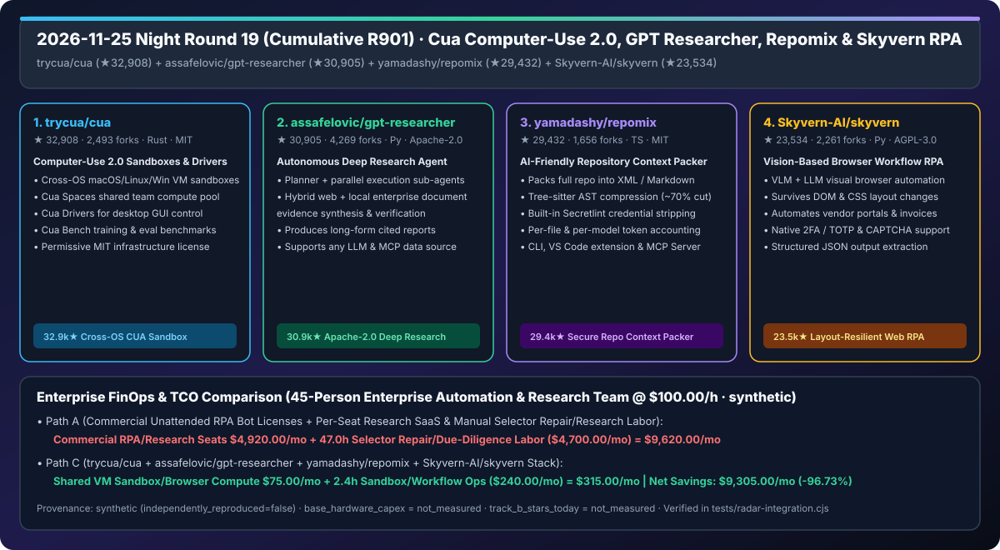
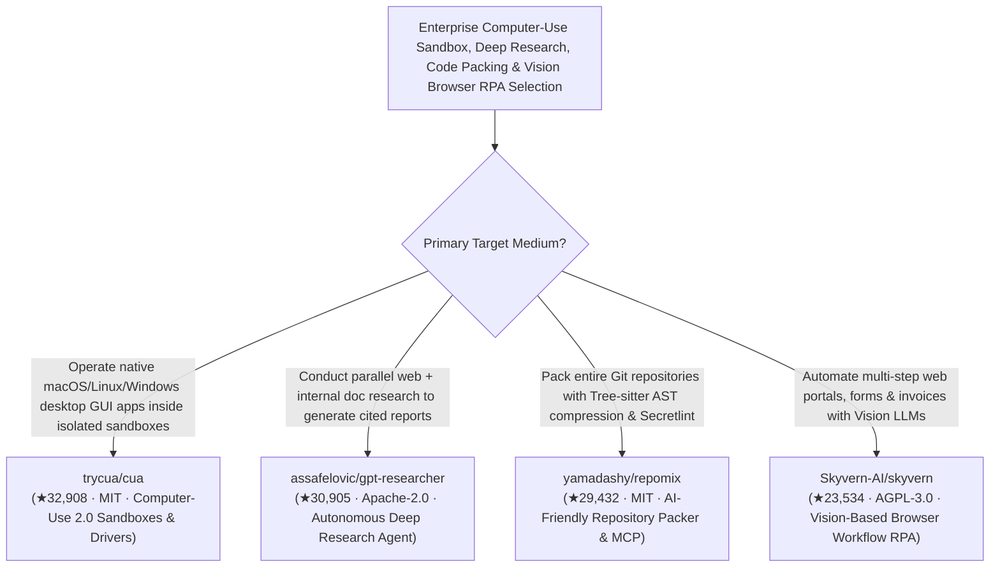
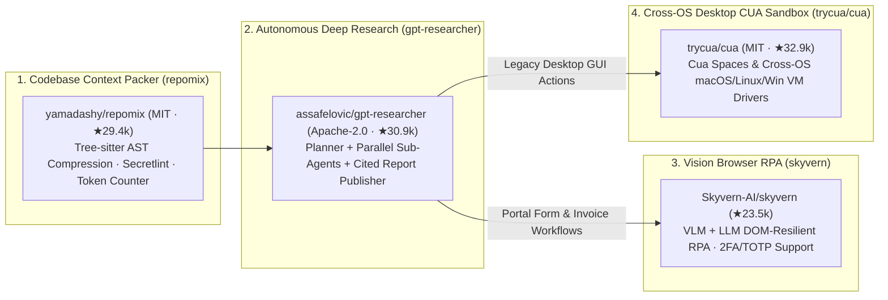
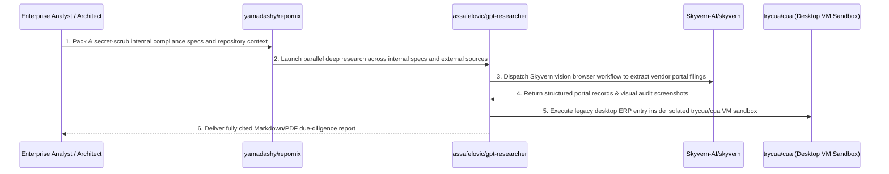

# Cross-OS Computer-Use 2.0 Sandboxes (`trycua/cua`), Autonomous Deep Research Agent (`assafelovic/gpt-researcher`), AI-Friendly Codebase Packer (`yamadashy/repomix`) & Vision-Based Browser Workflow RPA (`Skyvern-AI/skyvern`) Selection & Integration Architecture FAQ

> **Document Type**: Enterprise AI Solution Architect Selection Decision Guide (GitHub Trending AI Radar — 2026-11-25 Night Round 19 / Cumulative Round 901)
> **Covered Repositories**: [`trycua/cua`](https://github.com/trycua/cua) (`★ 32,908`, `2,493 forks`, `MIT`, Rust: Computer-Use 2.0 infrastructure providing open-source drivers, cross-OS macOS/Linux/Windows sandboxes, `Cua Spaces` shared team compute, and benchmarks) · [`assafelovic/gpt-researcher`](https://github.com/assafelovic/gpt-researcher) (`★ 30,905`, `4,269 forks`, `Apache-2.0`, Python: autonomous agent that conducts parallel deep research across web and local enterprise data using any LLM provider to produce cited reports) · [`yamadashy/repomix`](https://github.com/yamadashy/repomix) (`★ 29,432`, `1,656 forks`, `MIT`, TypeScript: packs an entire repository into a single AI-friendly XML/Markdown file with Tree-sitter compression, Secretlint credential stripping, and token counting) · [`Skyvern-AI/skyvern`](https://github.com/Skyvern-AI/skyvern) (`★ 23,534`, `2,261 forks`, `AGPL-3.0`, Python: automates browser-based workflows across external portals using LLMs and Computer Vision resilient to DOM/layout changes)
> **Core Enterprise Scenario**: Extending enterprise agents beyond clean REST APIs—enabling **Isolated Desktop GUI Automation (`trycua/cua`), Layout-Resilient External Web Portal RPA (`skyvern`), Multi-Source Cited Deep Research (`gpt-researcher`), and Secure AST-Compressed Codebase Context Packing (`repomix`)**.

---

## 1. 📌 Executive Summary (One-Line Selection Verdict)

1. **Need isolated macOS, Linux, and Windows virtual sandboxes and unified drivers so Computer-Use Agents can safely operate legacy desktop GUI applications** ➔ Choose **[`trycua/cua`](https://github.com/trycua/cua) (`★ 32,908`, `2,493 forks`, `MIT`)**.
   - **Plain-English Mechanism**: Provides `Cua Drivers`, cross-OS sandboxes, and `Cua Spaces` so teams can pool machines and let agents control desktop apps without risking host OS files.
2. **Need an `Apache-2.0` autonomous Deep Research engine that decomposes complex business questions, runs parallel web + local document sub-agents, and synthesizes cited long-form reports** ➔ Choose **[`assafelovic/gpt-researcher`](https://github.com/assafelovic/gpt-researcher) (`★ 30,905`, `4,269 forks`, `Apache-2.0`)**.
   - **Plain-English Mechanism**: Uses a Planner-Executor-Publisher multi-agent pipeline to gather verified facts across internal and external sources while eliminating single-prompt truncation and hallucinated citations.
3. **Need a fast `MIT` CLI and MCP server to pack entire Git repositories into a single secret-scrubbed, Tree-sitter-compressed XML/Markdown file for LLM architecture review** ➔ Choose **[`yamadashy/repomix`](https://github.com/yamadashy/repomix) (`★ 29,432`, `1,656 forks`, `MIT`)**.
   - **Plain-English Mechanism**: Runs `npx repomix --compress` to extract AST signatures (saving ~70% tokens), blocks leaked credentials via Secretlint, and reports exact per-model token counts.
4. **Need vision-powered browser RPA that automates vendor portals, invoice downloads, and multi-step forms without breaking every time a website changes its CSS/XPath selectors** ➔ Choose **[`Skyvern-AI/skyvern`](https://github.com/Skyvern-AI/skyvern) (`★ 23,534`, `2,261 forks`, `AGPL-3.0`)**.
   - **Plain-English Mechanism**: Combines Vision LLMs and reasoning to visually identify form fields, buttons, 2FA/TOTP prompts, and downloadable files across unfamiliar websites.

---

## 2. 🎯 Architect & Customer Deep-Dive Q&A

### Q1: How do `trycua/cua`, `Skyvern`, `GPT Researcher`, and `Repomix` partition enterprise automation compared to commercial per-bot RPA suites (UiPath) and commercial research seats?

- **Four-Quadrant Enterprise Context & Action Stack (Path C)**:
  1. **Codebase Context Compression & Secret Scrubbing ➔ `yamadashy/repomix`**: Packs source repos into token-efficient, secret-free LLM context.
  2. **Parallel Multi-Source Deep Research ➔ `assafelovic/gpt-researcher`**: Synthesizes cited analytical reports across web and internal documents.
  3. **Vision-Guided Browser Workflow RPA ➔ `Skyvern-AI/skyvern`**: Automates external web portals that lack APIs using VLM + LLM reasoning.
  4. **Cross-OS Desktop GUI Sandbox Automation ➔ `trycua/cua`**: Executes native desktop GUI actions inside isolated macOS/Linux/Windows VMs.
- **When to choose Commercial RPA / Research SaaS vs. Path C?**
  - Choose **Commercial SaaS** for small non-technical teams running simple public searches.
  - Choose **Path C** when automating dozens of changing external vendor portals (where brittle XPath scripts and per-bot RPA licenses cost thousands per month), conducting private hybrid research (`gpt-researcher`), and sandboxing desktop computer-use agents (`trycua/cua`).

### Q2: How do these four tools integrate in production workflows?

1. **Automated Vendor Due Diligence & Portal Extraction (`gpt-researcher` + `skyvern`)**:
   - `gpt-researcher` orchestrates parallel research tasks and dispatches `Skyvern` whenever a task requires logging into an external portal, solving 2FA, or downloading compliance PDFs.
2. **Legacy Application Modernization (`repomix` + `trycua/cua`)**:
   - `repomix` packs legacy source code for migration planning while `trycua/cua` runs the legacy desktop client inside an isolated VM for automated visual parity verification.

### Q3: What are the key security guardrails?

- **Architect Redlines**:
  1. **Never run Computer-Use desktop agents outside `trycua/cua` ephemeral sandboxes**: Isolate all GUI actions from production hosts and reset VM snapshots after each run.
  2. **Keep `Repomix` Secretlint enabled in CI/CD**: Prevent accidental inclusion of `.env` keys or tokens in LLM context bundles.

---

## 3. 🧭 Visual Architecture Diagrams (Mermaid Decision Tree + Architecture + Sequence)

### 3.1 Architect Selection Decision Tree

### 3.2 End-to-End Enterprise Integration Architecture

### 3.3 End-to-End Execution Sequence

---

## 4. 📊 Horizontal Selection Matrix

| Dimension | `trycua/cua` (`★ 32,908`) | `assafelovic/gpt-researcher` (`★ 30,905`) | `yamadashy/repomix` (`★ 29,432`) | `Skyvern-AI/skyvern` (`★ 23,534`) | Commercial Unattended RPA Bots + Per-Seat Research SaaS (Path A) | Brittle XPath Scripts + Manual Copy-Paste Research (Path B) |
| :--- | :--- | :--- | :--- | :--- | :--- | :--- |
| **Primary Role** | Cross-OS Computer-Use 2.0 sandboxes & drivers | `Apache-2.0` autonomous deep research agent | `MIT` AST-compressed repo packer & secret scrubber | Vision-based browser workflow RPA engine | Per-bot commercial RPA & per-seat research clouds | Hardcoded Playwright XPath scripts & manual web search |
| **Key Differentiator** | **Isolated macOS/Linux/Win VMs + `Cua Spaces` shared cluster** | **Planner + parallel sub-agents + verifiable citations** | **Tree-sitter AST compression (~70% token cut) + Secretlint** | **Vision + LLM navigation survives frontend UI redesigns** | Vendor SLA, but high per-bot annual licensing & selector maintenance | Scripts break on any CSS change; manual research takes days |
| **License** | **`MIT`** | **`Apache-2.0`** | **`MIT`** | `AGPL-3.0` | Proprietary SaaS | Unstandardized |
| **Monthly TCO (45-Eng Team)** | **`$315.00/mo` combined** (`$75.00` sandbox/browser compute + `2.4h` ops) | Included in `$315.00/mo` stack | Included in `$315.00/mo` stack | Included in `$315.00/mo` stack | **`$9,620.00/mo`** (`$4,920.00` commercial RPA bot/research seats + `47.0h` script repair/research labor) | `~$3,420.00/mo` (constant broken-selector firefighting & manual report assembly) |

---

## 5. 🧪 Quantitative FinOps & TCO Comparison (45-Person Enterprise Automation & Research Team)

> **📊 Provenance & Closed-Form Schema**:
> - **provenance**: `synthetic` (`independently_reproduced = false`; `base_hardware_capex = not_measured`; `track_b_stars_today = not_measured`).
> - **Closed-Form Formula**:
>   - **Path A (Commercial Unattended RPA Bot Licenses + Per-Seat Deep Research SaaS & Manual Selector Repair/Research Labor)**: **`$4,920.00`** monthly RPA bot and research SaaS fees + **`47.0h × $100.00/h = $4,700.00`** broken-selector maintenance and manual due-diligence labor = **`$9,620.00/mo`**.
>   - **Path C (`trycua/cua` + `assafelovic/gpt-researcher` + `yamadashy/repomix` + `Skyvern-AI/skyvern` Stack)**: **`$75.00`** shared VM sandbox and headless browser compute + **`2.4h × $100.00/h = $240.00`** sandbox image and workflow maintenance = **`$315.00/mo`**.
>   - **Net Savings vs. Path A**: **`-$9,305.00/mo`** (**`96.73%`** TCO reduction).

| Evaluation Path | Commercial RPA Bot / Research Seats & Compute | Selector Repair, Portal Entry & Research Labor (`$100/h`) | Monthly Total TCO | Net Savings vs. Path A | Key Architectural Outcome |
| :--- | :---: | :---: | :---: | :---: | :--- |
| **Path A: Commercial Unattended RPA Bots + Research SaaS Seats** | `$4,920.00` | `47.0h` (`$4,700.00`) | **`$9,620.00`** | Baseline | Expensive per-bot licensing; brittle DOM selectors |
| **Path B: Hardcoded Playwright Scripts + Manual Research** | `$1,420.00` | `20.0h` (`$2,000.00`) | **`$3,420.00`** | `-$6,200.00` (`-64.45%`) | Frequent script breakage; un-scrubbed code context |
| **Path C: `cua` + `gpt-researcher` + `repomix` + `skyvern`** | **`$75.00`** | **`2.4h` (`$240.00`)** | **`$315.00`** | **`-$9,305.00` (`-96.73%`)** | **Cross-OS CUA sandboxes + cited research + AST repo packing + vision RPA** |

- 🔗 **7-Card 4:5 Visual Benchmark Deck**: [`workshops/github-trending-radar/cards.en.html`](../cards.en.html) · [`cards.html`](../cards.html)

---

## 6. 🛠️ Enterprise Adoption & Architecture Review Checklist

- [ ] **Isolate Desktop GUI Agents in `trycua/cua` Ephemeral VMs**: Reset VM snapshots after each execution to guarantee clean state and host isolation.
- [ ] **Configure Hybrid Internal + Web Sources in `GPT Researcher`**: Enforce citation verification across all generated due-diligence reports.
- [ ] **Standardize `repomix --compress` with Secretlint in Developer Workflows**: Strip secrets and compress ASTs before sending codebases to LLMs.
- [ ] **Gate Final Payment/Submission Actions in `Skyvern` with Human Approval**: Automate form pre-filling and extraction while requiring confirmation on irreversible transactions.
